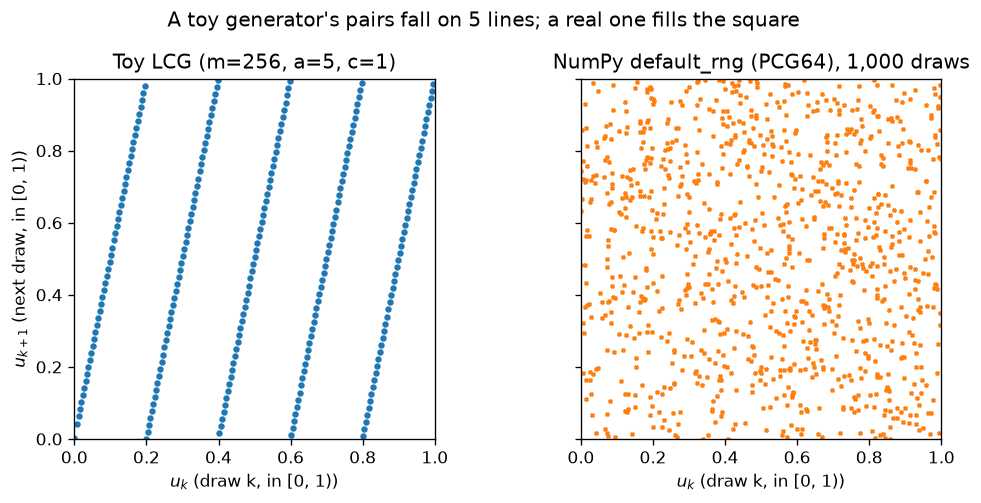

# A1.1 The lab workflow

**Core** · Part A, week 1 (course week 01) · ~1 h · Lab:
[`labs/A/a1_1_lab_workflow.py`](../../labs/A/a1_1_lab_workflow.py)

## Why it matters

Every lab in this course is a Python file you run with one command, and every printed number in a
lesson is supposed to match what you see on your screen. That only works if three things are under
control: the **environment** (the exact library versions), the **entry point** (how a file is run),
and the **randomness** (which random numbers come out). In a job, the same three things decide
whether a colleague can reproduce your model, whether a bug report is believable, and whether an
experiment that "improved accuracy by 0.4%" improved anything at all or just drew different random
numbers.

## Prerequisite check

This is the first lesson of the course, so the checks are about the tools you already use.

- Can you open a terminal in `D:\personal\ai-ml-course` and run a command there? If not, do that
  before anything else; every lab is run from the repository root.
- Do you know what a lockfile does (`package-lock.json`, `pnpm-lock.yaml`)? If not, read the
  "Intuition" section slowly; `uv.lock` is the same idea.
- Have you installed the VS Code Python extension? You need it to run `# %%` cells.

## Intuition

### The environment: `uv` is `npm ci` for Python

`pyproject.toml` lists every library the course uses, each pinned to one version. `uv.lock` records
the full resolved dependency tree, including the libraries those libraries pull in. `uv` is the
tool that reads both and builds a virtual environment in `.venv/`.

The four commands you will use:

| Command | What it does | Closest npm equivalent |
|---|---|---|
| `uv sync` | Make `.venv/` match `uv.lock` exactly | `npm ci` |
| `uv run python labs/A/a1_1_lab_workflow.py` | Run a file inside that environment (syncing first if needed) | `npx` / `npm run` |
| `uv sync --group local-llm` | Also install an optional group from `pyproject.toml` | installing an optional dependency set |
| `uv add <pkg>==<version>` | Add a new pinned dependency and update the lock | `npm install --save-exact` |

You never `pip install` inside a lab. A lab that installs its own packages runs on your machine and
nowhere else.

> **Bridge:** `uv.lock` is `package-lock.json`, and `.venv/` is `node_modules/`, one per project.
> **Where it breaks:** Python resolves one version of each library for the whole environment; there
> is no nested `node_modules` that lets two libraries use two versions of NumPy. When two libraries
> disagree, the resolver fails and someone has to pick a version, which is why `pyproject.toml`
> has comments like "0.54.0 has no Python 3.12 wheels yet".

### The entry point: `.py` files with `# %%` cells, not notebooks

A **Jupyter** notebook (`.ipynb`) is a JSON file holding code cells *and* their outputs. It is
excellent for exploring and poor for everything else: diffs are unreadable, outputs go stale
silently, and cells can be run out of order so the notebook's state is something no file
describes.

This course uses plain `.py` files split into cells by `# %%` comment lines. The same file works two
ways:

1. **As a script:** `uv run python labs/A/a1_1_lab_workflow.py` runs every cell top to bottom, in
   order, from a fresh interpreter. This is how a lab is "checked", and it is the only run whose
   output counts.
2. **Interactively:** open the file in VS Code, and a "Run Cell" link appears above every `# %%`.
   VS Code sends that cell to a Jupyter kernel (the `ipykernel` package from the project's
   `.venv/`) and shows plots inline. Pick the `.venv` interpreter when VS Code asks.

The trap with interactive running is the same as with notebooks: if you edit cell 3 and re-run only
cell 3, cell 5 still sees the old values. When in doubt, restart the kernel and run all, or run the
file as a script.

> **Bridge:** running the file as a script is your CI pipeline; running cells interactively is a
> REPL attached to a dev server. **Where it breaks:** a REPL session has no hot reload; nothing
> re-runs downstream cells for you when you change an upstream one.

### The lab header

Every lab starts with the same header (`course/STYLE_GUIDE.md` §3.3). Read it once now so you can
skip it in every later lab:

- `matplotlib.use("Agg")` when not inside a kernel: under `uv run`, plots are written to files, and
  no window pops up and blocks the script.
- `SEED = 0` and `rng = np.random.default_rng(SEED)`: the only source of randomness in the lab.
- `repo_root()`: finds the folder that holds `pyproject.toml`, so paths work from anywhere.
- `DATA`, `OUT`, `IMG`: downloaded data (`data/`, never committed), scratch figures (`outputs/`,
  never committed), and the one key plot per lesson (`lessons/<P>/img/`, committed).
- `section("name")` prints `== name ==`. The expected-output blocks in each lesson quote these
  sections, so you can find the matching part of your own output.
- A `GPU_SCALE` flag: `False` gives settings that finish on the laptop CPU in under 5 minutes;
  `True` gives the full-size settings for a free Colab or Kaggle GPU. It is the only line you change
  when you move a lab there.
- Lines that start with `~` (elapsed time, machine name) are expected to differ between runs and
  machines. Every other printed line should match the lesson exactly.

### Randomness: a seed is the starting state of a deterministic machine

Computers do not produce random numbers. A **pseudo-random number generator** is a small machine
with an internal state and a rule that turns the current state into the next one. Each step also
outputs a number derived from the state. The numbers look random, but the whole sequence is fixed
once you fix the starting state. That starting state comes from the **seed**.

So "set the seed" means "start the machine from a known state", and "same seed, same numbers" is not
a convention, it is arithmetic. The rest of this lesson builds a toy generator by hand to make that
concrete, then uses the real ones.

## The math

**Symbols**

| Symbol | Meaning | Shape |
|---|---|---|
| $x_k$ | the generator's internal state after $k$ steps (an integer) | scalar |
| $x_0$ | the seed: the state before the first step | scalar |
| $m$ | the modulus: states are the integers $0, 1, \dots, m-1$ | scalar |
| $a$ | the multiplier | scalar |
| $c$ | the increment | scalar |
| $u_k$ | the output scaled into $[0, 1)$ | scalar |

The toy generator is a **linear congruential generator** (LCG), one of the oldest designs:

$$x_{k+1} = (a\,x_k + c) \bmod m, \qquad u_k = \frac{x_k}{m}.$$

"$\bmod\ m$" means "the remainder after dividing by $m$", the `%` operator in Python and TypeScript.
Because the remainder is always one of $0, \dots, m-1$, there are only $m$ possible states, so the
sequence must eventually repeat. The number of steps before it repeats is the **period**.

Which $a$ and $c$ give the longest possible period, $m$? A classical result (the Hull–Dobell
theorem) says the period is exactly $m$ when all three of these hold:

1. $c$ and $m$ share no common factor other than 1;
2. $a - 1$ is divisible by every prime that divides $m$;
3. if $m$ is divisible by 4, then $a - 1$ is divisible by 4.

For $m = 16$ (only prime factor 2), $a = 5$, $c = 3$: $c = 3$ is odd, so condition 1 holds; $a - 1 = 4$
is divisible by 2 and by 4, so conditions 2 and 3 hold. Expect a period of 16: every state from 0 to
15 appears exactly once before the seed comes back. You do not need to remember this theorem; it is
here so that the lab's "distinct states: 16" is a prediction you can check, not a coincidence.

Real generators are far better designs. NumPy's `default_rng` uses **PCG64**, which has a 128-bit
state and a period of $2^{128}$. Python's `random` module uses the Mersenne Twister, and PyTorch has
its own. The seeding idea is identical in all of them.

## Worked example by hand

Take $m = 16$, $a = 5$, $c = 3$ and the seed $x_0 = 7$. Each step is "multiply by 5, add 3, keep the
remainder after dividing by 16":

| $k$ | $a\,x_{k-1} + c$ | $\bmod 16$ gives $x_k$ | $u_k = x_k / 16$ |
|---|---|---|---|
| 1 | $5 \cdot 7 + 3 = 38$ | $38 - 2 \cdot 16 = 6$ | 0.375 |
| 2 | $5 \cdot 6 + 3 = 33$ | $33 - 2 \cdot 16 = 1$ | 0.0625 |
| 3 | $5 \cdot 1 + 3 = 8$ | $8$ | 0.5 |
| 4 | $5 \cdot 8 + 3 = 43$ | $43 - 2 \cdot 16 = 11$ | 0.6875 |
| 5 | $5 \cdot 11 + 3 = 58$ | $58 - 3 \cdot 16 = 10$ | 0.625 |
| 6 | $5 \cdot 10 + 3 = 53$ | $53 - 3 \cdot 16 = 5$ | 0.3125 |

Three things to notice:

- Run it again from $x_0 = 7$ and you get 6, 1, 8, 11, 10, 5 again. That is what a seed buys you.
- Start from $x_0 = 8$ instead and the first state is $5 \cdot 8 + 3 = 43 \to 11$. Look at the table:
  11 is $x_4$ of the seed-7 run, so the seed-8 sequence is the seed-7 sequence *shifted*. With only
  16 states, every seed lands somewhere on the same cycle. Real generators have so many states that
  two seeds land far apart, but the picture is the same.
- Keep going and you reach $x_{16} = 7$, the seed. The sequence has period 16, as the theorem
  predicted.

## Key plot



Each dot is a pair of consecutive outputs $(u_k, u_{k+1})$. If the numbers were independent, the
dots would fill the square evenly, as they do on the right. The toy LCG (here $m = 256$, $a = 5$,
$c = 1$) puts every pair on one of 5 lines, because $u_{k+1}$ is almost exactly $5u_k$ wrapped
around. A generator can be perfectly repeatable and still badly non-random; use the library's.

## From scratch in NumPy

The lab's `lcg` function is the formula above in a loop. It returns the states *after* the seed:

```python
def lcg(seed: int, a: int, c: int, m: int, n: int) -> IntArray:
    """Return n states of x_{k+1} = (a x_k + c) mod m, starting after the seed -> (n,)."""
    out = np.empty(n, dtype=np.int64)
    x = seed
    for k in range(n):
        x = (a * x + c) % m
        out[k] = x
    return out
```

The first cell reproduces the hand-worked table. The second checks the three properties: the period
is 16, all 16 states appear once, and the same seed gives the same numbers.

```text
== worked example: toy LCG ==
x_1..x_6: [6, 1, 8, 11, 10, 5]
u_1..u_6: [0.375, 0.0625, 0.5, 0.6875, 0.625, 0.3125]

== from scratch: properties ==
all 16 states: [6, 1, 8, 11, 10, 5, 12, 15, 14, 9, 0, 3, 2, 13, 4, 7]
x_16 == seed: True
distinct states: 16
same seed, same numbers: True
seed 8 gives: [11, 10, 5, 12, 15]
```

"seed 8 gives: [11, 10, 5, 12, 15]" is the seed-7 sequence starting from its 4th state, as worked
out by hand.

## With NumPy, Python and PyTorch

There is no library LCG to compare against, so the check here is that the real generators have the
same properties as the toy one. First, the environment itself. The lab's first cell prints the
versions it is running with; they must match `pyproject.toml`:

```text
== health check ==
python        3.12.15
numpy         2.5.4
pandas        3.0.6
matplotlib    3.11.2
scipy         1.18.1
scikit-learn  1.9.1
torch         2.14.1+cpu
cuda available: False
~ machine: AMD64 Windows 11
```

`+cpu` is PyTorch's CPU-only build, and `cuda available: False` is correct on this laptop: there is
no NVIDIA GPU. On Colab or Kaggle with a GPU runtime the same line prints `True`. The Python patch
version (`3.12.15`) depends on the interpreter `uv` installed and may differ on your machine; every
library version must match.

Then NumPy's generator. Create it once with a seed and pass it around:

```python
first = np.random.default_rng(SEED).random(3)
second = np.random.default_rng(SEED).random(3)
np.testing.assert_array_equal(first, second)
```

The second block shows the one rule that surprises people: a generator is a **stream**, and every
draw moves it forward. Drawing 5 numbers at once equals drawing 3 then 2. But if you add one extra
draw anywhere upstream, *every later number shifts by one*, as the "after an extra draw" line shows.
In a lab this means: adding a random call near the top changes the train/test split, the weight
initialization and every result below it.

The fix for that is the third block: `spawn` makes independent child generators, one per purpose (one
for the data, one for the model). Extra draws from the data stream no longer move the model stream.

```text
== with numpy: same seed, same numbers ==
run 1: [0.637, 0.2698, 0.041]
run 2: [0.637, 0.2698, 0.041]
matches across runs: OK

== with numpy: the stream position matters ==
random(5) == random(3) + random(2): OK
before: [0.637, 0.2698, 0.041, 0.0165, 0.8133]
after an extra draw: [0.2698, 0.041, 0.0165, 0.8133, 0.9128]

== with numpy: independent streams ==
data stream:  [0.9429, 0.3163, 0.7223]
model stream: [0.6772, 0.243, 0.6118]

== python and torch ==
python random: [0.8444, 0.758, 0.4206] repeatable: True
torch.rand:    [0.4963, 0.7682, 0.0885] repeatable: True
```

Python's `random`, NumPy and PyTorch each keep **their own** generator. Seeding one does not seed
the others, which is why a lab that uses all three sets all three (`random.seed`, `default_rng`,
`torch.manual_seed`), as `STYLE_GUIDE.md` §3.2 requires. The same seed 0 gives different numbers in
each library because they are different machines.

## In practice

- **When to use it:** always. Every script that trains, splits or samples takes a seed from one
  constant at the top, creates its generators from it, and prints the library versions it ran with.
  Report a result as a mean over several seeds (Part B does this with cross-validation), never from
  one lucky seed.
- **Failure modes:**
  - *Using the legacy global generator* (`np.random.seed(0)`, then `np.random.rand()`): any library
    you call can draw from the same hidden global state and shift your numbers. You notice when a
    result changes after an unrelated import or function call. Pass a `Generator` instead.
  - *Seeding one library and not another:* the NumPy part repeats and the PyTorch part does not. You
    notice when two runs differ only in the deep learning part.
  - *Stale interactive state:* you edited and re-ran one cell, and a later cell still uses old
    values. You notice when "Run all" gives a different answer from the cell-by-cell session.
  - *Seeds do not cover everything:* multi-threaded float sums can add in a different order, and
    float addition is not associative, so the last digits can change between runs; GPU kernels can
    be non-deterministic for the same reason. Python's `set` ordering of strings also changes per
    process unless `PYTHONHASHSEED` is fixed. You notice when results agree to 5 decimals but not
    to 10. This course rounds printed floats to 4 decimals for that reason.
  - *An unpinned environment:* a library upgrade changes a default (a solver, a tolerance) and the
    numbers move. You notice when a colleague's output differs and the version lines differ too.
- **Defaults that work:** `SEED = 0`; one `np.random.default_rng(SEED)` per script, `spawn` when
  you need independent streams; `random_state=SEED` on every scikit-learn estimator and splitter
  (from Part B); `torch.manual_seed(SEED)` before building a model (from Part C). `uv sync` after
  every `git pull` that touches `uv.lock`. VERIFY (as of 2026-10): `default_rng` uses PCG64 in
  NumPy 2.5.

## Exercises

Save your work to `my-work/A/a1_1_lab_workflow.md` (or `.py`) and ask for a review.

1. **By hand:** Use the toy LCG with $m = 8$, $a = 5$, $c = 1$ and seed $x_0 = 2$. Write out the
   states $x_1, \dots, x_8$ and the period. Then check the three Hull–Dobell conditions for these
   numbers and say whether they predict what you found. Finally, change $c$ to 2 and redo it: what
   is the period now, and which condition fails?
2. **Code:** Write `labs`-style code (header, `section()`, seed) for a function
   `shuffle_split(n: int, test_frac: float, rng: np.random.Generator) -> tuple[IntArray, IntArray]`
   that returns the row indices of a random train/test split. Show (a) that two calls with
   generators made from the same seed give identical splits, (b) that the two index arrays never
   overlap and together cover `0..n-1`, and (c) that adding one extra `rng.random()` call before the
   split changes it, while drawing the split from a spawned child generator does not.
3. **Think:** A teammate reports that their new feature improved validation accuracy from 0.912 to
   0.917. Their script uses `np.random.seed(42)` at the top, and both runs were done on different
   days. List what you would ask for or check before believing the improvement, and what you would
   change in the script so the next comparison is trustworthy.

## Takeaways

1. `uv sync` builds `.venv/` from `uv.lock`; `uv run python <file>` runs a lab in it. Never
   `pip install` inside a lab.
2. Labs are `.py` files with `# %%` cells: run the whole file for the official output, run cells in
   VS Code to explore, and restart and run all when state gets confusing.
3. A random number generator is a deterministic machine; the seed is its starting state, so the same
   seed always gives the same numbers.
4. A generator is a stream: every draw moves it forward, so an extra draw upstream shifts everything
   downstream. Use one `default_rng` per script and `spawn` for independent purposes.
5. Python, NumPy and PyTorch have separate generators; seed each one, and print library versions so
   results can be reproduced.

**What builds on this:** every lab in the course uses this header;
[A1.2](a1_2_numpy_arrays.md) uses the `Generator` to make test data;
[A5.2](a5_2_common_distributions.md) turns uniform draws like $u_k$ into other distributions;
[B1.1](../B/b1_1_ml_workflow.md) builds a seeded train/validation/test split.
