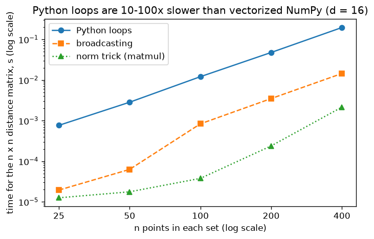

# A1.2 NumPy arrays

**Core** · Part A, week 1 (course week 01) · ~3 h · Lab:
[`labs/A/a1_2_numpy_arrays.py`](../../labs/A/a1_2_numpy_arrays.py)

## Why it matters

Every model in this course, from linear regression to a transformer, is arithmetic on arrays: a
data matrix of shape `(n, d)`, a weight vector of shape `(d,)`, a batch of images of shape
`(B, C, H, W)`. Most bugs you will hit in ML code are not wrong formulas but wrong **shapes**: a
`(n,)` array that silently became `(n, 1)`, a mean taken over the wrong axis, a subtraction that
broadcast into an `(n, n)` matrix instead of failing. And a Python loop over the elements of an
array is 10–100 times slower than the same computation written as whole-array operations, which is
the difference between a lab that runs in a second and one that runs for an hour.

## Prerequisite check

- Can you run a lab with `uv run python labs/...` and read its `== section ==` output? If not,
  revisit [A1.1](a1_1_lab_workflow.md).
- Can you write a nested loop over a 2-D list (`for i in range(rows): for j in range(cols):`) in
  Python? If not, spend 20 minutes on a Python basics tutorial first.
- Do you remember Pythagoras ($c^2 = a^2 + b^2$ for a right triangle)? The distance examples rely on
  it and nothing more.

## Intuition

### An array is a typed block of memory plus a shape

A Python list is a list of pointers to separate objects, each of which could be anything. A NumPy
**array** is one contiguous block of numbers of a single **dtype** (usually `float64`, 8 bytes
each) plus a little metadata: the **shape** (how many entries along each axis) and the **strides**
(how many bytes to jump to move one step along each axis).

That design gives you two things:

1. **Speed.** An operation like `A + B` runs one compiled C loop over the memory block, instead of
   the Python interpreter dispatching an addition, checking types and allocating a new float object
   for every element.
2. **Cheap reshaping and slicing.** Changing the shape or taking a slice usually only changes the
   metadata. No numbers are copied.

> **Bridge:** a NumPy array is closer to a Node.js `Float64Array` over an `ArrayBuffer` than to a
> JavaScript array: fixed type, contiguous memory, and `subarray()` returns a view onto the same
> buffer, exactly like a NumPy slice. **Where it breaks:** typed arrays are 1-D and have no
> broadcasting; NumPy's shape and stride metadata let one buffer look like a matrix, a cube, or the
> transpose of a matrix without copying.

### Axes, and what "axis=0" means

A 2-D array of shape `(3, 4)` has **axis 0** (the 3 rows) and **axis 1** (the 4 columns). In this
course, rows are always examples and columns are features, so a data matrix $\mathbf{X}$ has shape
`(n, d)`.

A reduction such as `sum`, `mean` or `std` with `axis=k` *removes* axis `k` by combining along it:

- `X.mean(axis=0)` combines the rows: one mean **per column** (per feature), shape `(d,)`.
- `X.mean(axis=1)` combines the columns: one mean **per row** (per example), shape `(n,)`.

The phrase to remember is "axis=0 collapses the rows". `keepdims=True` keeps the collapsed axis as
size 1, so `(3, 4)` becomes `(3, 1)` instead of `(3,)`, which matters for broadcasting below.

### Indexing: views and copies

- `M[1]` is row 1, shape `(4,)`. `M[:, 1]` is column 1, shape `(3,)`: **an integer index removes
  that axis**.
- `M[:, [1]]` is also column 1, but shape `(3, 1)`: **a list index keeps the axis**.
- `M[M % 2 == 0]` uses a **boolean mask**: an array of `True`/`False` of the same shape selects the
  `True` entries and returns them as a flat 1-D array.
- A **basic slice** (`M[0, :2]`, anything built from integers and `start:stop:step`) returns a
  **view**: writing into it writes into `M`. An index with a list or a mask (**fancy indexing**)
  returns a **copy**. The lab shows both.

### Broadcasting: virtually repeating size-1 axes

**Broadcasting** is NumPy's rule for combining arrays of different shapes. You already use it when
you write `X - 5`: the scalar is treated as if it were repeated to the shape of `X`. The general
rule, applied axis by axis:

1. Line the shapes up **from the right**. If one shape is shorter, pad it on the left with 1s.
2. On each axis the two sizes must be **equal**, or one of them must be **1**.
3. A size-1 axis is stretched (virtually, without copying memory) to match the other.

So `(n, d) - (d,)` works: `(d,)` is padded to `(1, d)` and stretched to `(n, d)`. That is how one
line subtracts each column's mean from every row. But `(n, d) - (n,)` fails when $n \ne d$: `(n,)`
is padded to `(1, n)`, and $n$ does not match $d$ on the last axis. You want `(n, 1)`, which you get
with `keepdims=True` or `x[:, None]`.

The trap: broadcasting succeeds whenever the rule allows it, even when you did not mean it.
`y_hat - y` with `y_hat` of shape `(n, 1)` and `y` of shape `(n,)` gives an `(n, n)` matrix, no error,
and a loss that is quietly wrong. Labs check shapes with `assert` for this reason.

### Vectorizing a loop away

**Vectorization** means rewriting "for each element, do this" as one whole-array expression. The
recipe is mechanical:

1. Write the loop version first and get it right on tiny inputs.
2. Identify the loop indices (here $i$ over rows of $\mathbf{A}$, $j$ over rows of $\mathbf{B}$, $k$
   over features).
3. Give each index its own axis using `None` (also spelled `np.newaxis`), so broadcasting does the
   looping. Reduce the summed index with `.sum(axis=...)`.
4. Check the vectorized version against the loop version with `np.testing.assert_allclose`.

## The math

**Symbols**

| Symbol | Meaning | Shape |
|---|---|---|
| $\mathbf{A}$ | first set of points, one point per row | `(n, d)` |
| $\mathbf{B}$ | second set of points | `(m, d)` |
| $\mathbf{a}_i$ | row $i$ of $\mathbf{A}$ (one point) | `(d,)` |
| $\mathbf{b}_j$ | row $j$ of $\mathbf{B}$ | `(d,)` |
| $a_{ik}$ | feature $k$ of point $i$ | scalar |
| $\mathbf{D}$ | distance matrix, $D_{ij}$ = distance from $\mathbf{a}_i$ to $\mathbf{b}_j$ | `(n, m)` |
| $\mathbf{X}$ | a data matrix | `(n, d)` |
| $\mu_k$, $\sigma_k$ | mean and standard deviation of column $k$ | scalars; together `(d,)` |
| $\mathbf{Z}$ | standardized data | `(n, d)` |

Indices start at 1 in the math ($i = 1, \dots, n$) and at 0 in the code (`A[0]` is $\mathbf{a}_1$).

### Pairwise Euclidean distance

The **Euclidean distance** between two points is Pythagoras extended to $d$ features: subtract
feature by feature, square, add up, take the square root.

$$D_{ij} = \sqrt{\sum_{k=1}^{d} (a_{ik} - b_{jk})^2}$$

Computing this for every pair gives an `(n, m)` matrix. The loop version has three nested loops: $i$,
$j$ and $k$.

The broadcasting version builds every difference at once. `A[:, None, :]` has shape `(n, 1, d)`
and `B[None, :, :]` has shape `(1, m, d)`; their difference broadcasts to `(n, m, d)`, where entry
`[i, j, k]` is $a_{ik} - b_{jk}$. Squaring and summing over the last axis (`axis=-1`, the $k$ axis)
leaves `(n, m)`.

### The norm trick

Expand the square inside the sum, using $(x - y)^2 = x^2 + y^2 - 2xy$:

$$D_{ij}^2 = \sum_{k} (a_{ik} - b_{jk})^2 = \sum_k a_{ik}^2 + \sum_k b_{jk}^2 - 2\sum_k a_{ik} b_{jk}.$$

Each of the three pieces is easy to compute for all pairs at once:

- $\sum_k a_{ik}^2$ is the squared length of point $i$. For all points: `(A**2).sum(axis=1)`, shape
  `(n,)`, reshaped to `(n, 1)`.
- $\sum_k b_{jk}^2$ likewise, shape `(m,)`, reshaped to `(1, m)`.
- $\sum_k a_{ik} b_{jk}$, "multiply matching features and add", is called the **dot product** of
  $\mathbf{a}_i$ and $\mathbf{b}_j$ ([A1.5](a1_5_vectors.md) covers it properly). The dot product of
  every row of $\mathbf{A}$ with every row of $\mathbf{B}$ is exactly the matrix product `A @ B.T`, where `B.T` is the **transpose** of
  `B` (rows and columns swapped, shape `(d, m)`):
  shape `(n, d) @ (d, m)` → `(n, m)`. ([A2.2](a2_2_matrix_multiplication_inverse.md) covers matrix
  multiplication; for now, read `A @ B.T` as "all the dot products".)

Adding `(n, 1) + (1, m) - 2 (n, m)` broadcasts to `(n, m)`. Why bother? The broadcasting version
builds an `(n, m, d)` intermediate array; the trick never does, and `A @ B.T` runs on highly tuned
matrix-multiplication code. Two cautions: rounding can make a true 0 come out as a tiny negative
number, so clip at 0 before the square root; and the subtraction of two large, nearly equal numbers
loses precision (the lab shows it).

### Standardization

**Standardizing** a column means shifting it to mean 0 and scaling it to standard deviation 1:

$$\mu_k = \frac{1}{n}\sum_{i=1}^{n} x_{ik}, \qquad
\sigma_k = \sqrt{\frac{1}{n}\sum_{i=1}^{n} (x_{ik} - \mu_k)^2}, \qquad
z_{ik} = \frac{x_{ik} - \mu_k}{\sigma_k}.$$

In code that is `(X - X.mean(axis=0)) / X.std(axis=0)`: two `(d,)` vectors broadcast over the `n`
rows. Standardized features matter for any method that compares distances or uses gradient descent
(Parts B and C), because a feature measured in thousands otherwise dominates one measured in units.

Note the $\frac{1}{n}$ in $\sigma_k$. That is the **population** standard deviation (NumPy's default,
`ddof=0`, and what scikit-learn's `StandardScaler` uses). Dividing by $n - 1$ instead (`ddof=1`)
gives the **sample** standard deviation, which pandas uses by default. [A6.2](a6_2_confidence_intervals_bootstrap.md)
explains why $n - 1$ exists; for now, know that the two libraries disagree and check which one you
called.

## Worked example by hand

Take three points in $\mathbf{A}$, shape `(3, 2)`, and two in $\mathbf{B}$, shape `(2, 2)`:

$$\mathbf{A} = \begin{bmatrix} 0 & 0 \\ 1 & 0 \\ 0 & 2 \end{bmatrix}, \qquad
\mathbf{B} = \begin{bmatrix} 1 & 1 \\ 3 & 0 \end{bmatrix}.$$

**Direct formula.** For $\mathbf{a}_3 = (0, 2)$ and $\mathbf{b}_2 = (3, 0)$: differences
$(0 - 3, 2 - 0) = (-3, 2)$, squares $9 + 4 = 13$, distance $\sqrt{13} \approx 3.6056$. Doing all six
pairs the same way:

| | $\mathbf{b}_1 = (1, 1)$ | $\mathbf{b}_2 = (3, 0)$ |
|---|---|---|
| $\mathbf{a}_1 = (0, 0)$ | $\sqrt{1 + 1} = \sqrt{2} \approx 1.4142$ | $\sqrt{9 + 0} = 3$ |
| $\mathbf{a}_2 = (1, 0)$ | $\sqrt{0 + 1} = 1$ | $\sqrt{4 + 0} = 2$ |
| $\mathbf{a}_3 = (0, 2)$ | $\sqrt{1 + 1} = \sqrt{2} \approx 1.4142$ | $\sqrt{9 + 4} = \sqrt{13} \approx 3.6056$ |

**Norm trick.** Squared lengths of the rows of $\mathbf{A}$: $0^2 + 0^2 = 0$, $1^2 + 0^2 = 1$,
$0^2 + 2^2 = 4$. Of $\mathbf{B}$: $1 + 1 = 2$, $9 + 0 = 9$. Dot products (multiply matching
features, add): $\mathbf{a}_2 \cdot \mathbf{b}_2 = 1 \cdot 3 + 0 \cdot 0 = 3$,
$\mathbf{a}_3 \cdot \mathbf{b}_1 = 0 \cdot 1 + 2 \cdot 1 = 2$, and so on:

$$\mathbf{A}\mathbf{B}^\top = \begin{bmatrix} 0 & 0 \\ 1 & 3 \\ 2 & 0 \end{bmatrix}.$$

Then $D_{ij}^2 = \lVert\mathbf{a}_i\rVert^2 + \lVert\mathbf{b}_j\rVert^2 - 2\,\mathbf{a}_i\cdot\mathbf{b}_j$.
For $(i, j) = (2, 2)$: $1 + 9 - 2 \cdot 3 = 4$, so $D_{22} = 2$, as in the table. For $(3, 1)$:
$4 + 2 - 2 \cdot 2 = 2$, so $D_{31} = \sqrt{2}$. The full matrix of squared distances is
$\begin{bmatrix} 2 & 9 \\ 1 & 4 \\ 2 & 13 \end{bmatrix}$.

**Standardization.** Take the column $(1, 2, 3)$. Mean $\mu = (1 + 2 + 3)/3 = 2$. Deviations
$(-1, 0, 1)$, squared $(1, 0, 1)$, mean of squares $2/3$, so $\sigma = \sqrt{2/3} \approx 0.8165$.
Standardized: $-1/0.8165 \approx -1.2247$, $0$, $1.2247$. With `ddof=1` you would divide the sum of
squares by $n - 1 = 2$ instead: $\sigma = \sqrt{2/2} = 1$, and the values would stay $(-1, 0, 1)$.

**Broadcasting shapes.** `(3, 1) + (1, 2)`: right-aligned, axis by axis: $1$ vs $2$ → 2; $3$ vs $1$
→ 3. Result `(3, 2)`. `(4, 3) + (4,)`: pad to `(1, 4)`; last axis $3$ vs $4$, neither is 1 → error.

## Key plot



Time to build the $n \times n$ distance matrix for 16-feature points, on log-log axes. The three
lines have similar slopes (all do about $n^2 d$ work) but sit at different heights: each step down
is the same arithmetic done by faster machinery. The exact times depend on your laptop; the gap
between the lines is what to remember.

## From scratch in NumPy

The lab first prints shapes and exercises indexing and axes on `M = np.arange(12).reshape(3, 4)`:

```text
== indexing ==
[[ 0  1  2  3]
 [ 4  5  6  7]
 [ 8  9 10 11]]
M[1]        -> [4, 5, 6, 7]  shape (4,)
M[:, 1]     -> [1, 5, 9]  shape (3,)
M[:, [1]]   -> [[1], [5], [9]]  shape (3, 1)
M[M % 2 == 0] -> [0, 2, 4, 6, 8, 10]
after view[0] = 99, M[0, 0] = 99
after copy[0, 0] = -1, M[0, 0] = 99

== axes ==
M.sum(axis=0) -> [12, 15, 18, 21]  shape (4,)
M.sum(axis=1) -> [6, 22, 38]  shape (3,)
M.sum(axis=1, keepdims=True) shape (3, 1)
```

Writing through the view changed `M`; writing through the copy did not. `axis=0` collapsed the 3
rows, leaving 4 column sums.

Next, `broadcast_shape` implements the three rules above (left-pad with 1s, then per axis the
sizes must match or be 1) and is checked against what NumPy actually does:

```python
def broadcast_shape(*shapes: tuple[int, ...]) -> tuple[int, ...]:
    """Predict the broadcast result shape of several array shapes, or raise ValueError."""
    ndim = max(len(s) for s in shapes)
    padded = [(1,) * (ndim - len(s)) + tuple(s) for s in shapes]  # left-pad with 1s
    out = []
    for axis in range(ndim):
        sizes = {p[axis] for p in padded} - {1}
        if len(sizes) > 1:
            raise ValueError(f"axis {axis}: sizes {sorted(sizes)} do not match and none is 1")
        out.append(sizes.pop() if sizes else 1)
    return tuple(out)
```

```text
== broadcasting shape predictor ==
    (3, 1) + (1, 2) -> mine (3, 2)     numpy (3, 2)     agree True
    (5, 1) + (3,)   -> mine (5, 3)     numpy (5, 3)     agree True
    (4, 3) + (3,)   -> mine (4, 3)     numpy (4, 3)     agree True
    (4, 3) + (4,)   -> mine error      numpy error      agree True
                      (axis 1: sizes [3, 4] do not match and none is 1)
 (2, 1, 3) + (4, 1) -> mine (2, 4, 3)  numpy (2, 4, 3)  agree True
```

Then the three distance functions. The loop version converts to Python lists and runs three nested
loops. The broadcasting version is two lines:

```python
diff = A[:, None, :] - B[None, :, :]  # (n, 1, d) - (1, m, d) -> (n, m, d)
return np.sqrt((diff**2).sum(axis=-1))  # (n, m)
```

The trick version:

```python
a_sq = (A**2).sum(axis=1)[:, None]  # (n, 1)
b_sq = (B**2).sum(axis=1)[None, :]  # (1, m)
cross = A @ B.T  # (n, d) @ (d, m) -> (n, m)
d_sq = a_sq + b_sq - 2.0 * cross  # (n, m)
return np.sqrt(np.maximum(d_sq, 0.0))  # clip tiny negatives from rounding
```

All three reproduce the hand-worked numbers, then agree on 200 × 200 random 16-feature points. Lines
starting with `~` are timings and will differ on your machine:

```text
== worked example: distances ==
|a|^2: [0.0, 1.0, 4.0]  |b|^2: [2.0, 9.0]
A @ B.T: [[0.0, 0.0], [1.0, 3.0], [2.0, 0.0]]
squared distances: [[2.0, 9.0], [1.0, 4.0], [2.0, 13.0]]
pairwise_loops     [[1.4142, 3.0], [1.0, 2.0], [1.4142, 3.6056]]
pairwise_broadcast [[1.4142, 3.0], [1.0, 2.0], [1.4142, 3.6056]]
pairwise_trick     [[1.4142, 3.0], [1.0, 2.0], [1.4142, 3.6056]]

== from scratch: agreement ==
broadcast == loops: OK
trick == loops: OK
D[0, :3] = [6.7062, 4.4444, 5.1398]
~ n=   25: loops      0.75 ms  broadcast    0.020 ms  trick    0.012 ms
~ n=   50: loops      2.90 ms  broadcast    0.064 ms  trick    0.017 ms
~ n=  100: loops     12.88 ms  broadcast    0.863 ms  trick    0.036 ms
~ n=  200: loops     49.10 ms  broadcast    3.639 ms  trick    0.210 ms
~ n=  400: loops    203.20 ms  broadcast   16.731 ms  trick    2.493 ms
```

Finally, standardization, on a `(3, 2)` matrix whose first column is the hand-worked $(1, 2, 3)$:

```python
def standardize(X: FloatArray) -> FloatArray:
    """Scale every column to mean 0 and (population) std 1. X (n, d) -> (n, d)."""
    mu = X.mean(axis=0)  # (d,) one mean per column
    sigma = X.std(axis=0)  # (d,) ddof=0: divide by n
    if np.any(sigma == 0):
        raise ValueError("a column is constant; its standard deviation is 0")
    return (X - mu) / sigma  # (n, d) - (d,) broadcasts over rows
```

```text
== from scratch: standardize ==
column means: [2.0, 30.0]  column stds: [0.8165, 21.6025]
standardized:
 [[-1.2247 -0.9258]
 [ 0.     -0.4629]
 [ 1.2247  1.3887]]
new means: [0.0, 0.0]  new stds: [1.0, 1.0]
```

## With SciPy and scikit-learn

`scipy.spatial.distance.cdist(P, Q)` computes the same distance matrix, and scikit-learn's
`StandardScaler().fit_transform(X)` the same standardization. Both from-scratch versions agree to the
course's default tolerance (`rtol=1e-6`):

```text
== with scipy and scikit-learn ==
pairwise_broadcast matches scipy cdist: OK
pairwise_trick matches scipy cdist: OK
standardize matches StandardScaler: OK
np.std ddof=0: 0.8165  ddof=1: 1.0

== the trick's precision trap ==
true distance: 0.001
broadcast: 0.0010000020
trick:     0.0000000000
trick after centring: 0.001
```

The last block is the trick's failure mode. Two points near $(10^8, 10^8)$ that are $0.001$ apart:
each squared length is about $2 \times 10^{16}$, and a `float64` only carries about 16 significant
digits, so $\lVert\mathbf{a}\rVert^2 + \lVert\mathbf{b}\rVert^2 - 2\,\mathbf{a}\cdot\mathbf{b}$ cancels
to exactly 0. The broadcasting version subtracts the coordinates first and keeps the answer.
Centring the data (subtracting the mean, as standardization does) brings the numbers back to a
small scale and fixes it. scikit-learn's `euclidean_distances` uses the trick too, so the same
caution applies to it.

## In practice

- **When to use it:** always write array code as whole-array operations. Use the broadcasting
  pattern when the intermediate array fits in memory comfortably; use the matmul trick (or
  `cdist`) for large $n$, $m$ or $d$, on centred data.
- **Failure modes:**
  - *Silent broadcasting:* `(n, 1) - (n,)` gives `(n, n)`. You notice when a loss or a metric is
    oddly large or the result shape is wrong; `assert y_hat.shape == y.shape` catches it at once.
  - *Wrong axis:* `X.mean()` (no axis) gives one number for the whole matrix; `axis=1` gives one per
    row. You notice when a "per-feature" vector has length $n$ instead of $d$.
  - *Unexpected aliasing:* modifying a slice modifies the original. You notice when an array
    changes "by itself"; use `.copy()` when you mean a copy.
  - *Memory blow-up:* the `(n, m, d)` broadcast for $n = m = 2000$, $d = 512$ is 16 GB. You notice
    when the laptop starts swapping; switch to the trick.
  - *Integer dtypes:* `np.array([1, 2, 3])` is an integer array, and assigning `0.5` into it stores
    `0`. You notice when values are truncated; create float arrays with `dtype=float` or
    `np.zeros(..., dtype=np.float64)`.
  - *`ddof` mismatches:* NumPy's `std` divides by $n$, pandas' by $n - 1$. You notice when two
    "standard deviations" of the same column differ slightly.
- **Defaults that work:** `float64` for anything numeric in Parts A and B; `X.mean(axis=0)` for
  per-feature statistics; `keepdims=True` or `[:, None]` whenever a reduced array must broadcast
  against the original; `np.testing.assert_allclose(mine, theirs, rtol=1e-6, atol=1e-8)` to compare
  floats, never `==`. VERIFY (as of 2026-10): NumPy 2.5's `std` default is `ddof=0`.

## Exercises

Save your work to `my-work/A/a1_2_numpy_arrays.md` (or `.py`) and ask for a review.

1. **By hand:** For each expression, give the result shape or say why it fails, using the three
   broadcasting rules: (a) `(4, 1) + (3,)`; (b) `(2, 3) * (2,)`; (c) `(5, 1, 4) - (3, 1)`;
   (d) `X - X.mean(axis=1)` where `X` is `(6, 3)`; (e) the same as (d) with `keepdims=True`. Then
   compute by hand the distance matrix between $\mathbf{A} = [[1, 1], [2, 3]]$ and
   $\mathbf{B} = [[1, 1], [4, 5], [1, 4]]$ with the norm trick, showing $\lVert\mathbf{a}_i\rVert^2$,
   $\lVert\mathbf{b}_j\rVert^2$ and $\mathbf{A}\mathbf{B}^\top$.
2. **Code:** Write `row_normalize(X: FloatArray) -> FloatArray` that divides each **row** of
   `X` (shape `(n, d)`) by its L2 length $\sqrt{\sum_k x_{ik}^2}$, so every row has length 1, using
   no Python loops. Rows that are all zeros must stay all zeros (no `nan`). Check it against a loop
   version and against `sklearn.preprocessing.normalize`, assert every non-zero row has length 1,
   and time your version against the loop for `X` of shape `(10_000, 64)`.
3. **Think:** A teammate's loss function is `np.mean((y_hat - y) ** 2)`, where the model returns
   `y_hat` with shape `(n, 1)` and `y` has shape `(n,)`. The code runs without errors and training
   "converges", but the model is poor. Explain exactly what is computed, why it is wrong, why no error
   was raised, and what you would add to the codebase so this class of bug fails loudly next time.

## Takeaways

1. An array is one typed memory block plus a shape; operations on whole arrays run in compiled code
   and are 10–100 times faster than Python loops.
2. Rows are examples, columns are features: `X` is `(n, d)`, and `X.mean(axis=0)` is one mean per
   feature, shape `(d,)`.
3. Broadcasting aligns shapes from the right; each axis must match or be 1. It never warns you when
   it does something you did not intend, so assert shapes.
4. Integer indices drop an axis, list indices keep it; basic slices are views, fancy indexing makes
   copies.
5. Vectorize by giving each loop index its own axis and reducing over the summed one; check against
   the loop version with `assert_allclose`.

**What builds on this:** [A1.5](a1_5_vectors.md) (dot products, norms and cosine similarity on
arrays); [A2.1](a2_1_matrices_as_linear_maps.md) (the shape rule `(n, d) @ (d, k) → (n, k)`);
[B2.3](../B/b2_3_knn.md) (k-nearest neighbours is this distance matrix plus a sort);
[B5.1](../B/b5_1_k_means.md) (k-means computes point-to-centroid distances every iteration).
