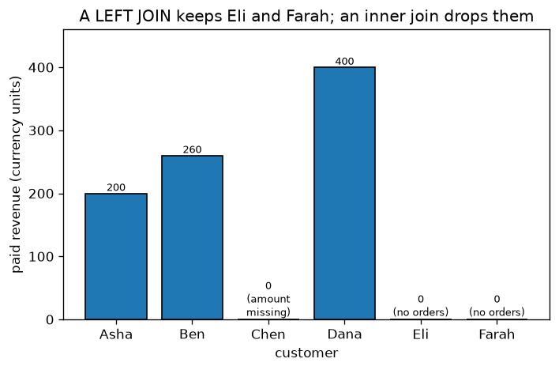

# A1.3 pandas

**Core** · Part A, week 1 (course week 01) · ~3 h · Lab:
[`labs/A/a1_3_pandas.py`](../../labs/A/a1_3_pandas.py)

## Why it matters

Almost every ML project starts as tables: users, orders, events, labels. Before a model sees a
number, someone filters rows, joins tables, aggregates per user and decides what to do with missing
values, and in Python that someone uses pandas. You already know how to do all of this in SQL. The
risk is not that pandas is hard; it is that pandas and SQL treat **missing values** and **joins**
slightly differently, and those differences silently change row counts, means and, eventually,
model features.

## Prerequisite check

- Can you predict the shape of `X.mean(axis=0)` for `X` of shape `(n, d)`, and explain what a
  boolean mask does? If not, revisit [A1.2](a1_2_numpy_arrays.md).
- Can you write a SQL query with `WHERE`, `GROUP BY`, `HAVING`, an inner `JOIN` and a `LEFT JOIN`,
  and say what `COUNT(*)` and `COUNT(column)` return when the column has NULLs? This lesson maps
  each of those to pandas.
- Do you know what `NULL = NULL` evaluates to in SQL? (Not `TRUE`.) The same idea comes back as
  `NaN != NaN`.

## Intuition

### A DataFrame is a table whose columns are NumPy arrays

A **DataFrame** is a set of named columns that share one **index** (the row labels). Each column is
a **Series**: a one-dimensional array with a dtype, plus the shared index. So everything from A1.2
still applies inside a column: a numeric column is a typed array, comparisons give boolean masks,
and operations are vectorized.

> **Bridge:** a DataFrame is a SQL table loaded into memory, and pandas methods map closely onto SQL
> clauses: boolean masks are `WHERE`, `groupby().agg()` is `GROUP BY`, `merge` is `JOIN`, a mask on
> the grouped result is `HAVING`, `sort_values` is `ORDER BY`. **Where it breaks:** a DataFrame has
> no query planner, no indexes in the database sense, and no constraints. There is no `NOT NULL`, no
> foreign key, no unique key unless you check for it yourself, and every step runs eagerly, in
> memory, in the order you wrote it.

### The index

The index is the most un-SQL part of pandas. Every DataFrame has row labels (by default `0, 1, 2,
...`), and many operations align on them: adding two Series matches rows by label, not by position.
After a `groupby`, the group keys become the index. `reset_index()` turns the index back into an
ordinary column. In this course, call `reset_index()` after a groupby unless you need the index; it
keeps results looking like SQL tables.

### Selection: `[]`, `.loc` and `.iloc`

- `df["amount"]` is one column (a Series); `df[["order_id", "amount"]]` is a DataFrame with two.
- `df.loc[row_selector, column_selector]` selects by **label** and by boolean mask. It is the one
  form that works for reading *and* writing, e.g. `df.loc[df["status"] == "refunded", "amount"] = 0`.
- `df.iloc[0:3, 1]` selects by **position**, like NumPy.

Combine conditions with `&` (and), `|` (or) and `~` (not), each condition in parentheses, because
Python's `and`/`or` do not work elementwise.

### Missing values

pandas marks a missing number as `NaN` ("not a number", a special float). Most reductions **skip**
missing values by default, which matches SQL's aggregates. But there are differences, and they are
the source of real bugs:

| Situation | SQL | pandas |
|---|---|---|
| Count all rows in a group | `COUNT(*)` | `.size()` / `"size"` |
| Count non-missing values | `COUNT(col)` | `.count()` / `"count"` |
| Mean | `AVG(col)` skips NULL | `.mean()` skips NaN |
| Sum when every value is missing | `NULL` | `0.0` (use `sum(min_count=1)` to get NaN) |
| `GROUP BY` a key that is missing | NULLs form one group | rows are **dropped** unless `dropna=False` |
| Test for missing | `col IS NULL` | `df["col"].isna()` (never `== np.nan`) |
| Integer column after a left join with no match | stays integer, value NULL | becomes **float64** (NaN is a float) |

Filling missing values (`fillna`) is a modelling decision, not a cleanup chore: [B1.2](../B/b1_2_data_cleaning.md)
covers when to drop, impute or flag, and [B1.4](../B/b1_4_data_leakage.md) covers why imputing with a
statistic computed on all the data leaks information.

### Copy-on-write (pandas 3)

pandas 3 uses **copy-on-write**: any selection behaves like a new object, and modifying it never
changes the original. One consequence: **chained assignment** such as
`df[df["status"] == "refunded"]["amount"] = 0` does nothing to `df`. The first `[...]` produces a
temporary result, the second assigns into that temporary, and it is thrown away. pandas warns with
`ChainedAssignmentError`. Always write with a single `.loc[rows, cols] = value`. Older tutorials show
a `SettingWithCopyWarning` for the same mistake; that warning no longer exists in pandas 3.
VERIFY (as of 2026-10): copy-on-write is the default from pandas 3.0.

## The math

**Symbols**

| Symbol | Meaning | Shape |
|---|---|---|
| $L$, $R$ | the left and right tables of a join | `(n_L, ·)`, `(n_R, ·)` |
| $k$ | a join-key value (e.g. one `customer_id`) | scalar |
| $n_L(k)$, $n_R(k)$ | number of rows with key $k$ in $L$ and in $R$ | integers |
| $g$ | a group (one value of the group-by key) | — |
| $I_g$ | the set of row indices in group $g$ whose value is **not** missing | set |
| $\lvert I_g \rvert$ | the number of elements in $I_g$ | integer |
| $v_i$ | the value being aggregated in row $i$ | scalar |

### Aggregates with missing values

For a group $g$, SQL's `AVG` and pandas' `mean` both compute

$$\text{mean}_g = \frac{1}{\lvert I_g \rvert} \sum_{i \in I_g} v_i,$$

the sum of the *present* values divided by the number of *present* values. Missing rows are not
treated as zero; they are left out of both the top and the bottom of the fraction. `COUNT(col)` is
$\lvert I_g \rvert$; `COUNT(*)` counts every row in the group, missing or not.

### How many rows does a join produce?

An inner join pairs every left row with every right row that has the same key. For one key value
$k$, that is $n_L(k) \times n_R(k)$ pairs, so

$$\text{rows}(L \bowtie R) = \sum_{k} n_L(k)\, n_R(k),$$

where $L \bowtie R$ (the "bowtie") is the usual symbol for the inner join of $L$ and $R$, and the sum
runs over every key value that appears in either table.

A left join adds one row for each left row whose key has no match in $R$ (with NULL/NaN in $R$'s
columns):

$$\text{rows}(L \text{ left join } R) = \sum_k n_L(k)\, n_R(k) \; + \; \#\{\text{rows of } L \text{ with } n_R(\text{key}) = 0\}.$$

The product is the reason joins "explode": if a key appears 1,000 times on each side, it alone
produces 1,000,000 rows. `merge(..., validate="many_to_one")` makes pandas raise an error when the
right-hand key is not unique, which catches this before it happens.

## Worked example by hand

The lab's two tables. `customers`, shape `(6, 4)`:

| customer_id | name | city | signup_year |
|---|---|---|---|
| 1 | Asha | Pune | 2023 |
| 2 | Ben | Leeds | 2024 |
| 3 | Chen | Pune | 2024 |
| 4 | Dana | Austin | 2023 |
| 5 | Eli | Leeds | 2025 |
| 6 | Farah | *missing* | 2025 |

`orders`, shape `(10, 4)`:

| order_id | customer_id | amount | status |
|---|---|---|---|
| 101 | 1 | 120 | paid |
| 102 | 1 | 80 | paid |
| 103 | 2 | 200 | paid |
| 104 | 3 | *missing* | paid |
| 105 | 3 | 50 | refunded |
| 106 | 4 | 300 | paid |
| 107 | 4 | 100 | paid |
| 108 | 4 | 20 | refunded |
| 109 | 2 | 60 | paid |
| 110 | 9 | 75 | paid |

**Aggregates for customer 3.** The group has 2 rows, orders 104 and 105, so `COUNT(*)` = 2. Only one
amount is present, so $I_3 = \{105\}$ and `COUNT(amount)` = 1. `SUM(amount)` = 50, and
`AVG(amount)` = $50 / 1 = 50$, **not** $50 / 2 = 25$. Treating the missing amount as 0 would give 25.

**Inner join row count.** Key counts in `orders`: customer 1 → 2 rows, 2 → 2, 3 → 2, 4 → 3, 9 → 1.
In `customers`, each id 1–6 appears once. Customer 9 is not in `customers`, so it contributes
$1 \times 0 = 0$. Total: $2 \cdot 1 + 2 \cdot 1 + 2 \cdot 1 + 3 \cdot 1 + 1 \cdot 0 = 9$ rows. Order
110 disappears.

**Left join row count** (`customers` on the left). The 9 matched pairs, plus one row each for
customers 5 and 6, which have no orders: $9 + 2 = 11$ rows. Eli's and Farah's rows have NaN in
`order_id` and `amount`.

**HAVING.** Paid orders joined to customers: Pune has orders 101 (120), 102 (80) and 104 (missing):
3 orders, total $120 + 80 = 200$. Leeds: 103 (200) and 109 (60), total 260. Austin: 106 (300) and
107 (100), total 400. `HAVING SUM(amount) > 250` keeps Austin and Leeds.

## Key plot



Paid revenue per customer, built from `customers` **left-joined** to paid orders. Eli and Farah
appear with 0 because they have no orders; with an inner join they would vanish, and a chart of
"revenue per customer" would quietly cover 4 customers instead of 6. Chen is a different case: he
has a paid order, but its amount is missing, so the sum of his present amounts is 0. Both kinds of
zero mean "check the data", not "this customer spent nothing".

## From scratch in plain Python

Before trusting `groupby().mean()`, write it with dictionaries. One pass over the rows keeps a
running sum and count per key, skipping missing values, then divides:

```python
def groupby_mean(keys: list[int], values: list[float | None]) -> dict[int, float]:
    """Mean of the non-missing values per key, like SQL AVG or pandas mean (skipna)."""
    sums: dict[int, float] = {}
    counts: dict[int, int] = {}
    for key, value in zip(keys, values, strict=True):
        if value is None or value != value:  # skip None and NaN (NaN != NaN)
            continue
        sums[key] = sums.get(key, 0.0) + value
        counts[key] = counts.get(key, 0) + 1
    return {key: sums[key] / counts[key] for key in sorted(sums)}
```

`value != value` is the classic NaN test: NaN is the only value not equal to itself. This is exactly
the $\frac{1}{\lvert I_g\rvert}\sum_{i \in I_g} v_i$ formula. The lab checks it against pandas on the
`orders` table and on 100,000 random rows:

```text
== from scratch: group-by mean ==
mine:   {1: 100.0, 2: 130.0, 3: 50.0, 4: 140.0, 9: 75.0}
pandas: {1: 100.0, 2: 130.0, 3: 50.0, 4: 140.0, 9: 75.0}
matches pandas groupby().mean(): OK
100,000 rows: dict and pandas agree: OK
~ dict 11.0 ms, pandas 1.8 ms
```

Customer 3's mean is 50, as worked out by hand.

## With pandas (and SQLite)

The lab loads both tables into Python's built-in `sqlite3` (an in-memory database, no server) and
into pandas, runs each SQL query, writes the pandas equivalent, and asserts the two results are equal
with `pd.testing.assert_frame_equal`. The first check is the worked example:

```text
== worked example ==
   order_id  customer_id  amount    status
3       104            3     NaN      paid
4       105            3    50.0  refunded
COUNT(*): 2  COUNT(amount): 1
SUM(amount): 50.0  AVG(amount): 50.0
```

**Q1, `WHERE`.** A boolean mask selects rows, a column list selects columns:

```python
orders.loc[
    (orders["status"] == "paid") & (orders["amount"] >= 100),
    ["order_id", "customer_id", "amount"],
].sort_values("order_id")
```

**Q2, `GROUP BY`.** Named aggregation, `new_name=(column, function)`, maps one-to-one onto the
`SELECT` list. `"size"` is `COUNT(*)`, `"count"` is `COUNT(col)`:

```python
orders.groupby("customer_id").agg(
    n_orders=("order_id", "size"),
    n_with_amount=("amount", "count"),
    total=("amount", "sum"),
    avg_amount=("amount", "mean"),
).reset_index()
```

**Q3, inner `JOIN`** and **Q4, `LEFT JOIN`**: `merge(other, on="key", how="inner" | "left")`.

**Q5, `HAVING`.** There is no separate clause; filter the grouped result with a mask:

```python
paid = orders[orders["status"] == "paid"].merge(customers, on="customer_id", how="inner")
by_city = paid.groupby("city").agg(n_orders=("order_id", "size"), total=("amount", "sum")).reset_index()
by_city[by_city["total"] > 250].sort_values("total", ascending=False)
```

The real output:

```text
== Q1 filter ==
 order_id  customer_id  amount
      101            1   120.0
      103            2   200.0
      106            4   300.0
      107            4   100.0
Q1: SQL and pandas agree (4 rows)

== Q2 group by ==
 customer_id  n_orders  n_with_amount  total  avg_amount
           1         2              2  200.0       100.0
           2         2              2  260.0       130.0
           3         2              1   50.0        50.0
           4         3              3  420.0       140.0
           9         1              1   75.0        75.0
Q2: SQL and pandas agree (5 rows)

== Q3 inner join ==
 order_id name   city  amount
      101 Asha   Pune   120.0
      102 Asha   Pune    80.0
      103  Ben  Leeds   200.0
      104 Chen   Pune     NaN
      105 Chen   Pune    50.0
      106 Dana Austin   300.0
      107 Dana Austin   100.0
      108 Dana Austin    20.0
      109  Ben  Leeds    60.0
orders: 10  rows after inner join: 9  (order 110 has no customer)
Q3: SQL and pandas agree (9 rows)

== Q4 left join ==
 customer_id  name  order_id  amount
           1  Asha     101.0   120.0
           1  Asha     102.0    80.0
           2   Ben     103.0   200.0
           2   Ben     109.0    60.0
           3  Chen     104.0     NaN
           3  Chen     105.0    50.0
           4  Dana     106.0   300.0
           4  Dana     107.0   100.0
           4  Dana     108.0    20.0
           5   Eli       NaN     NaN
           6 Farah       NaN     NaN
order_id dtype after the left join: float64 (was int64 )
Q4: SQL and pandas agree (11 rows)

== Q5 having ==
before HAVING:
  city  n_orders  total
Austin         2  400.0
 Leeds         2  260.0
  Pune         3  200.0
Q5: SQL and pandas agree (2 rows)
```

The row counts, 9 and 11, are the ones computed by hand. Note what the left join did to `order_id`:
an integer column became `float64` (`101.0`), because NaN is a float and a NumPy integer array cannot
hold it. If you need integers with gaps, convert with `.astype("Int64")` (capital I), pandas'
nullable integer type.

Then the missing-value differences from the table above, and the copy-on-write trap:

```text
== missing values ==
SQL GROUP BY city:
  city  n
   NaN  1
Austin  1
 Leeds  2
  Pune  2
pandas groupby('city').size(): {'Austin': 1, 'Leeds': 2, 'Pune': 2}
pandas groupby('city', dropna=False).size(): {'Austin': 1, 'Leeds': 2, 'Pune': 2, nan: 1}
SQL SUM of only NULLs: None
pandas sum of only NaN: 0.0  with min_count=1: nan
NaN == NaN: False  isna() finds it: True
median used to fill: 80.0  order 104 now: 80.0

== chained assignment ==
warning raised: ['ChainedAssignmentError']
refunded amounts after chained assignment: [50.0, 20.0]
refunded amounts after .loc assignment:    [0.0, 0.0]
```

SQL kept Farah (city NULL) as her own group; pandas dropped her until `dropna=False`. A missing value
read back from SQLite displays as `NaN` in the DataFrame; in the database it is `NULL`. And the
chained assignment raised a warning and changed nothing, while the single `.loc` assignment worked.

## In practice

- **When to use it:** pandas for any table that fits comfortably in memory (as a rule of thumb, up to
  a few GB on this laptop). Push filtering and joining into SQL when the data lives in a database
  and is larger than that, and read only the result into pandas.
- **Failure modes:**
  - *Join explosions:* a key that is not unique on the side you assumed. You notice when the row
    count after a merge is larger than before; check with `len()` before and after, and pass
    `validate="one_to_one"` or `"many_to_one"`.
  - *Silent row loss:* an inner join drops unmatched rows. You notice when a total or a count
    shrinks; use `how="left"` and `indicator=True` to see what did not match.
  - *Missing group keys dropped:* `groupby` drops NaN keys by default. You notice when group counts
    do not add up to `len(df)`; pass `dropna=False`.
  - *Sum of nothing is 0:* a group whose values are all missing sums to 0.0, which looks like real
    data. You notice when zeros appear where you expected gaps; use `min_count=1`.
  - *Chained assignment:* writes that do nothing. You notice the `ChainedAssignmentError` warning;
    rewrite as one `.loc[...] = ...`.
  - *Integers turned into floats:* after a left join, an integer id column is float. You notice
    `101.0` in the output, or a join on that column failing; use `Int64` or re-cast after filling.
  - *`ddof` again:* `df.std()` divides by $n - 1$, `np.std` by $n$ ([A1.2](a1_2_numpy_arrays.md)).
- **Defaults that work:** `pd.read_csv(..., dtype=...)` with explicit dtypes for id columns;
  `merge(..., how="left", validate="many_to_one")` when enriching a fact table with a lookup table;
  named aggregation in `groupby().agg()`; `reset_index()` after a groupby; `df.isna().sum()` as the
  first line of any exploration. VERIFY (as of 2026-10): in pandas 3.0 text columns use the dedicated
  `str` dtype by default instead of `object`.

## Exercises

Save your work to `my-work/A/a1_3_pandas.md` (or `.py`) and ask for a review.

1. **By hand:** Using the two tables in the worked example, compute without code: (a) the number of
   rows of `orders LEFT JOIN customers` (orders on the left); (b) `COUNT(*)`, `COUNT(amount)` and
   `AVG(amount)` per `status`; (c) the result of
   `SELECT signup_year, COUNT(o.order_id) FROM customers c LEFT JOIN orders o ON ... GROUP BY signup_year`.
   Explain why `COUNT(o.order_id)` and `COUNT(*)` give different numbers in (c).
2. **Code:** In the lab's setting (both tables, SQLite and pandas), write the SQL and the pandas
   version of: "for each city, the number of distinct customers, the number of paid orders, and the
   share of that city's orders that were refunded", including customers with no orders and keeping
   Farah's missing city as its own group. Assert that SQL and pandas agree. Then add a third table,
   `payments(order_id, method)`, in which one order has *two* payment rows, and show how a naive merge
   double-counts revenue and how `validate=` would have caught it.
3. **Think:** You are building a feature "average order amount over the customer's lifetime" for a
   churn model. 8% of `amount` values are missing because of a logging bug that only affected the
   mobile app for three months. List the options (drop, fill with 0, fill with a median, add an
   indicator column, something else), say which you would choose and why, and say what each option
   would do to the feature for mobile users.

## Takeaways

1. A DataFrame is named NumPy columns sharing an index: masks are `WHERE`, `groupby().agg()` is
   `GROUP BY`, `merge` is `JOIN`, a mask on the aggregate is `HAVING`.
2. Means and counts skip missing values in both SQL and pandas, but `groupby` drops missing keys,
   an all-missing sum is 0, and an integer column with gaps becomes float. Know each difference.
3. Inner-join rows $= \sum_k n_L(k)\,n_R(k)$: check row counts before and after every merge and use
   `validate=` to catch non-unique keys.
4. Write with one `.loc[rows, cols] = value`; chained assignment does nothing under pandas 3's
   copy-on-write.
5. Prove a pandas transformation right by computing it a second way (SQL, plain Python) and
   asserting the results are equal.

**What builds on this:** [A1.4](a1_4_matplotlib.md) (plotting the tables you built);
[A6.1](a6_1_descriptive_statistics_eda.md) (descriptive statistics and EDA on a DataFrame);
[B1.2](../B/b1_2_data_cleaning.md) (cleaning and imputing missing values);
[B1.4](../B/b1_4_data_leakage.md) (why fitting an imputer on all rows leaks).
