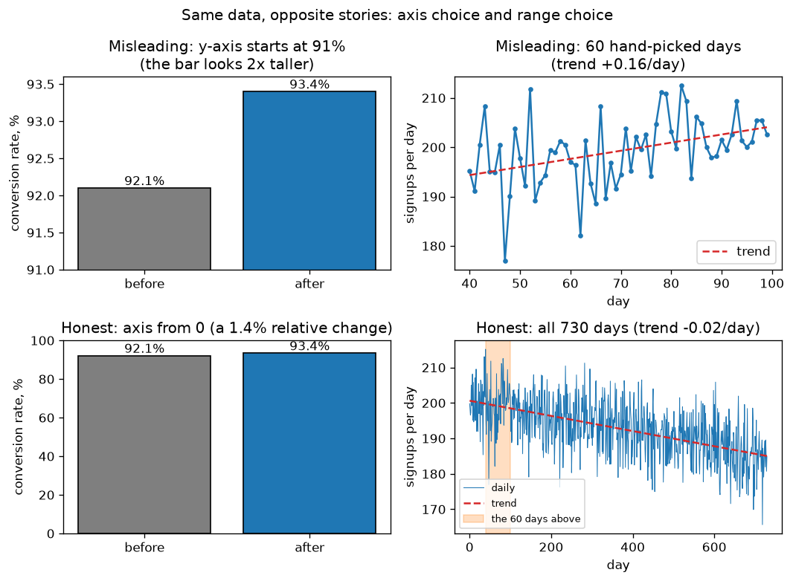

# A1.4 matplotlib

**Core** · Part A, week 1 (course week 01) · ~2 h · Lab:
[`labs/A/a1_4_matplotlib.py`](../../labs/A/a1_4_matplotlib.py)

## Why it matters

Before you trust a model you look at the data, and before anyone else trusts your model they look
at your charts. A loss curve tells you whether training worked, a histogram tells you whether a
feature is skewed or has impossible values, and a scatter plot tells you whether two variables are
related at all. A chart can also lie: a truncated axis or a hand-picked date range can turn a 1%
change into an apparent doubling. In this course every lab draws its key plot with matplotlib, and
every project report is judged partly on whether its charts are honest.

## Prerequisite check

- Can you make an array of shape `(730,)` with `np.arange` and apply an elementwise function to
  it? If not, revisit [A1.2](a1_2_numpy_arrays.md).
- Can you pull one column out of a DataFrame as a NumPy array (`df["col"].to_numpy()`)? If not,
  revisit [A1.3](a1_3_pandas.md).
- Do you know what `floor` does ($\lfloor 2.7 \rfloor = 2$)? Histogram binning uses it.

## Intuition

### Figure, Axes, and the object-oriented API

A matplotlib **Figure** is the whole image. It contains one or more **Axes**: each Axes is one
plot, with its own x-axis, y-axis, title and legend. (The name is confusing: "Axes" is the plot,
and each Axes has two "axis" objects.)

There are two ways to draw. The `plt.plot(...)` style draws on "the current Axes", a hidden global.
The **object-oriented** style creates the Figure and Axes explicitly and calls methods on them:

```python
fig, ax = plt.subplots(figsize=(6, 4), dpi=120)  # one Figure, one Axes
ax.plot(x, y, label="daily")
ax.set_xlabel("day")
ax.set_ylabel("signups per day")
ax.set_title("Signups fall slowly over two years")
ax.legend(loc="best")
fig.tight_layout()
fig.savefig("plot.png", dpi=120, bbox_inches="tight")
plt.close(fig)
```

This course always uses the object-oriented style (`STYLE_GUIDE.md` §4). With several subplots,
`fig, axes = plt.subplots(2, 2)` returns a `(2, 2)` NumPy array of Axes, and you draw on
`axes[0, 1]` the same way.

> **Bridge:** the `plt.*` style is a module-level singleton, like a global `app` object that every
> file mutates; the object-oriented style is dependency injection, where each function receives the
> `ax` it draws on. **Where it breaks:** matplotlib still keeps global state behind the scenes
> (open figures stay in memory until `plt.close(fig)`), so a loop that creates figures without
> closing them leaks memory even in the object-oriented style.

### Four plots cover most of the work

| Plot | Method | Answers |
|---|---|---|
| Line | `ax.plot(x, y)` | How does a quantity change over an ordered variable (time, epochs)? |
| Scatter | `ax.scatter(x, y)` | Are two variables related? Are there clusters or outliers? |
| Histogram | `ax.hist(x, bins=...)` | What is the distribution of one variable: centre, spread, skew, gaps? |
| Bar | `ax.bar(labels, values)` | How do a few categories compare? |

### What a histogram does

A **histogram** cuts the range of the data into equal-width intervals (**bins**), counts how many
values fall in each, and draws one bar per bin. The bar's height is the count, or the **density**:
the count scaled so that the total *area* of the bars is 1, which makes histograms of different
sample sizes comparable. The number of bins changes the picture: too few bins hide the shape, too
many show only noise.

### Plots that don't mislead

A chart encodes numbers as visual quantities: the length of a bar, the position of a point, the slope
of a line. A chart misleads when the visual quantity changes by a different amount than the number
it encodes. The two classic ways:

1. **A truncated axis on a bar chart.** A bar encodes its value by its *length from zero*. Start the
   y-axis at 91% and a bar at 93.4% is drawn more than twice as long as one at 92.1%, though the
   values differ by 1.4%. Bar charts start at zero. (Line charts are different: they encode values by
   position and slope, so zooming the y-axis to the data's range is fine, as long as the axis is
   labelled.)
2. **A cherry-picked range.** Any noisy series contains stretches that rise and stretches that fall.
   Show only the stretch that supports your story and the trend reverses. Show the full range, or
   say why a window was chosen before looking at the data.

Other rules from `STYLE_GUIDE.md` §4: every axis has a label with units; the title states the
takeaway; log scales are labelled "(log scale)"; colour never carries meaning alone (add markers or
line styles); the legend does not cover the data.

## The math

**Symbols**

| Symbol | Meaning | Shape |
|---|---|---|
| $\mathbf{x}$ | the data | `(n,)` |
| $n$ | number of values | int |
| $\ell$, $u$ | the lower and upper end of the histogram's range | scalars |
| $k$ | number of bins | int |
| $h$ | bin width | scalar |
| $e_j$ | the $j$-th bin edge, $j = 0, \dots, k$ | scalar; all edges `(k + 1,)` |
| $c_j$ | count in bin $j$ | int; all counts `(k,)` |
| $f_j$ | density in bin $j$ | scalar |

In this lesson bins are numbered from 0, like the code, because the formula for the bin index is
cleaner that way.

### Equal-width binning

The width and the edges:

$$h = \frac{u - \ell}{k}, \qquad e_j = \ell + j\,h \quad (j = 0, 1, \dots, k).$$

So $e_0 = \ell$ and $e_k = u$. Bin $j$ is the interval $[e_j, e_{j+1})$: it includes its left edge and
excludes its right one, except the last bin, $[e_{k-1}, e_k]$, which includes $u$ so the maximum is
counted. A value $x$ falls in bin

$$j(x) = \min\!\left(\left\lfloor \frac{x - \ell}{h} \right\rfloor,\; k - 1\right).$$

$\frac{x - \ell}{h}$ says how many bin widths $x$ is above the start; the floor $\lfloor\cdot\rfloor$
rounds down to a whole number of bins; the $\min$ moves $x = u$ (which would give index $k$) into the
last bin.

### Density

$$f_j = \frac{c_j}{n\,h}.$$

Each bar's area is $f_j \cdot h = c_j / n$, the fraction of values in that bin, so the areas add up
to $\sum_j c_j / n = 1$. That is why a density histogram can be overlaid on a probability density
curve ([A5.2](a5_2_common_distributions.md)).

### How many bins?

Two classical rules, both built into NumPy (`bins="sturges"`, `bins="fd"`):

- **Sturges:** $k = \lceil \log_2 n \rceil + 1$. For $n = 1{,}000$: $\log_2 1000 \approx 9.97$, so
  $k = 10 + 1 = 11$. It assumes roughly bell-shaped data and gives too few bins for skewed or large
  samples.
- **Freedman–Diaconis:** bin width $h = 2\,\mathrm{IQR}\,n^{-1/3}$, where IQR is the interquartile
  range ([A6.1](a6_1_descriptive_statistics_eda.md)). It adapts to the spread and is robust to
  outliers.

NumPy's `bins="auto"` takes whichever of the two gives the smaller width (more bins). Treat any rule
as a starting point and try a few values.

### The lie factor

Edward Tufte (*The Visual Display of Quantitative Information*, 1983) defines a chart's **lie factor**
as

$$\text{lie factor} = \frac{\text{size of the effect shown in the graphic}}{\text{size of the effect in the data}},$$

where each "size of effect" is a relative change, $\frac{\text{new} - \text{old}}{\text{old}}$. An honest
chart has a lie factor close to 1. For a bar chart whose y-axis starts at $a$ instead of 0, the drawn
bar lengths are $v - a$, so the graphic's effect is $\frac{v_2 - a}{v_1 - a} - 1$.

## Worked example by hand

**Histogram.** Take $\mathbf{x} = (1, 2, 2, 3, 7, 9, 10)$, $n = 7$, with $k = 3$ bins over
$[\ell, u] = [1, 10]$.

- Width: $h = (10 - 1)/3 = 3$. Edges: $e_0 = 1$, $e_1 = 4$, $e_2 = 7$, $e_3 = 10$.
- Bin indices: $x = 2$ gives $\lfloor (2 - 1)/3 \rfloor = \lfloor 0.33 \rfloor = 0$. $x = 7$ gives
  $\lfloor 6/3 \rfloor = 2$: 7 sits exactly on the edge $e_2$, so it goes to the bin that *starts*
  there. $x = 10$ gives $\lfloor 9/3 \rfloor = 3$, and $\min(3, 2) = 2$: the maximum goes in the last
  bin. All indices: $(0, 0, 0, 0, 2, 2, 2)$.
- Counts: $c = (4, 0, 3)$. The empty middle bin is a real gap in the data.
- Densities: $f_0 = 4/(7 \cdot 3) = 4/21 \approx 0.1905$, $f_1 = 0$, $f_2 = 3/21 \approx 0.1429$.
  Areas: $0.1905 \cdot 3 + 0 + 0.1429 \cdot 3 = 4/7 + 3/7 = 1$.

**Lie factor.** Conversion went from 92.1% to 93.4%, drawn on an axis that starts at 91%.

- Effect in the data: $(93.4 - 92.1)/92.1 = 1.3/92.1 \approx 0.0141$, a 1.41% relative increase.
- Bar lengths drawn: $92.1 - 91 = 1.1$ and $93.4 - 91 = 2.4$. Effect in the graphic:
  $2.4/1.1 - 1 \approx 1.1818$, a 118% increase.
- Lie factor: $1.1818 / 0.0141 \approx 84$. The chart exaggerates the change about 84 times.

## Key plot



The same numbers, two stories. Left: the truncated axis (top) makes a 1.4% improvement look like a
doubling; from zero (bottom) the bars are nearly equal. Right: the steepest-rising 60-day window of a
two-year series (top) shows growth; the full series (bottom, window shaded) is in slow decline. The
lab *searched* for that window, which is exactly what cherry-picking is.

## From scratch in NumPy

The binning function is the formulas above, vectorized:

```python
def histogram(x: FloatArray, n_bins: int, lo: float, hi: float) -> tuple[IntArray, FloatArray]:
    """Equal-width histogram like np.histogram. x (n,) -> counts (n_bins,), edges (n_bins + 1,)."""
    if hi <= lo or n_bins < 1:
        raise ValueError("need hi > lo and n_bins >= 1")
    width = (hi - lo) / n_bins
    edges = lo + width * np.arange(n_bins + 1)  # (n_bins + 1,)
    inside = x[(x >= lo) & (x <= hi)]  # values outside [lo, hi] are ignored
    idx = np.floor((inside - lo) / width).astype(np.int64)  # bin index per value
    idx = np.minimum(idx, n_bins - 1)  # x == hi belongs to the last bin (closed on the right)
    counts = np.bincount(idx, minlength=n_bins)  # (n_bins,)
    return counts, edges
```

`np.bincount(idx)` counts how many times each integer appears in `idx`: the counting step without a
loop. `minlength=n_bins` keeps empty bins at the end. The lab reproduces the hand-worked example and
the lie factor:

```text
== worked example: histogram ==
edges: [1.0, 4.0, 7.0, 10.0]
bin index per value: [0, 0, 0, 0, 2, 2, 2]
counts: [4, 0, 3]
density: [0.1905, 0.0, 0.1429]  area: 1.0
```

The lie-factor cell runs after the library comparison below; its output:

```text
== lie factor ==
data change:  0.0141  (1.41 %)
drawn change: 1.1818  (118.18 %)
lie factor:   83.7
```

## With NumPy and matplotlib

`np.histogram(x, bins=30, range=(lo, hi))` and `ax.hist(...)` (which calls `np.histogram`
internally and also draws the bars) return the same counts and edges. The lab checks both on 1,000
skewed "latency" values, then compares the bin-count rules:

```text
== from scratch vs numpy and matplotlib ==
matches np.histogram: OK
matches ax.hist: OK
first 5 counts: [218, 172, 152, 115, 83]  total: 1000
Sturges bins for n = 1000 : 11  numpy: 11
numpy 'auto' bins: 38
```

For this right-skewed sample, `"auto"` chooses 38 bins, Freedman–Diaconis winning over Sturges' 11,
because the long tail makes Sturges' bins too wide to show the shape near the peak.

The lab also draws a scratch figure (`outputs/a1_4/basic_plots.png`, not committed) with a line,
scatter and two histograms on a `(2, 2)` grid of Axes; read that cell as a template for subplots. Its
last panel histograms `log10(latency)` instead of the latency: for skewed data, a log transform often
shows the shape better than any bin count. Finally the key plot, where the lab searches every 60-day
window for the steepest rise:

```text
== key plot ==
cherry-picked window: days 40-99
trend in the cherry-picked 60 days: +0.1645 signups/day
trend over all 730 days:        -0.0214 signups/day
saved lessons/A/img/a1_4_misleading_vs_honest.png
```

(`np.polyfit(x, y, 1)` fits a straight line and returns its slope first; you will derive that fit in
[A2.4](a2_4_projections_least_squares.md).)

## In practice

- **When to use it:** matplotlib for every static figure in labs, reports and papers. Libraries such
  as seaborn and plotly build on the same ideas; the honesty rules are the same in all of them.
- **Failure modes:**
  - *Truncated bar axes:* you notice when bars of similar values look very different; check that the
    y-limit starts at 0 for bars.
  - *Cherry-picked or unexplained ranges:* you notice a window that starts or ends at an odd date;
    ask what the full range shows.
  - *Bad bin counts:* one huge bar (too few bins) or a comb of spikes (too many). Try 3–4 bin counts
    before concluding anything about the shape.
  - *Unlabelled axes or units:* a reader cannot tell milliseconds from seconds. Every axis gets a
    label with units.
  - *Overplotting:* 100,000 scatter points become a solid blob. Use smaller markers, transparency
    (`alpha=0.1`), or a 2-D histogram (`ax.hist2d`).
  - *Figure leaks:* creating figures in a loop without `plt.close(fig)`; you notice memory growing
    and matplotlib's "More than 20 figures have been opened" warning.
  - *Colour-only encoding:* red/green lines are indistinguishable for many colour-blind readers; add
    `marker=` or `linestyle=`.
- **Defaults that work:** `fig, ax = plt.subplots(figsize=(6, 4), dpi=120)`; the default `tab10`
  colour cycle; `bins="auto"` as the first histogram, then adjust; `fig.tight_layout()` before
  `fig.savefig(path, dpi=120, bbox_inches="tight")`; `plt.close(fig)` after saving. VERIFY (as of
  2026-10): `bins="auto"` behaves as described in NumPy 2.5.

## Exercises

Save your work to `my-work/A/a1_4_matplotlib.md` (or `.py`) and ask for a review.

1. **By hand:** For $\mathbf{x} = (0.5, 1.5, 1.5, 2.0, 3.9, 4.0, 6.5, 8.0)$ and 4 equal-width bins over
   $[0.5, 8.0]$, compute $h$, the edges, every value's bin index (show the floor and the min), the
   counts and the densities, and check that the areas sum to 1. Then compute Sturges' $k$ for
   $n = 8$ and for $n = 100{,}000$.
2. **Code:** Write `misleading_report(values: dict[str, float], y_start: float) -> float` that draws a
   bar chart of `values` with the y-axis starting at `y_start`, saves it, and returns its lie factor
   for the first and last bars. Then write the honest counterpart, and use both on a real-looking
   example of your choice (for example, a model's accuracy before and after a change). Also make a
   histogram with 5, 30 and 300 bins of `rng.exponential(scale=120.0, size=1000) + 20.0` as three
   subplots sharing the x-axis, and write one sentence on which bin count you would publish and why.
3. **Think:** A product manager shows a slide: "Model v2 cut support tickets!" with a line chart of
   weekly tickets for the 6 weeks after launch, y-axis from 1,150 to 1,250, trending down. List the
   questions you would ask about the chart before agreeing, and describe the chart you would ask for
   instead.

## Takeaways

1. Use the object-oriented API: `fig, ax = plt.subplots()`, then `ax.plot / scatter / hist / bar`,
   labels with units, a takeaway title, `fig.savefig`, `plt.close(fig)`.
2. A histogram bins values with $j = \min(\lfloor (x - \ell)/h \rfloor, k - 1)$; density
   $c_j / (n h)$ makes the bar areas sum to 1.
3. The bin count changes the picture: start with `bins="auto"`, try others, and consider a log scale
   for skewed data.
4. Bars encode length from zero, so bar axes start at 0; line charts may zoom, if labelled.
5. Show the full range or justify the window; the lie factor (graphic effect / data effect) should
   be near 1.

**What builds on this:** [A5.2](a5_2_common_distributions.md) (density histograms overlaid on
probability densities); [A6.1](a6_1_descriptive_statistics_eda.md) (EDA plots and Anscombe's
quartet); [A4.4](a4_4_gradient_descent.md) (reading loss curves); P1 (an EDA report whose plots are
graded against these rules).
