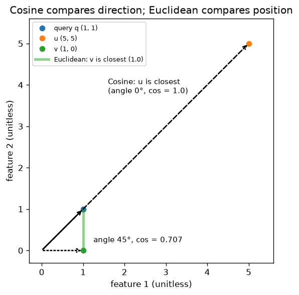

# A1.5 Vectors

**Core** · Part A, week 1 (course week 01) · ~2 h · Lab:
[`labs/A/a1_5_vectors.py`](../../labs/A/a1_5_vectors.py)

## Why it matters

In ML, almost everything becomes a vector: a row of features, a word, a sentence, an image, a user.
Once things are vectors, "how similar are these two things?" becomes arithmetic, and that one
question powers search, recommendations, clustering, retrieval-augmented generation (RAG) and
duplicate detection. The **dot product**, the **norm** and **cosine similarity** in this lesson are
the operations a vector database runs millions of times a second. Choosing the wrong similarity
measure, or forgetting to normalize, silently returns the wrong neighbours.

## Prerequisite check

- Can you predict the shape of `Q @ M.T` for `Q` `(q, d)` and `M` `(m, d)`, and of
  `np.linalg.norm(M, axis=1, keepdims=True)`? If not, revisit [A1.2](a1_2_numpy_arrays.md).
- Do you remember what cosine means for an angle in a right triangle (adjacent over hypotenuse), and
  that $\cos 0° = 1$, $\cos 90° = 0$, $\cos 180° = -1$? That is all the trigonometry this lesson
  uses.
- Can you square and square-root numbers like $\sqrt{9} = 3$, $\sqrt{5} \approx 2.2361$ on paper or a
  calculator? The worked example needs it.

## Intuition

### A vector is a list of numbers that you can draw as an arrow

A **vector** in this course is an ordered list of $d$ numbers, like `[0.9, 0.8, 0.1, 0.0]`. With
$d = 2$ you can draw it as an arrow from the origin to the point $(x_1, x_2)$. With $d = 384$ (a
typical sentence embedding) you cannot draw it, but every idea below still works, because each one
is defined by arithmetic, not by the picture.

Two things to see in the arrow picture:

- Its **length** (how far the tip is from the origin): the **norm**.
- Its **direction** (where it points): two vectors point the same way if one is a positive multiple of
  the other.

### Adding and scaling

**Adding** two vectors adds them feature by feature; in the picture, you put the second arrow's tail
on the first arrow's tip. **Scaling** by a number $c$ multiplies every feature by $c$: the arrow keeps
its direction (flips it if $c < 0$) and its length is multiplied by $\lvert c \rvert$.

### The dot product measures agreement

The **dot product** multiplies matching features and adds the results. It is large and positive when
the two vectors are big in the same features, near zero when they share nothing (one is large where
the other is zero), and negative when they point in opposite directions. In the picture,
$\mathbf{a} \cdot \mathbf{b} = \lVert\mathbf{a}\rVert\,\lVert\mathbf{b}\rVert \cos\theta$, where
$\theta$ is the angle between the arrows. You do not need to prove that identity; it is why the next
idea works.

### Cosine similarity removes length

Because the dot product grows with the lengths, a long vector looks "similar" to everything.
**Cosine similarity** divides the lengths out, leaving only $\cos\theta$, a number from $-1$
(opposite) through $0$ (unrelated, at right angles) to $1$ (same direction). For text embeddings,
direction tends to carry meaning while length carries things like word frequency or text length, so
cosine is the default similarity in semantic search.

> **Bridge:** cosine similarity is like comparing two users' tag profiles as *proportions* rather
> than raw counts: a power user with 1,000 tagged items and a new user with 10 can still have the
> same taste. **Where it breaks:** sometimes length *is* the signal (a "how much" feature such as
> spend), and cosine throws it away; then Euclidean distance on standardized features
> ([A1.2](a1_2_numpy_arrays.md)) is the better choice.

### Nearest-neighbour search

Given a **query** vector and a collection of $m$ stored vectors, **nearest-neighbour search** returns
the $k$ stored vectors most similar to the query. The brute-force version computes all $m$
similarities and sorts. A vector database such as pgvector ([I2.2](../I/i2_2_postgres_pgvector.md))
does the same thing, plus an index that avoids scoring every row when $m$ is in the millions.

## The math

**Symbols**

| Symbol | Meaning | Shape |
|---|---|---|
| $\mathbf{a}$, $\mathbf{b}$ | two vectors | `(d,)` each |
| $a_j$ | feature $j$ of $\mathbf{a}$ | scalar |
| $c$ | a scalar | scalar |
| $\mathbf{a} \cdot \mathbf{b}$ | dot product | scalar |
| $\lVert\mathbf{a}\rVert_2$, $\lVert\mathbf{a}\rVert_1$ | L2 and L1 norms | scalar |
| $\theta$ | angle between $\mathbf{a}$ and $\mathbf{b}$ | scalar, degrees or radians |
| $\hat{\mathbf{a}}$ | $\mathbf{a}$ scaled to length 1 (a **unit vector**) | `(d,)` |
| $\mathbf{Q}$ | query vectors, one per row | `(q, d)` |
| $\mathbf{M}$ | stored vectors, one per row | `(m, d)` |

In this lesson only, the hat in $\hat{\mathbf{a}}$ means "unit length", not "an estimate".

**Sum and scaling:** $(\mathbf{a} + \mathbf{b})_j = a_j + b_j$ and $(c\,\mathbf{a})_j = c\,a_j$. Both need
the same $d$; adding a `(3,)` and a `(4,)` vector is undefined.

**Dot product:**

$$\mathbf{a} \cdot \mathbf{b} = \sum_{j=1}^{d} a_j b_j = a_1 b_1 + a_2 b_2 + \dots + a_d b_d.$$

**Norms.** The **L2 norm** is the arrow's length, Pythagoras in $d$ dimensions. Notice it is the
square root of the vector's dot product with itself:

$$\lVert\mathbf{a}\rVert_2 = \sqrt{\sum_{j} a_j^2} = \sqrt{\mathbf{a} \cdot \mathbf{a}}.$$

The **L1 norm** adds absolute values, the distance a taxi drives on a grid of streets:

$$\lVert\mathbf{a}\rVert_1 = \sum_{j} \lvert a_j \rvert.$$

The L2 norm is the default; "the norm" without a subscript means L2. The L1 norm comes back in
regularization ([B2.2](../B/b2_2_regularization.md)).

**Cosine similarity:**

$$\cos(\mathbf{a}, \mathbf{b}) = \frac{\mathbf{a} \cdot \mathbf{b}}{\lVert\mathbf{a}\rVert_2 \, \lVert\mathbf{b}\rVert_2}.$$

It is undefined if either vector is all zeros (division by 0). The angle itself is
$\theta = \arccos(\cos(\mathbf{a}, \mathbf{b}))$. Libraries often report **cosine distance**
$= 1 - \cos(\mathbf{a}, \mathbf{b})$ instead, so that smaller means closer; check which one a function
returns.

**Unit vectors.** Dividing a vector by its length gives a vector of length 1 pointing the same way:
$\hat{\mathbf{a}} = \mathbf{a} / \lVert\mathbf{a}\rVert_2$. For unit vectors the denominator of the
cosine is $1 \times 1$, so

$$\cos(\mathbf{a}, \mathbf{b}) = \hat{\mathbf{a}} \cdot \hat{\mathbf{b}}.$$

This is why systems normalize vectors once, when they are stored, and then use the plain dot product
("inner product") at query time.

**Distance and cosine agree on unit vectors.** In [A1.2](a1_2_numpy_arrays.md) you expanded
$\lVert\mathbf{a} - \mathbf{b}\rVert^2 = \lVert\mathbf{a}\rVert^2 + \lVert\mathbf{b}\rVert^2 -
2\,\mathbf{a} \cdot \mathbf{b}$. For unit vectors both squared lengths are 1:

$$\lVert\hat{\mathbf{a}} - \hat{\mathbf{b}}\rVert_2^2 = 1 + 1 - 2\,\hat{\mathbf{a}} \cdot \hat{\mathbf{b}} = 2 - 2\cos(\mathbf{a}, \mathbf{b}).$$

A larger cosine means a smaller distance, so after normalizing, ranking by Euclidean distance and
ranking by cosine give the same order. Without normalizing they can disagree (key plot).

**All similarities at once.** Normalize every row of $\mathbf{Q}$ and $\mathbf{M}$, then
$\hat{\mathbf{Q}}\hat{\mathbf{M}}^\top$ has shape `(q, d) @ (d, m)` → `(q, m)`: entry $(i, j)$ is the
cosine between query $i$ and stored vector $j$, the same "all the dot products" product as the norm
trick in A1.2.

## Worked example by hand

Take $\mathbf{a} = (1, 2, 2)$ and $\mathbf{b} = (2, 0, 1)$, both `(3,)`.

- Sum: $\mathbf{a} + \mathbf{b} = (1 + 2,\ 2 + 0,\ 2 + 1) = (3, 2, 3)$. Scaling: $2\mathbf{a} = (2, 4, 4)$.
- Dot product: $1 \cdot 2 + 2 \cdot 0 + 2 \cdot 1 = 2 + 0 + 2 = 4$.
- L2 norms: $\lVert\mathbf{a}\rVert_2 = \sqrt{1 + 4 + 4} = \sqrt{9} = 3$;
  $\lVert\mathbf{b}\rVert_2 = \sqrt{4 + 0 + 1} = \sqrt{5} \approx 2.2361$.
- L1 norms: $\lVert\mathbf{a}\rVert_1 = 1 + 2 + 2 = 5$; $\lVert\mathbf{b}\rVert_1 = 2 + 0 + 1 = 3$.
- Cosine: $\dfrac{4}{3 \times 2.2361} = \dfrac{4}{6.7082} \approx 0.5963$. Angle:
  $\arccos(0.5963) \approx 53.4°$: somewhat aligned, far from identical.
- Unit-vector check: $2 - 2 \times 0.5963 = 0.8074$, which the lab confirms equals
  $\lVert\hat{\mathbf{a}} - \hat{\mathbf{b}}\rVert^2$.

**Word vectors.** The lab uses hand-made 4-feature vectors with the features (royal, male, female,
food). They are typed in to make the arithmetic visible; real embeddings are learned from data
([E1.3](../E/e1_3_word2vec.md)) and their features have no names. Take
$\text{king} = (0.9, 0.8, 0.1, 0)$ and $\text{queen} = (0.9, 0.1, 0.8, 0)$:

- $\text{king} \cdot \text{queen} = 0.81 + 0.08 + 0.08 + 0 = 0.97$.
- $\lVert\text{king}\rVert^2 = 0.81 + 0.64 + 0.01 + 0 = 1.46$, and $\lVert\text{queen}\rVert^2 = 1.46$
  too, so the product of the lengths is $\sqrt{1.46}\sqrt{1.46} = 1.46$.
- $\cos(\text{king}, \text{queen}) = 0.97 / 1.46 \approx 0.6644$: they share "royal", differ in gender.
- $\text{apple} = (0, 0, 0, 0.9)$ shares no non-zero feature with king, so the dot product is 0 and
  the cosine is 0: unrelated.

**Cosine vs Euclidean.** Query $\mathbf{q} = (1, 1)$, candidates $\mathbf{u} = (5, 5)$ and
$\mathbf{v} = (1, 0)$.

- Euclidean: $\lVert\mathbf{q} - \mathbf{u}\rVert = \sqrt{16 + 16} = \sqrt{32} \approx 5.6569$;
  $\lVert\mathbf{q} - \mathbf{v}\rVert = \sqrt{0 + 1} = 1$. Nearest: $\mathbf{v}$.
- Cosine: $\mathbf{q}\cdot\mathbf{u} = 10$, lengths $\sqrt2$ and $\sqrt{50}$, so
  $10/\sqrt{100} = 1$. $\mathbf{q}\cdot\mathbf{v} = 1$, lengths $\sqrt2$ and 1, so
  $1/\sqrt2 \approx 0.7071$. Nearest: $\mathbf{u}$.

## Key plot



The two measures answer different questions. Euclidean distance asks "which point is nearest?" and
picks $\mathbf{v}$; cosine asks "which arrow points the same way?" and picks $\mathbf{u}$, five times
longer but at angle 0°. Neither is wrong; choose the one that matches what similarity means for
your data, and remember that normalizing all vectors to length 1 makes the two agree.

## From scratch in NumPy

First in pure Python, so every operation is a visible loop over features:

```python
def dot(a: list[float], b: list[float]) -> float:
    """Dot product: sum of elementwise products."""
    if len(a) != len(b):
        raise ValueError(f"lengths differ: {len(a)} vs {len(b)}")
    return sum(x * y for x, y in zip(a, b, strict=True))


def norm_l2(a: list[float]) -> float:
    """Euclidean length: sqrt of the sum of squares."""
    return math.sqrt(dot(a, a))


def cosine(a: list[float], b: list[float]) -> float:
    """Cosine similarity a.b / (|a| |b|); undefined for a zero vector."""
    na, nb = norm_l2(a), norm_l2(b)
    if na == 0.0 or nb == 0.0:
        raise ValueError("cosine similarity is undefined for a zero vector")
    return dot(a, b) / (na * nb)
```

In NumPy the same operations are `a @ b`, `np.linalg.norm(a)` and `np.linalg.norm(a, ord=1)`. The lab
reproduces the worked example and checks that both versions agree:

```text
== worked example ==
a + b = [3.0, 2.0, 3.0]   2a = [2.0, 4.0, 4.0]
a . b = 4.0
|a|_2 = 3.0   |b|_2 = 2.2361
|a|_1 = 5.0   |b|_1 = 3.0
cos(a, b) = 0.5963   angle = 53.4 degrees

== from scratch vs numpy ==
dot      pure Python 4.0000  numpy 4.0000  OK
L2 norm  pure Python 3.0000  numpy 3.0000  OK
L1 norm  pure Python 5.0000  numpy 5.0000  OK
cosine   pure Python 0.5963  numpy 0.5963  OK

== unit vectors: distance and cosine agree ==
|a_hat - b_hat|^2 = 0.8074   2 - 2 cos = 0.8074
identity holds: OK
```

Then the brute-force search. `cosine_matrix` normalizes the rows (`keepdims=True` keeps the lengths
as `(q, 1)` and `(m, 1)` so they broadcast) and takes all the dot products with one matrix product;
`top_k` sorts one row of scores (`np.argsort` sorts ascending, so sorting `-scores` puts the
highest similarity first):

```python
def cosine_matrix(Q: FloatArray, M: FloatArray) -> FloatArray:
    """Cosine similarity of every query row with every row of M. Q (q, d), M (m, d) -> (q, m)."""
    Q_hat = Q / np.linalg.norm(Q, axis=1, keepdims=True)  # (q, d), rows of length 1
    M_hat = M / np.linalg.norm(M, axis=1, keepdims=True)  # (m, d)
    return Q_hat @ M_hat.T  # (q, d) @ (d, m) -> (q, m): all the dot products
```

```text
== nearest neighbours ==
cosine(king, queen) = 0.6644   cosine(king, apple) = 0.0
top 3 for 'queen': [('woman', 0.7449), ('king', 0.6644), ('prince', 0.6488)]
top 3 for 'banana': [('apple', 0.9923), ('bread', 0.9823), ('woman', 0.1225)]
king - man + woman = [0.9, 0.0, 0.9, 0.0]
nearest (excluding the three inputs): [('queen', 0.9948)]
```

The famous "king − man + woman ≈ queen" works here because the vectors were built to make it work:
subtracting "man" removes the male feature, adding "woman" adds the female one. With learned
embeddings the effect exists but is much noisier, and the convention of excluding the input words
(as `exclude={0, 2, 3}` does here) matters a lot; [E1.3](../E/e1_3_word2vec.md) looks at it with
real vectors.

## With scikit-learn and SciPy

`sklearn.metrics.pairwise.cosine_similarity` returns the same `(q, m)` matrix, and
`sklearn.neighbors.NearestNeighbors(metric="cosine")` does the brute-force search for you. SciPy's
`scipy.spatial.distance.cosine` returns the cosine **distance**, $1 - \cos$:

```text
== with scikit-learn and scipy ==
cosine_matrix matches sklearn cosine_similarity: OK
scipy cosine *distance*(a, b) = 0.4037  = 1 - cos: 0.4037
random 2000 x 384: matches sklearn: OK
sklearn neighbours of 'queen': [('queen', 1.0), ('woman', 0.7449), ('king', 0.6644), ('prince', 0.6488)]

== cosine vs euclidean ==
u: euclidean 5.6569  cosine 1.0000
v: euclidean 1.0000  cosine 0.7071
```

Note that scikit-learn's search returns `queen` as its own nearest neighbour (similarity 1.0): a
query that is in the collection always finds itself first. The from-scratch `top_k` excluded it
explicitly.

## In practice

- **When to use it:** cosine similarity for text and other learned embeddings (normalize once at
  ingestion, then use the dot product); Euclidean distance on standardized features when magnitude
  matters (kNN in [B2.3](../B/b2_3_knn.md), k-means in [B5.1](../B/b5_1_k_means.md)); the dot product
  itself inside every linear model and every attention layer.
- **Failure modes:**
  - *Zero vectors:* an empty document can embed to all zeros, and cosine divides by 0 → `nan`. You
    notice `nan` scores or warnings; filter or handle zero vectors explicitly.
  - *Mixing similarity and distance:* sorting cosine *distances* in descending order returns the
    *least* similar items. You notice obviously unrelated results; check whether the function returns
    $\cos$ or $1 - \cos$.
  - *Forgetting to normalize before using the dot product:* long vectors win every search. You notice
    the same few items (often long documents) at the top of every query.
  - *Comparing vectors from different models:* embeddings from two models (or two versions of one
    model) live in different spaces; their cosine is meaningless even when the dimensions match. You
    notice similarity scores that look random; store the model name with every vector.
  - *Self-matches:* a query that is itself in the collection returns itself. You notice the top
    result always has similarity 1.0; exclude the query's own id.
- **Defaults that work:** store embeddings L2-normalized as `float32` and search by inner product;
  `np.linalg.norm(M, axis=1, keepdims=True)` for row lengths; brute force is fine up to roughly a few
  hundred thousand vectors on a laptop before you need an index (Part I). VERIFY (as of 2026-10):
  384 dimensions is a common sentence-embedding width, but current models range from a few hundred
  to several thousand.

## Exercises

Save your work to `my-work/A/a1_5_vectors.md` (or `.py`) and ask for a review.

1. **By hand:** For $\mathbf{a} = (3, 4, 0)$, $\mathbf{b} = (4, 3, 0)$ and $\mathbf{c} = (0, 0, 2)$:
   compute $\mathbf{a} \cdot \mathbf{b}$, $\mathbf{a} \cdot \mathbf{c}$, the L1 and L2 norms of all
   three, $\cos(\mathbf{a}, \mathbf{b})$ and $\cos(\mathbf{a}, \mathbf{c})$, and the Euclidean distances
   $\lVert\mathbf{a} - \mathbf{b}\rVert$ and $\lVert\mathbf{a} - \mathbf{c}\rVert$. Then scale $\mathbf{b}$
   by 10 and say which of your numbers change and which do not. Finally, verify
   $\lVert\hat{\mathbf{a}} - \hat{\mathbf{b}}\rVert^2 = 2 - 2\cos(\mathbf{a}, \mathbf{b})$ with your
   numbers.
2. **Code:** Build a tiny semantic search. Make a `(m, d)` matrix of at least 12 hand-made vectors for
   short "documents" over 5 named features of your choice, and write
   `search(query: FloatArray, M: FloatArray, k: int) -> list[tuple[int, float]]` that returns the top
   $k$ by cosine with no Python loop over rows. Check it against `NearestNeighbors(metric="cosine")`.
   Then show, with numbers, one query where ranking by raw dot product gives a different top-1 than
   ranking by cosine, and explain why.
3. **Think:** Your team stores 2 million product-description embeddings in Postgres and searches by
   cosine. After a model upgrade, only new and edited products are re-embedded with the new model;
   the rest keep their old vectors. Search quality drops. Explain what is going wrong in terms of
   vectors, how you would detect it in production, and how you would migrate safely.

## Takeaways

1. Vectors add and scale feature by feature; the dot product $\sum_j a_j b_j$ measures how much two
   vectors agree.
2. The L2 norm is length, $\sqrt{\mathbf{a} \cdot \mathbf{a}}$; the L1 norm is the sum of absolute
   values.
3. Cosine similarity $\frac{\mathbf{a} \cdot \mathbf{b}}{\lVert\mathbf{a}\rVert\lVert\mathbf{b}\rVert}$
   compares direction and ignores length; cosine *distance* is $1 - \cos$.
4. For unit vectors, cosine equals the dot product and $\lVert\hat{\mathbf{a}} - \hat{\mathbf{b}}\rVert^2
   = 2 - 2\cos$, so normalize once and Euclidean and cosine rankings agree.
5. Brute-force nearest-neighbour search is one matrix product plus a sort; a vector database adds an
   index so it does not have to score every row.

**What builds on this:** [A2.1](a2_1_matrices_as_linear_maps.md) (a matrix times a vector is a stack
of dot products); [B2.3](../B/b2_3_knn.md) (k-nearest neighbours); [E1.3](../E/e1_3_word2vec.md)
(learned word vectors and their geometry); [I2.1](../I/i2_1_embeddings_semantic_search.md) and
[I2.2](../I/i2_2_postgres_pgvector.md) (embedding search at scale with pgvector).
