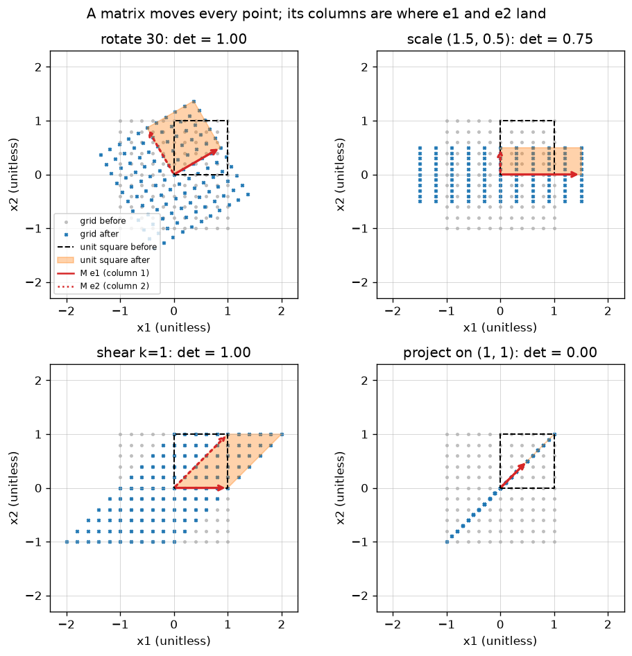

# A2.1 Matrices as linear maps

**Core** · Part A, week 2 (course week 02) · ~3 h · Lab:
[`labs/A/a2_1_matrices_as_linear_maps.py`](../../labs/A/a2_1_matrices_as_linear_maps.py)

## Why it matters

Every layer of every model in this course multiplies its input by a matrix: a linear regression
([B1.5](../B/b1_5_linear_regression.md)), each layer of a neural network
([C1.1](../C/c1_1_perceptron_mlp.md)), each attention head in a transformer
([F1.1](../F/f1_1_self_attention.md)). If you can see a matrix as a *function that moves points*,
you can reason about what a layer can and cannot do. And if you know the shape rule by heart, you
catch the most common bug in ML code, a mismatched or transposed matrix, before it runs, instead of
after it silently produces garbage.

## Prerequisite check

- Can you predict the shape of `X @ w` for `X` `(n, d)` and `w` `(d,)`, and of `X.T`? If not,
  revisit [A1.2](a1_2_numpy_arrays.md).
- Can you compute a dot product such as $(2, -1) \cdot (1, 2) = 0$ by hand? If not, revisit
  [A1.5](a1_5_vectors.md).
- Can you add and scale vectors, e.g. $1 \cdot (2, 1) + 2 \cdot (-1, 1) = (0, 3)$? If not, revisit
  [A1.5](a1_5_vectors.md).
- Do you remember $\cos 90° = 0$, $\sin 90° = 1$ and $\cos 30° \approx 0.8660$, $\sin 30° = 0.5$? A
  calculator is fine; this is all the trigonometry the lesson uses.

## Intuition

### A matrix is a function on vectors

You already know a **matrix** as a table of numbers: $m$ rows, $d$ columns, shape `(m, d)`. This
lesson adds a second meaning: a matrix $\mathbf{A}$ is a function. Give it a vector $\mathbf{x}$ of
length $d$ and it returns a vector $\mathbf{A}\mathbf{x}$ of length $m$. With $m = d = 2$ you can
draw it: every point of the plane moves somewhere else. The lab moves a whole grid of points and
the unit square at once, and the key plot shows the four classic moves: **rotation**, **scaling**,
**shear** and **projection**.

Not every function is a matrix. The ones that are, called **linear maps**, obey two rules:

1. Scaling the input scales the output: $\mathbf{A}(c\,\mathbf{x}) = c\,\mathbf{A}\mathbf{x}$.
2. Adding inputs adds outputs: $\mathbf{A}(\mathbf{x} + \mathbf{y}) = \mathbf{A}\mathbf{x} + \mathbf{A}\mathbf{y}$.

In the picture this means: the origin stays put, straight lines stay straight, and evenly spaced
grid lines stay evenly spaced (they may tilt, stretch or collapse, but they do not bend). Shifting
everything right by 1 is *not* linear, because the origin moves; that is why a neural-network layer
is written $\mathbf{W}\mathbf{x} + \mathbf{b}$, a linear map plus a separate shift (an **affine
map**).

### The columns tell you everything

Here is the one idea to take from this lesson. Write the two **standard basis vectors**
$\mathbf{e}_1 = (1, 0)$ and $\mathbf{e}_2 = (0, 1)$. Any point is a mix of them:
$(x_1, x_2) = x_1\mathbf{e}_1 + x_2\mathbf{e}_2$. Because the map is linear, it must send that point
to $x_1\,\mathbf{A}\mathbf{e}_1 + x_2\,\mathbf{A}\mathbf{e}_2$. So once you know where $\mathbf{e}_1$
and $\mathbf{e}_2$ land, you know where *every* point lands. And where do they land?
$\mathbf{A}\mathbf{e}_1$ is the first column of $\mathbf{A}$, and $\mathbf{A}\mathbf{e}_2$ is the
second. **The columns of a matrix are the images of the basis vectors.** In the key plot they are the
two red arrows, and the shaded shape is the unit square they span.

This works in reverse too: to build a matrix that does something, decide where $\mathbf{e}_1$ and
$\mathbf{e}_2$ should go and write those as the columns. A 90° counter-clockwise rotation sends
$\mathbf{e}_1 = (1, 0)$ to $(0, 1)$ and $\mathbf{e}_2 = (0, 1)$ to $(-1, 0)$, so its matrix has columns
$(0, 1)$ and $(-1, 0)$.

### Two ways to compute $\mathbf{A}\mathbf{x}$

- **Row view:** entry $i$ of $\mathbf{A}\mathbf{x}$ is the dot product of row $i$ of $\mathbf{A}$ with
  $\mathbf{x}$ ([A1.5](a1_5_vectors.md)). This is how you compute by hand, and how a weight matrix
  "scores" an input: each output is one weighted sum of the inputs.
- **Column view:** $\mathbf{A}\mathbf{x}$ is a **linear combination** of the columns of $\mathbf{A}$,
  using the entries of $\mathbf{x}$ as the weights. This is how you *think*: the output always lies
  among the points the columns can reach. A2.3 builds on exactly this.

Both give the same numbers; they are two ways of grouping the same multiplications.

### Area: the determinant

The unit square has area 1. After a 2×2 map it becomes a parallelogram whose area is the same for
every unit of area in the plane: the map scales all areas by one factor, the **determinant**
$\det(\mathbf{A})$. A rotation or a shear keeps areas ($\det = 1$); scaling by 1.5 and 0.5 gives
$\det = 0.75$; a projection squashes the plane onto a line ($\det = 0$). A negative determinant
means the map also flips the plane over, like a mirror. A determinant of 0 is the important case: the
map loses information, because many points land on the same output, so it cannot be undone. A2.2 and
A2.3 return to this.

> **Bridge:** a matrix is like a pure function `transform(point): Point` whose whole implementation
> is fully described by two return values, `transform(e1)` and `transform(e2)`, because linearity lets
> you compute every other call from those two. **Where it breaks:** a general function needs its full
> body; only linear functions are pinned down by their behaviour on a basis, and anything with an
> `if`, a `max` or a constant offset is not linear (that is why networks need non-linear activations
> between their matrices, [C1.1](../C/c1_1_perceptron_mlp.md)).

## The math

**Symbols**

| Symbol | Meaning | Shape |
|---|---|---|
| $\mathbf{A}$ | a matrix, read as a linear map from $d$-vectors to $m$-vectors | `(m, d)` |
| $A_{ij}$ | the entry in row $i$, column $j$ (`A[i-1, j-1]` in code) | scalar |
| $\mathbf{a}_j$ | column $j$ of $\mathbf{A}$ | `(m,)` |
| $\mathbf{x}$ | an input vector | `(d,)` |
| $\mathbf{e}_j$ | standard basis vector: 1 in position $j$, 0 elsewhere | `(d,)` |
| $\mathbf{X}$ | many input points, one per row | `(n, d)` |
| $\theta$ | a rotation angle | scalar, degrees |
| $\det(\mathbf{A})$ | determinant (2×2 only in this lesson) | scalar |

Indices start at 1 in the math and at 0 in the code.

**Matrix–vector product.** For $\mathbf{A}$ `(m, d)` and $\mathbf{x}$ `(d,)`, the row view is

$$(\mathbf{A}\mathbf{x})_i = \sum_{j=1}^{d} A_{ij}\,x_j \qquad \text{for } i = 1, \dots, m,$$

and the column view is

$$\mathbf{A}\mathbf{x} = x_1\,\mathbf{a}_1 + x_2\,\mathbf{a}_2 + \dots + x_d\,\mathbf{a}_d.$$

They are the same sum: the first adds across row $i$; the second collects, for each $j$, the
contribution $x_j A_{ij}$ to every row at once. Setting $\mathbf{x} = \mathbf{e}_j$ in the column view
gives $\mathbf{A}\mathbf{e}_j = \mathbf{a}_j$: column $j$ is where $\mathbf{e}_j$ lands.

**The shape rule.** $\mathbf{A}$ `(m, d)` times $\mathbf{x}$ `(d,)` gives `(m,)`: the number of
columns of the matrix must equal the length of the vector, because each row is dotted with
$\mathbf{x}$. The same rule for two matrices (A2.2 explains why it holds):

$$\underbrace{(n, d)}_{\text{left}} \; @ \; \underbrace{(d, k)}_{\text{right}} \;\to\; (n, k).$$

The inner sizes must match and disappear; the outer sizes survive. A chain follows the rule pair by
pair: `(5, 3) @ (3, 4) @ (4, 2)` → `(5, 4) @ (4, 2)` → `(5, 2)`.

**Many points at once: rows are examples.** The math writes one point as a column and computes
$\mathbf{A}\mathbf{x}$. The code stores $n$ points as the *rows* of $\mathbf{X}$ `(n, d)`
([STYLE_GUIDE](../../course/STYLE_GUIDE.md) §1.1). To apply $\mathbf{A}$ to every row, compute

$$\mathbf{X}\mathbf{A}^\top \quad \text{shapes: } (n, d) @ (d, m) \to (n, m).$$

Row $i$ of the result is $\mathbf{A}\mathbf{x}_i$, written as a row. The **transpose**
$\mathbf{A}^\top$ swaps rows and columns: $(\mathbf{A}^\top)_{ij} = A_{ji}$, shape `(d, m)`. Why the
transpose appears: entry $(i, k)$ of $\mathbf{X}\mathbf{A}^\top$ is row $i$ of $\mathbf{X}$ dotted with
column $k$ of $\mathbf{A}^\top$, and column $k$ of $\mathbf{A}^\top$ is row $k$ of $\mathbf{A}$, so it is
$\sum_j A_{kj} X_{ij} = (\mathbf{A}\mathbf{x}_i)_k$. This is exactly what PyTorch's `nn.Linear` does:
it stores `weight` with shape `(out, in)` and computes `x @ weight.T + bias`
([C2.1](../C/c2_1_tensors_autograd_modules.md)).

**The four classic 2×2 maps.** Each is built from where it sends $\mathbf{e}_1$ (column 1) and
$\mathbf{e}_2$ (column 2). For the rotation, use the fact that the point at angle $\alpha$ on the
circle of radius 1 is $(\cos\alpha, \sin\alpha)$: $\mathbf{e}_1$ sits at angle 0 and moves to angle
$\theta$; $\mathbf{e}_2$ sits at 90° and moves to $90° + \theta$, which is the point
$(-\sin\theta, \cos\theta)$.

| Map | Matrix | $\mathbf{e}_1 \to$ | $\mathbf{e}_2 \to$ | det |
|---|---|---|---|---|
| Rotate by $\theta$ (counter-clockwise) | $\begin{pmatrix}\cos\theta & -\sin\theta\\ \sin\theta & \cos\theta\end{pmatrix}$ | $(\cos\theta, \sin\theta)$ | $(-\sin\theta, \cos\theta)$ | 1 |
| Scale axes by $s_x, s_y$ | $\begin{pmatrix}s_x & 0\\ 0 & s_y\end{pmatrix}$ | $(s_x, 0)$ | $(0, s_y)$ | $s_x s_y$ |
| Shear by $k$ | $\begin{pmatrix}1 & k\\ 0 & 1\end{pmatrix}$ | $(1, 0)$ | $(k, 1)$ | 1 |
| Project onto the line along $\mathbf{u}$ | $\dfrac{\mathbf{u}\mathbf{u}^\top}{\mathbf{u}^\top\mathbf{u}}$ | onto the line | onto the line | 0 |

For the projection, $\mathbf{u}\mathbf{u}^\top$ is the **outer product**: a column `(2, 1)` times a row
`(1, 2)` gives a `(2, 2)` matrix with entries $u_i u_j$. For $\mathbf{u} = (1, 1)$ it is
$\begin{pmatrix}1&1\\1&1\end{pmatrix}$, divided by $\mathbf{u}^\top\mathbf{u} = 2$. A2.4 derives why this
formula projects.

**Determinant of a 2×2 matrix.**

$$\det\begin{pmatrix}a & b\\ c & d\end{pmatrix} = ad - bc.$$

It is the signed area of the parallelogram spanned by the columns $(a, c)$ and $(b, d)$. The lab
checks this by transforming the unit square and measuring the area of the result directly. (The
letter $d$ is overloaded here: inside this formula it is an entry, not the number of features.)

## Worked example by hand

Take $\mathbf{A} = \begin{pmatrix}2 & -1\\ 1 & 1\end{pmatrix}$, shape `(2, 2)`, and
$\mathbf{x} = (1, 2)$, shape `(2,)`.

1. **Columns.** $\mathbf{A}\mathbf{e}_1 = (2, 1)$ and $\mathbf{A}\mathbf{e}_2 = (-1, 1)$: the unit square's
   bottom edge becomes the arrow to $(2, 1)$ and its left edge the arrow to $(-1, 1)$.
2. **Row view.** Row 1 is $(2, -1)$: $2 \cdot 1 + (-1) \cdot 2 = 0$. Row 2 is $(1, 1)$:
   $1 \cdot 1 + 1 \cdot 2 = 3$. So $\mathbf{A}\mathbf{x} = (0, 3)$.
3. **Column view.** $1 \cdot (2, 1) + 2 \cdot (-1, 1) = (2 - 2,\ 1 + 2) = (0, 3)$. Same answer.
4. **Many points.** Put three points in the rows of $\mathbf{X} = \begin{pmatrix}1&0\\0&1\\1&1\end{pmatrix}$,
   shape `(3, 2)`. Then $\mathbf{X}\mathbf{A}^\top$, shape `(3, 2)`, has rows $(2, 1)$, $(-1, 1)$ and
   $(2, 1) + (-1, 1) = (1, 2)$: the two columns of $\mathbf{A}$ and their sum, the far corner of the
   parallelogram.
5. **Determinant.** $2 \cdot 1 - (-1) \cdot 1 = 3$: the unit square becomes a parallelogram of area 3.
6. **The four maps on the same $\mathbf{x} = (1, 2)$:**
   - Rotate 90°: $\begin{pmatrix}0&-1\\1&0\end{pmatrix}$, rows give $(0 \cdot 1 - 1 \cdot 2,\ 1 \cdot 1 + 0 \cdot 2) = (-2, 1)$.
   - Rotate 30°: $\cos 30° \approx 0.8660$, $\sin 30° = 0.5$, so
     $(0.8660 - 0.5 \cdot 2,\ 0.5 + 0.8660 \cdot 2) = (-0.1340, 2.2321)$.
   - Scale by (1.5, 0.5): $(1.5, 1.0)$.
   - Shear with $k = 1$: $(1 + 1 \cdot 2,\ 2) = (3, 2)$.
   - Project onto the line along $(1, 1)$: $\tfrac12\begin{pmatrix}1&1\\1&1\end{pmatrix}(1, 2) = (1.5, 1.5)$,
     the point on the diagonal closest to $(1, 2)$.
7. **Shapes.** `(100, 3) @ (3, 2)` → `(100, 2)`. `(5, 3) @ (5, 2)` → error: 3 columns on the left,
   5 rows on the right. `(5, 3) @ (3,)` → `(5,)`: one number per row.

## Key plot



Grey dots are the grid before, blue crosses after. The red arrows are the matrix's two columns, the
images of $\mathbf{e}_1$ and $\mathbf{e}_2$, and the orange shape is the unit square after the map,
with the determinant (its area) in each title. Notice that every grid stays a grid. The projection is
the odd one out: the whole plane collapses onto one line, area 0, and there is no way to tell which
point a blue cross came from.

## From scratch in NumPy

The lab writes the matrix–vector product twice in plain Python, once per view, so every
multiplication is visible:

```python
def matvec_rows(A: list[list[float]], x: list[float]) -> list[float]:
    """Row view: entry i of Ax is (row i of A) . x. A (m, d) as lists, x (d,) -> (m,)."""
    if any(len(row) != len(x) for row in A):
        raise ValueError(f"A has rows of length {len(A[0])}, x has length {len(x)}")
    return [sum(a_ij * x_j for a_ij, x_j in zip(row, x, strict=True)) for row in A]


def matvec_columns(A: list[list[float]], x: list[float]) -> list[float]:
    """Column view: Ax = x_1 * (column 1) + ... + x_d * (column d). A (m, d), x (d,) -> (m,)."""
    m, d = len(A), len(A[0])
    if d != len(x):
        raise ValueError(f"A has {d} columns, x has length {len(x)}")
    out = [0.0] * m
    for j in range(d):  # j is 0-based here; column j+1 in the math
        for i in range(m):
            out[i] += x[j] * A[i][j]
    return out
```

and reproduces the worked example:

```text
== worked example ==
A e1 = column 1 = [2.0, 1.0]   A e2 = column 2 = [-1.0, 1.0]
row view    Ax = [0.0, 3.0]
column view Ax = [0.0, 3.0]
numpy       A @ x = [0.0, 3.0]
three points as rows, X @ A.T = [[2.0, 1.0], [-1.0, 1.0], [1.0, 2.0]]
det(A) = 2*1 - (-1)*1 = 3.0
```

Each classic map is a small function that returns its matrix, built column by column from the table
in "The math" (`rotation(theta_deg)`, `scaling(sx, sy)`, `shear(k)`, `projection_onto(u)`). Applied to
the same $\mathbf{x}$:

```text
== four maps applied to x = (1, 2) ==
rotate 90          M = [[0.0, -1.0], [1.0, 0.0]]          M x = [-2.0, 1.0]      det = 1.0000
rotate 30          M = [[0.866, -0.5], [0.5, 0.866]]      M x = [-0.134, 2.2321] det = 1.0000
scale (1.5, 0.5)   M = [[1.5, 0.0], [0.0, 0.5]]           M x = [1.5, 1.0]       det = 0.7500
shear k=1          M = [[1.0, 1.0], [0.0, 1.0]]           M x = [3.0, 2.0]       det = 1.0000
project on (1, 1)  M = [[0.5, 0.5], [0.5, 0.5]]           M x = [1.5, 1.5]       det = 0.0000

== linearity ==
shear(3u - 2v) == 3 shear(u) - 2 shear(v): OK
M @ 0 = [0.0, 0.0]   but (0 + shift) = [1.0, 0.0] -> a shift is not linear
```

Next, the whole grid at once. A loop of `M @ p` over the 121 points must equal one product
`GRID @ M.T`. Forgetting the transpose does *not* raise an error for a square matrix: it silently
applies a different map, here a rotation the other way. The transpose of the rotation matrix swaps
its two off-diagonal entries, $-\sin\theta$ and $\sin\theta$, and since $\cos(-\theta) = \cos\theta$
and $\sin(-\theta) = -\sin\theta$, that is exactly the rotation by $-\theta$:

```text
== many points at once ==
loop of M @ p over 121 points == GRID @ M.T: OK
GRID @ M (no transpose) equals rotating by -30 degrees: True
rotation keeps every length: True
```

Finally, `check_shapes(*operands)` applies the shape rule along a chain and explains the first
mismatch, following NumPy's convention for 1-D operands (on the left a vector acts as a row, on the
right as a column, and that temporary axis is dropped afterwards). The lab tests every prediction
against what NumPy really does:

```text
== shape checker ==
(100, 3) @ (3, 2)            -> (100, 2)   numpy agrees: True
(5, 3) @ (3, 4) @ (4, 2)     -> (5, 2)   numpy agrees: True
(3,) @ (3, 4)                -> (4,)   numpy agrees: True
(5, 3) @ (3,)                -> (5,)   numpy agrees: True
(3,) @ (3,)                  -> ()   numpy agrees: True
(5, 3) @ (5, 2)              -> error: product 1: (5, 3) @ (5, 2): inner sizes differ (3 columns on the left, 5 rows on the right)   numpy agrees: True
(5, 3) @ (3, 4) @ (2, 4)     -> error: product 2: (5, 4) @ (2, 4): inner sizes differ (4 columns on the left, 2 rows on the right)   numpy agrees: True
```

`(3,) @ (3,)` → `()` is the dot product of A1.5: a 0-dimensional array, a single number.

## With NumPy

NumPy has three spellings of the same product: the `@` operator, `np.matmul`, and `np.einsum`, which
writes the sum out by index names. `np.einsum("ij,nj->ni", M, X)` reads "for every point $n$ and
output $i$, sum $M_{ij} X_{nj}$ over $j$", which is exactly $\mathbf{X}\mathbf{M}^\top$. The lab checks
all three against each other on 10,000 random points, and the from-scratch column view against them
on the first 200, then confirms that the determinant really is the area of the transformed unit
square:

```text
== with numpy: @, matmul, einsum ==
10000 points: X @ M.T == np.matmul == np.einsum: OK
from-scratch column view (first 200 points) matches numpy: OK

== determinant as area ==
A (worked example)   area of image of unit square = 3.0000   det = 3.0000
rotate 90            area of image of unit square = 1.0000   det = 1.0000
rotate 30            area of image of unit square = 1.0000   det = 1.0000
scale (1.5, 0.5)     area of image of unit square = 0.7500   det = 0.7500
shear k=1            area of image of unit square = 1.0000   det = 1.0000
project on (1, 1)    area of image of unit square = 0.0000   det = 0.0000
area == det for every map: OK

== composition order matters ==
shear then rotate: [-2.0, 3.0]   rotate then shear: [-1.0, 1.0]
```

The last section previews A2.2: applying two maps one after the other is itself a linear map, and
the order changes the result.

## In practice

- **When to use it:** every time you read or write a layer. Ask "what are the shapes?" and "what does
  this matrix do to its input?" A weight matrix of shape `(out, in)` maps `in` features to `out`
  features; each output is one weighted sum (row view), and the outputs can only lie among
  combinations of the columns (column view).
- **Failure modes:**
  - *A transpose bug on a square matrix:* `X @ W` instead of `X @ W.T` when `W` is `(d, d)` runs and
    returns wrong numbers. You notice only through bad metrics; test new layers against a hand-computed
    example, as the lab does.
  - *Data stored `(d, n)` instead of `(n, d)`:* raises a shape error when $n \ne d$, and silently
    treats features as examples when $n = d$ (for example in a unit test with a 3×3 toy matrix). You
    notice that results depend on the batch size; use non-square shapes (`n = 5, d = 3`) in tests.
  - *Expecting a linear map to model a shift or a curve:* $\mathbf{A}\mathbf{0} = \mathbf{0}$ always, and
    straight lines stay straight. You notice a fit that is forced through the origin; add a bias
    (intercept) term, and non-linear features or activations when the relationship is curved.
  - *1-D vs 2-D vectors:* `x` with shape `(d,)` and with shape `(d, 1)` behave differently under `@`
    and broadcasting ([A1.2](a1_2_numpy_arrays.md)). You notice an unexpected `(d, d)` or `(n, n)`
    result; assert shapes after every product while debugging.
- **Defaults that work:** store data as `(n, d)` and apply maps as `X @ W` with `W` `(d, k)`, or
  `X @ A.T` when `A` follows the math convention `(k, d)`; write the shape in a comment on every line
  that changes it; reach for `np.einsum` when a product has more than two axes (attention in
  [F1.1](../F/f1_1_self_attention.md)), because the index string documents itself. Library
  conventions differ: PyTorch's `nn.Linear` stores `(out, in)`, while most from-scratch code (and this
  course) uses `(in, out)`. VERIFY (as of 2026-10) against the docs of the version you use.

## Exercises

Save your work to `my-work/A/a2_1_matrices_as_linear_maps.md` (or `.py`) and ask for a review.

1. **By hand:** Let $\mathbf{M} = \begin{pmatrix}0 & 2\\ 1 & 0\end{pmatrix}$. (a) Where do $\mathbf{e}_1$
   and $\mathbf{e}_2$ land? Sketch the unit square before and after. (b) Compute $\mathbf{M}(3, -1)$ with
   both the row view and the column view. (c) Compute $\det(\mathbf{M})$ and say in words what the sign
   and the size mean. (d) Give the result shape, or "error" with the reason, for
   `(10, 2) @ M.T`, `(2, 10) @ M`, `M @ (2,)` and `(4, 3) @ (3, 2) @ (4, 2)`.
2. **Code:** Write `reflection(phi_deg: float) -> FloatArray` that returns the 2×2 matrix reflecting
   points across the line through the origin at angle $\phi$ to the x-axis, **built from where it
   sends $\mathbf{e}_1$ and $\mathbf{e}_2$** (hint: reflecting across that line sends the direction at
   angle $\alpha$ to the direction at angle $2\phi - \alpha$). Test with asserts that for several
   angles: reflecting twice gives back every point, lengths are preserved, points on the line do not
   move, and $\det = -1$. Plot a shape that is not symmetric (a letter F drawn as a closed polygon
   works well) before and after reflecting it for $\phi = 30°$.
3. **Think:** A data pipeline hands your model a feature matrix that is sometimes `(n, d)` and,
   after a refactor, sometimes `(d, n)`. Your service uses `d = 64` features and serves batches of
   between 1 and 256 rows. When does this crash, and when does it silently return wrong predictions?
   What checks would you add, where, and how would you write a unit test that would have caught it?

## Takeaways

1. A matrix `(m, d)` is a linear map from $d$-vectors to $m$-vectors: it keeps the origin fixed and
   keeps grid lines straight and evenly spaced.
2. Column $j$ is where $\mathbf{e}_j$ lands, so the columns describe the whole map; $\mathbf{A}\mathbf{x}$
   is a combination of the columns weighted by $\mathbf{x}$ (and, computed row by row, a stack of dot
   products).
3. Shape rule: `(n, d) @ (d, k) → (n, k)`. Inner sizes must match and disappear.
4. With examples in rows, apply a map to every point at once as `X @ A.T`; a missing transpose on a
   square matrix runs silently and gives a different map.
5. The determinant of a 2×2 matrix, $ad - bc$, is the factor by which it scales areas; 0 means the map
   squashes the plane and cannot be undone.

**What builds on this:** [A2.2](a2_2_matrix_multiplication_inverse.md) (composing maps is matrix
multiplication; undoing them is the inverse); [A2.3](a2_3_linear_systems_rank.md) (which outputs a
map can reach: rank); [A3.1](a3_1_eigenvalues_eigenvectors.md) (directions a map only stretches);
[C1.1](../C/c1_1_perceptron_mlp.md) and [C2.1](../C/c2_1_tensors_autograd_modules.md) (layers as
$\mathbf{X}\mathbf{W} + \mathbf{b}$); [F1.1](../F/f1_1_self_attention.md) (attention as batched matrix
products).
