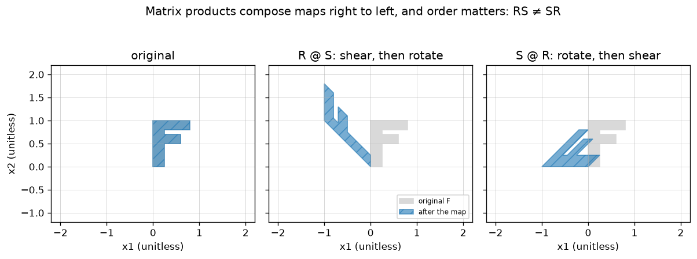

# A2.2 Matrix multiplication, transpose, identity and inverse

**Core** · Part A, week 2 (course week 02) · ~3 h · Lab:
[`labs/A/a2_2_matrix_multiplication_inverse.py`](../../labs/A/a2_2_matrix_multiplication_inverse.py)

## Why it matters

A neural network is a chain of matrix products with non-linear functions in between, and training it
is mostly more matrix products ([C1.2](../C/c1_2_backprop_by_hand.md)). Knowing what a product
*means* (do one map, then another), which rules it obeys (order matters; transposes reverse the
order) and how it costs ($n \cdot d \cdot k$ multiply-adds) lets you read model code, predict memory
and time, and derive gradients without guessing. The inverse matters for the opposite reason: you
need the idea constantly ("undo this map", "solve for $\mathbf{w}$") and you should almost never
compute it. Code that calls `inv()` to solve equations is slower and less accurate than it needs to
be.

## Prerequisite check

- Can you compute $\mathbf{A}\mathbf{x}$ by the row view and by the column view, and say what the
  columns of $\mathbf{A}$ mean? If not, revisit [A2.1](a2_1_matrices_as_linear_maps.md).
- Can you apply the shape rule `(n, d) @ (d, k) → (n, k)` to a chain of three matrices? If not,
  revisit [A2.1](a2_1_matrices_as_linear_maps.md).
- Can you compute the determinant $ad - bc$ of a 2×2 matrix and say what 0 means? If not, revisit
  [A2.1](a2_1_matrices_as_linear_maps.md).
- Can you write a dot product as a Python loop and as `a @ b`? If not, revisit
  [A1.5](a1_5_vectors.md) and [A1.2](a1_2_numpy_arrays.md).

## Intuition

### Multiplying matrices is doing one map after another

In A2.1 a matrix was a map: $\mathbf{x} \mapsto \mathbf{B}\mathbf{x}$. Apply a second map
$\mathbf{A}$ to the result and you get $\mathbf{A}(\mathbf{B}\mathbf{x})$. This combined map is also
linear, so (A2.1) it is described by one matrix, whose columns are where $\mathbf{e}_1, \mathbf{e}_2,
\dots$ end up after both maps. That matrix is the **matrix product** $\mathbf{A}\mathbf{B}$. Read it
**right to left**: $\mathbf{A}\mathbf{B}$ means "first $\mathbf{B}$, then $\mathbf{A}$", just like
function composition `a(b(x))`.

Two consequences you can see without any algebra:

- **Order matters.** Shearing then rotating is not rotating then shearing (key plot). In general
  $\mathbf{A}\mathbf{B} \ne \mathbf{B}\mathbf{A}$; matrix multiplication is not **commutative**.
- **Grouping does not matter.** "Do $\mathbf{C}$, then $\mathbf{B}$, then $\mathbf{A}$" is the same
  sequence however you bracket it: $(\mathbf{A}\mathbf{B})\mathbf{C} = \mathbf{A}(\mathbf{B}\mathbf{C})$.
  This is **associativity**, and it is a performance lever: for a vector $\mathbf{x}$,
  $\mathbf{A}(\mathbf{B}\mathbf{x})$ costs two matrix–vector products, while $(\mathbf{A}\mathbf{B})\mathbf{x}$
  first builds a whole matrix.

### Three ways to compute the product

The lab writes all three, because each one is the right mental model somewhere later:

1. **Dot products (entry view):** entry $(i, j)$ of $\mathbf{A}\mathbf{B}$ is row $i$ of $\mathbf{A}$
   dotted with column $j$ of $\mathbf{B}$. This is how you compute by hand.
2. **Columns (map view):** column $j$ of $\mathbf{A}\mathbf{B}$ is $\mathbf{A}$ applied to column $j$
   of $\mathbf{B}$. This is the composition idea above.
3. **Sum of outer products:** $\mathbf{A}\mathbf{B}$ is the sum over $p$ of (column $p$ of
   $\mathbf{A}$) times (row $p$ of $\mathbf{B}$), each term a full `(n, k)` matrix of rank 1 (A2.3).
   This view returns in the SVD ([A3.2](a3_2_svd.md)) and in LoRA fine-tuning
   ([J1.3](../J/j1_3_lora_qlora.md)), which adds a low-rank product to a weight matrix.

### Transpose, identity and inverse

The **transpose** $\mathbf{A}^\top$ flips a matrix over its diagonal: rows become columns. It is
everywhere in ML code because data has examples in rows (A2.1: `X @ A.T`), and because gradients of
products involve transposes ([A4.2](a4_2_gradients_jacobians.md)).

The **identity matrix** $\mathbf{I}$ is the map that does nothing: ones on the diagonal, zeros
elsewhere. Its columns are $\mathbf{e}_1, \mathbf{e}_2, \dots$, which stay where they are.

The **inverse** $\mathbf{A}^{-1}$ is the map that undoes $\mathbf{A}$: do $\mathbf{A}$, then
$\mathbf{A}^{-1}$, and every point is back where it started, so $\mathbf{A}^{-1}\mathbf{A} = \mathbf{I}$.
It exists only when no information was lost. A projection sends many points to the same place, so
there is no way to know where to send them back; its determinant is 0 and it has no inverse. Such a
matrix is called **singular**. Only square matrices can have inverses: a `(3, 2)` matrix maps the
plane into 3-D space, and a `(2, 3)` one squashes 3-D space onto a plane.

> **Bridge:** composing matrices is like composing middleware or Unix pipes: `cat | sort | uniq` runs
> left to right, and swapping two stages usually changes the output. The inverse is like a database
> migration's `down()`: it exists only if `up()` lost nothing. **Where it breaks:** pipes compose left
> to right, but $\mathbf{A}\mathbf{B}\mathbf{x}$ runs right to left; and unlike most code, a linear map
> is fully reversible exactly when one number, its determinant, is non-zero.

## The math

**Symbols**

| Symbol | Meaning | Shape |
|---|---|---|
| $\mathbf{A}$ | left matrix | `(n, d)` |
| $\mathbf{B}$ | right matrix | `(d, k)` |
| $\mathbf{A}\mathbf{B}$ | their product | `(n, k)` |
| $A_{ip}$ | entry in row $i$, column $p$ | scalar |
| $\mathbf{b}_j$ | column $j$ of $\mathbf{B}$ | `(d,)` |
| $\mathbf{A}^\top$ | transpose of $\mathbf{A}$ | `(d, n)` |
| $\mathbf{I}_d$ | identity matrix | `(d, d)` |
| $\mathbf{M}^{-1}$ | inverse of a square matrix $\mathbf{M}$ | `(d, d)` |

**The product.** For $\mathbf{A}$ `(n, d)` and $\mathbf{B}$ `(d, k)`,

$$(\mathbf{A}\mathbf{B})_{ij} = \sum_{p=1}^{d} A_{ip} B_{pj}, \qquad i = 1..n,\ j = 1..k.$$

That is "row $i$ of $\mathbf{A}$ dotted with column $j$ of $\mathbf{B}$", which explains the shape rule:
the dot product needs row $i$ of $\mathbf{A}$ (length $d$) and column $j$ of $\mathbf{B}$ (length $d$) to
be equally long, and there is one entry per pair $(i, j)$, so the result is `(n, k)`.

**Why this formula is composition.** Column $j$ of $\mathbf{A}\mathbf{B}$ should be where $\mathbf{e}_j$
lands after $\mathbf{B}$ and then $\mathbf{A}$. After $\mathbf{B}$, $\mathbf{e}_j$ is at $\mathbf{b}_j$
(A2.1). After $\mathbf{A}$, it is at $\mathbf{A}\mathbf{b}_j$, whose entry $i$ is, by the row view,
$\sum_p A_{ip}(\mathbf{b}_j)_p = \sum_p A_{ip}B_{pj}$. That is the formula above. So

$$\mathbf{A}\mathbf{B} = \begin{pmatrix}\mathbf{A}\mathbf{b}_1 & \mathbf{A}\mathbf{b}_2 & \cdots & \mathbf{A}\mathbf{b}_k\end{pmatrix}
\quad\text{and}\quad (\mathbf{A}\mathbf{B})\mathbf{x} = \mathbf{A}(\mathbf{B}\mathbf{x}).$$

**Cost.** Each of the $n \cdot k$ entries needs $d$ multiply-adds, so $n\,d\,k$ in total; for two
square `(d, d)` matrices, $d^3$. Doubling $d$ makes the product 8 times as expensive.

**Rules.** For matrices of compatible shapes:

- Not commutative: in general $\mathbf{A}\mathbf{B} \ne \mathbf{B}\mathbf{A}$ (and when $n \ne k$, one of
  the two may not even be defined).
- Associative: $(\mathbf{A}\mathbf{B})\mathbf{C} = \mathbf{A}(\mathbf{B}\mathbf{C})$.
- Distributive: $\mathbf{A}(\mathbf{B} + \mathbf{C}) = \mathbf{A}\mathbf{B} + \mathbf{A}\mathbf{C}$.

**Transpose.** $(\mathbf{A}^\top)_{ij} = A_{ji}$, and the transpose of a product reverses the order:

$$(\mathbf{A}\mathbf{B})^\top = \mathbf{B}^\top\mathbf{A}^\top.$$

Check by shapes first: $(\mathbf{A}\mathbf{B})^\top$ is `(k, n)`, and $\mathbf{B}^\top\mathbf{A}^\top$ is
`(k, d) @ (d, n)` → `(k, n)`, while $\mathbf{A}^\top\mathbf{B}^\top$ would be `(d, n) @ (k, d)`, which
does not even fit. Then by entries: $((\mathbf{A}\mathbf{B})^\top)_{ij} = (\mathbf{A}\mathbf{B})_{ji} =
\sum_p A_{jp}B_{pi} = \sum_p (\mathbf{B}^\top)_{ip}(\mathbf{A}^\top)_{pj} = (\mathbf{B}^\top\mathbf{A}^\top)_{ij}$.
A useful consequence: $\mathbf{X}^\top\mathbf{X}$ `(d, d)` is always **symmetric** (equal to its own
transpose), because $(\mathbf{X}^\top\mathbf{X})^\top = \mathbf{X}^\top(\mathbf{X}^\top)^\top =
\mathbf{X}^\top\mathbf{X}$. You will meet it in A2.4.

**Identity.** $\mathbf{I}_d$ has $(\mathbf{I}_d)_{ij} = 1$ if $i = j$ and 0 otherwise. For $\mathbf{A}$
`(n, d)`: $\mathbf{A}\mathbf{I}_d = \mathbf{A}$ and $\mathbf{I}_n\mathbf{A} = \mathbf{A}$.

**Inverse.** A square $\mathbf{M}$ `(d, d)` is **invertible** if there is a matrix $\mathbf{M}^{-1}$
with

$$\mathbf{M}\mathbf{M}^{-1} = \mathbf{M}^{-1}\mathbf{M} = \mathbf{I}_d.$$

For a 2×2 matrix there is a formula. Swap the diagonal, negate the off-diagonal, divide by the
determinant:

$$\begin{pmatrix}a & b\\ c & d\end{pmatrix}^{-1} = \frac{1}{ad - bc}\begin{pmatrix}d & -b\\ -c & a\end{pmatrix}.$$

You can check it by multiplying: the top-left entry of the product is $(a \cdot d + b \cdot (-c))/(ad -
bc) = 1$, the top-right is $(a(-b) + ba)/(ad - bc) = 0$, and the other two work the same way. The
division also shows why $\det = 0$ means no inverse.

Two more rules, both "reverse the order":

$$(\mathbf{A}\mathbf{B})^{-1} = \mathbf{B}^{-1}\mathbf{A}^{-1}, \qquad (\mathbf{A}^\top)^{-1} = (\mathbf{A}^{-1})^\top.$$

The first is "socks and shoes": you put socks on first and shoes second, so to undo it you take the
shoes off first. Check: $(\mathbf{A}\mathbf{B})(\mathbf{B}^{-1}\mathbf{A}^{-1}) = \mathbf{A}(\mathbf{B}\mathbf{B}^{-1})\mathbf{A}^{-1}
= \mathbf{A}\mathbf{I}\mathbf{A}^{-1} = \mathbf{I}$, using associativity to regroup.

**Gauss–Jordan elimination** inverts any invertible square matrix using three **row operations**: swap
two rows, divide a row by a non-zero number, and subtract a multiple of one row from another. Write
the **augmented matrix** $[\mathbf{M} \mid \mathbf{I}]$, shape `(d, 2d)`, and apply row operations to
the whole thing until the left half becomes $\mathbf{I}$. The right half is then $\mathbf{M}^{-1}$.

Why it works: each row operation is itself multiplication on the left by some invertible matrix
$\mathbf{E}$ (for example, swapping rows 1 and 2 of anything is multiplying by $\mathbf{I}$ with its rows
1 and 2 swapped). Doing operations $\mathbf{E}_1, \dots, \mathbf{E}_s$ that turn the left half into
$\mathbf{I}$ means $\mathbf{E}_s \cdots \mathbf{E}_1\mathbf{M} = \mathbf{I}$, so the product
$\mathbf{E}_s \cdots \mathbf{E}_1$ *is* $\mathbf{M}^{-1}$. The right half started as $\mathbf{I}$ and
received the same operations, so it now holds $\mathbf{E}_s \cdots \mathbf{E}_1\mathbf{I} = \mathbf{M}^{-1}$.
If at some column no row has a non-zero entry to use (a **pivot**), the matrix is singular. Choosing
the row with the largest absolute entry as the pivot, **partial pivoting**, avoids dividing by zero or
by tiny numbers; [A2.3](a2_3_linear_systems_rank.md) shows why the tiny case matters.

**You rarely want the inverse itself.** To solve $\mathbf{M}\mathbf{x} = \mathbf{b}$, the textbook
answer is $\mathbf{x} = \mathbf{M}^{-1}\mathbf{b}$, but computing $\mathbf{M}^{-1}$ and then multiplying
does more work and loses more accuracy than eliminating directly on $[\mathbf{M} \mid \mathbf{b}]$,
which is what `np.linalg.solve` does. [A3.4](a3_4_numerical_stability.md) measures the difference.

## Worked example by hand

Take $\mathbf{A} = \begin{pmatrix}1&2\\3&4\end{pmatrix}$ and $\mathbf{B} = \begin{pmatrix}0&1\\1&0\end{pmatrix}$,
both `(2, 2)`. $\mathbf{B}$ swaps the two coordinates of a vector.

1. **$\mathbf{A}\mathbf{B}$, entry by entry:** $(1 \cdot 0 + 2 \cdot 1,\ 1 \cdot 1 + 2 \cdot 0;\ 3 \cdot 0 +
   4 \cdot 1,\ 3 \cdot 1 + 4 \cdot 0) = \begin{pmatrix}2&1\\4&3\end{pmatrix}$: $\mathbf{A}$ with its *columns*
   swapped. (First swap the input's coordinates, then apply $\mathbf{A}$.)
2. **$\mathbf{B}\mathbf{A}$:** $\begin{pmatrix}3&4\\1&2\end{pmatrix}$: $\mathbf{A}$ with its *rows* swapped. So
   $\mathbf{A}\mathbf{B} \ne \mathbf{B}\mathbf{A}$.
3. **Rectangular shapes.** $\mathbf{C} = \begin{pmatrix}1&0&2\\0&1&-1\end{pmatrix}$ `(2, 3)`,
   $\mathbf{D} = \begin{pmatrix}1&1\\2&0\\0&3\end{pmatrix}$ `(3, 2)`. $\mathbf{C}\mathbf{D}$ is `(2, 2)`: its
   top-left entry is $(1, 0, 2)\cdot(1, 2, 0) = 1$ and its top-right is $(1, 0, 2)\cdot(1, 0, 3) = 7$, giving
   $\begin{pmatrix}1&7\\2&-3\end{pmatrix}$. $\mathbf{D}\mathbf{C}$ is `(3, 3)`, a different size entirely.
4. **Transpose.** $\mathbf{A}^\top = \begin{pmatrix}1&3\\2&4\end{pmatrix}$.
5. **2×2 inverse.** $\det\mathbf{A} = 1 \cdot 4 - 2 \cdot 3 = -2$, so
   $\mathbf{A}^{-1} = \frac{1}{-2}\begin{pmatrix}4&-2\\-3&1\end{pmatrix} = \begin{pmatrix}-2&1\\1.5&-0.5\end{pmatrix}$.
   Check the top row of $\mathbf{A}\mathbf{A}^{-1}$: $(1 \cdot (-2) + 2 \cdot 1.5,\ 1 \cdot 1 + 2 \cdot (-0.5)) = (1, 0)$. ✓
6. **A singular matrix.** $\begin{pmatrix}1&2\\2&4\end{pmatrix}$ has $\det = 4 - 4 = 0$: its second column
   is twice its first, so it squashes the plane onto the line through $(1, 2)$. No inverse.
7. **Gauss–Jordan on a 3×3.** Invert $\mathbf{M} = \begin{pmatrix}0&1&2\\1&1&0\\1&2&1\end{pmatrix}$. Write
   $R_1, R_2, R_3$ for the rows of the augmented matrix. The top-left entry is 0, so you cannot use it
   as a pivot: the largest entry in column 1 is the 1 in $R_2$ (tied with $R_3$; take the first).

   ```
   start [M | I]                 swap R1 and R2                R3 <- R3 - 1*R1
   [0 1 2 | 1 0 0]               [1 1 0 | 0 1 0]               [1 1 0 | 0  1 0]
   [1 1 0 | 0 1 0]               [0 1 2 | 1 0 0]               [0 1 2 | 1  0 0]
   [1 2 1 | 0 0 1]               [1 2 1 | 0 0 1]               [0 1 1 | 0 -1 1]
   ```

   Column 1 is done. Column 2's pivot is the 1 in $R_2$; clear above and below it:

   ```
   R1 <- R1 - 1*R2               R3 <- R3 - 1*R2
   [1 0 -2 | -1  1 0]            [1 0 -2 | -1  1 0]
   [0 1  2 |  1  0 0]            [0 1  2 |  1  0 0]
   [0 1  1 |  0 -1 1]            [0 0 -1 | -1 -1 1]
   ```

   Column 3's pivot is $-1$: divide $R_3$ by $-1$, then clear above it:

   ```
   R3 <- R3 / (-1)               R1 <- R1 + 2*R3               R2 <- R2 - 2*R3
   [1 0 -2 | -1  1  0]           [1 0 0 |  1  3 -2]            [1 0 0 |  1  3 -2]
   [0 1  2 |  1  0  0]           [0 1 2 |  1  0  0]            [0 1 0 | -1 -2  2]
   [0 0  1 |  1  1 -1]           [0 0 1 |  1  1 -1]            [0 0 1 |  1  1 -1]
   ```

   So $\mathbf{M}^{-1} = \begin{pmatrix}1&3&-2\\-1&-2&2\\1&1&-1\end{pmatrix}$. Check one entry of
   $\mathbf{M}\mathbf{M}^{-1}$: row 1 of $\mathbf{M}$, $(0, 1, 2)$, dotted with column 1 of
   $\mathbf{M}^{-1}$, $(1, -1, 1)$, is $0 - 1 + 2 = 1$. ✓ And for $\mathbf{b} = (3, 2, 4)$,
   $\mathbf{x} = \mathbf{M}^{-1}\mathbf{b} = (3 + 6 - 8,\ -3 - 4 + 8,\ 3 + 2 - 4) = (1, 1, 1)$; check:
   $\mathbf{M}(1, 1, 1) = (0 + 1 + 2,\ 1 + 1 + 0,\ 1 + 2 + 1) = (3, 2, 4)$. ✓

## Key plot



$\mathbf{R}$ is the 90° rotation and $\mathbf{S}$ the shear $\begin{pmatrix}1&1\\0&1\end{pmatrix}$ from
A2.1. The same two maps in a different order give two different shapes, so $\mathbf{R}\mathbf{S} \ne
\mathbf{S}\mathbf{R}$. An F is used because it has no symmetry: you can see every turn and slant.

## From scratch in NumPy

The three views of the product, each checked against `@` on random `(12, 8)` and `(8, 5)` matrices:

```python
def matmul_loops(A: FloatArray, B: FloatArray) -> FloatArray:
    """Triple loop: C[i, j] = sum_p A[i, p] B[p, j]. A (n, d), B (d, k) -> (n, k)."""
    n_, d_ = A.shape
    d2, k_ = B.shape
    if d_ != d2:
        raise ValueError(f"inner sizes differ: A is {A.shape}, B is {B.shape}")
    C = np.zeros((n_, k_))
    for i in range(n_):
        for j in range(k_):
            total = 0.0
            for p in range(d_):
                total += A[i, p] * B[p, j]
            C[i, j] = total
    return C


def matmul_outer(A: FloatArray, B: FloatArray) -> FloatArray:
    """Sum of d outer products: (column p of A)(row p of B). A (n, d), B (d, k) -> (n, k)."""
    ...
    C = np.zeros((A.shape[0], B.shape[1]))
    for p in range(A.shape[1]):
        C += np.outer(A[:, p], B[p])  # (n,) outer (k,) -> (n, k), a rank-1 matrix
    return C
```

(`matmul_dots` in the lab is the middle version: one `A[i] @ B[:, j]` per entry.)

```text
== worked example ==
AB = [[2.0, 1.0], [4.0, 3.0]]   (AB)[0, 0] = 1*0 + 2*1 = 2.0
BA = [[3.0, 4.0], [1.0, 2.0]]
AB == BA: False
C (2, 3) @ D (3, 2) = [[1.0, 7.0], [2.0, -3.0]]  shape (2, 2)
D (3, 2) @ C (2, 3) = [[1.0, 1.0, 1.0], [2.0, 0.0, 4.0], [0.0, 3.0, -3.0]]  shape (3, 3)

== from scratch: three ways to multiply ==
matmul_loops  (12, 8) @ (8, 5) -> (12, 5) matches @: OK
matmul_dots   (12, 8) @ (8, 5) -> (12, 5) matches @: OK
matmul_outer  (12, 8) @ (8, 5) -> (12, 5) matches @: OK
worked example, loops: [[2.0, 1.0], [4.0, 3.0]]
shape error caught: inner sizes differ: A is (12, 8), B is (12, 8)

== speed ==
multiplying two 80 x 80 matrices takes 512,000 multiply-adds
~ triple loop: 427.5 ms   @: 0.127 ms   ratio ~3,368x
```

The timing line starts with `~` because it differs on every run and every machine; expect the loop to
be thousands of times slower. `@` hands the work to a compiled, multi-threaded linear-algebra library
(BLAS) that does the same $d^3$ multiply-adds in cache-friendly blocks. The arithmetic is identical;
the overhead is not.

Transpose and identity:

```text
== transpose and identity ==
A.T = [[1.0, 3.0], [2.0, 4.0]]
(XW).T == W.T X.T: OK   shapes (5, 12) == (5, 12)
X.T X is (8, 8) and symmetric: True
I = [[1.0, 0.0], [0.0, 1.0]]   A I == A: True   I A == A: True
```

The 2×2 inverse is the formula from "The math", refusing a determinant of 0. Gauss–Jordan builds
$[\mathbf{M} \mid \mathbf{I}]$, picks the largest entry at or below the diagonal as each pivot, scales
the pivot row so the pivot is 1, and clears the rest of the column:

```python
def gauss_jordan_inverse(M: FloatArray, verbose: bool = False, tol: float = 1e-12) -> FloatArray:
    """Invert a square matrix by row-reducing [M | I] to [I | M^-1], with partial pivoting. (m, m) -> (m, m)."""
    m = M.shape[0]
    ...
    aug = np.hstack([M.astype(float), np.eye(m)])  # (m, 2m): the augmented matrix [M | I]
    for col in range(m):
        pivot_row = col + int(np.argmax(np.abs(aug[col:, col])))  # largest entry at or below
        if abs(aug[pivot_row, col]) < tol:
            raise ValueError(f"column {col + 1} has no usable pivot: the matrix is singular")
        if pivot_row != col:
            aug[[col, pivot_row]] = aug[[pivot_row, col]]  # swap two rows
        pivot = aug[col, col]
        if pivot != 1.0:
            aug[col] = aug[col] / pivot  # make the pivot 1
        for r in range(m):
            if r != col and aug[r, col] != 0.0:
                factor = aug[r, col]
                aug[r] = aug[r] - factor * aug[col]  # clear the rest of the column
    return aug[:, m:]  # the right half is now M^-1
```

The lab prints every step (the eight matrices of the worked example, omitted here) and then:

```text
== 2x2 inverse ==
det(A) = 1*4 - 2*3 = -2.0
A^-1 = [[-2.0, 1.0], [1.5, -0.5]]
A @ A^-1 = [[1.0, 0.0], [0.0, 1.0]]   A^-1 @ A = [[1.0, 0.0], [0.0, 1.0]]
singular [[1, 2], [2, 4]]: det = 0: the matrix squashes the plane onto a line, no inverse

== gauss-jordan on a 3x3 ==
...
A3^-1 = [[1.0, 3.0, -2.0], [-1.0, -2.0, 2.0], [1.0, 1.0, -1.0]]
A3 @ A3^-1 = [[1.0, 0.0, 0.0], [0.0, 1.0, 0.0], [0.0, 0.0, 1.0]]
A3 @ A3^-1 == I: OK
```

## With NumPy

`np.linalg.inv` computes the inverse (with a more careful algorithm than ours, [A3.4](a3_4_numerical_stability.md));
`np.linalg.solve(M, b)` solves $\mathbf{M}\mathbf{x} = \mathbf{b}$ without forming $\mathbf{M}^{-1}$. Both
raise `LinAlgError` on an exactly singular matrix:

```text
== with numpy ==
gauss_jordan_inverse and inverse_2x2 match np.linalg.inv: OK
random 50 x 50: matches np.linalg.inv: OK
np.linalg.inv on the singular matrix raises LinAlgError: Singular matrix
x = A3^-1 b = [1.0, 1.0, 1.0]   np.linalg.solve(A3, b) = [1.0, 1.0, 1.0]
(AB)^-1 == B^-1 A^-1: OK

== composition order ==
R @ S (shear, then rotate) = [[0.0, -1.0], [1.0, 1.0]]
S @ R (rotate, then shear) = [[1.0, -1.0], [1.0, 0.0]]
(R @ S) @ x = [-2.0, 3.0]  == R @ (S @ x) = [-2.0, 3.0]
```

The last line is associativity, and it matches A2.1's "shear then rotate" result for
$\mathbf{x} = (1, 2)$.

## In practice

- **When to use it:** read every `@` in model code as "apply this map", and check the order:
  `X @ W1 @ W2` applies `W1` first. Precompute a fixed product (for example two consecutive linear
  layers with nothing in between collapse into one matrix `W1 @ W2`) when it saves work at serving
  time. Use the inverse as a *concept*; in code, call `np.linalg.solve` (or `torch.linalg.solve`).
- **Failure modes:**
  - *Swapped order:* `B @ A` where you meant `A @ B` runs fine for square matrices and gives a different
    map. You notice wrong outputs on a hand-checked example; name matrices by what they map (`W_in_hidden`)
    and test against a tiny case.
  - *Accidental huge intermediate:* `(X @ X.T) @ v` for `X` `(n, d)` builds an `(n, n)` matrix: with
    $n = 100{,}000$ rows that is $10^{10}$ entries, 80 GB of float64. `X @ (X.T @ v)` gives the same
    answer with tiny intermediates. You notice a memory error or a very slow line; bracket for the
    smallest intermediate.
  - *`inv()` to solve a system:* slower and less accurate, and catastrophically so when the matrix is
    close to singular ([A3.4](a3_4_numerical_stability.md)). You notice large residuals
    `M @ x - b`; use `solve`.
  - *Elementwise vs matrix product:* `A * B` multiplies entry by entry (and broadcasts), `A @ B` is the
    matrix product. Both run on square matrices. You notice wrong values, not errors; grep for `*` on
    2-D arrays when debugging.
- **Defaults that work:** `@` for products, `np.linalg.solve` for systems, `np.eye(d)` for identities,
  `X.T @ X` for Gram matrices (A2.4). Compare matrices with `np.testing.assert_allclose`, never `==`.
  Expect $O(d^3)$ for products and inversion of `(d, d)` matrices; a 1,000 × 1,000 product is about
  $10^9$ multiply-adds, milliseconds with BLAS on a laptop.

## Exercises

Save your work to `my-work/A/a2_2_matrix_multiplication_inverse.md` (or `.py`) and ask for a review.

1. **By hand:** Let $\mathbf{P} = \begin{pmatrix}1&2&0\\0&1&1\end{pmatrix}$ `(2, 3)` and
   $\mathbf{Q} = \begin{pmatrix}2&1\\0&1\\1&0\end{pmatrix}$ `(3, 2)`. (a) Compute $\mathbf{P}\mathbf{Q}$ and
   $\mathbf{Q}\mathbf{P}$ and give their shapes. (b) Compute $\mathbf{Q}^\top\mathbf{P}^\top$ and check that
   it equals $(\mathbf{P}\mathbf{Q})^\top$. (c) Invert $\mathbf{P}\mathbf{Q}$ with the 2×2 formula and check
   your answer by multiplying. (d) Explain, without computing a determinant, why $\mathbf{Q}\mathbf{P}$
   cannot be invertible. (Hint: what is the largest number of independent directions that can come
   out of $\mathbf{P}$?)
2. **Code:** Write `matpow(M: FloatArray, k: int) -> FloatArray` that computes $\mathbf{M}^k$ for a
   square matrix and $k \ge 0$ using **repeated squaring** ($\mathbf{M}^8 = ((\mathbf{M}^2)^2)^2$) and
   your own `matmul_loops`, copied from the lab, for every product. Count the matrix products it uses
   and compare with the naive $k - 1$. Check against `np.linalg.matrix_power` for several $k$. Then use
   it on $\mathbf{F} = \begin{pmatrix}1&1\\1&0\end{pmatrix}$ to compute the 30th Fibonacci number
   (explain why the top-right entry of $\mathbf{F}^k$ is a Fibonacci number), and say what goes wrong
   for $k = 100$ with `float64`.
3. **Think:** A feature pipeline first converts three sensor readings to different units (multiply
   each feature by its own constant: a diagonal matrix $\mathbf{S}$) and then applies a fixed
   `(3, 3)` mixing matrix $\mathbf{W}$ learned offline, so each row becomes $\mathbf{W}\mathbf{S}\mathbf{x}$.
   A teammate wants to swap the order to $\mathbf{S}\mathbf{W}\mathbf{x}$ "because it is the same
   multiplications". When is that safe and when is it not? How would you precompute the pipeline for
   serving, and what test would you write before merging the change?

## Takeaways

1. $\mathbf{A}\mathbf{B}$ is "do $\mathbf{B}$, then $\mathbf{A}$"; entry $(i, j)$ is row $i$ of
   $\mathbf{A}$ dotted with column $j$ of $\mathbf{B}$, and column $j$ is $\mathbf{A}\mathbf{b}_j$.
2. Order matters ($\mathbf{A}\mathbf{B} \ne \mathbf{B}\mathbf{A}$), grouping does not
   ($(\mathbf{A}\mathbf{B})\mathbf{C} = \mathbf{A}(\mathbf{B}\mathbf{C})$), and bracketing changes the cost.
3. A product of `(n, d)` and `(d, k)` costs $n\,d\,k$ multiply-adds; `@` is thousands of times faster
   than a Python loop doing the same arithmetic.
4. Transposes and inverses of products reverse the order: $(\mathbf{A}\mathbf{B})^\top = \mathbf{B}^\top\mathbf{A}^\top$,
   $(\mathbf{A}\mathbf{B})^{-1} = \mathbf{B}^{-1}\mathbf{A}^{-1}$; $\mathbf{X}^\top\mathbf{X}$ is symmetric.
5. A square matrix has an inverse only if it loses no information (det ≠ 0). Gauss–Jordan finds it by
   row operations; in code, solve systems with `solve`, not `inv`.

**What builds on this:** [A2.3](a2_3_linear_systems_rank.md) (elimination to solve systems, and rank);
[A2.4](a2_4_projections_least_squares.md) ($\mathbf{X}^\top\mathbf{X}$ and the normal equations);
[A3.2](a3_2_svd.md) (a matrix as a sum of rank-1 outer products); [A3.4](a3_4_numerical_stability.md)
(why `solve` beats `inv`); [C1.2](../C/c1_2_backprop_by_hand.md) (backpropagation is products of
transposed matrices); [J1.3](../J/j1_3_lora_qlora.md) (LoRA's low-rank product).
