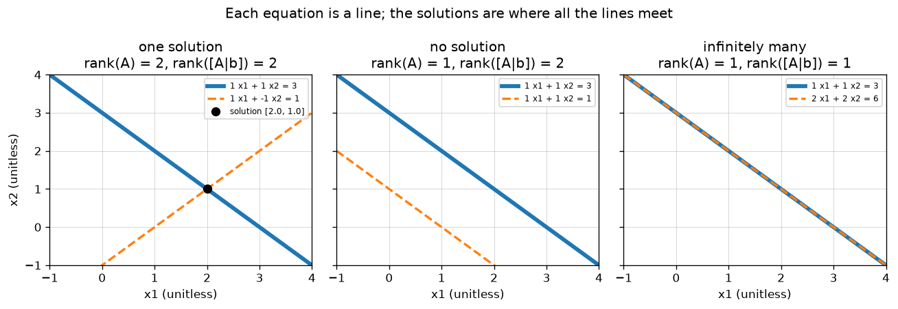

# A2.3 Systems of linear equations and rank

**Core** · Part A, week 2 (course week 02) · ~2.5 h · Lab:
[`labs/A/a2_3_linear_systems_rank.py`](../../labs/A/a2_3_linear_systems_rank.py)

## Why it matters

Fitting a linear model means finding weights $\mathbf{w}$ with $\mathbf{X}\mathbf{w} \approx \mathbf{y}$:
a system of linear equations, one per training example. Whether that system has one answer, none or
infinitely many decides whether your model is well defined. The tool that tells you is **rank**. Rank
explains why a one-hot encoding plus an intercept breaks plain linear regression
([B1.3](../B/b1_3_feature_engineering.md)), why duplicated or derived features make coefficients
meaningless, and why `np.linalg.solve` sometimes raises `LinAlgError: Singular matrix` on data that
looked fine. The algorithm in this lesson, Gaussian elimination, is also what runs inside every
`solve` call you will make.

## Prerequisite check

- Can you multiply a matrix by a vector with the column view, $\mathbf{A}\mathbf{x} = x_1\mathbf{a}_1 + \dots + x_d\mathbf{a}_d$?
  If not, revisit [A2.1](a2_1_matrices_as_linear_maps.md).
- Do you know the three row operations (swap, scale, subtract a multiple of another row) and why they
  do not change the answer? If not, revisit the Gauss–Jordan section of
  [A2.2](a2_2_matrix_multiplication_inverse.md).
- Can you say why a 2×2 matrix with determinant 0 has no inverse? If not, revisit
  [A2.1](a2_1_matrices_as_linear_maps.md) and [A2.2](a2_2_matrix_multiplication_inverse.md).
- Can you write a nested loop over the rows of a NumPy array and use `np.argmax`? If not, revisit
  [A1.2](a1_2_numpy_arrays.md).

## Intuition

### Two pictures of the same question

A **system of linear equations** such as

$$x_1 + x_2 = 3, \qquad x_1 - x_2 = 1$$

can be read two ways.

- **Row picture:** each equation is a line in the plane (a plane in 3-D, a "hyperplane" beyond). The
  solutions are the points on *all* of them at once. Two lines in the plane either cross once, are
  parallel and never meet, or are the same line and meet everywhere. The key plot shows all three.
- **Column picture:** written as $\mathbf{A}\mathbf{x} = \mathbf{b}$, the question is "which mix of the
  columns of $\mathbf{A}$ produces $\mathbf{b}$?" Here $x_1(1, 1) + x_2(1, -1) = (3, 1)$, answered by
  $x_1 = 2, x_2 = 1$. The set of everything the columns can produce is the **column space** of
  $\mathbf{A}$: exactly the outputs the map $\mathbf{A}$ can reach (A2.1). A solution exists if and only
  if $\mathbf{b}$ is in it.

### Rank: how many genuinely different directions

The columns $(1, 2)$ and $(2, 4)$ point the same way; together they reach only one line, however you
mix them. The columns $(1, 1)$ and $(1, -1)$ reach the whole plane. The **rank** of a matrix is the
number of genuinely different directions among its columns: the dimension of its column space. A
column that is a mix of the others adds nothing new; it is **linearly dependent** on them. A set of
columns where none is a mix of the others is **linearly independent**.

Now the three cases read off directly, for $\mathbf{A}$ with $d$ columns (unknowns):

- **No solution** when $\mathbf{b}$ points somewhere the columns cannot reach. Appending $\mathbf{b}$
  as an extra column then adds a new direction: $\operatorname{rank}([\mathbf{A} \mid \mathbf{b}]) > \operatorname{rank}(\mathbf{A})$.
- **Exactly one solution** when $\mathbf{b}$ is reachable and the columns are independent:
  $\operatorname{rank}(\mathbf{A}) = d$. There is only one way to mix independent directions to get a
  given point.
- **Infinitely many** when $\mathbf{b}$ is reachable but the columns are dependent:
  $\operatorname{rank}(\mathbf{A}) < d$. Some mix of the columns gives $\mathbf{0}$, and you can add any
  multiple of that mix to a solution without changing $\mathbf{A}\mathbf{x}$.

### Gaussian elimination: how a computer decides

**Gaussian elimination** solves the system by row operations, which never change the set of solutions
(swapping two equations, scaling one, or subtracting a multiple of one from another keeps every true
statement true). It clears the entries below the diagonal column by column until the system is
triangular; then the last equation has one unknown, the one above it two, and so on, and **back
substitution** solves them from the bottom up. Along the way, a row that turns into all zeros tells
you a direction was redundant (rank < number of rows), and a row that reads $0 = $ something non-zero
tells you the system is contradictory.

> **Bridge:** a dependent column is a denormalized column in a table: `total_price` stored next to
> `unit_price` and `quantity`, or `price_eur` next to `price_usd`. It carries no new information, and
> rank counts the columns that do. **Where it breaks:** only *linear* derivations count. `price_usd²`
> or `log(price_usd)` is a new direction to linear algebra even though a human sees it as derived. And
> real data is rarely *exactly* dependent: two noisy columns that are almost the same have full rank
> on paper but behave as if dependent in floating point ([A3.4](a3_4_numerical_stability.md)).

## The math

**Symbols**

| Symbol | Meaning | Shape |
|---|---|---|
| $\mathbf{A}$ | coefficient matrix: one row per equation, one column per unknown | `(m, d)` |
| $\mathbf{x}$ | the unknowns | `(d,)` |
| $\mathbf{b}$ | right-hand side | `(m,)` |
| $[\mathbf{A} \mid \mathbf{b}]$ | augmented matrix, $\mathbf{b}$ appended as a last column | `(m, d + 1)` |
| $\mathbf{a}_j$ | column $j$ of $\mathbf{A}$ | `(m,)` |
| $\mathbf{U}$ | upper-triangular matrix (zeros below the diagonal) | `(d, d)` |
| $\operatorname{rank}(\mathbf{A})$ | number of independent columns (= independent rows) | int |
| $\mathbf{x}_p$, $\mathbf{n}$ | a particular solution and a null-space vector | `(d,)` |

**The system.** $m$ equations in $d$ unknowns:

$$\mathbf{A}\mathbf{x} = \mathbf{b} \iff \sum_{j=1}^{d} A_{ij}x_j = b_i \text{ for } i = 1..m \iff x_1\mathbf{a}_1 + \dots + x_d\mathbf{a}_d = \mathbf{b}.$$

**Linear independence.** Columns $\mathbf{a}_1, \dots, \mathbf{a}_d$ are independent if the only way to
get $x_1\mathbf{a}_1 + \dots + x_d\mathbf{a}_d = \mathbf{0}$ is $x_1 = \dots = x_d = 0$. Otherwise some
non-zero $\mathbf{x}$ gives $\mathbf{0}$, and that equation can be rearranged to write one column as a
mix of the others.

**Rank.** $\operatorname{rank}(\mathbf{A})$ is the largest number of independent columns. It is also
the largest number of independent rows (a fact worth knowing, not proving here), so
$\operatorname{rank}(\mathbf{A}) \le \min(m, d)$. A matrix with $\operatorname{rank} = \min(m, d)$ has
**full rank**. A square matrix is invertible exactly when it has full rank (A2.2's "loses no
information").

**Null space and the shape of the solution set.** The **null space** of $\mathbf{A}$ is the set of all
$\mathbf{n}$ with $\mathbf{A}\mathbf{n} = \mathbf{0}$. If $\mathbf{x}_p$ is any one solution, then every
solution is $\mathbf{x}_p + \mathbf{n}$ for some $\mathbf{n}$ in the null space, because
$\mathbf{A}(\mathbf{x}_p + \mathbf{n}) = \mathbf{b} + \mathbf{0} = \mathbf{b}$. The rank–nullity rule
counts the directions: the null space has dimension $d - \operatorname{rank}(\mathbf{A})$, the number of
**free variables** you can choose at will.

**The decision rule** (the Rouché–Capelli theorem, in practical form):

| Condition | Solutions |
|---|---|
| $\operatorname{rank}([\mathbf{A} \mid \mathbf{b}]) > \operatorname{rank}(\mathbf{A})$ | none |
| $\operatorname{rank}([\mathbf{A} \mid \mathbf{b}]) = \operatorname{rank}(\mathbf{A}) = d$ | exactly one |
| $\operatorname{rank}([\mathbf{A} \mid \mathbf{b}]) = \operatorname{rank}(\mathbf{A}) < d$ | infinitely many, with $d - \operatorname{rank}(\mathbf{A})$ free variables |

Appending a column can raise the rank by at most 1, so the first row is "$\mathbf{b}$ added a new
direction", i.e. $\mathbf{b}$ is not in the column space.

**Gaussian elimination with partial pivoting.** Work on $[\mathbf{A} \mid \mathbf{b}]$. For each column,
from left to right, with the current row starting at the top:

1. **Pivot:** among the current row and the rows below it, pick the one whose entry in this column has
   the largest absolute value, and swap it up. If all those entries are (numerically) zero, this column
   has no pivot: move to the next column and keep the current row.
2. **Eliminate:** for each row $r$ below, subtract $\ell_r = A_{r,\text{col}} / A_{\text{row},\text{col}}$
   times the pivot row, which puts a 0 under the pivot.
3. Move down one row.

The result is in **row echelon form**: a staircase where each row's first non-zero entry (its pivot)
is to the right of the row above's. The number of pivots is the rank. For a square system with $d$
pivots, the left part is an upper-triangular $\mathbf{U}$ with non-zero diagonal, and back substitution
gives, from $i = d$ down to $1$,

$$x_i = \frac{c_i - \sum_{j > i} U_{ij}x_j}{U_{ii}},$$

where $\mathbf{c}$ is the transformed right-hand side. Elimination costs about $\tfrac{2}{3}d^3$
operations for a `(d, d)` system, back substitution only about $d^2$.

**Why pivot.** Without pivoting, a zero on the diagonal stops the algorithm, and a *tiny* one is
worse: dividing by it creates huge multipliers $\ell_r$, and the rounding of floating-point numbers
(about 16 significant digits for `float64`) wipes out the information in the other rows. Picking the
largest available pivot keeps every $\lvert\ell_r\rvert \le 1$. The worked example shows the damage
with numbers.

## Worked example by hand

**One solution.** Solve $x_1 + x_2 + x_3 = 6$, $2x_2 + 5x_3 = -4$, $2x_1 + 5x_2 - x_3 = 27$, i.e.
$\mathbf{A}_u = \begin{pmatrix}1&1&1\\0&2&5\\2&5&-1\end{pmatrix}$ `(3, 3)`, $\mathbf{b}_u = (6, -4, 27)$.

1. Column 1: the entries are $1, 0, 2$; the largest is the 2 in $R_3$, so swap $R_1$ and $R_3$:

   ```
   [2 5 -1 | 27]
   [0 2  5 | -4]
   [1 1  1 |  6]
   ```

2. Clear column 1 under the pivot: $R_2$ already has 0. $R_3 \leftarrow R_3 - \tfrac{1}{2}R_1$:
   $(1 - 1,\ 1 - 2.5,\ 1 + 0.5 \mid 6 - 13.5) = (0, -1.5, 1.5 \mid -7.5)$.
3. Column 2, from row 2 down: the entries are $2$ and $-1.5$; $\lvert 2\rvert$ is larger, so no swap.
   $R_3 \leftarrow R_3 - \tfrac{-1.5}{2}R_2 = R_3 + 0.75R_2$:
   $(0,\ -1.5 + 1.5,\ 1.5 + 3.75 \mid -7.5 - 3) = (0, 0, 5.25 \mid -10.5)$.

   ```
   [2 5   -1 |  27  ]
   [0 2    5 |  -4  ]
   [0 0 5.25 | -10.5]
   ```

4. Three pivots, so rank 3 = $d$: exactly one solution. Back substitution:
   $x_3 = -10.5/5.25 = -2$; $x_2 = (-4 - 5 \cdot (-2))/2 = 6/2 = 3$;
   $x_1 = (27 - 5 \cdot 3 - (-1)(-2))/2 = (27 - 15 - 2)/2 = 5$.
5. Check in the *original* equations: $5 + 3 - 2 = 6$ ✓, $6 - 10 = -4$ ✓, $10 + 15 + 2 = 27$ ✓.

**No solution, and infinitely many.** Take $\mathbf{A}_s = \begin{pmatrix}1&1&1\\1&2&3\\2&3&4\end{pmatrix}$.
Its third row is the sum of the first two. Eliminate without pivoting to keep the numbers small:
$R_2 \leftarrow R_2 - R_1$ gives $(0, 1, 2)$; $R_3 \leftarrow R_3 - 2R_1$ gives $(0, 1, 2)$;
$R_3 \leftarrow R_3 - R_2$ gives $(0, 0, 0)$. Two pivots: $\operatorname{rank}(\mathbf{A}_s) = 2$.

- With $\mathbf{b}_\text{none} = (6, 14, 21)$ the right-hand side goes $14 - 6 = 8$, $21 - 12 = 9$,
  $9 - 8 = 1$, so the last row reads $0x_1 + 0x_2 + 0x_3 = 1$. Impossible: no solution, and
  $\operatorname{rank}([\mathbf{A}_s \mid \mathbf{b}]) = 3 > 2$. In words: equation 3 says the sum of
  equations 1 and 2 equals 21, but they add up to 20.
- With $\mathbf{b}_\text{inf} = (6, 14, 20)$ the last row reads $0 = 0$: one equation was redundant.
  The other two are $x_1 + x_2 + x_3 = 6$ and $x_2 + 2x_3 = 8$. Choose the free variable $x_3 = t$:
  then $x_2 = 8 - 2t$ and $x_1 = 6 - x_2 - x_3 = -2 + t$. Every solution is

  $$\mathbf{x} = (-2, 8, 0) + t\,(1, -2, 1), \qquad t \text{ any number},$$

  a particular solution plus the null-space direction $(1, -2, 1)$. Check the direction:
  $\mathbf{A}_s(1, -2, 1) = (1 - 2 + 1,\ 1 - 4 + 3,\ 2 - 6 + 4) = (0, 0, 0)$ ✓. $t = 0, 1, 2$ give
  $(-2, 8, 0)$, $(-1, 6, 1)$, $(0, 4, 2)$; the lab checks all three. Rank–nullity: $3 - 2 = 1$ free
  variable.

**Why pivot, with numbers.** Solve $10^{-20}x_1 + x_2 = 1$, $x_1 + x_2 = 2$. The true answer is
$x_1 = 1/(1 - 10^{-20}) \approx 1$ and $x_2 \approx 1$.

- *Without pivoting:* $\ell = 1/10^{-20} = 10^{20}$, and $R_2 \leftarrow R_2 - 10^{20}R_1$ gives
  $(1 - 10^{20})x_2 = 2 - 10^{20}$. In `float64` both $1 - 10^{20}$ and $2 - 10^{20}$ round to exactly
  $-10^{20}$ (the 1 and the 2 are below the 16th significant digit), so $x_2 = 1$. Then
  $x_1 = (1 - x_2)/10^{-20} = 0/10^{-20} = 0$. Completely wrong.
- *With pivoting:* swap first, so the pivot is 1 and $\ell = 10^{-20}$: $(1 - 10^{-20})x_2 = 1 - 2 \cdot 10^{-20}$
  rounds to $x_2 = 1$, and $x_1 = 2 - x_2 = 1$. Correct.

## Key plot



The row picture of $\operatorname{rank}$: when the rows are independent the lines cross once
(rank 2, one solution). When they are dependent, the lines are parallel; whether they coincide
(infinitely many solutions) or not (none) depends on $\mathbf{b}$, which is exactly what comparing
$\operatorname{rank}(\mathbf{A})$ with $\operatorname{rank}([\mathbf{A} \mid \mathbf{b}])$ detects.

## From scratch in NumPy

`row_echelon` is the elimination loop described in "The math", returning the reduced matrix and the
pivot columns; `back_substitute` solves the triangular system from the bottom up:

```python
def row_echelon(aug: FloatArray, verbose: bool = False, tol: float = 1e-10) -> tuple[FloatArray, list[int]]:
    """Reduce a matrix to row echelon form with partial pivoting. (m, c) -> ((m, c), pivot columns)."""
    R = aug.astype(float).copy()
    m, c = R.shape
    pivots: list[int] = []
    row = 0
    for col in range(c):
        if row == m:
            break
        best = row + int(np.argmax(np.abs(R[row:, col])))
        if abs(R[best, col]) < tol:
            continue  # no pivot in this column: it is a free column
        if best != row:
            R[[row, best]] = R[[best, row]]
        for r in range(row + 1, m):
            factor = R[r, col] / R[row, col]
            if factor != 0.0:
                R[r] -= factor * R[row]
                R[r, col] = 0.0  # exactly zero, not 1e-17
        pivots.append(col)
        row += 1
    return R, pivots


def back_substitute(U: FloatArray, c: FloatArray) -> FloatArray:
    """Solve U x = c for upper-triangular U (d, d) with non-zero diagonal, from the last row up. -> (d,)."""
    d = U.shape[0]
    x = np.zeros(d)
    for i in range(d - 1, -1, -1):
        x[i] = (c[i] - U[i, i + 1 :] @ x[i + 1 :]) / U[i, i]
    return x
```

The `tol` argument matters: after floating-point arithmetic a "zero" is often `1e-17`, and treating it
as a pivot would claim a direction that is not really there. On top of these, `rank(A)` counts the
pivots, `solve(A, b)` refuses a matrix with fewer than $d$ pivots, and `classify(A, b)` applies the
decision rule. The lab prints every elimination step of the worked example (they match the matrices
above) and then:

```text
pivot columns: [0, 1, 2]   back substitution: x = [5.0, 3.0, -2.0]
check A_u @ x = [6.0, -4.0, 27.0] == b_u: True

== from scratch: rank and classification ==
unique   rank(A) = 3, rank([A|b]) = 3, d = 3: exactly one solution
infinite rank(A) = 2, rank([A|b]) = 2, d = 3: infinitely many solutions (1 free variable)
none     rank(A) = 2, rank([A|b]) = 3, d = 3: no solution (b is not reachable)
elimination of [A_s | b_none]:
    [      2       3       4 |      21 ]
    [      0     0.5       1 |     3.5 ]
    [      0       0       0 |      -1 ]
last row says 0 x1 + 0 x2 + 0 x3 = -1: impossible
elimination of [A_s | b_inf]:
    [      2       3       4 |      20 ]
    [      0     0.5       1 |       4 ]
    [      0       0       0 |       0 ]
last row says 0 = 0: one equation was redundant
  candidate [-2.0, 8.0, 0.0]  A_s @ x = [6.0, 14.0, 20.0]  solves it: True
  candidate [-1.0, 6.0, 1.0]  A_s @ x = [6.0, 14.0, 20.0]  solves it: True
  candidate [0.0, 4.0, 2.0]  A_s @ x = [6.0, 14.0, 20.0]  solves it: True
solve(A_s, b_inf): A is singular (rank 2 < 3): no unique solution

== why pivot ==
without pivoting x = [0.0, 1.0]
with pivoting    x = [1.0, 1.0]
np.linalg.solve  x = [1.0, 1.0]
```

With pivoting, the code swapped the row $(2, 3, 4)$ to the top, so its echelon form differs from the
hand version (and the contradiction reads $0 = -1$ instead of $0 = 1$). Different row operations, same
conclusion: the rank and the solution set do not depend on which valid operations you choose.

## With NumPy

`np.linalg.solve` runs the same elimination in compiled LAPACK code. LAPACK calls it an **LU
factorization** with partial pivoting: it stores the result of elimination as an upper-triangular
$\mathbf{U}$ (our echelon form) plus a lower-triangular $\mathbf{L}$ holding the multipliers
$\ell_r$, so the same work can be reused for a new right-hand side. `np.linalg.matrix_rank` counts rank differently, from the singular values of
[A3.2](a3_2_svd.md), with a tolerance scaled to the matrix; on these examples both methods agree. For a
system that is singular or has no exact solution, `np.linalg.lstsq` still returns an answer, the
least-squares one that [A2.4](a2_4_projections_least_squares.md) derives:

```text
== with numpy ==
solve matches np.linalg.solve on the worked example and 50 random 20x20 systems: OK
rank A_u                mine 3   np.linalg.matrix_rank 3
rank A_s                mine 2   np.linalg.matrix_rank 2
rank [A_s | b_none]     mine 3   np.linalg.matrix_rank 3
rank low-rank (50, 10)  mine 4   np.linalg.matrix_rank 4
rank random (50, 10)    mine 10   np.linalg.matrix_rank 10
np.linalg.solve(A_s, b_inf) raises LinAlgError: Singular matrix (even though solutions exist)
np.linalg.lstsq(A_s, b_inf): x = [1.0, 2.0, 3.0]  rank 2  A_s @ x = [6.0, 14.0, 20.0]
np.linalg.lstsq(A_s, b_none): x = [1.2778, 2.1111, 2.9444]  A_s @ x = [6.3333, 14.3333, 20.6667] (closest reachable b, see A2.4)
```

Three things to notice. `solve` refuses a singular system even when it has solutions: it only
answers "the unique solution". `lstsq` on the consistent singular system picks $(1, 2, 3)$, which is
$t = 3$ on the solution line above: of all the solutions, it returns the one with the smallest length.
And on the contradictory system it returns the $\mathbf{x}$ whose $\mathbf{A}\mathbf{x}$ is as close as
possible to $\mathbf{b}$, which is the whole idea of fitting a model. The "low-rank (50, 10)" matrix was
built as `(50, 4) @ (4, 10)`, so its rank cannot exceed 4: a product's rank is at most the smallest
inner size.

## In practice

- **When to use it:** call `np.linalg.solve` for square systems you expect to be well behaved; check
  `np.linalg.matrix_rank(X)` against `X.shape[1]` when a model's coefficients look unstable; use
  `np.linalg.lstsq` (or a regularized model, [B2.2](../B/b2_2_regularization.md)) when the system is
  rectangular or rank deficient.
- **Failure modes:**
  - *Rank-deficient features:* a column that is an exact linear mix of others (one-hot columns for
    every category plus an intercept; `total = a + b` stored next to `a` and `b`). `solve` on
    $\mathbf{X}^\top\mathbf{X}$ raises `LinAlgError`, or worse returns huge, unstable coefficients if
    rounding hides the exact dependence. You notice `matrix_rank(X) < X.shape[1]`; drop a redundant
    column or regularize.
  - *Treating a near-zero as non-zero:* elimination without a tolerance "finds" a pivot of `1e-17` and
    reports full rank. You notice ranks that change when you rescale the data; always compare against
    a tolerance relative to the matrix's size ([A3.4](a3_4_numerical_stability.md)).
  - *No pivoting:* tiny pivots destroy accuracy, as the worked example shows. You notice residuals
    $\lVert\mathbf{A}\mathbf{x} - \mathbf{b}\rVert$ far above rounding level; never hand-roll elimination
    without pivoting in real code (or at all: use the library).
  - *More unknowns than equations* ($d > m$, e.g. more features than rows): rank is at most $m < d$,
    so there are infinitely many exact fits. You notice a perfect training fit that does not
    generalize; this is the extreme of overfitting ([B4.5](../B/b4_5_bias_variance.md)) and why such
    models need regularization.
- **Defaults that work:** `np.linalg.solve(A, b)` for square full-rank systems; check residuals with
  `np.allclose(A @ x, b)`; `np.linalg.matrix_rank` with its default tolerance; `lstsq(..., rcond=None)`
  for everything else. scikit-learn's `LinearRegression` uses a least-squares solver that tolerates
  rank deficiency (VERIFY (as of 2026-10) for the pinned version's docs), but a tolerated problem is
  still a problem: the coefficients of dependent columns are not individually meaningful.

## Exercises

Save your work to `my-work/A/a2_3_linear_systems_rank.md` (or `.py`) and ask for a review.

1. **By hand:** (a) Solve $2x_1 + x_2 - x_3 = 8$, $-3x_1 - x_2 + 2x_3 = -11$, $-2x_1 + x_2 + 2x_3 = -3$
   by Gaussian elimination *with* partial pivoting, showing each augmented matrix, then back-substitute
   and check your answer in the original equations. (b) Find the rank of
   $\mathbf{M} = \begin{pmatrix}1&2&3\\2&4&6\\1&0&1\end{pmatrix}$ by elimination. For each right-hand side
   $\mathbf{b} = (1, 2, 0)$ and $\mathbf{b} = (1, 3, 0)$, decide whether $\mathbf{M}\mathbf{x} = \mathbf{b}$
   has no, one or infinitely many solutions, and if infinitely many, write all of them as
   $\mathbf{x}_p + t\,\mathbf{n}$.
2. **Code:** Write `solve_general(A: FloatArray, b: FloatArray) -> tuple[FloatArray, FloatArray] | None`
   that returns `None` when $\mathbf{A}\mathbf{x} = \mathbf{b}$ has no solution, and otherwise a
   particular solution `x_p` `(d,)` and a matrix `N` `(d, d - rank)` whose columns span the null space.
   Reduce all the way to **reduced row echelon form** (each pivot 1, zeros above and below it), set the
   free variables to 0 for `x_p`, and to each unit vector in turn for the columns of `N`. Test on
   $\mathbf{A}_s$ with both right-hand sides from the lesson, on a random `(4, 6)` matrix, and on a
   `(6, 4)` matrix of rank 2. For each, assert that $\mathbf{A}(\mathbf{x}_p + \mathbf{N}\mathbf{t}) \approx \mathbf{b}$
   for random $\mathbf{t}$, and that `N.shape[1]` equals `scipy.linalg.null_space(A).shape[1]`.
3. **Think:** You fit a linear model to predict delivery time from features that include a categorical
   `city` with 5 values, one-hot encoded into 5 columns, plus an intercept column of ones. Explain
   with rank what is wrong with this design matrix, what `np.linalg.solve(X.T @ X, X.T @ y)` will do,
   and what `LinearRegression` will do. Then give two different fixes and say what the coefficients
   mean under each.

## Takeaways

1. $\mathbf{A}\mathbf{x} = \mathbf{b}$ asks which mix of $\mathbf{A}$'s columns makes $\mathbf{b}$; a
   solution exists exactly when $\mathbf{b}$ is in the column space.
2. Rank is the number of independent columns (= independent rows); a column that is a linear mix of
   others adds nothing.
3. Compare $\operatorname{rank}(\mathbf{A})$, $\operatorname{rank}([\mathbf{A} \mid \mathbf{b}])$ and $d$:
   no solution if $\mathbf{b}$ raises the rank, one if the rank equals $d$, otherwise infinitely many,
   with $d - \operatorname{rank}$ free variables.
4. All solutions are one particular solution plus anything in the null space.
5. Gaussian elimination with partial pivoting is how computers solve systems; pivoting is essential in
   floating point, and `np.linalg.solve` does it for you.

**What builds on this:** [A2.4](a2_4_projections_least_squares.md) (the best answer when there is no
exact one); [A3.2](a3_2_svd.md) (rank from singular values); [A3.4](a3_4_numerical_stability.md)
(near-dependence and conditioning); [B1.3](../B/b1_3_feature_engineering.md) (one-hot encoding and the
dropped column); [B1.5](../B/b1_5_linear_regression.md) and [B2.2](../B/b2_2_regularization.md)
(regression with dependent features).
