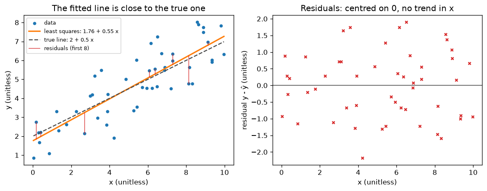

# A2.4 Projections and least squares

**Core** · Part A, week 2 (course week 02) · ~2.5 h · Lab:
[`labs/A/a2_4_projections_least_squares.py`](../../labs/A/a2_4_projections_least_squares.py)

## Why it matters

Real data never fits a model exactly: with 50 noisy points and 2 parameters, the 50 equations
$\mathbf{X}\mathbf{w} = \mathbf{y}$ have no solution (A2.3). **Least squares** picks the $\mathbf{w}$
that gets as close as possible, and the geometry of *why* that answer is right, a **projection**, is
the first model fit of this course. The same normal equations are linear regression
([B1.5](../B/b1_5_linear_regression.md)); the same idea of "closest point in a subspace" returns in PCA
([B5.4](../B/b5_4_pca.md)); and the residuals it leaves behind are the first thing you look at when a
regression model misbehaves in production.

## Prerequisite check

- Can you compute a dot product and say what $\mathbf{a}\cdot\mathbf{b} = 0$ means geometrically? If
  not, revisit [A1.5](a1_5_vectors.md).
- Can you multiply $\mathbf{X}^\top\mathbf{X}$ for a `(4, 2)` matrix by hand and give its shape? If not,
  revisit [A2.2](a2_2_matrix_multiplication_inverse.md).
- Can you invert a 2×2 matrix with the $ad - bc$ formula? If not, revisit
  [A2.2](a2_2_matrix_multiplication_inverse.md).
- Can you say what the column space of a matrix is, and when $\mathbf{A}\mathbf{x} = \mathbf{b}$ has no
  solution? If not, revisit [A2.3](a2_3_linear_systems_rank.md).

## Intuition

### The closest point is straight below

Stand in a field next to a straight road and walk to the nearest point of the road. You walk at a
right angle to it. Any other point on the road is further away, because it adds a stretch along the
road to the perpendicular distance (Pythagoras). That nearest point is the **projection** of where
you stand onto the road, and the walk is the **residual**: the part of your position the road cannot
represent. The defining property is that the residual is **orthogonal** (at a right angle, dot product
zero) to the road.

Replace "road" with "plane through the origin" or "any subspace" and nothing changes: the closest
point is the one whose residual is orthogonal to every direction in the subspace.

### Fitting a model is projecting

Take $n$ data points and the model $\hat{y} = w_0 + w_1 x$. Stack the predictions for all points:
$\hat{\mathbf{y}} = \mathbf{X}\mathbf{w}$, where $\mathbf{X}$ `(n, 2)` has a column of ones and a column
of $x$ values. Whatever $\mathbf{w}$ you choose, $\hat{\mathbf{y}}$ is a mix of the two columns of
$\mathbf{X}$, so it lies in their column space, a 2-dimensional plane inside $n$-dimensional space.
The observed $\mathbf{y}$ is a point in that big space that is (because of noise) *not* on the plane.

The best fit is the point of the plane closest to $\mathbf{y}$: its projection. Closest in ordinary
Euclidean distance means minimizing $\lVert\mathbf{y} - \mathbf{X}\mathbf{w}\rVert^2 = \sum_i (y_i -
\hat{y}_i)^2$, the **sum of squared residuals**. So "least squares" and "project $\mathbf{y}$ onto the
column space of $\mathbf{X}$" are the same thing, and the right angle gives the answer without any
calculus: the residual must be orthogonal to every column of $\mathbf{X}$. Writing that down gives the
**normal equations** ("normal" is an old word for perpendicular).

Two immediate consequences you will see in the lab: with a column of ones in $\mathbf{X}$, the
residual is orthogonal to the ones vector, so **the residuals sum to zero**; and since it is also
orthogonal to the $x$ column, **the residuals have no linear trend in $x$**.

> **Bridge:** least squares is like reconciling a budget that cannot balance exactly: you choose the
> two adjustable numbers (intercept, slope) so the total squared mismatch across all line items is as
> small as possible, and the leftover mismatch has no component you could still remove by adjusting
> them. **Where it breaks:** "squared" is a choice, not a law. Squaring makes one huge mismatch count
> as much as a hundred small ones, so a single corrupted row can drag the whole fit (exercise 3).

## The math

**Symbols**

| Symbol | Meaning | Shape |
|---|---|---|
| $\mathbf{a}$ | direction of a line through the origin | `(n,)` |
| $\mathbf{b}$ | the point being projected | `(n,)` |
| $\mathbf{p}$ | its projection (closest point in the subspace) | `(n,)` |
| $\mathbf{r}$ | residual, $\mathbf{b} - \mathbf{p}$ | `(n,)` |
| $\mathbf{A}$ | matrix whose independent columns span the subspace | `(n, k)` |
| $\mathbf{c}$ | coefficients of $\mathbf{p}$ in terms of those columns | `(k,)` |
| $\mathbf{P}$ | projection matrix, $\mathbf{p} = \mathbf{P}\mathbf{b}$ | `(n, n)` |
| $\mathbf{X}$ | **design matrix**: one row per example, a column of ones then the features | `(n, d)` |
| $\mathbf{y}$, $\hat{\mathbf{y}}$ | targets and fitted values $\mathbf{X}\mathbf{w}$ | `(n,)` |
| $\mathbf{w}$ | weights, with $w_0$ the intercept | `(d,)` |

In this lesson $d$ counts the column of ones, so a line has $d = 2$.

**Projection onto a line.** Points on the line are $c\,\mathbf{a}$ for a number $c$. Require the
residual to be orthogonal to $\mathbf{a}$:

$$\mathbf{a}^\top(\mathbf{b} - c\,\mathbf{a}) = 0 \;\Rightarrow\; \mathbf{a}^\top\mathbf{b} - c\,\mathbf{a}^\top\mathbf{a} = 0 \;\Rightarrow\; c = \frac{\mathbf{a}^\top\mathbf{b}}{\mathbf{a}^\top\mathbf{a}}, \qquad \mathbf{p} = \frac{\mathbf{a}^\top\mathbf{b}}{\mathbf{a}^\top\mathbf{a}}\,\mathbf{a}.$$

Moving the scalar around, $\mathbf{p} = \mathbf{a}\,\dfrac{\mathbf{a}^\top\mathbf{b}}{\mathbf{a}^\top\mathbf{a}} = \dfrac{\mathbf{a}\mathbf{a}^\top}{\mathbf{a}^\top\mathbf{a}}\,\mathbf{b}$,
which is the projection matrix you used in A2.1.

**Why orthogonal means closest.** Let $\mathbf{q}$ be any other point on the line. Then
$\mathbf{b} - \mathbf{q} = \mathbf{r} + (\mathbf{p} - \mathbf{q})$, where $\mathbf{r}$ is orthogonal to
the line and $\mathbf{p} - \mathbf{q}$ lies along it. Expanding the squared length (A1.5:
$\lVert\mathbf{u} + \mathbf{v}\rVert^2 = \lVert\mathbf{u}\rVert^2 + 2\,\mathbf{u}\cdot\mathbf{v} + \lVert\mathbf{v}\rVert^2$)
and using $\mathbf{r}\cdot(\mathbf{p} - \mathbf{q}) = 0$:

$$\lVert\mathbf{b} - \mathbf{q}\rVert^2 = \lVert\mathbf{r}\rVert^2 + \lVert\mathbf{p} - \mathbf{q}\rVert^2 \ge \lVert\mathbf{r}\rVert^2,$$

with equality only at $\mathbf{q} = \mathbf{p}$. The same argument works for any subspace.

**Projection onto the column space of $\mathbf{A}$** `(n, k)`, columns independent. The projection is a
mix of the columns, $\mathbf{p} = \mathbf{A}\mathbf{c}$. The residual must be orthogonal to each column
$\mathbf{a}_j$, i.e. $\mathbf{a}_j^\top(\mathbf{b} - \mathbf{A}\mathbf{c}) = 0$ for $j = 1..k$. Stacking
these $k$ equations as rows is exactly multiplying by $\mathbf{A}^\top$:

$$\mathbf{A}^\top(\mathbf{b} - \mathbf{A}\mathbf{c}) = \mathbf{0} \;\Rightarrow\; \mathbf{A}^\top\mathbf{A}\,\mathbf{c} = \mathbf{A}^\top\mathbf{b}.$$

Shapes: $\mathbf{A}^\top\mathbf{A}$ is `(k, n) @ (n, k)` → `(k, k)`, small; $\mathbf{A}^\top\mathbf{b}$ is
`(k,)`. $\mathbf{A}^\top\mathbf{A}$ is invertible exactly when the columns of $\mathbf{A}$ are independent
(rank $k$, A2.3), and then

$$\mathbf{c} = (\mathbf{A}^\top\mathbf{A})^{-1}\mathbf{A}^\top\mathbf{b}, \qquad \mathbf{P} = \mathbf{A}(\mathbf{A}^\top\mathbf{A})^{-1}\mathbf{A}^\top \text{ `(n, n)`}.$$

Two properties identify a projection matrix: $\mathbf{P}^2 = \mathbf{P}$ (**idempotent**: projecting a
point that is already in the subspace leaves it there) and $\mathbf{P}^\top = \mathbf{P}$ (symmetric).
The inverse is written here to show the structure; in code you solve the $k \times k$ system instead
(A2.2).

**Least squares.** Fitting $\mathbf{X}\mathbf{w} \approx \mathbf{y}$ is the projection above with
$\mathbf{A} = \mathbf{X}$, $\mathbf{b} = \mathbf{y}$, $\mathbf{c} = \mathbf{w}$:

$$\boxed{\mathbf{X}^\top\mathbf{X}\,\mathbf{w} = \mathbf{X}^\top\mathbf{y}} \qquad \text{(the normal equations)},$$

and $\mathbf{w}$ minimizes $\mathcal{L}(\mathbf{w}) = \lVert\mathbf{y} - \mathbf{X}\mathbf{w}\rVert^2 = \sum_{i=1}^{n}(y_i - \mathbf{x}_i^\top\mathbf{w})^2$.
For a straight line, $\mathbf{X} = [\mathbf{1}, \mathbf{x}]$ and the normal equations are the 2×2 system

$$\begin{pmatrix} n & \sum_i x_i \\ \sum_i x_i & \sum_i x_i^2 \end{pmatrix}\begin{pmatrix} w_0 \\ w_1 \end{pmatrix} = \begin{pmatrix} \sum_i y_i \\ \sum_i x_i y_i \end{pmatrix}.$$

Reading the first row, $n w_0 + w_1\sum_i x_i = \sum_i y_i$, divided by $n$: $\bar{y} = w_0 + w_1\bar{x}$.
The fitted line always passes through the point of means $(\bar{x}, \bar{y})$.

You will derive the same equations again with calculus in [A4.2](a4_2_gradients_jacobians.md) by
setting the gradient of $\mathcal{L}$ to zero, and solve them a third way, by gradient descent, in
[A4.4](a4_4_gradient_descent.md). Three routes, one answer.

**A warning about $\mathbf{X}^\top\mathbf{X}$.** Forming $\mathbf{X}^\top\mathbf{X}$ squares the
**condition number** (how much the matrix amplifies rounding errors): if $\mathbf{X}$ loses 3 digits
of accuracy, $\mathbf{X}^\top\mathbf{X}$ loses 6. For well-scaled data with a handful of features this
does not matter; for nearly dependent features it does, and library solvers (`np.linalg.lstsq`,
scikit-learn) work on $\mathbf{X}$ directly with a QR or SVD factorization instead
([A3.4](a3_4_numerical_stability.md)).

## Worked example by hand

**1. Onto a line.** $\mathbf{a} = (2, 1)$, $\mathbf{b} = (1, 3)$. $\mathbf{a}^\top\mathbf{b} = 2 + 3 = 5$,
$\mathbf{a}^\top\mathbf{a} = 4 + 1 = 5$, so $c = 1$ and $\mathbf{p} = (2, 1)$. Residual
$\mathbf{r} = (1 - 2, 3 - 1) = (-1, 2)$; check $\mathbf{r}\cdot\mathbf{a} = -2 + 2 = 0$ ✓.

**2. Onto a plane in 3-D.** The columns of $\mathbf{A} = \begin{pmatrix}1&0\\0&1\\1&1\end{pmatrix}$ `(3, 2)`
span a plane; project $\mathbf{b} = (1, 2, 4)$.

- $\mathbf{A}^\top\mathbf{A} = \begin{pmatrix}1+0+1 & 0+0+1\\ 0+0+1 & 0+1+1\end{pmatrix} = \begin{pmatrix}2&1\\1&2\end{pmatrix}$,
  $\mathbf{A}^\top\mathbf{b} = (1 + 0 + 4,\ 0 + 2 + 4) = (5, 6)$.
- Solve with the 2×2 inverse: $\det = 4 - 1 = 3$, so $\mathbf{c} = \frac13\begin{pmatrix}2&-1\\-1&2\end{pmatrix}(5, 6) = \frac13(10 - 6,\ -5 + 12) = (4/3, 7/3) \approx (1.3333, 2.3333)$.
- $\mathbf{p} = \frac43(1, 0, 1) + \frac73(0, 1, 1) = (4/3, 7/3, 11/3) \approx (1.3333, 2.3333, 3.6667)$.
- $\mathbf{r} = \mathbf{b} - \mathbf{p} = (-1/3, -1/3, 1/3)$. Check against column 1: $-\frac13 + 0 + \frac13 = 0$ ✓;
  column 2: $0 - \frac13 + \frac13 = 0$ ✓.

**3. A line through four points.** Fit $\hat{y} = w_0 + w_1x$ to $(0, 1), (1, 3), (2, 4), (3, 4)$.

- $\mathbf{X} = \begin{pmatrix}1&0\\1&1\\1&2\\1&3\end{pmatrix}$ `(4, 2)`, $\mathbf{y} = (1, 3, 4, 4)$.
- $\mathbf{X}^\top\mathbf{X} = \begin{pmatrix} n & \sum x \\ \sum x & \sum x^2\end{pmatrix} = \begin{pmatrix}4 & 6\\ 6 & 14\end{pmatrix}$
  ($\sum x = 0 + 1 + 2 + 3$, $\sum x^2 = 0 + 1 + 4 + 9$).
- $\mathbf{X}^\top\mathbf{y} = (\sum y,\ \sum xy) = (1 + 3 + 4 + 4,\ 0 + 3 + 8 + 12) = (12, 23)$.
- $\det = 4 \cdot 14 - 6 \cdot 6 = 20$, so $\mathbf{w} = \frac{1}{20}\begin{pmatrix}14 & -6\\ -6 & 4\end{pmatrix}(12, 23) = \frac{1}{20}(168 - 138,\ -72 + 92) = \frac{1}{20}(30, 20) = (1.5, 1.0)$.
- Fitted values $1.5, 2.5, 3.5, 4.5$; residuals $y - \hat{y} = (-0.5, 0.5, 0.5, -0.5)$.
- Orthogonality checks: $\sum r_i = 0$ ✓ and $\sum x_i r_i = 0 + 0.5 + 1 - 1.5 = 0$ ✓. The line passes
  through the means: $\bar{x} = 1.5$, $\bar{y} = 3$, and $1.5 + 1.0 \cdot 1.5 = 3$ ✓.
- Sum of squared residuals $= 4 \times 0.25 = 1.0$. No other line through these points does better.

## Key plot



Left: the least-squares line (solid) and the line that generated the data (dashed). They differ
because 50 noisy points cannot pin the line down exactly; with more data they converge. Right: the
**residual plot**. Because the residual vector is orthogonal to the ones column and the $x$ column,
the residuals average exactly zero and show no straight-line trend in $x$. A curve or a funnel shape
in this plot would mean the model is missing something (a curved relationship, or noise that grows
with $x$), which is why it is the first plot to make after any regression fit.

## From scratch in NumPy

The projection functions are the formulas, line for line:

```python
def project_onto_line(b: FloatArray, a: FloatArray) -> FloatArray:
    """Closest point to b on the line through the origin along a. a, b (d,) -> (d,)."""
    return (a @ b) / (a @ a) * a


def project_onto_columns(b: FloatArray, A: FloatArray) -> tuple[FloatArray, FloatArray]:
    """Project b (n,) onto the column space of A (n, k). Returns (coefficients (k,), projection (n,))."""
    c = np.linalg.solve(A.T @ A, A.T @ b)  # the normal equations, (k, k) c = (k,)
    return c, A @ c
```

(`np.linalg.solve` does the elimination of [A2.3](a2_3_linear_systems_rank.md); writing it again here
would add nothing.)

```text
== worked example: projection onto a line ==
a . b = 5.0   a . a = 5.0   coefficient = 1.0
p = [2.0, 1.0]   residual r = b - p = [-1.0, 2.0]   r . a = 0.0

== worked example: projection onto a plane ==
A^T A = [[2.0, 1.0], [1.0, 2.0]]   A^T b = [5.0, 6.0]
c = [1.3333, 2.3333]   p = A c = [1.3333, 2.3333, 3.6667]   r = b - p = [-0.3333, -0.3333, 0.3333]
A^T r = [0.0, 0.0] -> the residual is orthogonal to both columns
P = [[0.6667, -0.3333, 0.3333], [-0.3333, 0.6667, 0.3333], [0.3333, 0.3333, 0.6667]]
P @ b == p: True   P @ P == P: True   P.T == P: True
projecting twice changes nothing: P @ p == p: True

== worked example: line through four points ==
X = [[1.0, 0.0], [1.0, 1.0], [1.0, 2.0], [1.0, 3.0]]
X^T X = [[4.0, 6.0], [6.0, 14.0]]   X^T y = [12.0, 23.0]
w = (intercept, slope) = [1.5, 1.0]
predictions = [1.5, 2.5, 3.5, 4.5]   residuals = [-0.5, 0.5, 0.5, -0.5]
sum of residuals = 0.0   sum of x * residual = 0.0
sum of squared residuals = 1.0
```

The model fit itself is three lines. `design_matrix(x)` stacks a column of ones next to `x`:

```python
def fit_least_squares(X: FloatArray, y: FloatArray) -> FloatArray:
    """Solve the normal equations X^T X w = X^T y. X (n, d), y (n,) -> w (d,)."""
    XtX = X.T @ X  # (d, d)
    Xty = X.T @ y  # (d,)
    return np.linalg.solve(XtX, Xty)  # never inv(XtX) @ Xty; see A2.2, A3.4
```

On 50 points generated from $y = 2 + 0.5x$ plus noise with standard deviation 1, the lab fits the line,
confirms the residual is orthogonal to both columns, and nudges $\mathbf{w}$ in four directions to show
that every nudge increases the sum of squared residuals:

```text
== from scratch: normal equations ==
X (50, 2)  X^T X (2, 2)  w (2,)
fitted w = [1.7575, 0.5523]   true w = [2.0, 0.5]
X^T residual = [0.0, 0.0] (zero up to rounding: orthogonal)
sum of squared residuals at w: 49.6687
  at w + [0.1, 0.0]   50.1687  (larger)
  at w + [-0.1, 0.0]  50.1687  (larger)
  at w + [0.0, 0.02]  50.3937  (larger)
  at w + [0.0, -0.02] 50.3937  (larger)
```

Notice the two nudges of the intercept give the *same* increase, 0.5. That is not luck: the loss is a
bowl-shaped quadratic in $\mathbf{w}$, symmetric around its minimum; nudging $w_0$ by $\pm 0.1$ adds
$n \times 0.1^2 = 50 \times 0.01 = 0.5$ (the cross term vanishes because the residuals sum to zero).
[A4.4](a4_4_gradient_descent.md) walks down that bowl.

## With NumPy and scikit-learn

`np.linalg.lstsq(X, y)` solves the least-squares problem from $\mathbf{X}$ directly (with an SVD,
[A3.2](a3_2_svd.md)), and scikit-learn's `LinearRegression` adds the intercept column itself
(`fit_intercept=True` by default), so it takes the raw $x$ as a `(n, 1)` matrix:

```text
== with numpy and scikit-learn ==
normal equations   w = [1.7575, 0.5523]
np.linalg.lstsq    w = [1.7575, 0.5523]
LinearRegression   w = [1.7575, 0.5523]
all three agree: OK
condition numbers: X 12.7   X^T X 161.3   (= cond(X)^2 161.3)
```

The last line is the warning from "The math", measured: forming $\mathbf{X}^\top\mathbf{X}$ squared the
condition number, from 12.7 to 161.3. Harmless here, but the reason libraries avoid it.

## In practice

- **When to use it:** least squares is the default fit for a linear model with a numeric target, the
  baseline every fancier regressor must beat ([B1.5](../B/b1_5_linear_regression.md)). Projections show
  up whenever you remove a component: centering data removes the projection onto the ones vector,
  PCA keeps the projection onto a few directions ([B5.4](../B/b5_4_pca.md)).
- **Failure modes:**
  - *Forgetting the intercept column:* the fit is forced through the origin, and the residuals no
    longer sum to zero. You notice a systematic offset in the residual plot; add the ones column (or
    keep `fit_intercept=True`).
  - *Dependent columns:* $\mathbf{X}^\top\mathbf{X}$ is singular (A2.3, exercise 3 there) and `solve`
    fails or returns huge weights. You notice `matrix_rank(X) < X.shape[1]`; remove the redundancy or
    regularize ([B2.2](../B/b2_2_regularization.md)).
  - *Outliers:* squaring lets one bad row pull the line (exercise 3). You notice large isolated
    residuals; inspect them before trusting the fit, and consider a robust loss.
  - *A good fit is not a good model:* least squares minimizes error on the data it saw. With many
    features relative to rows it fits noise. You notice the training error far below the error on
    held-out data; always evaluate on data the fit did not use ([B1.1](../B/b1_1_ml_workflow.md)).
  - *Residual structure:* a curve or funnel in the residual plot means the linear model is
    misspecified or the noise is not constant. You notice it only if you plot it; always plot it.
- **Defaults that work:** `np.linalg.lstsq(X, y, rcond=None)` or `LinearRegression()` rather than
  hand-solving the normal equations; the normal equations by hand only for learning or for tiny,
  well-scaled problems; always plot residuals against the fitted values and against each feature.

## Exercises

Save your work to `my-work/A/a2_4_projections_least_squares.md` (or `.py`) and ask for a review.

1. **By hand:** (a) Project $\mathbf{b} = (3, 1, 2)$ onto the line through $\mathbf{a} = (1, 1, 0)$. Give
   $\mathbf{p}$, $\mathbf{r}$, check $\mathbf{r}\cdot\mathbf{a} = 0$, and verify
   $\lVert\mathbf{b}\rVert^2 = \lVert\mathbf{p}\rVert^2 + \lVert\mathbf{r}\rVert^2$. (b) Fit
   $\hat{y} = w_0 + w_1x$ to the three points $(1, 2), (2, 3), (3, 5)$ with the normal equations, showing
   $\mathbf{X}$, $\mathbf{X}^\top\mathbf{X}$, $\mathbf{X}^\top\mathbf{y}$ and $\mathbf{w}$. Give the
   residuals, check both orthogonality conditions, and check the line passes through $(\bar{x}, \bar{y})$.
2. **Code:** Fit a quadratic $\hat{y} = w_0 + w_1x + w_2x^2$ by least squares. Generate 40 points from
   $y = 1 - 2x + 0.5x^2$ plus noise ($x$ uniform on $[-3, 4]$, `SEED = 0`), build the `(40, 3)` design
   matrix, and solve the normal equations from scratch. Check against `np.linalg.lstsq` and
   `np.polyfit`, mind the coefficient order of `np.polyfit`. Assert that the residual is orthogonal to
   all three columns, build the projection matrix and assert it is idempotent and symmetric. Then fit
   a *straight line* to the same data and plot both residual plots side by side: what does the
   straight line's residual plot show that its fit statistics alone would not?
3. **Think:** A sensor feeds a least-squares calibration $\text{reading} \approx w_0 + w_1 \cdot \text{voltage}$
   that is refitted nightly on the day's 1,000 readings. One night, one reading is logged as 1,000 times
   its true value. Explain, using the squared loss, what happens to $w_0$ and $w_1$ and why one row out of
   1,000 can do this. How would you detect it in an automated pipeline before the new calibration is
   deployed, and what would you change about the fit itself?

## Takeaways

1. The closest point to $\mathbf{b}$ in a subspace is its projection; the residual
   $\mathbf{b} - \mathbf{p}$ is orthogonal to the subspace, and orthogonal means closest (Pythagoras).
2. Onto a line: $\mathbf{p} = \frac{\mathbf{a}^\top\mathbf{b}}{\mathbf{a}^\top\mathbf{a}}\mathbf{a}$. Onto
   a column space: solve $\mathbf{A}^\top\mathbf{A}\mathbf{c} = \mathbf{A}^\top\mathbf{b}$, and
   $\mathbf{P} = \mathbf{A}(\mathbf{A}^\top\mathbf{A})^{-1}\mathbf{A}^\top$ satisfies $\mathbf{P}^2 = \mathbf{P} = \mathbf{P}^\top$.
3. Least squares projects $\mathbf{y}$ onto the column space of $\mathbf{X}$: the normal equations
   $\mathbf{X}^\top\mathbf{X}\mathbf{w} = \mathbf{X}^\top\mathbf{y}$ minimize the sum of squared residuals.
4. With an intercept column, residuals sum to zero, are uncorrelated with every feature, and the line
   passes through the means; the residual plot is the first diagnostic of any fit.
5. In code, use `np.linalg.lstsq` or `LinearRegression`; forming $\mathbf{X}^\top\mathbf{X}$ squares the
   condition number, and squared loss is sensitive to outliers.

**What builds on this:** [A3.2](a3_2_svd.md) and [A3.4](a3_4_numerical_stability.md) (solving least
squares stably); [A4.2](a4_2_gradients_jacobians.md) and [A4.4](a4_4_gradient_descent.md) (the same
fit by calculus and by gradient descent); [B1.5](../B/b1_5_linear_regression.md) (linear regression);
[B2.2](../B/b2_2_regularization.md) (ridge regression changes $\mathbf{X}^\top\mathbf{X}$ to
$\mathbf{X}^\top\mathbf{X} + \lambda\mathbf{I}$); [B5.4](../B/b5_4_pca.md) (PCA as the best projection).
