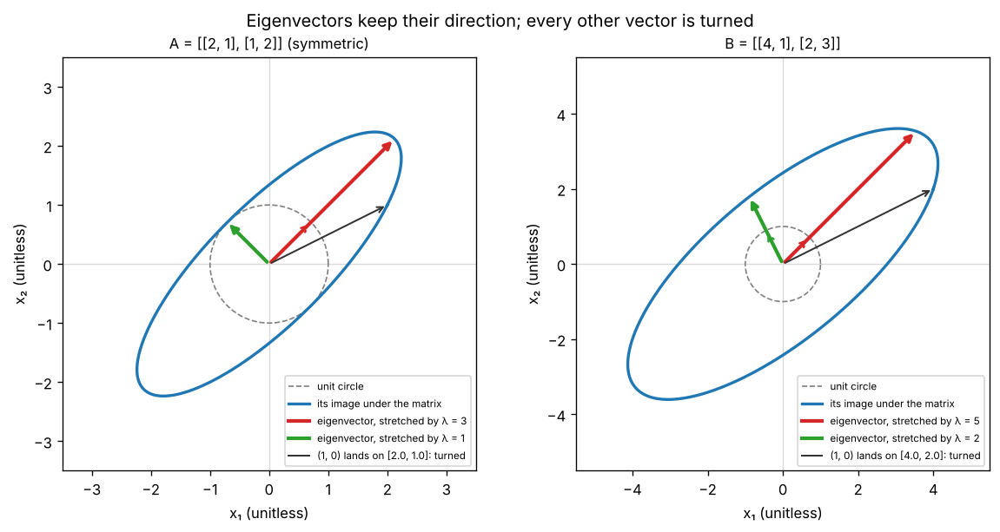

# A3.1 Eigenvalues and eigenvectors

**Core** · Part A, week 3 (course week 03) · ~3 h · Lab:
[`labs/A/a3_1_eigenvalues_eigenvectors.py`](../../labs/A/a3_1_eigenvalues_eigenvectors.py)

## Why it matters

A square matrix moves almost every vector off its line, but usually a few special directions only
get stretched. Those directions, the **eigenvectors**, and their stretch factors, the
**eigenvalues**, tell you what the matrix *does* in the simplest possible terms. That one idea is how
PCA finds the directions your data spreads along ([B5.4](../B/b5_4_pca.md)), why applying the same
weight matrix 100 times in a recurrent network makes gradients explode or vanish
([E2.1](../E/e2_1_rnn_bptt.md)), and how a long-run "steady state" of any process with fixed
transition rates is computed. In production the failure is quiet: an iterative eigen-solver that has
not converged still returns a vector, and nothing tells you it is wrong unless you check.

## Prerequisite check

- Can you multiply a 2×2 matrix by a vector by hand and say what the columns of the matrix mean as a
  map? If not, revisit [A2.1](a2_1_matrices_as_linear_maps.md).
- Can you compute the determinant of a 2×2 matrix and say what $\det = 0$ means? If not, revisit
  [A2.1](a2_1_matrices_as_linear_maps.md) and [A2.2](a2_2_matrix_multiplication_inverse.md).
- Can you find all solutions of $\mathbf{M}\mathbf{x} = \mathbf{0}$ for a singular 2×2 matrix (its null
  space)? If not, revisit [A2.3](a2_3_linear_systems_rank.md).
- Can you compute a dot product and a vector's length, and normalize a vector to length 1? If not,
  revisit [A1.5](a1_5_vectors.md).

## Intuition

### Most vectors turn; a few only stretch

Take $\mathbf{A} = \begin{pmatrix}2&1\\1&2\end{pmatrix}$ and apply it to a few vectors. $(1, 0)$ lands on
$(2, 1)$: it got longer *and* turned. $(1, 1)$ lands on $(3, 3)$: same direction, three times as long.
$(1, -1)$ lands on $(1, -1)$: unchanged. So this matrix has two special directions. Along $(1, 1)$
it stretches by 3; along $(1, -1)$ it stretches by 1 (does nothing). Every other vector is a mix of
those two directions, so the matrix stretches its two parts by different amounts and the result
points somewhere new. That is why ordinary vectors turn.

An **eigenvector** of a square matrix is a non-zero vector whose direction the matrix does not change;
the matrix only multiplies it by a number, its **eigenvalue**. The eigenvalue can be larger than 1
(stretch), between 0 and 1 (shrink), negative (flip to the opposite direction, and stretch or shrink),
or 0 (squash flat: the matrix is singular, A2.3).

The key plot below shows this for a whole circle of vectors at once. The unit circle becomes an
ellipse; the eigenvector arrows are the only ones that stay on their own line.

### Apply a matrix many times and one direction wins

Write any starting vector as a mix of eigenvectors: $\mathbf{x}_0 = c_1\mathbf{v}_1 + c_2\mathbf{v}_2$.
Each application of $\mathbf{A}$ multiplies the $\mathbf{v}_1$ part by $\lambda_1$ and the
$\mathbf{v}_2$ part by $\lambda_2$. After $k$ applications the parts have been multiplied by
$\lambda_1^k$ and $\lambda_2^k$. If $\lvert\lambda_1\rvert = 3$ and $\lvert\lambda_2\rvert = 1$, after
ten steps the first part has grown $3^{10} \approx 59{,}000$ times relative to the second: the vector
points almost exactly along $\mathbf{v}_1$, whatever you started with. This is **power iteration**,
the simplest eigen-solver, and the one you write from scratch in the lab. It also explains a training
failure you will meet in [E2.1](../E/e2_1_rnn_bptt.md): multiply by the same matrix many times and
anything along an eigenvector with $\lvert\lambda\rvert > 1$ explodes, and anything with
$\lvert\lambda\rvert < 1$ vanishes.

> **Bridge:** a **Markov chain** is a state machine with probabilities on its edges: from page Home, a
> visitor goes to Search with probability 0.4, and so on. Pushing the whole population through the
> state machine once is one matrix multiplication; doing it until the shares stop changing gives the
> long-run traffic share of each page, and that steady state is an eigenvector with eigenvalue 1.
> **Where it breaks:** a real state machine reacts to its whole history; a Markov chain only knows the
> current state. And the steady state exists and is reached only if every state can reach every
> other and the chain does not cycle in lockstep (A → B → A → B …). Check those before trusting the
> number.

## The math

**Symbols**

| Symbol | Meaning | Shape |
|---|---|---|
| $\mathbf{A}$ | a square matrix | `(d, d)` |
| $\mathbf{v}$, $\mathbf{v}_j$ | an eigenvector (non-zero); the $j$-th eigenvector | `(d,)` |
| $\lambda$, $\lambda_j$ | an eigenvalue (a scalar, not the regularization $\lambda$) | scalar |
| $\mathbf{I}_d$ | identity matrix | `(d, d)` |
| $\operatorname{tr}(\mathbf{A})$ | **trace**: the sum of the diagonal entries | scalar |
| $\mathbf{V}$ | matrix whose columns are eigenvectors | `(d, d)` |
| $\boldsymbol{\Lambda}$ | diagonal matrix of eigenvalues, $\Lambda_{jj} = \lambda_j$ | `(d, d)` |
| $\mathbf{Q}$ | **orthogonal matrix**: orthonormal columns, $\mathbf{Q}^\top\mathbf{Q} = \mathbf{I}_d$ | `(d, d)` |
| $\mathbf{x}_k$ | the vector after $k$ steps of power iteration | `(d,)` |

Eigenvalues are numbered by size, $\lvert\lambda_1\rvert \ge \lvert\lambda_2\rvert \ge \dots$; the code's
0-based arrays are not sorted that way unless you sort them (see "With NumPy").

**The definition.** $\mathbf{v} \ne \mathbf{0}$ is an eigenvector of $\mathbf{A}$ with eigenvalue
$\lambda$ when

$$\mathbf{A}\mathbf{v} = \lambda\mathbf{v}.$$

Any non-zero multiple of $\mathbf{v}$ is also an eigenvector (if $\mathbf{A}\mathbf{v} = \lambda\mathbf{v}$,
then $\mathbf{A}(5\mathbf{v}) = 5\lambda\mathbf{v} = \lambda(5\mathbf{v})$), so an eigenvector is really a
*direction*. Software returns it scaled to length 1, with an arbitrary sign.

**Finding the eigenvalues.** Move everything to one side and write $\lambda\mathbf{v}$ as
$\lambda\mathbf{I}\mathbf{v}$ so both terms are a matrix times $\mathbf{v}$:

$$\mathbf{A}\mathbf{v} - \lambda\mathbf{I}\mathbf{v} = \mathbf{0} \quad\Longleftrightarrow\quad (\mathbf{A} - \lambda\mathbf{I})\,\mathbf{v} = \mathbf{0}.$$

($\lambda\mathbf{I}$ has $\lambda$ on the diagonal and zeros elsewhere, so $\mathbf{A} - \lambda\mathbf{I}$ is just
$\mathbf{A}$ with $\lambda$ subtracted from each diagonal entry.)

We need a *non-zero* $\mathbf{v}$ in the null space of $\mathbf{A} - \lambda\mathbf{I}$. A2.3 says that
happens exactly when that matrix is singular, i.e. when its determinant is zero:

$$\det(\mathbf{A} - \lambda\mathbf{I}) = 0.$$

For a 2×2 matrix with entries $\begin{pmatrix}p & q\\ r & s\end{pmatrix}$ (letters chosen so they do not
clash with $d$ and $b$ elsewhere), the determinant formula $ad - bc$ of A2.1 gives

$$\det\begin{pmatrix}p - \lambda & q\\ r & s - \lambda\end{pmatrix} = (p - \lambda)(s - \lambda) - qr = \lambda^2 - (p + s)\lambda + (ps - qr).$$

The coefficient of $\lambda$ is minus the trace ($p + s$ is the sum of the diagonal) and the constant
is the determinant ($ps - qr$), so the **characteristic polynomial** of a 2×2 matrix is

$$\lambda^2 - \operatorname{tr}(\mathbf{A})\,\lambda + \det(\mathbf{A}) = 0, \qquad \lambda = \frac{\operatorname{tr} \pm \sqrt{\operatorname{tr}^2 - 4\det}}{2}.$$

If the two roots are $\lambda_1, \lambda_2$, the polynomial factors as $(\lambda - \lambda_1)(\lambda - \lambda_2) = \lambda^2 - (\lambda_1 + \lambda_2)\lambda + \lambda_1\lambda_2$.
Matching coefficients: **the eigenvalues add up to the trace and multiply to the determinant.** This
also holds for any size $d$ (stated, not proved) and is a free check on hand calculations. A $d \times d$ matrix has a degree-$d$
polynomial, so $d$ eigenvalues (some may repeat). If $\operatorname{tr}^2 - 4\det < 0$ the roots are
complex: a rotation by 90° turns *every* direction, so it has no real eigenvector.

**Finding an eigenvector.** Substitute one $\lambda$ into $(\mathbf{A} - \lambda\mathbf{I})\mathbf{v} = \mathbf{0}$
and solve. The matrix is singular by construction, so its rows are dependent and one equation is enough.

**Eigendecomposition.** Put the eigenvectors in the columns of $\mathbf{V}$ and the eigenvalues on
the diagonal of $\boldsymbol{\Lambda}$. Column $j$ of $\mathbf{A}\mathbf{V}$ is $\mathbf{A}\mathbf{v}_j = \lambda_j\mathbf{v}_j$,
which is also column $j$ of $\mathbf{V}\boldsymbol{\Lambda}$, because multiplying by a diagonal matrix on
the right scales each column: $\begin{pmatrix}a&b\\c&e\end{pmatrix}\begin{pmatrix}\lambda_1&0\\0&\lambda_2\end{pmatrix} = \begin{pmatrix}\lambda_1a&\lambda_2b\\\lambda_1c&\lambda_2e\end{pmatrix}$. So $\mathbf{A}\mathbf{V} = \mathbf{V}\boldsymbol{\Lambda}$. If the $d$
eigenvectors are independent, $\mathbf{V}$ is invertible (A2.2) and

$$\mathbf{A} = \mathbf{V}\boldsymbol{\Lambda}\mathbf{V}^{-1}, \qquad \mathbf{A}^k = \mathbf{V}\boldsymbol{\Lambda}^k\mathbf{V}^{-1},$$

because in $\mathbf{A}\mathbf{A} = \mathbf{V}\boldsymbol{\Lambda}\mathbf{V}^{-1}\mathbf{V}\boldsymbol{\Lambda}\mathbf{V}^{-1}$
the middle $\mathbf{V}^{-1}\mathbf{V}$ is $\mathbf{I}$. Read it as a recipe: change to eigenvector
coordinates ($\mathbf{V}^{-1}$), stretch each coordinate separately ($\boldsymbol{\Lambda}$), change back
($\mathbf{V}$). Some matrices have too few independent eigenvectors (a shear has one direction, try
it in the lab) and cannot be written this way.

**Symmetric matrices are the friendly case.** If $\mathbf{A} = \mathbf{A}^\top$, eigenvectors with
different eigenvalues are orthogonal. Proof: take $\mathbf{A}\mathbf{v}_1 = \lambda_1\mathbf{v}_1$ and
$\mathbf{A}\mathbf{v}_2 = \lambda_2\mathbf{v}_2$. Then

$$\lambda_1(\mathbf{v}_1^\top\mathbf{v}_2) = (\mathbf{A}\mathbf{v}_1)^\top\mathbf{v}_2 = \mathbf{v}_1^\top\mathbf{A}^\top\mathbf{v}_2 = \mathbf{v}_1^\top\mathbf{A}\mathbf{v}_2 = \lambda_2(\mathbf{v}_1^\top\mathbf{v}_2),$$

using $(\mathbf{M}\mathbf{x})^\top = \mathbf{x}^\top\mathbf{M}^\top$ (A2.2) and then $\mathbf{A}^\top = \mathbf{A}$.
So $(\lambda_1 - \lambda_2)\,\mathbf{v}_1^\top\mathbf{v}_2 = 0$, and with $\lambda_1 \ne \lambda_2$ the dot
product must be 0. The full result, the **spectral theorem** (stated here, not proved), says a real
symmetric matrix always has real eigenvalues and a full set of orthonormal eigenvectors, so

$$\mathbf{A} = \mathbf{Q}\boldsymbol{\Lambda}\mathbf{Q}^\top, \qquad \mathbf{Q}^\top\mathbf{Q} = \mathbf{I}_d \;(\text{so } \mathbf{Q}^{-1} = \mathbf{Q}^\top).$$

Covariance matrices (A3.3) and $\mathbf{X}^\top\mathbf{X}$ (A2.4) are symmetric, which is why this case
carries most of machine learning.

**Power iteration.** Assume $|\lambda_1| > |\lambda_2| \ge \dots \ge |\lambda_d|$ and that the
eigenvectors form a basis, so a starting vector can be written $\mathbf{x}_0 = c_1\mathbf{v}_1 + \dots + c_d\mathbf{v}_d$.
Apply $\mathbf{A}$ $k$ times; each eigenvector part picks up its own eigenvalue $k$ times:

$$\mathbf{A}^k\mathbf{x}_0 = c_1\lambda_1^k\mathbf{v}_1 + c_2\lambda_2^k\mathbf{v}_2 + \dots = \lambda_1^k\Big(c_1\mathbf{v}_1 + c_2\big(\tfrac{\lambda_2}{\lambda_1}\big)^k\mathbf{v}_2 + \dots\Big).$$

Every ratio $\lambda_j/\lambda_1$ has absolute value below 1, so its $k$-th power goes to 0 and the
bracket turns into $c_1\mathbf{v}_1$. Three practical details follow from this one line:

1. The error shrinks by a factor of about $\lvert\lambda_2/\lambda_1\rvert$ per step. A ratio of 0.5 is
   fast; 0.99 is painfully slow; a ratio of exactly 1 (e.g. eigenvalues 2 and −2) never converges.
2. $\lambda_1^k$ overflows or underflows, so the code divides by the length after every step:
   $\mathbf{x}_k = \mathbf{A}\mathbf{x}_{k-1} / \lVert\mathbf{A}\mathbf{x}_{k-1}\rVert$. Only the direction matters.
3. You need $c_1 \ne 0$. A random starting vector has $c_1 \ne 0$ with probability 1.

Once $\mathbf{x}$ is (nearly) an eigenvector, read off the eigenvalue with the **Rayleigh quotient**
$\lambda \approx \mathbf{x}^\top\mathbf{A}\mathbf{x} / \mathbf{x}^\top\mathbf{x}$: if $\mathbf{A}\mathbf{x} = \lambda\mathbf{x}$
exactly, the numerator is $\mathbf{x}^\top\lambda\mathbf{x} = \lambda\,\mathbf{x}^\top\mathbf{x}$ and the
ratio is $\lambda$. For a symmetric matrix its error is proportional to the *square* of the angle
error (stated, not derived), so it is accurate early; for a non-symmetric one only to the angle itself
(you will see the difference in the lab output).

## Worked example by hand

**1. Eigenvalues and eigenvectors of $\mathbf{A} = \begin{pmatrix}2&1\\1&2\end{pmatrix}$.**

- $\operatorname{tr} = 2 + 2 = 4$, $\det = 2 \cdot 2 - 1 \cdot 1 = 3$. Characteristic polynomial
  $\lambda^2 - 4\lambda + 3 = (\lambda - 3)(\lambda - 1)$ (two numbers that add to 4 and multiply to 3), so $\lambda_1 = 3$, $\lambda_2 = 1$. Check: $3 + 1 = 4$ ✓, $3 \cdot 1 = 3$ ✓.
- $\lambda_1 = 3$: $\mathbf{A} - 3\mathbf{I} = \begin{pmatrix}-1&1\\1&-1\end{pmatrix}$. The first row says
  $-v_1 + v_2 = 0$, so $v_2 = v_1$: $\mathbf{v}_1 = (1, 1)$. Check $\mathbf{A}(1, 1) = (3, 3)$ ✓.
- $\lambda_2 = 1$: $\mathbf{A} - \mathbf{I} = \begin{pmatrix}1&1\\1&1\end{pmatrix}$, so $v_1 + v_2 = 0$:
  $\mathbf{v}_2 = (1, -1)$. Check $\mathbf{A}(1, -1) = (1, -1)$ ✓.
- $\mathbf{A}$ is symmetric, and indeed $(1, 1)\cdot(1, -1) = 0$: orthogonal.

**2. A non-symmetric matrix, $\mathbf{B} = \begin{pmatrix}4&1\\2&3\end{pmatrix}$.** $\operatorname{tr} = 7$,
$\det = 12 - 2 = 10$, so $\lambda^2 - 7\lambda + 10 = (\lambda - 5)(\lambda - 2)$. For $\lambda = 5$:
$\mathbf{B} - 5\mathbf{I} = \begin{pmatrix}-1&1\\2&-2\end{pmatrix}$ gives $\mathbf{v} = (1, 1)$. For
$\lambda = 2$: $\begin{pmatrix}2&1\\2&1\end{pmatrix}$ gives $2v_1 + v_2 = 0$, $\mathbf{v} = (1, -2)$. The
dot product is $1 - 2 = -1 \ne 0$: without symmetry, eigenvectors need not be orthogonal.

**3. Power iteration on $\mathbf{A}$ from $\mathbf{x}_0 = (1, 0)$**, without normalizing, so the
numbers stay whole:

| $k$ | $\mathbf{A}^k\mathbf{x}_0$ | Rayleigh quotient | angle to $(1, 1)$ |
|---|---|---|---|
| 1 | $(2, 1)$ | $\frac{(2,1)\cdot(5,4)}{5} = \frac{14}{5} = 2.8$ | 18.43° |
| 2 | $(5, 4)$ | $\frac{(5,4)\cdot(14,13)}{41} = \frac{122}{41} = 2.9756$ | 6.34° |
| 3 | $(14, 13)$ | $\frac{(14,13)\cdot(41,40)}{365} = \frac{1094}{365} = 2.9973$ | 2.12° |
| 4 | $(41, 40)$ | $\frac{(41,40)\cdot(122,121)}{3281} = \frac{9842}{3281} = 2.9997$ | 0.71° |

(Each Rayleigh numerator uses the *next* vector, since $\mathbf{A}\mathbf{x}_k = \mathbf{x}_{k+1}$.)
Why the angle shrinks by a factor of about 3 each time: $(1, 0) = \tfrac12(1, 1) + \tfrac12(1, -1)$, so
$\mathbf{A}^k(1, 0) = \tfrac12 3^k (1, 1) + \tfrac12 1^k (1, -1) = \big(\tfrac{3^k + 1}{2}, \tfrac{3^k - 1}{2}\big)$.
For $k = 3$ that is $(14, 13)$ ✓. The $(1, -1)$ part stays the same size while the $(1, 1)$ part
triples. The two parts are perpendicular, so the tangent of the angle to $(1, 1)$ is the ratio of their
lengths, $\frac{1/2}{3^k/2} = 1/3^k$: it shrinks by exactly $\lambda_2/\lambda_1 = 1/3$ per step, as the
math predicted ($\tan 18.43° = 1/3$, $\tan 6.34° = 1/9$).

The lab prints the same numbers:

```text
== worked example: characteristic polynomial ==
A: trace = 4.0000  det = 3.0000  eigenvalues = [3.0, 1.0]
B: trace = 7.0000  det = 10.0000  eigenvalues = [5.0, 2.0]
A @ (1, 1)  = [3.0, 3.0]  = 3 * (1, 1)
A @ (1, -1) = [1.0, -1.0]  = 1 * (1, -1)
A's eigenvectors are orthogonal: (1, 1) . (1, -1) = 0.0
B @ (1, 1)  = [5.0, 5.0]  = 5 * (1, 1)
B @ (1, -2) = [2.0, -4.0]  = 2 * (1, -2)
B's eigenvectors are not orthogonal: (1, 1) . (1, -2) = -1.0
an ordinary vector turns: A @ (1, 0) = [2.0, 1.0]  (not a multiple of (1, 0))

== worked example: power iteration by hand ==
A^1 x0 = [2.0, 1.0]     Rayleigh quotient = 2.8000  angle to (1, 1) = 18.4349 deg
A^2 x0 = [5.0, 4.0]     Rayleigh quotient = 2.9756  angle to (1, 1) = 6.3402 deg
A^3 x0 = [14.0, 13.0]   Rayleigh quotient = 2.9973  angle to (1, 1) = 2.1211 deg
A^4 x0 = [41.0, 40.0]   Rayleigh quotient = 2.9997  angle to (1, 1) = 0.7073 deg
```

## Key plot



Each panel applies a matrix to every point of the unit circle (dashed) and draws the image (the
ellipse). The thin dashed arrows are the unit eigenvectors; the thick arrows are where they land,
on the same line, stretched by $\lambda$. The black arrow is $(1, 0)$, which is turned. On the left
($\mathbf{A}$, symmetric) the eigenvectors are perpendicular and lie exactly along the ellipse's long
and short axes. On the right ($\mathbf{B}$, not symmetric) they are not perpendicular and are *not*
the ellipse's axes. The axes of the ellipse for any matrix are found by the SVD, the next lesson
([A3.2](a3_2_svd.md)).

## From scratch in NumPy

Power iteration is the loop from "The math", plus a stopping test. The test compares two consecutive
unit vectors: if $\lvert\mathbf{x}_k\cdot\mathbf{x}_{k-1}\rvert$ (the cosine of the angle between them)
is within `TOL` of 1, the direction has stopped changing. The `abs` matters: for a negative
eigenvalue the vector flips sign every step while staying on the same line.

```python
def power_iteration(
    M: FloatArray, tol: float = TOL, max_iters: int = MAX_ITERS, seed: int = SEED
) -> tuple[float, FloatArray, int]:
    """Dominant eigenpair of a square matrix. M (d, d) -> (eigenvalue, unit eigenvector (d,), iterations)."""
    d = M.shape[0]
    x = np.random.default_rng(seed).normal(size=d)  # (d,), random start
    x /= np.linalg.norm(x)
    for k in range(1, max_iters + 1):
        y = M @ x  # (d,)
        y /= np.linalg.norm(y)
        if 1.0 - abs(y @ x) < tol:
            x = y
            break
        x = y
    else:
        raise RuntimeError(f"power iteration did not converge in {max_iters} iterations")
    lam = float(x @ M @ x)  # Rayleigh quotient (x has unit length)
    return lam, x, k
```

The `for … else` raises if the loop never hits `break`: a solver that silently returns its last guess
is the production failure from "Why it matters". On $\mathbf{A}$, $\mathbf{B}$ and a random symmetric
6×6 matrix:

```text
== from scratch: power iteration ==
A: lambda = 3.000000  v = [-0.7071, -0.7071]  iterations = 17
B: lambda = 5.000001  v = [0.7071, 0.7071]  iterations = 17   (v is (1, 1)/sqrt(2) = 0.7071)
random symmetric (6, 6): lambda = -2.003712  iterations = 138  |S v - lambda v| < 1e-5: True
```

Three things to read off. $\mathbf{A}$'s eigenvector came back as $-(1, 1)/\sqrt2$: the sign is arbitrary.
$\mathbf{B}$'s eigenvalue is off in the sixth decimal while $\mathbf{A}$'s is not: that is the
Rayleigh-quotient accuracy difference between non-symmetric and symmetric matrices. And the random
matrix's dominant eigenvalue is *negative*: "dominant" means largest in absolute value. Its next
eigenvalue is 1.8151 (see "With NumPy"), a ratio of $1.8151/2.0037 \approx 0.91$, hence 138 iterations
instead of 17. The convergence-speed cell isolates that effect with diagonal matrices whose two
eigenvalues have a chosen ratio:

```text
== from scratch: convergence speed ==
|lambda2/lambda1| = 0.1   iterations to converge = 6
|lambda2/lambda1| = 0.5   iterations to converge = 17
|lambda2/lambda1| = 0.9   iterations to converge = 86
|lambda2/lambda1| = 0.99  iterations to converge = 659
```

Going from a ratio of 0.9 to 0.99 costs about eight times the iterations. That gap between the top two
eigenvalues is what to check when an iterative solver is slow.

Finally the Markov chain from the bridge: three pages, a row-stochastic **transition matrix**
$\mathbf{P}$ `(3, 3)` (row $i$ is the probability of each next page given page $i$; rows sum to 1), and a
row vector of traffic shares updated by `share = share @ P`. That *is* power iteration, applied to
$\mathbf{P}^\top$ (because $\mathbf{s}\mathbf{P} = (\mathbf{P}^\top\mathbf{s}^\top)^\top$), with the
largest eigenvalue equal to 1 so no normalization is needed:

```text
== from scratch: steady state of a Markov chain ==
share after 100 steps (Home, Search, Checkout) = [0.3387, 0.371, 0.2903]
P^T @ share == share: True -> eigenvector of P^T with eigenvalue 1
```

## With NumPy

`np.linalg.eig` handles any square matrix; `np.linalg.eigh` is for symmetric (Hermitian) matrices and is
faster, always real, and sorted. Both return eigenvectors as the **columns** of the second array,
scaled to length 1:

```text
== with numpy ==
np.linalg.eig(A) returns dtype complex128 even though the eigenvalues are real
np.linalg.eig(A):  values = [3.0, 1.0]   vectors (columns) = [[0.7071, -0.7071], [0.7071, 0.7071]]
np.linalg.eigh(A): values = [1.0, 3.0]   vectors (columns) = [[-0.7071, 0.7071], [0.7071, 0.7071]]
power iteration matches np.linalg.eigh on A: OK
power iteration matches np.linalg.eigh on the random (6, 6) matrix: OK
eigenvalues of the random matrix (eigh, ascending) = [-2.0037, -0.988, 0.2761, 0.4913, 1.5001, 1.8151]
A == Q diag(lambda) Q^T: True   Q^T Q == I: True
B: values = [5.0, 2.0]   B == V diag(lambda) V^-1: True
trace = sum of eigenvalues: True   det = product: True
a 90-degree rotation has no real eigenvector: eigenvalues = [0.+1.j 0.-1.j]
Markov steady state from np.linalg.eig(P.T), rescaled to sum 1 = [0.3387, 0.371, 0.2903]  matches: OK
```

Read the outputs carefully, because each of these trips people up:

- In the pinned NumPy 2.5.4, `eig` returns complex arrays even when every eigenvalue is real (VERIFY
  (as of 2026-10) if you upgrade NumPy). The lab checks the imaginary parts are zero before taking
  `.real`. `eigh` returns real arrays.
- `eig` gives no particular order (here 3 then 1); `eigh` sorts *ascending* (1 then 3), so the largest
  is last, `vals[-1]` and `vecs[:, -1]`.
- The eigenvector for eigenvalue `vals[j]` is `vecs[:, j]`, a column. `vecs[j]` is a row and is wrong.
- Signs differ between `eig`, `eigh` and power iteration; compare after aligning signs, as the lab
  does with `v * np.sign(v @ v_np)`.
- The comparison on the random matrix uses `rtol=1e-5` for the vector: the stopping test bounds
  $1 - \lvert\cos\theta\rvert \approx \theta^2/2$, so the angle error is about $\sqrt{2 \cdot 10^{-12}} \approx 1.4 \times 10^{-6}$.
- For the Markov chain, `eig` returns a unit-*length* eigenvector; a probability vector must *sum* to 1,
  so the lab rescales it. Any multiple of an eigenvector is an eigenvector.

## In practice

- **When to use it:** whenever a matrix is applied repeatedly (Markov chains, recurrent networks,
  iterative algorithms) or is symmetric and describes spread or curvature (covariance matrices in
  [A3.3](a3_3_covariance_matrices.md) and PCA in [B5.4](../B/b5_4_pca.md)). For non-square matrices, or to
  find the axes of what any matrix does, use the SVD ([A3.2](a3_2_svd.md)).
- **Failure modes:**
  - *Eigenvectors read as rows:* `vecs[0]` instead of `vecs[:, 0]`. You notice `M @ v` is not a
    multiple of `v`; always assert `np.allclose(M @ v, lam * v)` once.
  - *A symmetric matrix that is not quite symmetric:* rounding makes `S` differ from `S.T` by `1e-17`,
    `eig` returns tiny imaginary parts and an unsorted, non-orthogonal basis. You notice complex
    output; use `eigh`, or symmetrize first with `(S + S.T) / 2`.
  - *Power iteration with a small eigen-gap:* $\lvert\lambda_2/\lambda_1\rvert$ near 1 means thousands of
    iterations; exactly 1 means none suffice. You notice the iteration count hitting its cap; always
    cap iterations, log the count, and raise rather than return an unconverged vector.
  - *Too few eigenvectors:* a shear like $\begin{pmatrix}1&1\\0&1\end{pmatrix}$ has one eigenvector
    direction; `eig` returns two nearly parallel columns and $\mathbf{V}^{-1}$ is unreliable. You notice
    `np.linalg.cond(vecs)` is huge ([A3.4](a3_4_numerical_stability.md)).
  - *Real eigenvalues assumed:* rotations and many non-symmetric matrices have complex eigenvalues.
    You notice `vals.imag` is non-zero; decide whether you really need an eigendecomposition or an SVD.
- **Defaults that work:** `np.linalg.eigh` for any symmetric matrix; `np.linalg.eig` only for
  non-symmetric ones, with an explicit check of `.imag`; for the top few eigenpairs of a large sparse
  matrix, `scipy.sparse.linalg.eigsh` (VERIFY (as of 2026-10) in the SciPy docs) rather than a full
  decomposition; power iteration only to learn or when you need just the top eigenpair of a huge
  matrix you can only multiply by.

## Exercises

Save your work to `my-work/A/a3_1_eigenvalues_eigenvectors.md` (or `.py`) and ask for a review.

1. **By hand:** Let $\mathbf{A} = \begin{pmatrix}5&2\\2&2\end{pmatrix}$. (a) Write the characteristic
   polynomial, find both eigenvalues and an eigenvector for each, and check the trace, determinant and
   orthogonality. (b) Run three steps of power iteration from $\mathbf{x}_0 = (1, 0)$ without
   normalizing, and compute the Rayleigh quotient after each step. (c) Without recomputing any
   polynomial, give the eigenvalues of $\mathbf{A}^2$, $\mathbf{A} + 3\mathbf{I}$ and $\mathbf{A}^{-1}$,
   and explain in one line each why their eigenvectors are the same as $\mathbf{A}$'s.
2. **Code:** Power iteration only finds the eigenvalue largest in absolute value. Write
   `inverse_iteration(M, shift, tol, max_iters)` that finds the eigenvalue of $\mathbf{M}$ *closest to
   `shift`* by running power iteration on $(\mathbf{M} - \text{shift}\cdot\mathbf{I})^{-1}$, using
   `np.linalg.solve` at every step instead of forming the inverse. Test it on a random symmetric 6×6
   matrix built as in the lab (`SEED = 0`) with `shift = 0` (smallest absolute eigenvalue) and with
   three other shifts of your choice, and check each result against `np.linalg.eigh` (allowing for
   sign). Print the iteration counts and explain, using $\lvert\lambda_2/\lambda_1\rvert$ for the
   inverted matrix, why they fall as the shift approaches an eigenvalue.
3. **Think:** Your team computes a nightly "long-run share of traffic" for 50 pages with power
   iteration on the page-to-page transition matrix, using a fixed 100 iterations and no convergence
   check. After a site redesign, the reported shares jump around from night to night even though the
   underlying traffic barely changed. Using eigenvalues, give two possible explanations. How would you
   make the pipeline detect the problem automatically, and what would you change?

## Takeaways

1. $\mathbf{A}\mathbf{v} = \lambda\mathbf{v}$: an eigenvector is a direction the matrix only stretches
   (or flips), and the eigenvalue is the stretch factor. Every other vector is turned.
2. Eigenvalues solve $\det(\mathbf{A} - \lambda\mathbf{I}) = 0$; for a 2×2 that is
   $\lambda^2 - \operatorname{tr}\,\lambda + \det = 0$. They always sum to the trace and multiply to the determinant.
3. Symmetric matrices have real eigenvalues and orthonormal eigenvectors, $\mathbf{A} = \mathbf{Q}\boldsymbol{\Lambda}\mathbf{Q}^\top$;
   use `np.linalg.eigh` for them.
4. Power iteration repeats $\mathbf{x} \leftarrow \mathbf{A}\mathbf{x} / \lVert\mathbf{A}\mathbf{x}\rVert$; it
   converges to the dominant eigenvector at a rate set by $\lvert\lambda_2/\lambda_1\rvert$, and must
   check that it converged.
5. Read NumPy's output with care: eigenvectors are columns, `eigh` sorts ascending, signs are arbitrary,
   and `eig` returns complex arrays in the pinned NumPy.

**What builds on this:** [A3.2](a3_2_svd.md) (the SVD is the eigendecomposition of
$\mathbf{A}^\top\mathbf{A}$, found by power iteration plus deflation); [A3.3](a3_3_covariance_matrices.md)
(eigenvectors of a covariance matrix are the directions of spread); [B5.4](../B/b5_4_pca.md) (PCA);
[E2.1](../E/e2_1_rnn_bptt.md) (repeated multiplication by one matrix makes gradients explode or vanish).
