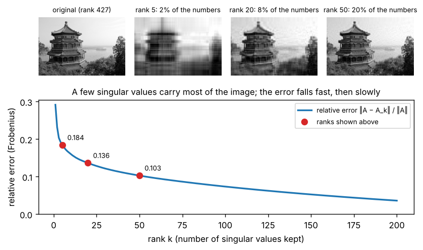

# A3.2 Singular value decomposition

**Core** · Part A, week 3 (course week 03) · ~3.5 h · Lab:
[`labs/A/a3_2_svd.py`](../../labs/A/a3_2_svd.py)

## Why it matters

Eigenvectors (A3.1) only exist for square matrices, and only behave well for symmetric ones. Real data
matrices are rectangular: 10,000 customers by 40 features, 1 million users by 50,000 products. The
**singular value decomposition (SVD)** works for *every* matrix and splits it into layers sorted by
importance. Keeping the top few layers compresses the matrix with the smallest possible error, which
is the engine behind PCA ([B5.4](../B/b5_4_pca.md)), matrix-factorization recommenders
([B6.1](../B/b6_1_recommender_systems.md)) and the low-rank updates of LoRA fine-tuning
([J1.3](../J/j1_3_lora_qlora.md)). It is also how `np.linalg.lstsq` and `matrix_rank` actually work, so
when they surprise you, the SVD is the explanation.

## Prerequisite check

- Can you find the eigenvalues and eigenvectors of a symmetric 2×2 matrix, and say why they are
  orthogonal? If not, revisit [A3.1](a3_1_eigenvalues_eigenvectors.md).
- Can you compute an outer product $\mathbf{u}\mathbf{v}^\top$ and say what its rank is? If not, revisit
  [A2.2](a2_2_matrix_multiplication_inverse.md).
- Can you say what the rank of a matrix counts, and why a one-hot encoding plus an intercept column is
  rank-deficient? If not, revisit [A2.3](a2_3_linear_systems_rank.md).
- Can you write the normal equations and say what `np.linalg.lstsq` minimizes? If not, revisit
  [A2.4](a2_4_projections_least_squares.md).

## Intuition

### Rotate, scale, rotate

The key plot of A3.1 showed a matrix turning the unit circle into an ellipse. For the non-symmetric
matrix the eigenvectors were *not* the ellipse's axes. The SVD finds the axes. It says: for any matrix
there is a set of perpendicular input directions $\mathbf{v}_1, \mathbf{v}_2, \dots$ that the matrix
sends to perpendicular output directions $\mathbf{u}_1, \mathbf{u}_2, \dots$, stretched by amounts
$\sigma_1 \ge \sigma_2 \ge \dots \ge 0$. The $\sigma_j$ are the **singular values**: the lengths of the
ellipse's half-axes. So any matrix does three things in a row:

1. **Rotate** the input so that the special directions $\mathbf{v}_j$ line up with the coordinate axes
   (this step may also include a reflection, a mirror flip).
2. **Scale** each axis by its own $\sigma_j$. If the matrix is rectangular, this step also drops or adds
   dimensions.
3. **Rotate** the result so the axes point along the output directions $\mathbf{u}_j$.

Unlike eigenvalues, singular values are never negative and never complex, and the SVD always exists.

### A matrix as a stack of layers

The same factorization can be read as a sum: $\mathbf{A} = \sigma_1\mathbf{u}_1\mathbf{v}_1^\top + \sigma_2\mathbf{u}_2\mathbf{v}_2^\top + \dots$.
Each term is an outer product, a rank-1 matrix (A2.2), and the terms are sorted by their weight
$\sigma_j$. For a photo, the first layer is roughly the overall brightness pattern, the next ones add
the large shapes, and the last hundreds add fine texture and noise. Keep the first $k$ layers and you
get the best possible rank-$k$ approximation of the matrix, storing $k(n + d + 1)$ numbers instead of
$nd$. For a 427 × 640 photo at $k = 20$ that is 7.8% of the numbers, and the key plot shows what you
keep.

> **Bridge:** a truncated SVD is lossy compression with a quality knob, like the quality setting of a
> JPEG export or a downsampled metrics rollup: you choose $k$, you get a smaller artifact, and you can
> compute exactly how much you lost. **Where it breaks:** a rollup's buckets are local (one hour, one
> host), but every SVD layer touches every entry of the matrix. Change one row and, in general, all
> the layers change. And the layers are mathematical directions, not business concepts: "layer 2" of
> a customer matrix rarely means anything a product manager would name.

## The math

**Symbols**

| Symbol | Meaning | Shape |
|---|---|---|
| $\mathbf{A}$ | any matrix | `(n, d)` |
| $r$ | $\min(n, d)$, the number of singular values | int |
| $\mathbf{U}$ | left singular vectors as columns, $\mathbf{U}^\top\mathbf{U} = \mathbf{I}_r$ | `(n, r)` |
| $\boldsymbol{\Sigma}$ | diagonal matrix of singular values $\sigma_1 \ge \dots \ge \sigma_r \ge 0$ | `(r, r)` |
| $\mathbf{V}$ | right singular vectors as columns, $\mathbf{V}^\top\mathbf{V} = \mathbf{I}_r$ | `(d, r)` |
| $\mathbf{u}_j$, $\mathbf{v}_j$, $\sigma_j$ | the $j$-th left vector, right vector and singular value | `(n,)`, `(d,)`, scalar |
| $\mathbf{A}_k$ | the rank-$k$ truncation $\sum_{j \le k}\sigma_j\mathbf{u}_j\mathbf{v}_j^\top$ | `(n, d)` |
| $\lVert\mathbf{A}\rVert_F$ | **Frobenius norm**, $\sqrt{\sum_{i,j} A_{ij}^2}$ | scalar |
| $\mathbf{A}^+$ | **pseudo-inverse** | `(d, n)` |

This is the **thin SVD** of the style guide; "full" SVDs pad $\mathbf{U}$ to `(n, n)` (see "With NumPy").

**The statement.** Every real matrix can be written

$$\mathbf{A} = \mathbf{U}\boldsymbol{\Sigma}\mathbf{V}^\top, \qquad \text{shapes } (n, r)(r, r)(r, d) \to (n, d).$$

Multiply both sides on the right by $\mathbf{V}$ and use $\mathbf{V}^\top\mathbf{V} = \mathbf{I}_r$ (its columns
are orthonormal): $\mathbf{A}\mathbf{V} = \mathbf{U}\boldsymbol{\Sigma}\mathbf{V}^\top\mathbf{V} = \mathbf{U}\boldsymbol{\Sigma}$. Column $j$ of
$\mathbf{U}\boldsymbol{\Sigma}$ is $\sigma_j\mathbf{u}_j$ (a diagonal matrix on the right scales columns, A3.1), so

$$\mathbf{A}\mathbf{v}_j = \sigma_j\mathbf{u}_j \quad \text{for each } j.$$

That is the picture from the intuition: input direction $\mathbf{v}_j$ goes to output direction
$\mathbf{u}_j$, stretched by $\sigma_j$. Applied to a vector, $\mathbf{A}\mathbf{x} = \mathbf{U}(\boldsymbol{\Sigma}(\mathbf{V}^\top\mathbf{x}))$:
$\mathbf{V}^\top\mathbf{x}$ gives the coordinates of $\mathbf{x}$ along the $\mathbf{v}_j$ (entry $j$ is the dot
product $\mathbf{v}_j^\top\mathbf{x}$, the projection coefficient of A2.4 for a unit vector: rotate),
$\boldsymbol{\Sigma}$ multiplies coordinate $j$ by $\sigma_j$ (scale), and $\mathbf{U}$ turns those
coordinates into a vector in output space (rotate).

**Where the pieces come from.** Compute $\mathbf{A}^\top\mathbf{A}$, a symmetric `(d, d)` matrix, using
$(\mathbf{M}\mathbf{N})^\top = \mathbf{N}^\top\mathbf{M}^\top$ (A2.2), $\boldsymbol{\Sigma}^\top = \boldsymbol{\Sigma}$
(it is diagonal) and $\mathbf{U}^\top\mathbf{U} = \mathbf{I}$:

$$\mathbf{A}^\top\mathbf{A} = (\mathbf{U}\boldsymbol{\Sigma}\mathbf{V}^\top)^\top\mathbf{U}\boldsymbol{\Sigma}\mathbf{V}^\top = \mathbf{V}\boldsymbol{\Sigma}\mathbf{U}^\top\mathbf{U}\boldsymbol{\Sigma}\mathbf{V}^\top = \mathbf{V}\boldsymbol{\Sigma}^2\mathbf{V}^\top.$$

That is exactly the symmetric eigendecomposition $\mathbf{Q}\boldsymbol{\Lambda}\mathbf{Q}^\top$ of A3.1. So:

- the right singular vectors $\mathbf{v}_j$ are the eigenvectors of $\mathbf{A}^\top\mathbf{A}$;
- the singular values are the square roots of its eigenvalues, $\sigma_j = \sqrt{\lambda_j}$. The square
  root is always real, because those eigenvalues are never negative: for a unit eigenvector,
  $\lambda_j = \mathbf{v}_j^\top\mathbf{A}^\top\mathbf{A}\mathbf{v}_j = \lVert\mathbf{A}\mathbf{v}_j\rVert^2 \ge 0$;
- the left singular vectors follow from $\mathbf{A}\mathbf{v}_j = \sigma_j\mathbf{u}_j$: $\mathbf{u}_j = \mathbf{A}\mathbf{v}_j / \sigma_j$
  (for $\sigma_j > 0$). They come out orthonormal automatically:
  $\mathbf{u}_i^\top\mathbf{u}_j = \frac{\mathbf{v}_i^\top\mathbf{A}^\top\mathbf{A}\mathbf{v}_j}{\sigma_i\sigma_j} = \frac{\sigma_j^2\,\mathbf{v}_i^\top\mathbf{v}_j}{\sigma_i\sigma_j}$,
  which is 0 for $i \ne j$ (the $\mathbf{v}$'s are orthogonal) and $\sigma_j^2/\sigma_j^2 = 1$ for $i = j$.

This gives the from-scratch algorithm: power iteration on $\mathbf{A}^\top\mathbf{A}$ finds $\mathbf{v}_1$,
then $\sigma_1 = \lVert\mathbf{A}\mathbf{v}_1\rVert$ and $\mathbf{u}_1 = \mathbf{A}\mathbf{v}_1/\sigma_1$. Then
**deflate**: subtract the layer just found, $\mathbf{A} \leftarrow \mathbf{A} - \sigma_1\mathbf{u}_1\mathbf{v}_1^\top$.
What is left is $\sum_{j \ge 2}\sigma_j\mathbf{u}_j\mathbf{v}_j^\top$, whose top singular vector is
$\mathbf{v}_2$, so repeat.

**Rank.** The rank of $\mathbf{A}$ is the number of non-zero singular values: the matrix is a sum of
that many independent rank-1 layers. In floating point nothing is exactly zero, so software counts
$\sigma_j$ above a cutoff; NumPy's `matrix_rank` uses $\sigma_1 \cdot \max(n, d) \cdot \varepsilon$, where
$\varepsilon \approx 2.2 \times 10^{-16}$ is the float64 rounding unit. This is the "rank from
singular values" that A2.3 promised.

**Best low-rank approximation.** The Frobenius norm is the plain length of the matrix flattened into
one long vector. Its square equals the sum of the squared singular values. Why: entry $(j, j)$ of
$\mathbf{A}^\top\mathbf{A}$ is column $j$ of $\mathbf{A}$ dotted with itself, its squared length. Adding up
the squared lengths of all columns adds up every $A_{ij}^2$, so
$\lVert\mathbf{A}\rVert_F^2 = \operatorname{tr}(\mathbf{A}^\top\mathbf{A})$, and the trace is the sum of the
eigenvalues (A3.1), which are the $\sigma_j^2$:

$$\lVert\mathbf{A}\rVert_F^2 = \sigma_1^2 + \sigma_2^2 + \dots + \sigma_r^2.$$

The leftover after truncation, $\mathbf{A} - \mathbf{A}_k = \sum_{j > k}\sigma_j\mathbf{u}_j\mathbf{v}_j^\top$,
is itself written in SVD form, so the same identity gives its size:

$$\lVert\mathbf{A} - \mathbf{A}_k\rVert_F^2 = \sigma_{k+1}^2 + \dots + \sigma_r^2, \qquad \text{relative error} = \sqrt{\frac{\sum_{j > k}\sigma_j^2}{\sum_j \sigma_j^2}}.$$

The **Eckart–Young theorem** (Eckart and Young, 1936; stated, not proved) says no rank-$k$ matrix gets
closer to $\mathbf{A}$ than $\mathbf{A}_k$. The fraction $\sum_{j \le k}\sigma_j^2 / \sum_j\sigma_j^2$ is
often called the "energy" kept.

**Least squares through the SVD.** For full-rank $\mathbf{X}$ `(n, d)` with $n \ge d$ (so $r = d$ and
$\mathbf{V}$ is square, $\mathbf{V}\mathbf{V}^\top = \mathbf{I}$), substitute $\mathbf{X} = \mathbf{U}\boldsymbol{\Sigma}\mathbf{V}^\top$
into the normal equations of A2.4. The left side is $\mathbf{X}^\top\mathbf{X}\mathbf{w} = \mathbf{V}\boldsymbol{\Sigma}^2\mathbf{V}^\top\mathbf{w}$
and the right side is $\mathbf{X}^\top\mathbf{y} = \mathbf{V}\boldsymbol{\Sigma}\mathbf{U}^\top\mathbf{y}$. Multiply both
by $\mathbf{V}^\top$ on the left, then by $\boldsymbol{\Sigma}^{-2}$, then by $\mathbf{V}$:

$$\boldsymbol{\Sigma}^2\mathbf{V}^\top\mathbf{w} = \boldsymbol{\Sigma}\mathbf{U}^\top\mathbf{y} \;\Rightarrow\; \mathbf{V}^\top\mathbf{w} = \boldsymbol{\Sigma}^{-1}\mathbf{U}^\top\mathbf{y} \;\Rightarrow\; \mathbf{w} = \mathbf{V}\boldsymbol{\Sigma}^{-1}\mathbf{U}^\top\mathbf{y}.$$

$\mathbf{X}^\top\mathbf{X}$ is never formed, so its squared condition number (A2.4) never appears. When
$\mathbf{X}$ is rank-deficient, some $\sigma_j = 0$ and least squares has infinitely many solutions
(A2.3). The **pseudo-inverse** $\mathbf{X}^+ = \mathbf{V}\boldsymbol{\Sigma}^+\mathbf{U}^\top$, where
$\boldsymbol{\Sigma}^+$ inverts the non-zero $\sigma_j$ and leaves the zeros at zero, picks the solution
with the smallest $\lVert\mathbf{w}\rVert$ (stated, not proved). That is what `np.linalg.lstsq` returns.

**Condition number.** The ratio $\sigma_1/\sigma_r$ is the matrix's **condition number** (for a square
or tall full-rank matrix). [A3.4](a3_4_numerical_stability.md) explains why it predicts lost digits.

## Worked example by hand

Find the SVD of $\mathbf{A} = \begin{pmatrix}3&0\\4&5\end{pmatrix}$ `(2, 2)`.

1. $\mathbf{A}^\top\mathbf{A} = \begin{pmatrix}3&4\\0&5\end{pmatrix}\begin{pmatrix}3&0\\4&5\end{pmatrix} = \begin{pmatrix}9 + 16 & 0 + 20\\ 0 + 20 & 0 + 25\end{pmatrix} = \begin{pmatrix}25&20\\20&25\end{pmatrix}$.
2. Its eigenvalues: $\operatorname{tr} = 50$, $\det = 625 - 400 = 225$, so $\lambda^2 - 50\lambda + 225 = (\lambda - 45)(\lambda - 5)$.
   Singular values $\sigma_1 = \sqrt{45} = 3\sqrt5 \approx 6.7082$, $\sigma_2 = \sqrt5 \approx 2.2361$.
3. Eigenvectors (same pattern as A3.1's $\begin{pmatrix}2&1\\1&2\end{pmatrix}$): $\mathbf{v}_1 = (1, 1)/\sqrt2$,
   $\mathbf{v}_2 = (1, -1)/\sqrt2$.
4. $\mathbf{u}_1 = \mathbf{A}\mathbf{v}_1/\sigma_1 = \frac{(3, 9)/\sqrt2}{3\sqrt5} = \frac{(1, 3)}{\sqrt{10}} \approx (0.3162, 0.9487)$,
   and $\mathbf{u}_2 = \mathbf{A}\mathbf{v}_2/\sigma_2 = \frac{(3, -1)/\sqrt2}{\sqrt5} = \frac{(3, -1)}{\sqrt{10}} \approx (0.9487, -0.3162)$.
   Check: $\mathbf{u}_1\cdot\mathbf{u}_2 = (3 - 3)/10 = 0$ ✓.
5. Check: $\sigma_1\sigma_2 = 3\sqrt5\cdot\sqrt5 = 15 = \lvert\det\mathbf{A}\rvert = \lvert 15 - 0\rvert$ ✓. (Rotations
   do not change area, so all the area scaling sits in $\boldsymbol{\Sigma}$.)
6. Rank-1 approximation: $\sigma_1\mathbf{u}_1\mathbf{v}_1^\top = 3\sqrt5\cdot\frac{1}{\sqrt{10}\sqrt2}\begin{pmatrix}1\\3\end{pmatrix}\begin{pmatrix}1&1\end{pmatrix} = \frac{3\sqrt5}{\sqrt{20}}\begin{pmatrix}1&1\\3&3\end{pmatrix} = \frac32\begin{pmatrix}1&1\\3&3\end{pmatrix} = \begin{pmatrix}1.5&1.5\\4.5&4.5\end{pmatrix}$.
7. Error: $\mathbf{A} - \mathbf{A}_1 = \begin{pmatrix}1.5&-1.5\\-0.5&0.5\end{pmatrix}$, squared Frobenius norm
   $2.25 + 2.25 + 0.25 + 0.25 = 5 = \sigma_2^2$ ✓, exactly as the formula promised.

```text
== worked example: SVD by hand ==
A^T A = [[25.0, 20.0], [20.0, 25.0]]
eigenvalues of A^T A = [45.0, 5.0]  singular values = sqrt = [6.7082, 2.2361]
sigma_1 = 3 sqrt(5) = 6.7082   sigma_2 = sqrt(5) = 2.2361
V (columns v1, v2) = [[0.7071, 0.7071], [0.7071, -0.7071]]
U = A V / sigma = [[0.3162, 0.9487], [0.9487, -0.3162]]   (1, 3)/sqrt(10) = [0.3162, 0.9487]
U^T U == I: True   V^T V == I: True
U diag(sigma) V^T == A: True
sigma_1 * sigma_2 = 15.0  = |det A| = 15.0
rank-1 approximation sigma_1 u1 v1^T = [[1.5, 1.5], [4.5, 4.5]]
A - A1 = [[1.5, -1.5], [-0.5, 0.5]]   squared Frobenius error = 5.0  = sigma_2^2 = 5.0
```

## Key plot



Rank 5 (2% of the numbers) keeps only the large light and dark regions; rank 20 (8%) is recognizable;
rank 50 (20%) is close to the original. The error curve drops steeply for the first handful of layers
and then flattens: the first singular values carry the broad structure, the long tail carries detail
and noise. Where to stop depends on what the matrix is for, not on the curve alone (exercise 2).

## From scratch in NumPy

`svd_power` is the algorithm from "The math": power iteration on the deflated $\mathbf{R}^\top\mathbf{R}$,
then $\sigma_j$, $\mathbf{u}_j$ and the deflation step. The `power_iteration` function is copied from
the A3.1 lab, with a tighter tolerance.

```python
def svd_power(A: FloatArray, k: int) -> tuple[FloatArray, FloatArray, FloatArray]:
    """Top-k SVD by power iteration and deflation. A (n, d) -> U (n, k), s (k,), V (d, k)."""
    n, d = A.shape
    R = A.copy()  # (n, d), what is left after removing the components found so far
    U, s, V = np.zeros((n, k)), np.zeros(k), np.zeros((d, k))
    for j in range(k):
        _, v, iters = power_iteration(R.T @ R)  # top right singular vector of what is left, (d,)
        Rv = R @ v  # (n,)
        s[j] = np.linalg.norm(Rv)  # sigma_j = |R v_j|
        U[:, j] = Rv / s[j]  # u_j = R v_j / sigma_j
        V[:, j] = v
        R = R - s[j] * np.outer(U[:, j], v)  # deflate: remove the rank-1 layer just found
    return U, s, V
```

On a random 6 × 4 matrix:

```text
== from scratch: SVD by power iteration and deflation ==
  component 1: sigma = 3.036073  power iterations = 20
  component 2: sigma = 2.033540  power iterations = 74
  component 3: sigma = 1.856326  power iterations = 12
  component 4: sigma = 0.895371  power iterations = 2
U (6, 4)  s (4,)  V (4, 4)
U diag(s) V^T == M: True   max error < 1e-12: True
```

Component 2 needs 74 iterations because, after deflation, the two largest eigenvalues of
$\mathbf{R}^\top\mathbf{R}$ are $\sigma_2^2 = 4.14$ and $\sigma_3^2 = 3.45$, a ratio of 0.83 (A3.1's
convergence rule). The last component needs 2: once three layers are removed, $\mathbf{R}$ has rank 1
and power iteration lands on the answer at once. This method is for learning. It forms
$\mathbf{R}^\top\mathbf{R}$, which squares the condition number, and errors in early components leak into
later ones. Libraries use different algorithms (NumPy calls LAPACK's `gesdd`).

## With NumPy and scikit-learn

`np.linalg.svd` returns three arrays, and two of its conventions cause most SVD bugs:

```text
== with numpy ==
np.linalg.svd(M) default:             U (6, 6)  s (4,)  Vt (4, 4)
np.linalg.svd(M, full_matrices=False): U (6, 4)  s (4,)  Vt (4, 4)
numpy returns V^T (rows are the v_j), not V; singular values sorted descending: [3.0361, 2.0335, 1.8563, 0.8954]
matches np.linalg.svd (after aligning signs): OK
```

The default `full_matrices=True` pads $\mathbf{U}$ to `(n, n)`: harmless at 6 rows, a memory explosion at
a million rows. Always pass `full_matrices=False`. The third output is $\mathbf{V}^\top$, so $\mathbf{v}_j$
is `Vt[j]` (a row). As with eigenvectors, each pair $(\mathbf{u}_j, \mathbf{v}_j)$ is only defined up to a
joint sign flip, so the comparison aligns signs first.

The same machinery gives rank and least squares. The lab builds a design matrix with an intercept and
a one-hot category for both levels, the dependent-columns trap of A2.3:

```text
== with numpy: rank and least squares via the SVD ==
singular values of X = [7.8771, 2.138, 0.6171, 0.0]   cutoff 1.0e-14 -> rank 3 (matrix_rank says 3)
cond(X^T X) > 1e15: True -> the normal equations are singular
w (SVD, from scratch) = [1.2194, 0.875, -0.0944, 1.3139]
w (np.linalg.lstsq)   = [1.2194, 0.875, -0.0944, 1.3139]
w (np.linalg.pinv)    = [1.2194, 0.875, -0.0944, 1.3139]   all three agree: OK
fitted values = [1.125, 2.0, 2.875, 5.1583, 6.0333, 6.9083]
```

One singular value is zero, so `solve` on the normal equations would fail. The pseudo-inverse quietly
returns the minimum-norm solution. Note what that means: the intercept and the two group weights are
not individually meaningful (add 1 to the intercept and subtract 1 from both group weights and the
fit is identical), even though the fitted values are. That is why A2.3 says to drop a column.

On the photo, keeping the top $k$ layers of `np.linalg.svd(gray, full_matrices=False)`:

```text
== image compression ==
singular values: first five = [327.2244, 60.366, 38.276, 22.5977, 19.2529]   last = 0.0120
rank  5: relative error 0.1841 (formula 0.1841)  energy kept 0.9661  storage 2.0% of the pixels
rank 20: relative error 0.1364 (formula 0.1364)  energy kept 0.9814  storage 7.8% of the pixels
rank 50: relative error 0.1028 (formula 0.1028)  energy kept 0.9894  storage 19.5% of the pixels
```

The measured error matches the $\sqrt{\sum_{j>k}\sigma_j^2 / \sum_j\sigma_j^2}$ formula. Look at the
"energy": rank 5 keeps 96.6% of it, yet the rank-5 image is barely recognizable. The first singular
value (327, five times the next) mostly encodes the average brightness, because every pixel is
positive. Energy fractions computed on data that has not been centered are dominated by the mean;
PCA subtracts the mean first for this reason ([B5.4](../B/b5_4_pca.md)).

scikit-learn's `TruncatedSVD` computes only the top $k$ components, which is what you want for large
or sparse matrices:

```text
== with scikit-learn ==
TruncatedSVD(algorithm='arpack') top 50 singular values match np.linalg.svd: OK
TruncatedSVD default (randomized): largest relative difference over the top 50 = 1.1e-02
components_ shape: (50, 640) = the top rows of V^T
```

The `arpack` solver is exact to rounding. The default `randomized` solver (VERIFY (as of 2026-10) in the
scikit-learn docs) trades accuracy for speed; here its 50th singular value is off by about 1%. Raise
`n_iter` if that matters for you. `TruncatedSVD` does not center the data, unlike `PCA`.

## In practice

- **When to use it:** compressing or denoising a matrix (keep the top $k$); finding the rank or the
  condition number of a matrix; solving least squares robustly, including rank-deficient cases
  (`lstsq`, `pinv`); PCA ([B5.4](../B/b5_4_pca.md)); latent factors in recommenders
  ([B6.1](../B/b6_1_recommender_systems.md)); reducing the dimension of embeddings before storage or
  search ([I2.1](../I/i2_1_embeddings_semantic_search.md)).
- **Failure modes:**
  - *`full_matrices=True` on tall data:* $\mathbf{U}$ becomes `(n, n)`; at $n = 10^6$ that is $10^{12}$
    float64 entries, 8 TB. You notice a `MemoryError` or a frozen machine; pass `full_matrices=False`.
  - *Using `Vt` as `V`:* the components are its rows. You notice reconstructions that do not match; assert
    `np.allclose(U * s @ Vt, A)` once.
  - *Sign flips across retrains:* a refit can flip $(\mathbf{u}_j, \mathbf{v}_j)$ to $(-\mathbf{u}_j, -\mathbf{v}_j)$.
    Any downstream feature built from them flips too. You notice a model that suddenly inverts a
    feature's effect; fix a sign convention (for example, make the largest-magnitude entry of each
    $\mathbf{v}_j$ positive).
  - *Choosing $k$ by energy alone:* on uncentered data the mean dominates (the photo), and on noisy
    data a 90% rule can keep mostly noise (exercise 2). You notice a $k$ that does not move a task metric;
    choose $k$ by the downstream task, a held-out reconstruction error, or a clear gap in the spectrum.
  - *Cost:* a full SVD of `(n, d)` costs on the order of $n d \min(n, d)$ operations. You notice it
    on big matrices; use `TruncatedSVD` or `scipy.sparse.linalg.svds` for the top $k$.
- **Defaults that work:** `np.linalg.svd(A, full_matrices=False)`; `np.linalg.lstsq(X, y, rcond=None)`
  for least squares; `TruncatedSVD(n_components=k, random_state=SEED)` for large or sparse matrices, and
  `algorithm="arpack"` when you need exact values; plot the singular values on a log scale before choosing $k$.

## Exercises

Save your work to `my-work/A/a3_2_svd.md` (or `.py`) and ask for a review.

1. **By hand:** Let $\mathbf{A} = \begin{pmatrix}2&2\\-1&1\end{pmatrix}$. (a) Compute $\mathbf{A}^\top\mathbf{A}$, its
   eigenvalues and eigenvectors, and from them $\sigma_1, \sigma_2, \mathbf{v}_1, \mathbf{v}_2, \mathbf{u}_1, \mathbf{u}_2$.
   Check $\sigma_1\sigma_2 = \lvert\det\mathbf{A}\rvert$. (b) Write the rank-1 approximation $\mathbf{A}_1$ and
   verify $\lVert\mathbf{A} - \mathbf{A}_1\rVert_F^2 = \sigma_2^2$. (c) Give the condition number
   $\sigma_1/\sigma_2$. (d) How many numbers does a rank-40 approximation of a 1000 × 800 matrix store,
   as a percentage of the full matrix?
2. **Code:** Build a "true" rank-3 matrix $\mathbf{L} = \mathbf{P}\mathbf{Q}^\top$ `(100, 80)` with $\mathbf{P}$ `(100, 3)`
   and $\mathbf{Q}$ `(80, 3)` drawn from a standard normal, then observe $\mathbf{Y} = \mathbf{L}$ plus Gaussian
   noise with standard deviation 1 (`SEED = 0`; draw $\mathbf{P}$, then $\mathbf{Q}$, then the noise). Plot the
   singular values of $\mathbf{Y}$ on a log scale. For $k = 1..20$, compute the relative Frobenius error
   of the rank-$k$ truncation of $\mathbf{Y}$ *against the clean $\mathbf{L}$*, and plot it with the error of
   $\mathbf{Y}$ itself as a reference line. Which $k$ is best? Which $k$ does the rule "keep 90% of the
   energy" choose, and why do the two disagree?
3. **Think:** Your product search stores 1 million item embeddings of 768 dimensions in Postgres with
   pgvector. A colleague proposes a truncated SVD to 128 dimensions to cut storage and query latency.
   What would you measure before agreeing, what has to happen to new items and to queries, what can go
   wrong over time, and how would you choose 128 versus some other $k$?

## Takeaways

1. Every matrix factors as $\mathbf{A} = \mathbf{U}\boldsymbol{\Sigma}\mathbf{V}^\top$: rotate, scale by
   $\sigma_1 \ge \sigma_2 \ge \dots \ge 0$, rotate. $\mathbf{A}\mathbf{v}_j = \sigma_j\mathbf{u}_j$.
2. The $\mathbf{v}_j$ are the eigenvectors of $\mathbf{A}^\top\mathbf{A}$ and $\sigma_j = \sqrt{\lambda_j}$;
   power iteration plus deflation computes them one layer at a time.
3. Keeping the top $k$ layers is the best rank-$k$ approximation (Eckart–Young), with squared error
   $\sum_{j > k}\sigma_j^2$ and storage $k(n + d + 1)$.
4. Rank is the number of non-zero singular values; the pseudo-inverse $\mathbf{V}\boldsymbol{\Sigma}^+\mathbf{U}^\top$
   solves least squares even when $\mathbf{X}$ is rank-deficient, and is what `lstsq` uses.
5. In NumPy pass `full_matrices=False`, remember the third output is $\mathbf{V}^\top$, align signs before
   comparing, and choose $k$ by the task, not by an energy percentage alone.

**What builds on this:** [A3.3](a3_3_covariance_matrices.md) (the SVD of centered data gives the
covariance matrix's eigenvectors); [A3.4](a3_4_numerical_stability.md) (condition number
$\sigma_1/\sigma_r$); [B5.4](../B/b5_4_pca.md) (PCA via the SVD); [B6.1](../B/b6_1_recommender_systems.md)
(matrix factorization); [J1.3](../J/j1_3_lora_qlora.md) (LoRA's low-rank weight updates).
