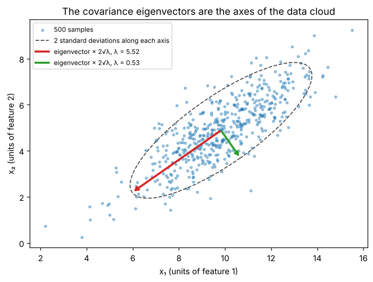

# A3.3 Covariance matrices

**Core** · Part A, week 3 (course week 03) · ~2 h · Lab:
[`labs/A/a3_3_covariance_matrices.py`](../../labs/A/a3_3_covariance_matrices.py)

## Why it matters

Before you model a dataset you want to know which features move together. The **covariance matrix**
answers that for every pair of features at once, in one `(d, d)` table. It is the input to PCA
([B5.4](../B/b5_4_pca.md)), the shape parameter of the multivariate Gaussian
([A5.2](a5_2_common_distributions.md)) and of Gaussian mixtures ([B5.3](../B/b5_3_gmm_em.md)), and the
first thing to look at when two features carry the same information (A2.3). Two properties, symmetry
and **positive semi-definiteness**, are what make all of that work. Getting the orientation or the
divisor wrong is one of the most common silent bugs in data code: `np.cov(X)` on a `(500, 2)` array
returns a `(500, 500)` matrix without complaint.

## Prerequisite check

- Can you compute a mean and subtract it from every row of a NumPy array with broadcasting? If not,
  revisit [A1.2](a1_2_numpy_arrays.md).
- Can you compute $\mathbf{X}^\top\mathbf{X}$ for a small matrix by hand and give its shape? If not,
  revisit [A2.2](a2_2_matrix_multiplication_inverse.md).
- Can you find the eigenvalues and eigenvectors of a symmetric 2×2 matrix? If not, revisit
  [A3.1](a3_1_eigenvalues_eigenvectors.md).
- Can you project a vector onto a unit direction with a dot product? If not, revisit
  [A2.4](a2_4_projections_least_squares.md).

## Intuition

### Do two features move together?

Take one feature, say the size of a house. Its **variance** measures how far values typically are
from their mean: average the squared deviations. Now take a second feature, the price. For each house,
multiply *its* deviation in size by *its* deviation in price. Big house and high price: positive times
positive, a positive product. Small house and low price: negative times negative, also positive. Big
house and low price: a negative product. Average those products and you get the **covariance** of
size and price: positive when the two tend to be above or below their means together, negative when
one tends to be high while the other is low, near zero when there is no linear pattern.

A dataset with $d$ features has $d$ variances and $d(d - 1)/2$ covariances between distinct pairs.
The covariance matrix arranges them in a $d \times d$ grid: entry $(j, k)$ is the covariance of
feature $j$ and feature $k$, and the diagonal, a feature's covariance with itself, is its variance.

### Two properties that are not accidents

**Symmetric.** The covariance of size with price uses the same products as the covariance of price
with size, so entry $(j, k)$ equals entry $(k, j)$.

**Positive semi-definite.** Pick any direction in feature space, for example "size plus price"
(a weighted combination of features), and compute the variance of the data along it. A variance is an
average of squares, so it can never be negative. The covariance matrix turns out to compute exactly
that variance for any direction you give it. "Positive semi-definite" is the name for a matrix that
never returns a negative number this way.

Because the matrix is symmetric, A3.1 applies: it has real eigenvalues and perpendicular
eigenvectors. The eigenvectors are the **axes of the data cloud** (the key plot), and each eigenvalue
is the variance along its axis. The largest eigenvalue's direction is the single direction along which
the data spreads most. That sentence is PCA.

### Units matter

Covariance carries the product of the two features' units: rupees times square metres. Changing price
from rupees to thousands of rupees divides every price covariance by 1,000, so the size of a covariance
says nothing on its own about how *strongly* two features are related. The **correlation** divides each
covariance by the two standard deviations, which removes the units and puts every entry between −1 and 1.

> **Bridge:** the covariance matrix is like a co-occurrence table you would build from logs, for example
> "how often do slow queries on table A coincide with slow queries on table B", computed for every pair of
> metrics at once. Both summarize pairwise relationships in a symmetric grid. **Where it breaks:** a
> co-occurrence count only goes up; a covariance is signed and centered, so it measures whether two
> metrics are *above their own averages* at the same time. And it only sees straight-line
> relationships: a U-shaped dependence can have covariance zero.

## The math

**Symbols**

| Symbol | Meaning | Shape |
|---|---|---|
| $\mathbf{X}$ | data matrix, one example per row | `(n, d)` |
| $\bar{\mathbf{x}}$ | sample mean of each feature (column means) | `(d,)` |
| $\mathbf{X}_c$ | centered data, $\mathbf{X}$ with $\bar{\mathbf{x}}$ subtracted from every row | `(n, d)` |
| $\mathbf{S}$ | sample covariance matrix | `(d, d)` |
| $S_{jk}$ | covariance of features $j$ and $k$; $S_{jj}$ is the variance of feature $j$ | scalar |
| $s_j$ | sample standard deviation of feature $j$, $\sqrt{S_{jj}}$ | scalar |
| $\mathbf{R}$ | correlation matrix | `(d, d)` |
| $\mathbf{w}$ | a direction (weights of a linear combination of features) | `(d,)` |
| $\boldsymbol{\Sigma}$ | the true (population) covariance the data came from | `(d, d)` |

$\mathbf{S}$ is computed from a sample and estimates $\boldsymbol{\Sigma}$; [A5.1](a5_1_random_variables_expectation.md)
covers the population version. (In A3.2, $\boldsymbol{\Sigma}$ was the matrix of singular values; the
style guide reserves it for both, and context decides. In this lesson it is always a covariance.)

**Entry by entry.** For features $j$ and $k$, with $x_{ij}$ the value of feature $j$ in example $i$:

$$S_{jk} = \frac{1}{n - 1}\sum_{i=1}^{n}(x_{ij} - \bar{x}_j)(x_{ik} - \bar{x}_k).$$

**As one matrix product.** Center first, $\mathbf{X}_c = \mathbf{X} - \mathbf{1}\bar{\mathbf{x}}^\top$ (in NumPy,
`X - X.mean(axis=0)`, broadcasting the mean row). Entry $(j, k)$ of $\mathbf{X}_c^\top\mathbf{X}_c$ is
column $j$ of $\mathbf{X}_c$ dotted with column $k$, which is exactly the sum above. So

$$\mathbf{S} = \frac{1}{n - 1}\mathbf{X}_c^\top\mathbf{X}_c, \qquad \text{shapes } (d, n)(n, d) \to (d, d).$$

**Why $n - 1$.** The deviations are measured from $\bar{\mathbf{x}}$, which was fitted to the same data,
so they come out slightly smaller on average than deviations from the true mean would be. Dividing
by $n - 1$ instead of $n$ corrects that on average (it makes $\mathbf{S}$ an **unbiased** estimate of
$\boldsymbol{\Sigma}$; the proof is in [A5.1](a5_1_random_variables_expectation.md)). Libraries call the
subtracted number `ddof` ("delta degrees of freedom"): `ddof=1` divides by $n - 1$, `ddof=0` by $n$.
For $n$ in the thousands the difference is negligible; for $n = 4$ it is 33%. The real danger is that
libraries disagree on the default (see "With NumPy and pandas").

**Symmetric.** $\mathbf{S}^\top = \frac{1}{n-1}(\mathbf{X}_c^\top\mathbf{X}_c)^\top = \frac{1}{n-1}\mathbf{X}_c^\top\mathbf{X}_c = \mathbf{S}$,
using $(\mathbf{A}\mathbf{B})^\top = \mathbf{B}^\top\mathbf{A}^\top$ (A2.2).

**Variance along a direction.** For a unit vector $\mathbf{w}$, the coordinate of centered example $i$
along $\mathbf{w}$ is the dot product $\mathbf{x}_{c,i}^\top\mathbf{w}$ (A2.4). All of them at once:
$\mathbf{X}_c\mathbf{w}$, shape `(n,)`. These coordinates already have mean zero (each centered column
sums to 0, so any weighted sum of the columns does too), so their variance is their sum of squares
over $n - 1$:

$$\operatorname{Var}(\text{data along } \mathbf{w}) = \frac{1}{n-1}(\mathbf{X}_c\mathbf{w})^\top(\mathbf{X}_c\mathbf{w}) = \mathbf{w}^\top\Big(\frac{1}{n-1}\mathbf{X}_c^\top\mathbf{X}_c\Big)\mathbf{w} = \mathbf{w}^\top\mathbf{S}\mathbf{w}.$$

The same formula with a non-unit $\mathbf{w}$ gives the variance of the combination
$w_1x_1 + \dots + w_dx_d$. A number of the form $\mathbf{w}^\top\mathbf{S}\mathbf{w}$ is called a
**quadratic form**.

**Positive semi-definite.** The middle step above also equals $\frac{1}{n-1}\lVert\mathbf{X}_c\mathbf{w}\rVert^2$,
a squared length, so

$$\mathbf{w}^\top\mathbf{S}\mathbf{w} \ge 0 \quad \text{for every } \mathbf{w}.$$

That is the definition of positive semi-definite (PSD). For a symmetric matrix it is equivalent to all
eigenvalues being $\ge 0$: take $\mathbf{w}$ = a unit eigenvector, then $\mathbf{w}^\top\mathbf{S}\mathbf{w} = \mathbf{w}^\top\lambda\mathbf{w} = \lambda$.
If every $\mathbf{w} \ne \mathbf{0}$ gives a strictly positive value, $\mathbf{S}$ is **positive definite**.
$\mathbf{S}$ fails to be definite exactly when some combination of features has zero variance, i.e. is
constant, i.e. the centered columns are linearly dependent (one feature is a linear function of the
others). Then $\mathbf{S}$ has a zero eigenvalue and is singular. With $n \le d$ this always happens,
because $\mathbf{X}_c$ has rank at most $n - 1$.

**The axes of the cloud.** Since $\mathbf{S}$ is symmetric, $\mathbf{S} = \mathbf{Q}\boldsymbol{\Lambda}\mathbf{Q}^\top$
(A3.1). Each eigenvalue is the variance along its eigenvector ($\mathbf{q}_j^\top\mathbf{S}\mathbf{q}_j = \lambda_j$),
and the largest eigenvalue is the largest variance along any unit direction (stated here; B5.4 shows
why). The connection to A3.2: if $\mathbf{X}_c = \mathbf{U}\boldsymbol{\Sigma}\mathbf{V}^\top$, then
$\mathbf{S} = \frac{1}{n-1}\mathbf{V}\boldsymbol{\Sigma}^2\mathbf{V}^\top$, so the right singular vectors of the
centered data are the covariance eigenvectors and $\lambda_j = \sigma_j^2/(n - 1)$. PCA uses the SVD
form because it never forms $\mathbf{X}_c^\top\mathbf{X}_c$ ([A3.4](a3_4_numerical_stability.md)).

**Correlation.** Divide each entry by the two standard deviations:

$$R_{jk} = \frac{S_{jk}}{s_j s_k}, \qquad \text{so } R_{jj} = 1 \text{ and } -1 \le R_{jk} \le 1.$$

It is the covariance matrix of the **standardized** features $(x_j - \bar{x}_j)/s_j$, so it is also
symmetric and PSD.

**Transforming data.** If every row is mapped by the same matrix, $\mathbf{Y} = \mathbf{X}\mathbf{M}$ with
$\mathbf{M}$ `(d, k)`, then $\mathbf{Y}_c = \mathbf{X}_c\mathbf{M}$ and

$$\operatorname{Cov}(\mathbf{Y}) = \frac{1}{n-1}\mathbf{M}^\top\mathbf{X}_c^\top\mathbf{X}_c\mathbf{M} = \mathbf{M}^\top\mathbf{S}\mathbf{M}, \qquad (k, d)(d, d)(d, k) \to (k, k).$$

The lab uses this to *create* data with a chosen covariance: start from independent standard normals
(covariance $\mathbf{I}$) and map each row $\mathbf{z}$ to $\mathbf{T}\mathbf{z}$ (in rows form, `Z @ T.T`),
which gives covariance $\mathbf{T}\mathbf{T}^\top$. Picking $\mathbf{T}$ with $\mathbf{T}\mathbf{T}^\top = \boldsymbol{\Sigma}$
is the Cholesky factorization of [A3.4](a3_4_numerical_stability.md); [A5.2](a5_2_common_distributions.md)
samples multivariate Gaussians this way.

## Worked example by hand

Four examples, two features: $\mathbf{X} = \begin{pmatrix}1&4\\3&5\\4&4\\4&7\end{pmatrix}$ `(4, 2)`.

1. Means: $\bar{x}_1 = (1 + 3 + 4 + 4)/4 = 3$, $\bar{x}_2 = (4 + 5 + 4 + 7)/4 = 5$.
2. Center: $\mathbf{X}_c = \begin{pmatrix}-2&-1\\0&0\\1&-1\\1&2\end{pmatrix}$. Each column sums to 0 ✓.
3. Products: $\sum (x_{i1} - \bar{x}_1)^2 = 4 + 0 + 1 + 1 = 6$; $\sum (x_{i2} - \bar{x}_2)^2 = 1 + 0 + 1 + 4 = 6$;
   $\sum (x_{i1} - \bar{x}_1)(x_{i2} - \bar{x}_2) = 2 + 0 - 1 + 2 = 3$. So $\mathbf{X}_c^\top\mathbf{X}_c = \begin{pmatrix}6&3\\3&6\end{pmatrix}$.
4. Divide by $n - 1 = 3$: $\mathbf{S} = \begin{pmatrix}2&1\\1&2\end{pmatrix}$. (Dividing by $n = 4$ would give
   $\begin{pmatrix}1.5&0.75\\0.75&1.5\end{pmatrix}$.)
5. Standard deviations $s_1 = s_2 = \sqrt2$; correlation $R_{12} = 1/(\sqrt2\cdot\sqrt2) = 0.5$.
6. $\mathbf{S}$ is the matrix of A3.1's worked example: eigenvalues 3 and 1, eigenvectors $(1, 1)/\sqrt2$
   and $(1, -1)/\sqrt2$. Both eigenvalues are positive, so $\mathbf{S}$ is positive definite.
7. Check "eigenvalue = variance along the eigenvector" directly. Along $\mathbf{w} = (1, 1)/\sqrt2$ the
   centered rows have coordinates $\mathbf{X}_c\mathbf{w} = (-3, 0, 0, 3)/\sqrt2$; sum of squares $(9 + 0 + 0 + 9)/2 = 9$;
   divided by 3: **3** ✓. Along $(1, -1)/\sqrt2$: $(-1, 0, 2, -1)/\sqrt2$, sum of squares $6/2 = 3$, divided by 3: **1** ✓.

```text
== worked example: covariance by hand ==
means = [3.0, 5.0]
centered rows = [[-2.0, -1.0], [0.0, 0.0], [1.0, -1.0], [1.0, 2.0]]
Xc^T Xc = [[6.0, 3.0], [3.0, 6.0]]
covariance (divide by n - 1 = 3) = [[2.0, 1.0], [1.0, 2.0]]
divide by n = 4 instead          = [[1.5, 0.75], [0.75, 1.5]]
standard deviations = [1.4142, 1.4142]   correlation = 0.5
eigenvalues (ascending) = [1.0, 3.0]   eigenvectors (columns) = [[-0.7071, 0.7071], [0.7071, 0.7071]]
along w = [0.7071, 0.7071]: projections = [-2.1213, 0.0, 0.0, 2.1213]  variance = 3.0000  w^T S w = 3.0000
along w = [0.7071, -0.7071]: projections = [-0.7071, 0.0, 1.4142, -0.7071]  variance = 1.0000  w^T S w = 1.0000
```

($-3/\sqrt2 = -2.1213$.)

## Key plot



The lab draws 500 points from a distribution with covariance $\begin{pmatrix}4&2.4\\2.4&2.25\end{pmatrix}$
(standard deviations 2 and 1.5, correlation 0.8), computes their sample covariance, and draws its two
eigenvectors from the mean, each scaled by $2\sqrt{\lambda_j}$ (two standard deviations along that axis).
The arrows line up with the long and short axes of the cloud, and the dashed ellipse they define
encloses most of the points. The long arrow points down-left because eigenvectors have an arbitrary
sign; the axis is what matters. Variance along the long axis (5.52) is ten times that along the short
axis (0.53): most of the information about where a point sits is in one direction, which is the
observation PCA turns into a method.

## From scratch in NumPy

The two functions are the two formulas. The lab also writes the entry-by-entry triple loop from the
definition and checks that the matrix product gives the same answer.

```python
def covariance(X: FloatArray, ddof: int = 1) -> FloatArray:
    """Covariance matrix of the columns. X (n, d) -> (d, d). ddof=1 divides by n - 1."""
    Xc = X - X.mean(axis=0)  # (n, d)
    return Xc.T @ Xc / (X.shape[0] - ddof)  # (d, n) @ (n, d) -> (d, d)


def correlation(X: FloatArray) -> FloatArray:
    """Correlation matrix of the columns. X (n, d) -> (d, d), ones on the diagonal."""
    S = covariance(X)
    sd = np.sqrt(np.diag(S))  # (d,)
    return S / np.outer(sd, sd)  # entry (j, k) divided by sd_j * sd_k
```

```text
== from scratch: covariance and correlation ==
matrix formula == entry-by-entry loops: OK
sample covariance = [[3.8837, 2.3415], [2.3415, 2.1713]]   true = [[4.0, 2.4], [2.4, 2.25]]
sample correlation = [[1.0, 0.8063], [0.8063, 1.0]]   true correlation = 0.8
```

The sample covariance is close to, but not equal to, the true one: 500 points estimate it with some
noise. Then the properties, checked numerically. `np.einsum("ij,jk,ik->i", W, S, W)` computes
$\mathbf{w}^\top\mathbf{S}\mathbf{w}$ for each of 1,000 random directions stored as the rows of `W` (the
index string spells out $\sum_{j,k} w_{ij}S_{jk}w_{ik}$ for each row $i$); a loop over the rows would give
the same numbers:

```text
== from scratch: symmetric and positive semi-definite ==
symmetric: S == S.T: True
eigenvalues = [0.5344, 5.5206]  all >= 0: True
w^T S w == variance of the data along w, for 1000 random w: OK   smallest value 0.0076 >= 0
largest eigenvalue = max variance over unit directions: 5.5206  direction: [-0.8196, -0.573]
add a column = col1 + col2: eigenvalues = [0.0, 0.5447, 16.2482] -> one is 0: semi-definite, singular
Cov(X @ M) == M^T S M: OK
```

The second-to-last line is the dependent-column case: a third feature equal to the sum of the first
two is a direction with zero variance, so one eigenvalue is 0 (to rounding). The matrix is still PSD,
but not positive definite, and it has no inverse. Anything that needs $\mathbf{S}^{-1}$, such as the
multivariate Gaussian density or Mahalanobis distance, breaks on it.

## With NumPy and pandas

The library functions agree with the from-scratch ones once you set two arguments correctly:

```text
== with numpy and pandas ==
np.cov(X).shape = (500, 500)  <- rows treated as variables: a 500 x 500 matrix, wrong
np.cov(X, rowvar=False) matches: OK   (ddof=1 by default)
ddof=0 versions match: OK
np.corrcoef(X, rowvar=False) matches: OK
DataFrame.cov() and .corr() match: OK
variance of x1: np.var = 3.8759 (ddof=0)   pandas .var() = 3.8837 (ddof=1)
worked example, n = 4: np.var = 1.5000   pandas = 2.0000
```

- `np.cov` and `np.corrcoef` assume **each row is a variable** (`rowvar=True`), the opposite of this
  course's rows-are-examples rule. On `(n, d)` data, always pass `rowvar=False`, or use `np.cov(X.T)`.
  Nothing errors if you forget; you get an `(n, n)` matrix.
- `np.cov` divides by $n - 1$ by default; `np.var` and `np.std` divide by $n$ (`ddof=0`); pandas
  `.var()`, `.std()` and `.cov()` divide by $n - 1$. On the four-row example that is 1.5 versus 2.0 for
  the same column. Pass `ddof` explicitly whenever the two must agree.
- pandas `.cov()` and `.corr()` skip missing values pair by pair. Different entries can then be computed
  from different rows, and the result can fail to be PSD. Handle missing values first
  ([A1.3](a1_3_pandas.md)).

## In practice

- **When to use it:** the first look at how numeric features relate (use the correlation matrix to
  compare strengths across units); detecting redundant features before a linear model (a near-zero
  eigenvalue); as the input to PCA ([B5.4](../B/b5_4_pca.md)), Gaussian models
  ([A5.2](a5_2_common_distributions.md), [B5.3](../B/b5_3_gmm_em.md)), and distances that account
  for correlated features (the Mahalanobis distance, which uses $\mathbf{S}^{-1}$).
- **Failure modes:**
  - *Wrong orientation:* `np.cov(X)` on `(n, d)` data. You notice a result of shape `(n, n)`; assert the
    shape is `(d, d)`.
  - *Mixed `ddof`:* comparing a NumPy variance with a pandas one. You notice small mismatches that
    shrink as $n$ grows; always pass `ddof`.
  - *Reading covariance magnitudes as strength:* a covariance in rupees × years looks enormous next to
    one in metres × kilograms. You notice "the biggest relationship" changes when you change units; use
    correlation to compare.
  - *Singular covariance:* dependent features, a constant column, or $n \le d$. You notice a zero (or
    tiny) eigenvalue and `LinAlgError` from anything that inverts $\mathbf{S}$; drop redundant features,
    or add a small multiple of $\mathbf{I}$ (shrinkage, [B2.2](../B/b2_2_regularization.md) uses the same idea).
  - *Outliers:* one extreme row can dominate a sum of products. You notice correlations that change a lot
    when you drop a handful of rows; inspect scatter plots ([A1.4](a1_4_matplotlib.md)) and consider a
    rank-based correlation ([A6.1](a6_1_descriptive_statistics_eda.md)).
  - *Non-linear relationships:* covariance only measures straight-line association; $y = x^2$ on
    symmetric $x$ has covariance near 0. You notice it only by plotting.
  - *Correlation is not causation:* two features that move together may both be driven by a third.
    [A6.1](a6_1_descriptive_statistics_eda.md) returns to this.
- **Defaults that work:** `np.cov(X, rowvar=False)` or `DataFrame.cov()` (both `ddof=1`); correlation
  for comparing relationships; `np.linalg.eigh` on the covariance (never `eig`); center with
  `X - X.mean(axis=0)` and keep the mean, because new data must be centered with the *training* mean
  ([B1.4](../B/b1_4_data_leakage.md)).

## Exercises

Save your work to `my-work/A/a3_3_covariance_matrices.md` (or `.py`) and ask for a review.

1. **By hand:** For $\mathbf{X} = \begin{pmatrix}1&2\\2&1\\3&6\end{pmatrix}$ `(3, 2)`: (a) compute the means, the
   centered matrix, and the covariance matrix with $n - 1$ and with $n$. (b) Compute the correlation.
   (c) Compute the variance of the data along $\mathbf{w} = (1, 1)/\sqrt2$ in two ways: by projecting the
   centered rows and by $\mathbf{w}^\top\mathbf{S}\mathbf{w}$. (d) Find the eigenvalues of $\mathbf{S}$ and say whether it is
   positive definite.
2. **Code:** Your data is too big to load at once and arrives in chunks of 10,000 rows. Write
   `cov_streaming_naive(chunks)` that makes one pass and accumulates only $n$, $\sum_i\mathbf{x}_i$ and
   $\sum_i\mathbf{x}_i\mathbf{x}_i^\top$, then returns $\big(\sum_i\mathbf{x}_i\mathbf{x}_i^\top - n\bar{\mathbf{x}}\bar{\mathbf{x}}^\top\big)/(n - 1)$
   (first show on paper that this equals $\frac{1}{n-1}\mathbf{X}_c^\top\mathbf{X}_c$). Test it on 100,000 rows of
   3-feature data with a covariance of your choice (`SEED = 0`), shifted by an offset of 0, $10^4$ and
   $10^8$, comparing against `np.cov(X, rowvar=False)`. Explain what goes wrong at large offsets, then
   write `cov_streaming_shifted` that fixes it while still making one pass, and show that it matches.
3. **Think:** A teammate's feature dashboard shows the covariance matrix of five features (price in
   rupees, floor area in square metres, age in years, distance to the metro in metres, number of rooms)
   and concludes that price and distance to the metro are "the most strongly related pair" because their
   covariance has the largest absolute value. Critique the conclusion, say what you would show instead,
   and name two things even the right matrix cannot tell them.

## Takeaways

1. The covariance matrix $\mathbf{S} = \frac{1}{n-1}\mathbf{X}_c^\top\mathbf{X}_c$ `(d, d)` holds every feature's variance
   on the diagonal and every pair's covariance off it; center first, and divide by $n - 1$ (`ddof=1`).
2. It is symmetric, and $\mathbf{w}^\top\mathbf{S}\mathbf{w}$ is the variance of the data along $\mathbf{w}$, which can never
   be negative: $\mathbf{S}$ is positive semi-definite, with all eigenvalues $\ge 0$.
3. A zero eigenvalue means some combination of features is constant (dependent features, or $n \le d$):
   the matrix is singular.
4. The eigenvectors of $\mathbf{S}$ are the axes of the data cloud and the eigenvalues are the variances along
   them; they equal the right singular vectors and $\sigma_j^2/(n-1)$ of the centered data.
5. Correlation $R_{jk} = S_{jk}/(s_js_k)$ removes units; use it to compare strengths. In code, pass
   `rowvar=False` to `np.cov` and `np.corrcoef`, and pass `ddof` explicitly.

**What builds on this:** [A3.4](a3_4_numerical_stability.md) (Cholesky factorization of a covariance
matrix); [A5.1](a5_1_random_variables_expectation.md) (population covariance and why $n - 1$);
[A5.2](a5_2_common_distributions.md) (the multivariate Gaussian); [B5.4](../B/b5_4_pca.md) (PCA: the
eigenvectors of $\mathbf{S}$); [B5.3](../B/b5_3_gmm_em.md) (one covariance matrix per cluster in a
Gaussian mixture).
