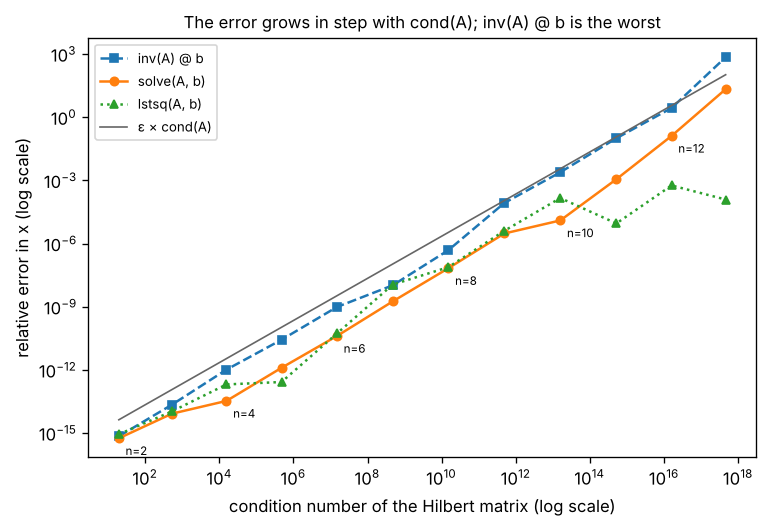

# A3.4 Numerical stability

**Depth** · Part A, week 3 (course week 03) · ~1.5 h · Lab:
[`labs/A/a3_4_numerical_stability.py`](../../labs/A/a3_4_numerical_stability.py)

## Why it matters

Computers do linear algebra with about 16 significant digits, and every operation rounds. Usually
nobody notices. But some problems amplify those rounding errors (and the measurement noise already in
your data) by factors of a million or more, and some algorithms amplify them more than they need to.
The symptoms in ML are regression coefficients that swing wildly between retrains, a covariance
matrix that "is not positive definite", a training run that turns into `nan` in float32. This lesson
gives you the one number that predicts the damage, the **condition number**, and the three habits that
avoid making it worse: solve instead of invert, use QR or the SVD instead of the normal equations, and
use Cholesky for symmetric positive-definite matrices. This is a Depth topic: skip it on a tight week,
but come back before Part B's regularization ([B2.2](../B/b2_2_regularization.md)) and Part C's
mixed precision ([C4.2](../C/c4_2_mixed_precision.md)).

## Prerequisite check

- Can you solve a 2×2 system and say what makes a matrix singular? If not, revisit
  [A2.3](a2_3_linear_systems_rank.md).
- Can you project a vector onto another and say why the residual is orthogonal? If not, revisit
  [A2.4](a2_4_projections_least_squares.md).
- Can you say what the singular values of a matrix are, and how $\mathbf{A}^\top\mathbf{A}$'s eigenvalues
  relate to them? If not, revisit [A3.2](a3_2_svd.md).
- Can you say why a covariance matrix is symmetric and positive semi-definite? If not, revisit
  [A3.3](a3_3_covariance_matrices.md).

## Intuition

### Floats are scientific notation with a fixed number of digits

A float64 stores a number like $1.2345678901234567 \times 10^{-3}$: about 16 significant digits and an
exponent. Anything beyond the 16th digit is rounded away. The gap between 1 and the next float is the
**machine epsilon**, $\varepsilon = 2.2 \times 10^{-16}$, so `1.0 + 1e-16 == 1.0` is `True`, and `0.1 + 0.2`
is not exactly `0.3` (0.1 has no finite binary expansion, just as 1/3 has none in decimal). Each
individual rounding error is tiny, about $\varepsilon$ relative to the result. The question is what the
rest of the computation does to it.

### Some problems are sensitive, whatever algorithm you use

Two nearly parallel lines cross at a point, but nudge one line a hair and the crossing point slides a
long way along them. Solving $\mathbf{A}\mathbf{x} = \mathbf{b}$ when the columns of $\mathbf{A}$ point in
nearly the same direction is exactly that picture. A change in the fifth digit of $\mathbf{b}$ can move
$\mathbf{x}$ completely (the first worked example). This sensitivity belongs to the *problem*, not to the
code: no algorithm can recover digits that the problem itself destroys. The condition number measures
it: roughly, **you lose $\log_{10}(\text{condition number})$ digits**. With a condition number of
$10^{10}$, a float64 answer has about 6 correct digits; at $10^{16}$, none.

### Some algorithms add damage the problem did not ask for

Separately, an algorithm can be careless. Computing $\mathbf{A}^{-1}$ and then multiplying does more
arithmetic, and so more rounding, than solving directly. Forming $\mathbf{X}^\top\mathbf{X}$ for least
squares squares the condition number (A2.4 measured that), so a problem that should lose 7 digits loses 14.
An algorithm that adds no more error than the problem's own sensitivity forces is called **stable**.
The good factorizations in this lesson, QR and Cholesky, plus the LU inside `np.linalg.solve` (A2.3), are
how libraries stay stable.

> **Bridge:** float64 is PostgreSQL's `DOUBLE PRECISION`: approximate, about 15 significant digits, and
> you would never store money in it (you use `NUMERIC`). **Where it breaks:** in ML you cannot switch to
> exact decimals. It would be far too slow, and it would not help: an ill-conditioned problem also
> amplifies the noise in your *measurements*, which are only known to a few digits anyway. The fix is to
> pose a better-conditioned problem (scale features, drop redundant ones, regularize) and to use stable
> algorithms, not to add digits.

## The math

**Symbols**

| Symbol | Meaning | Shape |
|---|---|---|
| $\varepsilon$ | machine epsilon, $2.2 \times 10^{-16}$ for float64, $1.2 \times 10^{-7}$ for float32 | scalar |
| $\mathbf{A}$ | a square, invertible matrix | `(d, d)` |
| $\sigma_{\max}$, $\sigma_{\min}$ | the largest and smallest singular values of $\mathbf{A}$ | scalar |
| $\kappa(\mathbf{A})$ | condition number, $\sigma_{\max}/\sigma_{\min}$ | scalar |
| $\delta\mathbf{b}$, $\delta\mathbf{x}$ | a small change in $\mathbf{b}$ and the change it causes in $\mathbf{x}$ | `(d,)` |
| $\mathbf{X}$ | a tall data matrix with independent columns | `(n, d)` |
| $\mathbf{Q}$ | orthonormal columns, $\mathbf{Q}^\top\mathbf{Q} = \mathbf{I}_d$ | `(n, d)` |
| $\mathbf{R}$ | upper triangular (zeros below the diagonal) | `(d, d)` |
| $\mathbf{C}$ | symmetric positive-definite matrix | `(d, d)` |
| $\mathbf{L}$ | lower triangular with positive diagonal | `(d, d)` |

**The condition number bounds the damage.** Solve $\mathbf{A}\mathbf{x} = \mathbf{b}$, then perturb $\mathbf{b}$:
$\mathbf{A}(\mathbf{x} + \delta\mathbf{x}) = \mathbf{b} + \delta\mathbf{b}$. Subtracting the first equation gives
$\mathbf{A}\,\delta\mathbf{x} = \delta\mathbf{b}$, so $\delta\mathbf{x} = \mathbf{A}^{-1}\delta\mathbf{b}$. Two facts from the
SVD (A3.2): $\mathbf{A}$ stretches any vector by at most $\sigma_{\max}$, and $\mathbf{A}^{-1} = \mathbf{V}\boldsymbol{\Sigma}^{-1}\mathbf{U}^\top$
stretches any vector by at most $1/\sigma_{\min}$. Therefore

$$\lVert\delta\mathbf{x}\rVert \le \frac{\lVert\delta\mathbf{b}\rVert}{\sigma_{\min}} \qquad\text{and}\qquad \lVert\mathbf{b}\rVert = \lVert\mathbf{A}\mathbf{x}\rVert \le \sigma_{\max}\lVert\mathbf{x}\rVert \;\Rightarrow\; \frac{1}{\lVert\mathbf{x}\rVert} \le \frac{\sigma_{\max}}{\lVert\mathbf{b}\rVert}.$$

Multiply the two inequalities:

$$\boxed{\frac{\lVert\delta\mathbf{x}\rVert}{\lVert\mathbf{x}\rVert} \le \kappa(\mathbf{A})\,\frac{\lVert\delta\mathbf{b}\rVert}{\lVert\mathbf{b}\rVert}}, \qquad \kappa(\mathbf{A}) = \frac{\sigma_{\max}}{\sigma_{\min}} \ge 1.$$

A relative error in the input (rounding $\mathbf{b}$ costs about $\varepsilon$, measuring it maybe $10^{-3}$)
can be amplified by up to $\kappa$ in the output. Errors in $\mathbf{A}$ itself obey a similar bound.
$\kappa = 1$ for an orthogonal matrix (it only rotates), and $\kappa = \infty$ for a singular one. In
practice, $\kappa\,\varepsilon \ge 1$ means the matrix is singular as far as float64 can tell: that is
the tolerance in `matrix_rank` (A3.2) and why A2.3 warned that nearly dependent columns "behave as if
dependent in floating point".

**The normal equations square it.** $\mathbf{X}^\top\mathbf{X} = \mathbf{V}\boldsymbol{\Sigma}^2\mathbf{V}^\top$ (A3.2), so
its singular values are the $\sigma_j^2$ and

$$\kappa(\mathbf{X}^\top\mathbf{X}) = \frac{\sigma_{\max}^2}{\sigma_{\min}^2} = \kappa(\mathbf{X})^2.$$

If $\kappa(\mathbf{X}) = 10^7$, the normal equations work with $10^{14}$ and keep about 2 digits.

**Why not `inv`.** `np.linalg.solve` factors $\mathbf{A}$ once (LU with pivoting, A2.3) and does two
triangular solves. Computing $\mathbf{A}^{-1}$ does the same factorization and then $d$ solves, one for
each column of $\mathbf{I}$, which is about three times the arithmetic for a single right-hand side; the
rounding errors in the entries of $\mathbf{A}^{-1}$ are then multiplied into $\mathbf{b}$. Both answers lose
digits in proportion to $\kappa$, because that is the problem's sensitivity. The difference is the
**residual** $\lVert\mathbf{A}\mathbf{x} - \mathbf{b}\rVert$: `solve` returns the exact solution of a system
within rounding of the one you gave it (it is **backward stable**), so its residual is always at the
$\varepsilon$ level; `inv(A) @ b` has no such guarantee. The lab measures both.

**QR by Gram–Schmidt.** Write the columns of $\mathbf{X}$ as $\mathbf{a}_1, \dots, \mathbf{a}_d$. Build orthonormal
$\mathbf{q}_1, \dots, \mathbf{q}_d$ one at a time, each time removing the parts along the $\mathbf{q}$'s already
found (projection onto a unit vector $\mathbf{q}$ is $(\mathbf{q}^\top\mathbf{a})\mathbf{q}$, from A2.4):

$$r_{ij} = \mathbf{q}_i^\top\mathbf{a}_j \;(i < j), \qquad \mathbf{v}_j = \mathbf{a}_j - \sum_{i<j} r_{ij}\mathbf{q}_i, \qquad r_{jj} = \lVert\mathbf{v}_j\rVert, \qquad \mathbf{q}_j = \mathbf{v}_j / r_{jj}.$$

Rearranged, $\mathbf{a}_j = r_{1j}\mathbf{q}_1 + \dots + r_{jj}\mathbf{q}_j$: column $j$ of $\mathbf{X}$ uses only the
first $j$ columns of $\mathbf{Q}$, so the coefficient matrix is upper triangular and $\mathbf{X} = \mathbf{Q}\mathbf{R}$.
This is **classical Gram–Schmidt**. In floating point, the $\mathbf{q}$'s slowly stop being orthogonal when
columns are nearly dependent. **Modified Gram–Schmidt** computes the same thing in a different order:
as soon as $\mathbf{q}_j$ is known, it is subtracted from *all* remaining columns, so each later coefficient
is computed from an already-cleaned vector. It is much better, but still not perfect. LAPACK (and so
`np.linalg.qr`) uses Householder reflections, which keep $\mathbf{Q}$ orthogonal to rounding level whatever
the conditioning (stated here; the lab shows all three).

**Least squares with QR.** Substitute $\mathbf{X} = \mathbf{Q}\mathbf{R}$ into the normal equations and use
$\mathbf{Q}^\top\mathbf{Q} = \mathbf{I}$:

$$\mathbf{R}^\top\mathbf{Q}^\top\mathbf{Q}\mathbf{R}\,\mathbf{w} = \mathbf{R}^\top\mathbf{Q}^\top\mathbf{y} \;\Rightarrow\; \mathbf{R}^\top\mathbf{R}\,\mathbf{w} = \mathbf{R}^\top\mathbf{Q}^\top\mathbf{y} \;\Rightarrow\; \mathbf{R}\,\mathbf{w} = \mathbf{Q}^\top\mathbf{y},$$

where the last step multiplies by $(\mathbf{R}^\top)^{-1}$, which exists because the columns of $\mathbf{X}$ are
independent (so every $r_{jj} > 0$). Solve the triangular system by back substitution (A2.3).
$\mathbf{X}^\top\mathbf{X}$ is never formed, and $\kappa(\mathbf{R}) = \kappa(\mathbf{X})$ because $\mathbf{Q}$ does not
change lengths: the condition number is not squared.

**Cholesky.** A symmetric positive-definite (A3.3) matrix factors as $\mathbf{C} = \mathbf{L}\mathbf{L}^\top$.
For a 2×2, multiply out and match entries:

$$\begin{pmatrix}\ell_{11}&0\\\ell_{21}&\ell_{22}\end{pmatrix}\begin{pmatrix}\ell_{11}&\ell_{21}\\0&\ell_{22}\end{pmatrix} = \begin{pmatrix}\ell_{11}^2 & \ell_{11}\ell_{21}\\ \ell_{11}\ell_{21} & \ell_{21}^2 + \ell_{22}^2\end{pmatrix} = \begin{pmatrix}c_{11}&c_{21}\\c_{21}&c_{22}\end{pmatrix}$$

gives $\ell_{11} = \sqrt{c_{11}}$, $\ell_{21} = c_{21}/\ell_{11}$, $\ell_{22} = \sqrt{c_{22} - \ell_{21}^2}$. The same
matching, column by column, gives the general formulas:

$$\ell_{jj} = \sqrt{c_{jj} - \sum_{k<j}\ell_{jk}^2}, \qquad \ell_{ij} = \frac{c_{ij} - \sum_{k<j}\ell_{ik}\ell_{jk}}{\ell_{jj}} \quad (i > j).$$

The number under each square root is positive exactly when $\mathbf{C}$ is positive definite (stated, not
proved), so Cholesky doubles as the standard test for positive definiteness: it fails on anything else.
It costs about half as much as LU. To solve $\mathbf{C}\mathbf{x} = \mathbf{b}$: forward-substitute
$\mathbf{L}\mathbf{y} = \mathbf{b}$ (first equation down), then back-substitute $\mathbf{L}^\top\mathbf{x} = \mathbf{y}$.
It is the method of choice for ridge regression's $\mathbf{X}^\top\mathbf{X} + \lambda\mathbf{I}$ (exercise 2), and
$\mathbf{L}$ is the matrix A3.3 used to generate data with a given covariance.

## Worked example by hand

**1. Condition number of a nearly singular system.** $\mathbf{A} = \begin{pmatrix}1&1\\1&1.0001\end{pmatrix}$,
$\mathbf{b} = (2, 2.0001)$. Subtracting row 1 from row 2: $0.0001\,x_2 = 0.0001$, so $x_2 = 1$, then $x_1 = 1$.
Now change $b_2$ to $2.0002$: $0.0001\,x_2 = 0.0002$, so $x_2 = 2$ and $x_1 = 0$. A change of $10^{-4}$ in one
entry of $\mathbf{b}$ (relative change $10^{-4}/\lVert\mathbf{b}\rVert = 10^{-4}/2.8285 \approx 3.5 \times 10^{-5}$) moved
$\mathbf{x}$ from $(1, 1)$ to $(0, 2)$, a relative change of $\lVert(-1, 1)\rVert/\lVert(1, 1)\rVert = 1$: an
amplification of about 28,000. The matrix is symmetric, so its singular values are the absolute values
of its eigenvalues: $\operatorname{tr} = 2.0001$, $\det = 0.0001$, so $\lambda \approx 2.0001$ and
$\lambda \approx 0.0001/2.0001 \approx 0.00005$ (product = det). $\kappa \approx 2.0001/0.00005 \approx 40{,}000$,
and indeed $28{,}000 \le 40{,}000$.

**2. QR by Gram–Schmidt** of $\mathbf{A} = \begin{pmatrix}3&1\\4&2\end{pmatrix}$, columns $\mathbf{a}_1 = (3, 4)$, $\mathbf{a}_2 = (1, 2)$.

- $r_{11} = \lVert\mathbf{a}_1\rVert = 5$, $\mathbf{q}_1 = (0.6, 0.8)$.
- $r_{12} = \mathbf{q}_1\cdot\mathbf{a}_2 = 0.6 + 1.6 = 2.2$. Remove that part: $\mathbf{v}_2 = (1, 2) - 2.2(0.6, 0.8) = (1 - 1.32, 2 - 1.76) = (-0.32, 0.24)$.
- $r_{22} = \sqrt{0.1024 + 0.0576} = \sqrt{0.16} = 0.4$, $\mathbf{q}_2 = (-0.8, 0.6)$. Check $\mathbf{q}_1\cdot\mathbf{q}_2 = -0.48 + 0.48 = 0$ ✓.
- $\mathbf{Q} = \begin{pmatrix}0.6&-0.8\\0.8&0.6\end{pmatrix}$, $\mathbf{R} = \begin{pmatrix}5&2.2\\0&0.4\end{pmatrix}$. Check column 2 of
  $\mathbf{Q}\mathbf{R}$: $2.2(0.6, 0.8) + 0.4(-0.8, 0.6) = (1.32 - 0.32, 1.76 + 0.24) = (1, 2)$ ✓.

**3. Cholesky** of $\mathbf{C} = \begin{pmatrix}4&2&2\\2&5&3\\2&3&6\end{pmatrix}$, then solve $\mathbf{C}\mathbf{x} = (8, 10, 11)$.

- Column 1: $\ell_{11} = \sqrt4 = 2$, $\ell_{21} = 2/2 = 1$, $\ell_{31} = 2/2 = 1$.
- Column 2: $\ell_{22} = \sqrt{5 - 1^2} = 2$, $\ell_{32} = (3 - \ell_{31}\ell_{21})/\ell_{22} = (3 - 1)/2 = 1$.
- Column 3: $\ell_{33} = \sqrt{6 - 1^2 - 1^2} = 2$. So $\mathbf{L} = \begin{pmatrix}2&0&0\\1&2&0\\1&1&2\end{pmatrix}$.
- Forward, $\mathbf{L}\mathbf{y} = \mathbf{b}$: $y_1 = 8/2 = 4$; $y_2 = (10 - 1\cdot4)/2 = 3$; $y_3 = (11 - 4 - 3)/2 = 2$.
- Back, $\mathbf{L}^\top\mathbf{x} = \mathbf{y}$ with $\mathbf{L}^\top = \begin{pmatrix}2&1&1\\0&2&1\\0&0&2\end{pmatrix}$: $x_3 = 2/2 = 1$;
  $x_2 = (3 - 1)/2 = 1$; $x_1 = (4 - 1 - 1)/2 = 1$. Check $\mathbf{C}(1, 1, 1) = (8, 10, 11)$ ✓.

```text
== worked example: an ill-conditioned 2x2 system ==
x for b = [2.0, 2.0001] -> [1.0, 1.0]
x for b' = [2.0, 2.0002] -> [0.0, 2.0]
relative change in b: 3.535e-05   relative change in x: 1.0000   amplification: 28285
singular values = 2.0001, 4.9999e-05   condition number = 40002   np.linalg.cond = 40002

== worked example: Gram-Schmidt ==
r11 = |a1| = 5.0000   q1 = [0.6, 0.8]
r12 = q1 . a2 = 2.2000   a2 - r12 q1 = [-0.32, 0.24]   r22 = 0.4000   q2 = [-0.8, 0.6]
Q = [[0.6, -0.8], [0.8, 0.6]]   R = [[5.0, 2.2], [0.0, 0.4]]
Q R == A: True   Q^T Q == I: True

== worked example: Cholesky ==
C = [[4.0, 2.0, 2.0], [2.0, 5.0, 3.0], [2.0, 3.0, 6.0]]
L (by hand) = [[2.0, 0.0, 0.0], [1.0, 2.0, 0.0], [1.0, 1.0, 2.0]]   L L^T == C: True
```

## Key plot



The lab solves $\mathbf{H}_n\mathbf{x} = \mathbf{b}$ for **Hilbert matrices** $H_{ij} = 1/(i + j - 1)$ (1-based)
of size 2 to 13, whose condition number grows from about 19 to about $10^{17}$, with a known answer
$\mathbf{x} = (1, \dots, 1)$. The grey line is $\varepsilon\,\kappa$, the error the bound predicts from rounding
alone. Every method's error climbs along it: one digit lost per factor of 10 in $\kappa$, exactly as
"The math" says, and by $n = 12$ there is nothing left. `inv(A) @ b` sits on or above the line; `solve`
is a few times better. `lstsq` falls off the line for the largest matrices because it treats singular
values below its cutoff as zero, which happens to suit this smooth true $\mathbf{x}$; do not count on that in
general.

## From scratch in NumPy

The lab writes classical and modified Gram–Schmidt, Cholesky, and the two triangular solves.
The two Gram–Schmidt variants differ in one line, which column the coefficients are computed from:

```python
def qr_classical(A: FloatArray) -> tuple[FloatArray, FloatArray]:
    """Thin QR by classical Gram-Schmidt. A (n, d), n >= d, full column rank -> Q (n, d), R (d, d)."""
    n, d = A.shape
    Q, R = np.zeros((n, d)), np.zeros((d, d))
    for j in range(d):
        R[:j, j] = Q[:, :j].T @ A[:, j]  # (j,): coefficients along the q's found so far, from the ORIGINAL column
        v = A[:, j] - Q[:, :j] @ R[:j, j]  # (n,): what is left after removing those parts
        R[j, j] = np.linalg.norm(v)
        Q[:, j] = v / R[j, j]
    return Q, R


def qr_modified(A: FloatArray) -> tuple[FloatArray, FloatArray]:
    """Thin QR by modified Gram-Schmidt. A (n, d), n >= d, full column rank -> Q (n, d), R (d, d)."""
    n, d = A.shape
    V = A.copy()  # (n, d): columns are updated in place as each q is removed
    Q, R = np.zeros((n, d)), np.zeros((d, d))
    for j in range(d):
        R[j, j] = np.linalg.norm(V[:, j])
        Q[:, j] = V[:, j] / R[j, j]
        R[j, j + 1 :] = Q[:, j] @ V[:, j + 1 :]  # coefficients from the UPDATED columns
        V[:, j + 1 :] -= np.outer(Q[:, j], R[j, j + 1 :])  # remove q_j from every later column now
    return Q, R


def cholesky(C: FloatArray) -> FloatArray:
    """Lower-triangular L with L L^T = C. C (d, d) symmetric positive definite -> L (d, d)."""
    d = C.shape[0]
    L = np.zeros((d, d))
    for j in range(d):
        diag = C[j, j] - L[j, :j] @ L[j, :j]
        if diag <= 0:
            raise np.linalg.LinAlgError(f"not positive definite (pivot {j} is {diag:.3g})")
        L[j, j] = np.sqrt(diag)
        L[j + 1 :, j] = (C[j + 1 :, j] - L[j + 1 :, :j] @ L[j, :j]) / L[j, j]
    return L
```

`forward_substitution` and `back_substitution` are short loops (the second is copied from the A2.3 lab).
On the worked examples, and on a matrix that is not positive definite:

```text
== from scratch: QR, Cholesky, triangular solves ==
modified Gram-Schmidt on the worked example: Q = [[0.6, -0.8], [0.8, 0.6]]  R = [[5.0, 2.2], [0.0, 0.4]]
cholesky(C) = [[2.0, 0.0, 0.0], [1.0, 2.0, 0.0], [1.0, 1.0, 2.0]]
solve C x = b via L y = b, then L^T x = y:  y = [4.0, 3.0, 2.0]   x = [1.0, 1.0, 1.0]   C x == b: True
cholesky([[1, 2], [2, 1]]) -> not positive definite (pivot 1 is -3)  (eigenvalues 3 and -1)
```

The next three cells measure stability. Their small numbers depend on your CPU and NumPy build, so
the lab prints them on lines that start with `~` (the style guide's marker for output that varies);
expect the same orders of magnitude, not the same digits.

On a 10 × 10 Hilbert matrix ($\kappa \approx 10^{13}$), how far is each $\mathbf{Q}$ from orthogonal?

```text
== from scratch: loss of orthogonality ==
Hilbert(10): condition number about 10^13
~ classical Gram-Schmidt      |Q^T Q - I| = 1.0e+00   |Q R - H| = 5.6e-17
~ modified Gram-Schmidt       |Q^T Q - I| = 3.0e-04   |Q R - H| = 5.6e-17
~ np.linalg.qr (Householder)  |Q^T Q - I| = 8.9e-16   |Q R - H| = 3.9e-16
```

All three reproduce $\mathbf{H}$ almost perfectly, so a check of $\mathbf{Q}\mathbf{R} = \mathbf{H}$ alone would pass all
three. But classical Gram–Schmidt's $\mathbf{Q}$ is not orthogonal at all (an error of 1 means some pair
of columns is nearly parallel); modified Gram–Schmidt is off by about $\varepsilon\kappa$; Householder is
at rounding level.

`inv` versus `solve` versus `lstsq` on Hilbert systems, the data behind the key plot:

```text
== solving ill-conditioned systems: inv vs solve vs lstsq ==
~  n     cond  error inv error solve error lstsq   resid inv resid solve
~  2  1.9e+01    7.0e-16     5.7e-16     8.8e-16     0.0e+00     0.0e+00
~  3  5.2e+02    2.2e-14     8.4e-15     1.1e-14     6.4e-15     0.0e+00
~  4  1.6e+04    1.0e-12     3.4e-14     2.0e-13     8.2e-14     0.0e+00
~  5  4.8e+05    2.7e-11     1.3e-12     2.7e-13     2.3e-13     7.9e-17
~  6  1.5e+07    9.7e-10     4.1e-11     5.4e-11     8.1e-12     1.5e-16
~  7  4.8e+08    1.0e-08     1.8e-09     1.1e-08     9.2e-10     6.5e-17
~  8  1.5e+10    4.8e-07     6.7e-08     7.6e-08     2.7e-08     1.6e-16
~  9  4.9e+11    8.4e-05     3.0e-06     4.0e-06     1.9e-06     7.9e-17
~ 10  1.6e+13    2.4e-03     1.2e-05     1.4e-04     3.4e-05     1.6e-16
~ 11  5.2e+14    1.0e-01     1.1e-03     9.0e-06     4.6e-04     6.7e-17
~ 12  1.6e+16    2.7e+00     1.3e-01     5.7e-04     4.6e-02     1.1e-16
~ 13  4.7e+17    7.0e+02     2.1e+01     1.2e-04     2.6e+00     5.2e-16
at n = 12, solve's error is within 100 * eps * cond: True
at n = 12, solve's residual is below inv's: True
```

Read the residual columns: `solve` keeps $\lVert\mathbf{A}\mathbf{x} - \mathbf{b}\rVert$ at rounding level for every
$n$, even at $n = 13$ where its answer is completely wrong. That is backward stability: it solved a
system within rounding of yours, exactly; your system is just too sensitive for that to pin down
$\mathbf{x}$. `inv` has residuals up to $10^{14}$ times larger. A small residual therefore does *not* prove
a correct answer when $\kappa$ is large; it only proves the algorithm did its part.

Finally, least squares on a degree-9 polynomial fit with $x \in [0, 1]$, where the columns
$1, x, x^2, \dots, x^9$ look alike and the exact weights are known:

```text
== least squares: normal equations vs QR vs lstsq ==
X (50, 10): condition number about 10^7;  X^T X: about 10^13
~ normal equations   relative error in w = 2.5e-04
~ QR (modified G-S)  relative error in w = 4.6e-05
~ QR (np.linalg.qr)  relative error in w = 8.8e-11
~ np.linalg.lstsq    relative error in w = 1.5e-10
QR error < normal-equations error: True
```

$\kappa(\mathbf{X}) \approx 10^7$ bounds a stable method's error by roughly $\varepsilon\kappa \approx 10^{-9}$; Householder QR and
`lstsq` (SVD) get there. The normal equations work with $\kappa^2 \approx 10^{13}$ and lose about five more
digits. Our modified Gram–Schmidt QR is in between, because its $\mathbf{Q}$ is not quite orthogonal, the
weakness the previous cell showed.

## With NumPy and SciPy

```text
== with numpy and scipy ==
np.linalg.qr R (raw) = [[-5.0, -2.2], [0.0, 0.4]] -> after flipping signs, Q and R match ours: OK
np.linalg.cholesky(C) matches: OK
scipy.linalg.cho_solve gives the same x: OK
np.linalg.cholesky([[1, 2], [2, 1]]) -> LinAlgError: Matrix is not positive definite
~ random 800x800 system: inv @ b 59 ms, solve 12 ms
```

`np.linalg.qr` may return negative diagonal entries in $\mathbf{R}$ (with the matching columns of $\mathbf{Q}$
flipped); both factorizations are valid, so compare after making the diagonal of $\mathbf{R}$ positive.
`scipy.linalg.cho_factor` and `cho_solve` factor once and reuse the factor for many right-hand sides.
`scipy.linalg.solve_triangular` does a triangular solve in compiled code. The timing line varies by
machine; `inv` was several times slower than `solve` here for one right-hand side.

## In practice

- **When to use it:** whenever a linear solve, a regression fit or a covariance computation gives
  results that change a lot with small changes in the data, or when you move code from float64 to
  float32 (GPUs, [C4.2](../C/c4_2_mixed_precision.md)), where $\varepsilon \approx 1.2 \times 10^{-7}$ and you
  have about 7 digits to lose instead of 16.
- **Failure modes:**
  - *Unscaled features:* one column in millions and another in thousandths gives a huge $\kappa(\mathbf{X})$
    even if the features are unrelated. You notice `np.linalg.cond(X)` in the millions; standardize
    the features first ([B1.3](../B/b1_3_feature_engineering.md)).
  - *Nearly dependent features:* two columns that are almost copies of each other. You notice
    coefficients that are huge with opposite signs and change between retrains (exercise 2); drop one
    or regularize ([B2.2](../B/b2_2_regularization.md)).
  - *Normal equations or `inv` in production code:* fine on toy data, fragile on real data. You notice
    accuracy that depends on how the data was scaled; use `lstsq`, `solve` or a library estimator.
  - *Trusting a small residual:* backward-stable solvers always give one. You notice nothing, which is
    the danger; check $\kappa$ too.
  - *"Matrix is not positive definite":* a covariance or kernel matrix that should be PSD has tiny
    negative eigenvalues from rounding, or is truly singular. You notice Cholesky raising; add a small
    "jitter" $\epsilon\mathbf{I}$ (for example $10^{-8}$ times the mean diagonal) and log that you did, or
    fix the dependent features.
  - *Catastrophic cancellation:* subtracting two large, nearly equal numbers, like the one-pass
    variance formula on data with a large offset ([A3.3](a3_3_covariance_matrices.md) exercise 2). You
    notice negative variances; center or shift before you accumulate.
  - *Comparing floats with `==`:* `0.1 + 0.2 == 0.3` is `False`. Use `np.isclose` /
    `np.testing.assert_allclose` with stated tolerances, as every lab does.
- **Defaults that work:** `np.linalg.solve(A, b)`, never `inv(A) @ b` (if you truly need the inverse
  matrix, as for the covariance of regression coefficients, still prefer `cho_solve` or `solve` with
  $\mathbf{I}$ as the right-hand side); `np.linalg.lstsq(X, y, rcond=None)` for least squares; Cholesky
  (`scipy.linalg.cho_factor` / `cho_solve`) for symmetric positive-definite systems; compute
  `np.linalg.cond` when results look unstable; standardize features before any linear model.

## Exercises

Save your work to `my-work/A/a3_4_numerical_stability.md` (or `.py`) and ask for a review.

1. **By hand:** (a) Compute the QR factorization of $\mathbf{A} = \begin{pmatrix}1&4\\2&2\\2&5\end{pmatrix}$ `(3, 2)`
   by Gram–Schmidt, then use it to solve the least-squares problem $\mathbf{A}\mathbf{w} \approx (1, 1, 1)$ by
   back substitution of $\mathbf{R}\mathbf{w} = \mathbf{Q}^\top\mathbf{y}$. Check $\mathbf{w}$ with the normal equations.
   (b) Compute the Cholesky factor of $\begin{pmatrix}9&3\\3&5\end{pmatrix}$, and show where Cholesky breaks down
   on $\begin{pmatrix}1&2\\2&1\end{pmatrix}$. (c) What is $\kappa$ of $\operatorname{diag}(100, 0.01)$? If $\mathbf{b}$ is known
   to a relative accuracy of $10^{-6}$, how accurate can you expect $\mathbf{x}$ to be?
2. **Code:** Ridge regression solves $(\mathbf{X}^\top\mathbf{X} + \lambda\mathbf{I})\mathbf{w} = \mathbf{X}^\top\mathbf{y}$. Generate
   $\mathbf{X}$ `(100, 5)` from a standard normal (`SEED = 0`), then overwrite column 1 with column 0 plus
   $10^{-4}$ times fresh standard-normal noise; set $\mathbf{y} = \mathbf{X}\mathbf{w}_{\text{true}}$ plus $0.1$ times
   standard-normal noise with $\mathbf{w}_{\text{true}} = (1, 1, -2, 0.5, 3)$. Implement `ridge_cholesky(X, y, lam)`
   with your own Cholesky and triangular solves. For $\lambda \in \{10^{-8}, 10^{-4}, 10^{-2}, 1, 10\}$,
   print $\kappa(\mathbf{X}^\top\mathbf{X} + \lambda\mathbf{I})$, $w_0$, $w_1$ and $w_0 + w_1$, and check against
   `sklearn.linear_model.Ridge(alpha=lam, fit_intercept=False, solver="cholesky")`. Also fit plain least
   squares with `lstsq`. Explain what happens to $w_0$ and $w_1$, why $w_0 + w_1$ is stable when they are
   not, and how $\lambda$ trades conditioning against bias.
3. **Think:** A teammate's pricing model is a linear regression refit weekly. Its features include
   `annual_revenue` (values around $10^7$), `conversion_rate` (around $10^{-2}$), and both
   `marketing_spend_usd` and `marketing_spend_inr`. The coefficients change sign from week to week even
   though the data barely changes, and last week's run on a GPU in float32 produced `nan`. Diagnose this
   with the ideas in this lesson, list what you would check (in order), and what you would change.

## Takeaways

1. float64 keeps about 16 significant digits ($\varepsilon = 2.2 \times 10^{-16}$); float32 about 7. Every
   operation rounds; compare floats with tolerances, never `==`.
2. The condition number $\kappa = \sigma_{\max}/\sigma_{\min}$ bounds how much relative input error (rounding or
   measurement) is amplified: you lose about $\log_{10}\kappa$ digits, whatever algorithm you use.
3. Solve, do not invert: `solve` is cheaper and backward stable (residuals at rounding level); `inv(A) @ b`
   is neither. A small residual does not mean an accurate answer when $\kappa$ is large.
4. The normal equations square the condition number; QR ($\mathbf{R}\mathbf{w} = \mathbf{Q}^\top\mathbf{y}$) or the SVD
   (`lstsq`) do not. Householder QR stays orthogonal; Gram–Schmidt does not on ill-conditioned matrices.
5. Cholesky $\mathbf{C} = \mathbf{L}\mathbf{L}^\top$ solves symmetric positive-definite systems at half the cost of LU
   and fails exactly when the matrix is not positive definite, which makes it a test as well as a solver.

**What builds on this:** [B1.3](../B/b1_3_feature_engineering.md) (scaling features improves
conditioning); [B2.2](../B/b2_2_regularization.md) (ridge: adding $\lambda\mathbf{I}$ fixes conditioning);
[A5.2](a5_2_common_distributions.md) (sampling a multivariate Gaussian with the Cholesky factor);
[C1.4](../C/c1_4_stable_softmax_cross_entropy.md) (numerically stable softmax);
[C4.2](../C/c4_2_mixed_precision.md) (float16 and bfloat16 training).
