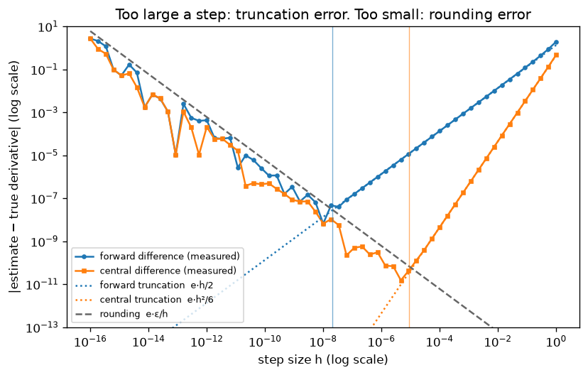

# A4.1 Derivatives and partial derivatives

**Core** · Part A, week 4 (course week 04) · ~1.5 h · Lab:
[`labs/A/a4_1_derivatives.py`](../../labs/A/a4_1_derivatives.py)

## Why it matters

Every model in this course from [B1.5](../B/b1_5_linear_regression.md) on is trained by nudging its
parameters in the direction that lowers the loss, and that direction is built from **derivatives**.
You will derive derivatives by hand, and later trust a library to compute them; in both cases a wrong
derivative does not crash anything. The model still trains, just worse, and nobody notices. The
defence is a **finite-difference** check: compute the slope numerically and compare. This lesson
builds that check and shows why its step size cannot be "as small as possible".

## Prerequisite check

- Can you compute the slope of the straight line through $(1, 3)$ and $(3, 7)$? If not, revisit the
  line fit in [A2.4](a2_4_projections_least_squares.md).
- Can you evaluate a NumPy expression over a whole array of inputs at once, without a loop? If not,
  revisit [A1.2](a1_2_numpy_arrays.md).
- Can you read a plot with both axes on a log scale, where each grid line is 10 times the last? If
  not, revisit [A1.4](a1_4_matplotlib.md).
- Do you know roughly how many significant digits a float64 keeps, and what "machine epsilon" is? If
  not, revisit [A3.4](a3_4_numerical_stability.md).

## Intuition

### Zoom in until the curve looks straight

Plot $f(x) = x^3$ and zoom in around $x = 2$. The more you zoom, the more the curve looks like a
straight line. The slope of that line is the **derivative** of $f$ at 2, written $f'(2)$. It answers:
"if I move $x$ a tiny bit, how many times that amount does $f$ move?" For $x^3$ at 2 the answer is 12:
move $x$ by 0.001 and $f$ moves by about 0.012.

You can estimate that slope without any calculus: evaluate $f$ at two nearby points and divide the
rise by the run, exactly as for a straight line. That estimate is a **finite difference**. The
closer the two points, the better the estimate, *in exact arithmetic*. On a computer there is a
catch, which is the whole second half of this lesson: make the points too close and the rise is
lost in rounding noise.

### Many inputs: change one, hold the rest

A loss depends on many parameters at once. A **partial derivative** asks the one-input question for
one parameter while freezing all the others: "if I nudge only $w_3$, how fast does the loss change?"
Computing it numerically is the same rise-over-run, with a step in one coordinate only. Collecting
every partial derivative into one vector gives the gradient, the subject of
[A4.2](a4_2_gradients_jacobians.md).

> **Bridge:** Prometheus' `rate(http_requests_total[5m])` is a finite difference: roughly
> (counter now − counter 5 minutes ago) / 300 s, a "backward difference" of the request counter. A
> wide window gives a smooth but lagging slope; a narrow one is noisy. **Where it breaks:** the
> counter is sampled and only changes in whole requests, so you cannot shrink the window below the
> scrape interval at all. A mathematical function can be evaluated at any $x$, so the step can be
> made tiny, until floating-point rounding, not sampling, becomes the noise.

## The math

**Symbols**

| Symbol | Meaning | Shape |
|---|---|---|
| $f$ | a function of one number, $f: \mathbb{R} \to \mathbb{R}$ | scalar → scalar |
| $x$ | the input where we want the slope | scalar |
| $h$ | step size of a finite difference ($h > 0$) | scalar |
| $f'(x)$, $\frac{df}{dx}$ | derivative of $f$ at $x$ (two notations for one thing) | scalar |
| $f''(x)$, $f'''(x)$ | second and third derivatives: the derivative of $f'$, then of $f''$ | scalar |
| $\mathbf{x}$ | input of a function of several numbers, $f: \mathbb{R}^n \to \mathbb{R}$ | `(n,)` |
| $\frac{\partial f}{\partial x_j}$ | partial derivative of $f$ with respect to $x_j$, others fixed | scalar |
| $\mathbf{e}_j$ | unit vector: 1 in position $j$, 0 elsewhere | `(n,)` |
| $\varepsilon$ | **machine epsilon**: the gap between 1 and the next float, $2.2 \times 10^{-16}$ for float64 | scalar |

**The definition.** The slope between $x$ and $x + h$ is the rise over the run,
$\frac{f(x + h) - f(x)}{h}$. The derivative is what that slope approaches as $h$ shrinks to 0:

$$f'(x) = \lim_{h \to 0} \frac{f(x + h) - f(x)}{h}.$$

**One derivative from the definition.** For $f(x) = x^2$, expand $(x + h)^2 = x^2 + 2xh + h^2$, so

$$\frac{(x + h)^2 - x^2}{h} = \frac{2xh + h^2}{h} = 2x + h \;\longrightarrow\; 2x \text{ as } h \to 0.$$

Doing the same for each building block gives the rules below. You need them, not their proofs:

| $f(x)$ | $f'(x)$ | | $f(x)$ | $f'(x)$ |
|---|---|---|---|---|
| $c$ (a constant) | $0$ | | $e^x$ | $e^x$ |
| $x^k$ (any power, e.g. $x^{-1} = 1/x$) | $k\,x^{k-1}$ | | $\log x$ | $1/x$ |
| $c \cdot u(x)$ | $c \cdot u'(x)$ | | $\sin x$ | $\cos x$ |
| $u(x) + v(x)$ | $u'(x) + v'(x)$ | | $\cos x$ | $-\sin x$ |
| $u(x)\,v(x)$ (**product rule**) | $u'(x)\,v(x) + u(x)\,v'(x)$ | | | |

The product rule in one line: if $u$ grows by $\Delta u$ and $v$ by $\Delta v$, the product grows
from $uv$ to $(u + \Delta u)(v + \Delta v) = uv + v\,\Delta u + u\,\Delta v + \Delta u\,\Delta v$. The
last term is a tiny times a tiny, negligible as the steps shrink, leaving $v\,\Delta u + u\,\Delta v$.
Functions inside functions, such as $e^{-x^2}$, need the chain rule, which is
[A4.3](a4_3_chain_rule_graphs.md).

**Partial derivatives.** For $f(\mathbf{x})$ with $\mathbf{x}$ of shape `(n,)`, treat every input except
$x_j$ as a constant and differentiate with the rules above:

$$\frac{\partial f}{\partial x_j}(\mathbf{x}) = \lim_{h \to 0} \frac{f(\mathbf{x} + h\,\mathbf{e}_j) - f(\mathbf{x})}{h}.$$

Adding $h\,\mathbf{e}_j$ moves only coordinate $j$. Example: $g(x_1, x_2) = x_1^2 x_2 + 3x_2$. With
$x_2$ frozen, $x_1^2 x_2$ is "a constant times $x_1^2$" and $3x_2$ is a constant, so
$\frac{\partial g}{\partial x_1} = 2x_1 x_2$. With $x_1$ frozen, $x_1^2 x_2$ is "a constant times
$x_2$", so $\frac{\partial g}{\partial x_2} = x_1^2 + 3$.

**How wrong is a finite difference? Truncation error.** Near $x$, a smooth function is very close
to a polynomial in the step $h$ (its **Taylor expansion**; stated here, not derived):

$$f(x + h) = f(x) + h\,f'(x) + \frac{h^2}{2} f''(x) + \frac{h^3}{6} f'''(x) + \dots$$

Check it on $x^3$, whose derivatives are $3x^2$, $6x$ and $6$: the right side is
$x^3 + 3x^2h + 3xh^2 + h^3$, which is exactly $(x + h)^3$ expanded. Now subtract $f(x)$ and divide by
$h$. The **forward difference** is

$$\frac{f(x + h) - f(x)}{h} = f'(x) + \frac{h}{2} f''(x) + \frac{h^2}{6} f'''(x) + \dots$$

so its error is about $\frac{h}{2}f''(x)$: proportional to $h$. Halve the step, halve the error.

The **central difference** steps both ways. Write the expansion again with $-h$ in place of $h$
(odd powers of $h$ flip sign): $f(x - h) = f(x) - h\,f'(x) + \frac{h^2}{2} f''(x) - \frac{h^3}{6} f'''(x) + \dots$.
Subtract it from the expansion of $f(x + h)$: $f(x)$ cancels, the $h^2$ terms cancel, and the $h$ and
$h^3$ terms double:

$$f(x + h) - f(x - h) = 2h\,f'(x) + \frac{2h^3}{6} f'''(x) + \dots \quad\Longrightarrow\quad \frac{f(x + h) - f(x - h)}{2h} = f'(x) + \frac{h^2}{6} f'''(x) + \dots$$

Its error is about $\frac{h^2}{6}f'''(x)$: proportional to $h^2$. Divide the step by 10 and the error
drops 100-fold. This is why gradient checks use the central difference: it costs two evaluations
of $f$ per partial derivative, against about one for the forward difference (which can reuse $f(x)$
for every coordinate), and is far more accurate.

**Rounding error.** A float64 stores about 16 significant digits, so every computed value of $f$ is
off by roughly $\varepsilon\,\lvert f(x)\rvert$. The numerator $f(x + h) - f(x)$ is a difference of two
nearly equal numbers, so its rounding error does not shrink with $h$; dividing it by $h$ blows it up
to about $\varepsilon\,\lvert f(x)\rvert / h$. That is catastrophic cancellation from
[A3.4](a3_4_numerical_stability.md). Add the two errors:

$$\text{forward error} \approx \underbrace{\tfrac{h}{2}\lvert f''\rvert}_{\text{shrinks with } h} + \underbrace{\tfrac{\varepsilon\lvert f\rvert}{h}}_{\text{grows as } h \to 0}, \qquad \text{central error} \approx \tfrac{h^2}{6}\lvert f'''\rvert + \tfrac{\varepsilon\lvert f\rvert}{h}.$$

One term falls and the other rises as $h$ shrinks, so there is a best $h$ in between. For a sum
$a h + b/h$, the minimum is where the two terms are equal (set its derivative $a - b/h^2$ to 0, so
$h = \sqrt{b/a}$). For $f = e^x$ at $x = 1$, where $f = f'' = f''' = e$:

- forward: $\frac{h}{2}e = \frac{\varepsilon e}{h}$ gives $h = \sqrt{2\varepsilon} \approx 2 \times 10^{-8}$,
  with an error of about $5.7 \times 10^{-8}$: only half the digits survive.
- central: setting the derivative of $\frac{h^2}{6}e + \frac{\varepsilon e}{h}$ to 0 gives
  $\frac{h}{3} = \frac{\varepsilon}{h^2}$, so $h = (3\varepsilon)^{1/3} \approx 9 \times 10^{-6}$, with an
  error of about $10^{-10}$: about two-thirds of the digits survive.

These are estimates of the size of the error, not exact values: individual rounding errors partly
cancel, so the measured minimum is noisy and often a little better.

## Worked example by hand

**1. $f(x) = x^3$ at $x = 2$.** Exact: $f'(x) = 3x^2$, so $f'(2) = 12$.

- Forward, $h = 0.1$: $2.1^3 = 9.261$, so $\frac{9.261 - 8}{0.1} = 12.61$. Error $0.61$. The
  expansion predicts $\frac{h}{2}f'' + \frac{h^2}{6}f''' = \frac{0.1}{2} \cdot 12 + \frac{0.01}{6} \cdot 6 = 0.6 + 0.01 = 0.61$ ✓
  (for a cubic the expansion stops, so the prediction is exact).
- Central, $h = 0.1$: $1.9^3 = 6.859$, so $\frac{9.261 - 6.859}{0.2} = \frac{2.402}{0.2} = 12.01$. Error
  $0.01 = \frac{h^2}{6} \cdot 6 = h^2$ ✓.
- $h = 0.01$: forward $12.0601$ (error $0.0601$, ten times smaller), central $12.0001$ (error
  $0.0001$, a hundred times smaller).

**2. Partial derivatives of $g(x_1, x_2) = x_1^2 x_2 + 3x_2$ at $(1, 2)$.** Exact:
$\frac{\partial g}{\partial x_1} = 2x_1x_2 = 4$ and $\frac{\partial g}{\partial x_2} = x_1^2 + 3 = 4$.
Numerically, with $h = 0.1$:

- Nudge $x_1$ only: $g(1.1, 2) = 1.21 \cdot 2 + 6 = 8.42$, $g(0.9, 2) = 0.81 \cdot 2 + 6 = 7.62$, so
  $\frac{8.42 - 7.62}{0.2} = 4$ ✓. Exact, because $g$ is quadratic in $x_1$ and $f''' = 0$.
- Nudge $x_2$ only: $g(1, 2.1) = 2.1 + 6.3 = 8.4$, $g(1, 1.9) = 1.9 + 5.7 = 7.6$, so $\frac{0.8}{0.2} = 4$ ✓.

The lab prints the same numbers:

```text
== worked example: x^3 at x = 2 ==
h = 0.1   forward = 12.610000 (error 0.610000, predicted 3*x*h + h^2 = 0.610000)   central = 12.010000 (error 0.010000, predicted h^2 = 0.010000)
h = 0.01  forward = 12.060100 (error 0.060100, predicted 3*x*h + h^2 = 0.060100)   central = 12.000100 (error 0.000100, predicted h^2 = 0.000100)

== worked example: partial derivatives ==
exact: dg/dx1 = 2 x1 x2 = 4.0   dg/dx2 = x1^2 + 3 = 4.0
g(1.1, 2) = 8.4200  g(0.9, 2) = 7.6200  -> central dg/dx1 = 4.0000
g(1, 2.1) = 8.4000  g(1, 1.9) = 7.6000  -> central dg/dx2 = 4.0000
```

($3xh + h^2$ is $\frac{h}{2} \cdot 6x + \frac{h^2}{6} \cdot 6$ written out for $x^3$.)

## Key plot



Read it right to left. For large $h$ the error falls along the dotted truncation lines: slope 1 on
the log-log plot for the forward difference (error $\propto h$), slope 2 for the central difference
(error $\propto h^2$). Below the best step (the thin vertical lines, the predicted optima) the
dashed rounding line $\varepsilon e/h$ takes over and the error *rises* as $h$ shrinks, jagged
because rounding is noisy. At $h = 10^{-16}$ the estimate is worthless.

## From scratch in NumPy

The two formulas are one line each:

```python
def forward_diff(f: Callable[[float], float], x: float, h: float) -> float:
    """Forward-difference slope (f(x + h) - f(x)) / h."""
    return (f(x + h) - f(x)) / h


def central_diff(f: Callable[[float], float], x: float, h: float) -> float:
    """Central-difference slope (f(x + h) - f(x - h)) / (2 h)."""
    return (f(x + h) - f(x - h)) / (2.0 * h)
```

A partial derivative of a function of a vector moves one coordinate. `step` is all zeros except
position `j`, the code version of $h\,\mathbf{e}_j$ (code indices start at 0, so `j = 0` is $x_1$):

```python
def partial(f: Callable[[FloatArray], float], x: FloatArray, j: int, h: float = 1e-5) -> float:
    """Central-difference partial derivative of f with respect to x[j]. x (n,) -> scalar."""
    step = np.zeros_like(x)  # (n,)
    step[j] = h
    return (f(x + step) - f(x - step)) / (2.0 * h)
```

On $g$ and on $h(\mathbf{x}) = x_1 \sin x_2 + e^{x_3}$, whose exact partials are $\sin x_2$,
$x_1\cos x_2$ and $e^{x_3}$ (in this one function $h$ is a name, not the step size):

```text
== from scratch: partial derivatives ==
dg/dx1 at (1, 2) with h = 1e-5: 4.0000000000
dg/dx2 at (1, 2) with h = 1e-5: 4.0000000000
h(x) = x1 sin(x2) + exp(x3) at [2.0, 0.5, -1.0]
  exact partials  = ['0.4794255386', '1.7551651238', '0.3678794412']
  central (1e-5)  = ['0.4794255386', '1.7551651237', '0.3678794412']
  largest absolute error = 4.1e-11
```

Ten correct digits, as the error analysis promised for a central difference near its best step.
The error study sweeps $h$ from $10^{-16}$ to 1 for $e^x$ at $x = 1$; a few rows, and the best step
found against the prediction:

```text
== from scratch: error against step size ==
h = 1e-01   forward error = 1.41e-01   central error = 4.53e-03
h = 1e-03   forward error = 1.36e-03   central error = 4.53e-07
h = 1e-05   forward error = 1.36e-05   central error = 5.86e-11
h = 1e-08   forward error = 6.60e-09   central error = 6.60e-09
h = 1e-11   forward error = 3.26e-05   central error = 1.04e-05
h = 1e-14   forward error = 9.34e-03   central error = 9.34e-03
forward: predicted best h = 2.1e-08  predicted error = 5.7e-08   best on the grid: h = 1.0e-08  error = 6.6e-09
central: predicted best h = 8.7e-06  predicted error = 1.0e-10   best on the grid: h = 4.6e-06  error = 1.5e-11
```

From $h = 10^{-1}$ to $10^{-3}$ the forward error drops 100-fold and the central error 10,000-fold:
$h$ versus $h^2$. Below $10^{-8}$ both get *worse*, and at $10^{-14}$ they agree, because both are pure
rounding noise. The best steps land within a factor of 2 to 3 of the predictions; the best errors are
better than predicted because rounding errors partly cancelled at those particular $h$ values.

Deep-learning frameworks compute in float32 by default, where $\varepsilon = 1.2 \times 10^{-7}$:

```text
== from scratch: float32 versus float64 ==
float64: best central error = 3.3e-11 at h = 3.2e-06
float32: best central error = 5.8e-06 at h = 3.2e-03
```

In float32 even the best central difference is only good to about 5 digits, and the best step is
around $10^{-3}$. This is why gradient checks are always run in float64 (PyTorch's `gradcheck` insists
on it, [C2.1](../C/c2_1_tensors_autograd_modules.md)).

Last, a function with a kink, where no derivative exists:

```text
== from scratch: a kink ==
|x| at 0, h = 1e-02: forward = 1.0   central = 0.0
|x| at 0, h = 1e-06: forward = 1.0   central = 0.0
ReLU at 1e-7, h = 1e-5: central = 0.5050  (true slope there is 1)
```

At the kink the two formulas disagree whatever the step, because there is no single slope to find.
And the ReLU line is the trap you will hit in [C1.3](../C/c1_3_autograd_engine.md): at
$x = 10^{-7}$ ReLU is smooth with slope 1, but the step $h = 10^{-5}$ straddles the kink at 0, so the
"check" reports about 0.5 and a correct gradient looks wrong.

## With SciPy and NumPy

`scipy.differentiate.derivative` (SciPy 1.15+, VERIFY (as of 2026-10) if you upgrade) runs central
differences at several step sizes and extrapolates, returning an error estimate as well.
`np.gradient` is for the other common case: you do not have $f$, only its values sampled on a grid,
such as a logged metric.

```text
== with scipy and numpy ==
scipy derivative of exp at 1 = 2.718281828459  error estimate = 7.1e-12  success = True  function calls = 11
central_diff matches scipy: OK
scipy derivative of x^3 at [0, 1, 2] = [0.0, 3.0, 12.0]   exact 3 x^2 = [0.0, 3.0, 12.0]
np.gradient(sin) on 11 points: max error inside = 0.0156  at the ends = 0.0164
```

The check passes at `rtol=1e-9` and no tighter: a single central difference at its best step is only
good to about $10^{-10}$ relative (the U-shape above), while SciPy's extrapolation is good to about
$10^{-12}$. `np.gradient` uses a central difference with the grid spacing ($\pi/10 \approx 0.31$) as $h$, so
it is only good to about 2 digits here; it cannot do better because it cannot choose $h$.

## In practice

- **When to use it:** to *check* a derivative you wrote by hand or a library computed, on a few
  inputs, in float64. Not to *train*: a finite-difference gradient of a model with $P$ parameters
  costs about $2P$ evaluations of the loss, against roughly the cost of one or two evaluations for
  backpropagation ([A4.3](a4_3_chain_rule_graphs.md)).
- **Failure modes:**
  - *Step too small:* the estimate is rounding noise. You notice that the estimate changes wildly
    when you change $h$ by a factor of 10; a good $h$ sits on a flat stretch.
  - *Step too large:* truncation error, so a correct derivative looks wrong. You notice that the
    relative error shrinks steadily when you shrink $h$.
  - *float32:* best case about 5 digits. You notice relative errors stuck around $10^{-4}$ to
    $10^{-5}$; cast the function and inputs to float64 for the check.
  - *Kinks and branches:* ReLU, `abs`, `max`, `round`, `if` statements. You notice a mismatch that
    appears only for inputs near the kink; move the check point away from it.
  - *Randomness inside $f$:* dropout or data shuffling makes $f(x + h)$ and $f(x - h)$ use different
    random numbers. You notice errors of order 1; fix the seed inside $f$ or switch it off.
  - *Large inputs:* near $x = 10^6$ floats are about $10^{-10}$ apart, so $x + h$ is rounded and the
    run is not exactly $2h$. You notice errors that grow with $\lvert x\rvert$; divide by the run
    actually taken, and choose $h$ on the scale where $f$ curves, which is not always $\lvert x\rvert$
    (exercise 2).
- **Defaults that work:** central differences in float64 with $h$ around $10^{-5}$ to $10^{-6}$ for
  inputs of order 1 (standardized features and typical weights are); judge by the relative error
  $\lvert a - b\rvert / \max(\lvert a\rvert, \lvert b\rvert)$, where below about $10^{-7}$ is a pass and above
  about $10^{-4}$ is almost certainly a bug (rules of thumb, not laws: [A4.2](a4_2_gradients_jacobians.md)
  builds the checker). For a quick accurate value, `scipy.differentiate.derivative`.

## Exercises

Save your work to `my-work/A/a4_1_derivatives.md` (or `.py`) and ask for a review.

1. **By hand:** (a) For $f(x) = 1/x$ at $x = 2$, compute the exact derivative, then the forward and
   central differences with $h = 0.1$ (four decimals), their errors, and the errors the expansion
   predicts from $\frac{h}{2}f''$ and $\frac{h^2}{6}f'''$. (b) For
   $f(x_1, x_2) = 3x_1^2 - 2x_1x_2 + x_2^3$, find both partial derivatives at $(1, -1)$, then estimate
   $\frac{\partial f}{\partial x_2}$ with a forward difference, $h = 0.1$, and explain the size and sign
   of its error. (c) A colleague says "use $h = 10^{-12}$ for the central difference, smaller is more
   accurate". Using the error formula, what error do you expect for a function with values and
   derivatives of order 1, and what $h$ would you use instead?
2. **Code:** Write `central_diff(f, x, h, recompute)` that, when `recompute` is true, divides by the
   run actually taken, `(x + h) - (x - h)`, instead of `2 * h`. For $f = \sin$ and $f = \log$, each at
   $x = 1$, $10^3$ and $10^6$, print the *relative* error of four variants: a fixed step $h = 10^{-5}$
   and a scaled step $h = h_0\max(1, \lvert x\rvert)$ with $h_0 = (3\varepsilon)^{1/3}$, each with and
   without the recompute. Explain which variant wins for which function and why, using two facts:
   float64 numbers near $10^6$ are about $10^{-10}$ apart, and each function curves on its own length
   scale (how far you must move before the slope changes noticeably).
3. **Think:** A teammate proposes computing the gradients of a 10-million-parameter model with central
   differences, "so we never have to derive anything". Estimate what one gradient would cost compared
   with one forward pass, and what accuracy it would have in float32. Then say when finite differences
   *are* worth running in a real project, and how you would build them into a test suite so the test
   neither misses bugs nor fails at random.

## Takeaways

1. A derivative is the local slope, the limit of rise over run; a partial derivative is the same with
   every other input held fixed.
2. The forward difference has error about $\frac{h}{2}f''$ ($\propto h$); the central difference about
   $\frac{h^2}{6}f'''$ ($\propto h^2$), which is why checks use the central one.
3. Rounding adds an error of about $\varepsilon\lvert f\rvert/h$, so shrinking $h$ eventually makes things
   worse: the total error is U-shaped, with a best $h$ near $10^{-5}$ (central, float64).
4. Check in float64: float32 leaves about 5 good digits at best.
5. Finite differences check gradients; they do not compute them for training, and they fail at kinks,
   with randomness inside $f$, and with unscaled steps on large inputs.

**What builds on this:** [A4.2](a4_2_gradients_jacobians.md) (gradients and a general gradient
checker); [A4.3](a4_3_chain_rule_graphs.md) (the chain rule for functions inside functions);
[A4.4](a4_4_gradient_descent.md) (gradient descent); [C1.3](../C/c1_3_autograd_engine.md) (checking
your autograd engine); [C2.1](../C/c2_1_tensors_autograd_modules.md) (PyTorch's `gradcheck`).
