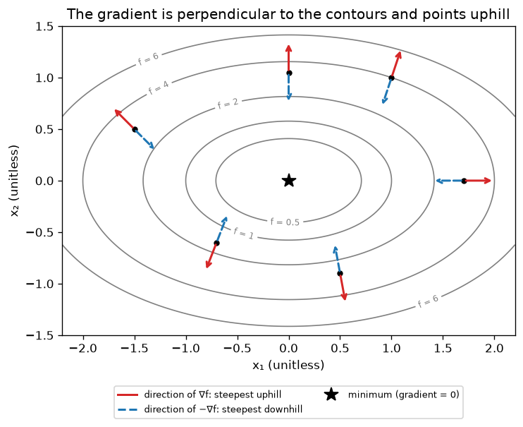

# A4.2 Gradients, Jacobians and the shapes of matrix derivatives used in ML

**Core** · Part A, week 4 (course week 04) · ~2 h · Lab:
[`labs/A/a4_2_gradients_jacobians.py`](../../labs/A/a4_2_gradients_jacobians.py)

## Why it matters

A model has thousands to billions of parameters, and training needs the derivative of one number, the
loss, with respect to every one of them at once. That collection is the **gradient**. To implement a
model from scratch (B1.5, B2.1, C1) you derive gradients of expressions like $\lVert\mathbf{X}\mathbf{w} - \mathbf{y}\rVert^2$
whose inputs are vectors and matrices, and the commonest bug is not wrong calculus but a wrong
*shape*: a missing transpose, or a broadcast that silently turns a `(n,)` residual into `(n, n)`. This
lesson gives you the four derivatives ML uses all the time, a rule for checking their shapes, and a
gradient checker that catches the rest.

## Prerequisite check

- Can you compute a partial derivative, holding the other inputs fixed, and check it with a central
  difference? If not, revisit [A4.1](a4_1_derivatives.md).
- Can you state the shape of `X.T @ r` for `X` of shape `(n, d)` and `r` of shape `(n,)`? If not,
  revisit [A2.1](a2_1_matrices_as_linear_maps.md) and [A2.2](a2_2_matrix_multiplication_inverse.md).
- Can you write the dot product $\mathbf{a}\cdot\mathbf{u}$ as $\lVert\mathbf{a}\rVert\lVert\mathbf{u}\rVert\cos\theta$? If
  not, revisit [A1.5](a1_5_vectors.md).
- Do you remember the normal equations $\mathbf{X}^\top\mathbf{X}\mathbf{w} = \mathbf{X}^\top\mathbf{y}$? If not, revisit
  [A2.4](a2_4_projections_least_squares.md).

## Intuition

### The gradient: every partial derivative in one arrow

Stand on a hillside where the height is $f(x_1, x_2)$. The partial derivative $\partial f/\partial x_1$ is
the slope if you walk due east; $\partial f/\partial x_2$ the slope if you walk due north. Put them in a
vector and you get the **gradient**, $\nabla f$. It is an arrow on the map with two properties that the
rest of the course relies on: it points in the direction of *steepest ascent*, and its length is that
steepest slope. Walking along a contour line (constant height) the slope is zero, so the gradient is
perpendicular to the contours. Gradient descent ([A4.4](a4_4_gradient_descent.md)) is "walk the other
way".

### The Jacobian: many outputs

A layer of a network takes a vector in and gives a vector out. Each output has its own gradient; stack
them as rows and you get the **Jacobian**, a matrix that says how every output moves when every input
moves. Near a point, any smooth function behaves like a linear map, and the Jacobian is that linear map
([A2.1](a2_1_matrices_as_linear_maps.md)).

### Shapes are your type system

In this course the gradient of a scalar loss with respect to a parameter always has **the same shape as
the parameter**: $\mathbf{w}$ `(d,)` gets a gradient `(d,)`, $\mathbf{W}$ `(d, k)` gets `(d, k)`. That rule, plus
knowing the shapes of the other pieces, usually leaves only one way to multiply them together.

> **Bridge:** shape-checking a gradient is type-checking. TypeScript rejects
> `function f(x: number[]): number[][]` returning the wrong thing; here `dW` must be `(d, k)` because `W` is.
> **Where it breaks:** the type checker is a proof that shapes match; a shape match is not a proof that
> the math is right. $\mathbf{X}^\top\mathbf{r}$ and $2\mathbf{X}^\top\mathbf{r}$ have the same shape, and NumPy
> broadcasting will happily "type-check" a `(n,)` minus a `(n, 1)` into a `(n, n)` matrix. That is why
> the numerical checker exists.

## The math

> **In this lesson only,** a generic function takes $p$ inputs, $f: \mathbb{R}^p \to \mathbb{R}$, so that $n$
> stays the number of examples and $d$ the number of features.

**Symbols**

| Symbol | Meaning | Shape |
|---|---|---|
| $f$ | a scalar function of a vector, $f: \mathbb{R}^p \to \mathbb{R}$ | `(p,)` → scalar |
| $\nabla f(\mathbf{x})$ | **gradient**: the partial derivatives $\partial f/\partial x_j$ stacked | `(p,)` |
| $\boldsymbol{\delta}$ | a small step in the input | `(p,)` |
| $\mathbf{u}$ | a direction, $\lVert\mathbf{u}\rVert = 1$ | `(p,)` |
| $\mathbf{F}$ | a vector function, $\mathbf{F}: \mathbb{R}^p \to \mathbb{R}^m$, with outputs $F_1, \dots, F_m$ | `(p,)` → `(m,)` |
| $\mathbf{J}$ | **Jacobian** of $\mathbf{F}$: $J_{ij} = \partial F_i/\partial x_j$ | `(m, p)` |
| $\mathbf{a}$, $\mathbf{b}$ | constant vectors | `(p,)`, `(m,)` |
| $\mathbf{M}$, $\mathbf{A}$ | constant matrices | `(p, p)`, `(m, p)` |
| $\mathbf{X}$, $\mathbf{y}$, $\mathbf{w}$ | data matrix, targets, weights | `(n, d)`, `(n,)`, `(d,)` |
| $\mathbf{r}$ | residual $\mathbf{X}\mathbf{w} - \mathbf{y}$ (prediction minus target) | `(n,)` |
| $\mathbf{W}$, $\mathbf{Y}$, $\mathbf{R}$ | weight matrix, target matrix, residual $\mathbf{X}\mathbf{W} - \mathbf{Y}$ | `(d, k)`, `(n, k)`, `(n, k)` |
| $\mathbf{H}$ | **Hessian**: $H_{ij} = \partial^2 f/\partial x_i\,\partial x_j$ | `(p, p)` |

### The gradient and the direction of steepest ascent

$$\nabla f(\mathbf{x}) = \Big(\frac{\partial f}{\partial x_1}, \dots, \frac{\partial f}{\partial x_p}\Big), \qquad \text{shape } (p,).$$

If you move every input a little, $\boldsymbol{\delta} = (\delta_1, \dots, \delta_p)$, each coordinate contributes
its own slope times its own step, and for small steps these contributions simply add (stated here; it
is the many-input version of "zoom in until it looks straight"):

$$f(\mathbf{x} + \boldsymbol{\delta}) \approx f(\mathbf{x}) + \frac{\partial f}{\partial x_1}\delta_1 + \dots + \frac{\partial f}{\partial x_p}\delta_p = f(\mathbf{x}) + \nabla f(\mathbf{x}) \cdot \boldsymbol{\delta}.$$

Take a step of length $t$ in direction $\mathbf{u}$, $\boldsymbol{\delta} = t\mathbf{u}$. Then $f$ changes by about
$t\,(\nabla f\cdot\mathbf{u})$, so the slope in direction $\mathbf{u}$ (the **directional derivative**) is
$\nabla f\cdot\mathbf{u}$. Write the dot product with the angle $\theta$ between them (A1.5):

$$\nabla f\cdot\mathbf{u} = \lVert\nabla f\rVert\,\lVert\mathbf{u}\rVert\cos\theta = \lVert\nabla f\rVert\cos\theta.$$

$\cos\theta$ is largest, 1, at $\theta = 0$: the steepest uphill direction is $\mathbf{u} = \nabla f/\lVert\nabla f\rVert$,
with slope $\lVert\nabla f\rVert$. At $\theta = 180°$ it is steepest downhill, slope $-\lVert\nabla f\rVert$. At
$\theta = 90°$ the slope is 0: that is moving along a contour, so the gradient is perpendicular to the
contour. At a minimum (or maximum) no direction goes down (or up), so $\nabla f = \mathbf{0}$.

### The Jacobian

For $\mathbf{F}: \mathbb{R}^p \to \mathbb{R}^m$, row $i$ of the Jacobian is the gradient of output $F_i$:

$$\mathbf{J} = \begin{pmatrix} \partial F_1/\partial x_1 & \cdots & \partial F_1/\partial x_p \\ \vdots & & \vdots \\ \partial F_m/\partial x_1 & \cdots & \partial F_m/\partial x_p \end{pmatrix}, \quad \text{shape } (m, p), \qquad \mathbf{F}(\mathbf{x} + \boldsymbol{\delta}) \approx \mathbf{F}(\mathbf{x}) + \mathbf{J}\boldsymbol{\delta}.$$

The approximation is the gradient one applied to each row. Two Jacobians you will meet constantly:

- **A linear map** $\mathbf{F}(\mathbf{x}) = \mathbf{A}\mathbf{x}$: $F_i = \sum_j A_{ij}x_j$, so $\partial F_i/\partial x_j = A_{ij}$ and
  $\mathbf{J} = \mathbf{A}$. The best linear approximation of a linear map is itself.
- **An elementwise function** $\mathbf{F}(\mathbf{x}) = (g(x_1), \dots, g(x_p))$, such as an activation: $F_i$ depends only
  on $x_i$, so $\mathbf{J}$ is diagonal with $g'(x_i)$ on the diagonal. You never build this $(p, p)$ matrix in
  code; multiplying by it is just `g_prime(x) * v` elementwise.

### Four derivatives that cover most of ML

Each is derived from partial derivatives alone, then shape-checked.

**(a) A linear function,** $f(\mathbf{x}) = \mathbf{a}^\top\mathbf{x} = \sum_j a_jx_j$. Only the $j = k$ term
contains $x_k$, so $\partial f/\partial x_k = a_k$:

$$\nabla_{\mathbf{x}}(\mathbf{a}^\top\mathbf{x}) = \mathbf{a} \quad (p,).$$

**(b) A quadratic form,** $f(\mathbf{x}) = \mathbf{x}^\top\mathbf{M}\mathbf{x} = \sum_i\sum_j x_iM_{ij}x_j$. The variable $x_k$
appears in the terms with $i = k$, which add up to $x_k\sum_j M_{kj}x_j$, and in the terms with $j = k$,
which add up to $x_k\sum_i x_iM_{ik}$ (the one term with $i = j = k$, $M_{kk}x_k^2$, sits in both sums,
and its derivative $2M_{kk}x_k$ is exactly split between them). Differentiating:

$$\frac{\partial f}{\partial x_k} = \sum_j M_{kj}x_j + \sum_i M_{ik}x_i = (\mathbf{M}\mathbf{x})_k + (\mathbf{M}^\top\mathbf{x})_k \quad\Longrightarrow\quad \nabla_{\mathbf{x}}(\mathbf{x}^\top\mathbf{M}\mathbf{x}) = (\mathbf{M} + \mathbf{M}^\top)\mathbf{x}.$$

If $\mathbf{M}$ is symmetric this is $2\mathbf{M}\mathbf{x}$, the matrix version of $(mx^2)' = 2mx$. If it is
not, $2\mathbf{M}\mathbf{x}$ is *wrong*, and the lab's checker catches it.

**(c) A squared residual,** $f(\mathbf{x}) = \lVert\mathbf{A}\mathbf{x} - \mathbf{b}\rVert^2$. Expand the square as a dot product
of the residual with itself, using $(\mathbf{A}\mathbf{x})^\top = \mathbf{x}^\top\mathbf{A}^\top$ (A2.2):

$$(\mathbf{A}\mathbf{x} - \mathbf{b})^\top(\mathbf{A}\mathbf{x} - \mathbf{b}) = \mathbf{x}^\top\mathbf{A}^\top\mathbf{A}\mathbf{x} - \mathbf{x}^\top\mathbf{A}^\top\mathbf{b} - \mathbf{b}^\top\mathbf{A}\mathbf{x} + \mathbf{b}^\top\mathbf{b}.$$

The two middle terms are the same number (a scalar equals its own transpose), so they combine to
$-2(\mathbf{A}^\top\mathbf{b})^\top\mathbf{x}$. Now use (b) with the symmetric $\mathbf{M} = \mathbf{A}^\top\mathbf{A}$, (a) with
$\mathbf{a} = -2\mathbf{A}^\top\mathbf{b}$, and note $\mathbf{b}^\top\mathbf{b}$ is a constant:

$$\nabla_{\mathbf{x}}\lVert\mathbf{A}\mathbf{x} - \mathbf{b}\rVert^2 = 2\mathbf{A}^\top\mathbf{A}\mathbf{x} - 2\mathbf{A}^\top\mathbf{b} = 2\mathbf{A}^\top(\mathbf{A}\mathbf{x} - \mathbf{b}).$$

Shape check: $\mathbf{A}^\top$ is `(p, m)`, the residual is `(m,)`, the product is `(p,)`, the shape of $\mathbf{x}$ ✓.
Read it as "the residual, pulled back through $\mathbf{A}^\top$".

**(d) Mean squared error.** Set $\mathbf{A} = \mathbf{X}$, $\mathbf{b} = \mathbf{y}$, $\mathbf{x} = \mathbf{w}$ and divide by $n$:

$$\mathcal{L}(\mathbf{w}) = \frac{1}{n}\lVert\mathbf{X}\mathbf{w} - \mathbf{y}\rVert^2, \qquad \nabla_{\mathbf{w}}\mathcal{L} = \frac{2}{n}\mathbf{X}^\top(\mathbf{X}\mathbf{w} - \mathbf{y}) = \frac{2}{n}\mathbf{X}^\top\mathbf{r} \quad (d,).$$

The intercept is handled as in A2.4, by a column of ones in $\mathbf{X}$; its entry of the gradient is then
$\frac{2}{n}\sum_i r_i$, twice the mean residual. Setting the gradient to zero gives
$\mathbf{X}^\top\mathbf{X}\mathbf{w} = \mathbf{X}^\top\mathbf{y}$: **the normal equations of A2.4 are "gradient = 0"**.

**A matrix of weights.** With $k$ outputs, $\mathbf{W}$ `(d, k)`, $\mathbf{Y}$ `(n, k)` and
$\mathcal{L}(\mathbf{W}) = \frac{1}{n}\lVert\mathbf{X}\mathbf{W} - \mathbf{Y}\rVert_F^2$ (the **Frobenius norm** squared: the sum of
squares of every entry). Column $c$ of $\mathbf{X}\mathbf{W} - \mathbf{Y}$ involves only column $c$ of $\mathbf{W}$, so the loss is
$k$ separate copies of (d), one per column, and the gradient column $c$ is $\frac{2}{n}\mathbf{X}^\top(\text{column } c \text{ of } \mathbf{R})$.
Stacking the columns:

$$\nabla_{\mathbf{W}}\mathcal{L} = \frac{2}{n}\mathbf{X}^\top(\mathbf{X}\mathbf{W} - \mathbf{Y}) = \frac{2}{n}\mathbf{X}^\top\mathbf{R} \quad (d, k).$$

**The shape trick.** You need something of shape `(d, k)` built from $\mathbf{X}$ `(n, d)` and $\mathbf{R}$ `(n, k)`.
The `n` must be summed away, so it has to be the inner dimension: `(d, n) @ (n, k)`, i.e. $\mathbf{X}^\top\mathbf{R}$.
`X @ R` does not even run, and `R.T @ X` is `(k, d)`, the transpose. The trick finds the right *product*;
it says nothing about constant factors like $2/n$, which the checker verifies.

### The Hessian

The Hessian is the Jacobian of the gradient: differentiate each entry of $\nabla f$ again. For a smooth
function it is symmetric ($\partial^2 f/\partial x_i\partial x_j = \partial^2 f/\partial x_j\partial x_i$, stated). It
describes curvature, the many-input $f''$:

$$f(\mathbf{x} + \boldsymbol{\delta}) \approx f(\mathbf{x}) + \nabla f\cdot\boldsymbol{\delta} + \tfrac12\boldsymbol{\delta}^\top\mathbf{H}\boldsymbol{\delta}.$$

From (b), the gradient of $\mathbf{x}^\top\mathbf{M}\mathbf{x}$ with symmetric $\mathbf{M}$ is $2\mathbf{M}\mathbf{x}$, a linear map, so its
Jacobian is $\mathbf{H} = 2\mathbf{M}$. For the MSE, the gradient $\frac{2}{n}\mathbf{X}^\top\mathbf{X}\mathbf{w} - \frac{2}{n}\mathbf{X}^\top\mathbf{y}$
has Jacobian $\mathbf{H} = \frac{2}{n}\mathbf{X}^\top\mathbf{X}$ `(d, d)`, the same everywhere. Its eigenvalues set the
safe step size of gradient descent ([A4.4](a4_4_gradient_descent.md)) and decide whether a function is
convex ([A4.5](a4_5_convexity_lagrange.md)).

## Worked example by hand

**1. A Jacobian.** $\mathbf{F}(\mathbf{x}) = (x_1x_2,\; x_1 + x_2^2,\; 3x_1)$ at $\mathbf{x} = (1, 2)$, so $m = 3$, $p = 2$.
Row by row, each output's partial derivatives:

$$\mathbf{J} = \begin{pmatrix} x_2 & x_1 \\ 1 & 2x_2 \\ 3 & 0 \end{pmatrix} = \begin{pmatrix} 2 & 1 \\ 1 & 4 \\ 3 & 0 \end{pmatrix}, \quad (3, 2).$$

Check the approximation with $\boldsymbol{\delta} = (0.01, -0.02)$: $\mathbf{F}(1, 2) = (2, 5, 3)$ and
$\mathbf{J}\boldsymbol{\delta} = (0.02 - 0.02,\; 0.01 - 0.08,\; 0.03) = (0, -0.07, 0.03)$, predicting $(2, 4.93, 3.03)$.
The true value is $(1.01 \cdot 1.98, 1.01 + 1.98^2, 3.03) = (1.9998, 4.9304, 3.03)$: right to about $10^{-4}$,
the size of $\delta^2$.

**2. The gradient of $\lVert\mathbf{A}\mathbf{x} - \mathbf{b}\rVert^2$** with $\mathbf{A} = \begin{pmatrix}1&0\\1&1\\1&2\end{pmatrix}$ `(3, 2)`,
$\mathbf{b} = (1, 2, 2)$. At $\mathbf{x} = \mathbf{0}$ the residual is $-\mathbf{b}$, so the gradient is $-2\mathbf{A}^\top\mathbf{b}$.
$\mathbf{A}^\top\mathbf{b} = (1 + 2 + 2,\; 0 + 2 + 4) = (5, 6)$, so $\nabla f(\mathbf{0}) = (-10, -12)$. Where is it zero?
$\mathbf{A}^\top\mathbf{A} = \begin{pmatrix}3&3\\3&5\end{pmatrix}$, and $\mathbf{A}^\top\mathbf{A}\mathbf{x} = \mathbf{A}^\top\mathbf{b}$ reads $3x_1 + 3x_2 = 5$ and
$3x_1 + 5x_2 = 6$. Subtracting, $2x_2 = 1$, so $x_2 = 0.5$ and $x_1 = (5 - 1.5)/3 = 7/6 \approx 1.1667$.

**3. The MSE gradient on A2.4's four points**, $x = (0, 1, 2, 3)$, $\mathbf{y} = (1, 3, 4, 4)$, with a ones
column so $\mathbf{X}$ is `(4, 2)` and $\mathbf{w} = (\text{intercept}, \text{slope})$. At $\mathbf{w} = \mathbf{0}$, $\mathbf{r} = -\mathbf{y}$ and
$\mathcal{L} = (1 + 9 + 16 + 16)/4 = 10.5$. $\mathbf{X}^\top\mathbf{y} = (1 + 3 + 4 + 4,\; 0 + 3 + 8 + 12) = (12, 23)$, so
$\nabla\mathcal{L} = \frac{2}{4}(-12, -23) = (-6, -11.5)$. Both entries are negative: increasing either the
intercept or the slope lowers the loss. [A4.4](a4_4_gradient_descent.md) takes the first step from here.
The Hessian is $\frac{2}{4}\mathbf{X}^\top\mathbf{X} = \frac12\begin{pmatrix}4&6\\6&14\end{pmatrix} = \begin{pmatrix}2&3\\3&7\end{pmatrix}$.

**4. Steepest ascent** for $f(\mathbf{x}) = x_1^2 + 3x_2^2$ at $(1, 1)$: $\nabla f = (2x_1, 6x_2) = (2, 6)$, length
$\sqrt{40} \approx 6.3246$. Slope due east, $\mathbf{u} = (1, 0)$: $\nabla f\cdot\mathbf{u} = 2$. Along the gradient: $6.3246$.
Along the contour: the direction perpendicular to $(2, 6)$ is $(3, -1)/\sqrt{10}$, and
$(2, 6)\cdot(3, -1) = 0$, so the slope is 0.

```text
== worked example: a Jacobian ==
F(1, 2) = [2.0, 5.0, 3.0]
J by hand, shape (3, 2) = [[2.0, 1.0], [1.0, 4.0], [3.0, 0.0]]
F(x + delta) = [1.9998, 4.9304, 3.03]   F(x) + J delta = [2.0, 4.93, 3.03]  (linear approximation)

== worked example: two gradients ==
||Ax - b||^2 at x = (0, 0):  A^T b = [5.0, 6.0]   gradient = -2 A^T b = [-10.0, -12.0]
setting the gradient to 0 gives the normal equations (A2.4): x* = [1.1667, 0.5]   gradient at x* = [0.0, 0.0]
MSE on the 4 points at w = (0, 0): 10.5   X^T y = [12.0, 23.0]   gradient = [-6.0, -11.5]

== worked example: direction of steepest ascent ==
gradient at (1, 1) = [2.0, 6.0]   length = 6.3246
  slope along x1 (1, 0)                      g . u = +2.0000
  slope along the gradient                   g . u = +6.3246
  slope against the gradient                 g . u = -6.3246
  slope along the contour (3, -1)/sqrt(10)   g . u = +0.0000
```

## Key plot



At every point the red arrow crosses the contour at a right angle, uphill. The dashed blue arrow is the
steepest *local* way down, and it does **not** point at the minimum (look at $(1, 1)$ or $(-1.5, 0.5)$):
the bowl is steeper in $x_2$ than in $x_1$ (the Hessian is $\operatorname{diag}(2, 6)$), so the gradient leans
toward $x_2$. That is why gradient descent zig-zags on elongated bowls, the subject of
[A4.4](a4_4_gradient_descent.md).

## From scratch in NumPy

A numerical gradient for a parameter of *any* shape loops over every coordinate with `np.ndindex`,
nudging it in place and restoring it. In place, because copying a large parameter array once per
coordinate would be slow; restoring, because the caller's array must come back unchanged:

```python
def numerical_gradient(f: Callable[[FloatArray], float], x: FloatArray, h: float = H_STEP) -> FloatArray:
    """Central-difference gradient of a scalar f at x of any shape. Returns the same shape as x."""
    grad = np.zeros_like(x, dtype=np.float64)
    for idx in np.ndindex(x.shape):  # every coordinate: (i,) for a vector, (i, j) for a matrix
        old = x[idx]
        x[idx] = old + h
        f_plus = f(x)
        x[idx] = old - h
        f_minus = f(x)
        x[idx] = old  # restore: the caller's array must come back unchanged
        grad[idx] = (f_plus - f_minus) / (2.0 * h)
    return grad
```

`numerical_jacobian` does the same for a vector function, one *column* per input (column $j$ is how
every output moves when $x_j$ moves). The comparison uses a relative error, elementwise
$\lvert a - b\rvert / \max(\lvert a\rvert, \lvert b\rvert)$, so that it means the same thing for gradients of size
$10^{-3}$ and $10^3$. The checks, including two deliberate bugs:

```text
== from scratch: gradient checker ==
Jacobian of F at (1, 2), numerical = [[2.0, 1.0], [1.0, 4.0], [3.0, 0.0]]
Jacobian of F (by hand)                      shape (3, 2)   rel error 3.8e-11  PASS
||Ax - b||^2: 2 A^T (Ax - b)                 shape (2,)     rel error 5.8e-12  PASS
MSE: (2/n) X^T (Xw - y)                      shape (3,)     rel error 9.3e-10  PASS
MSE with the 2 forgotten: (1/n) X^T (Xw - y) shape (3,)     rel error 5.0e-01  FAIL
x^T M x: (M + M^T) x                         shape (2,)     rel error 7.7e-12  PASS
x^T M x: 2 M x (true only if M symmetric)    shape (2,)     rel error 3.5e-01  FAIL
```

Correct gradients agree to about $10^{-10}$; the bugs are off by tens of percent. That gap, many orders
of magnitude, is what makes the check trustworthy. A forgotten factor of 2 shows up as exactly 0.5
everywhere, a signature worth recognising. With a matrix of weights, the gradient has the shape of $\mathbf{W}$:

```text
== from scratch: matrix shapes ==
X (20, 3)  W (3, 2)  R = XW - Y (20, 2)  dW = (2/n) X^T R (3, 2)
(1/n)||XW - Y||_F^2: (2/n) X^T (XW - Y)      shape (3, 2)   rel error 6.3e-10  PASS
Jacobian of x -> A x is A itself             shape (3, 3)   rel error 1.3e-09  PASS
Jacobian of elementwise tanh at w = [[0.6883, 0.0, 0.0], [0.0, 0.7259, 0.0], [0.0, 0.0, 0.2599]]
elementwise tanh: diag(1 - tanh^2)           shape (3, 3)   rel error 6.5e-11  PASS
```

($\tanh' = 1 - \tanh^2$ is stated here; the lab only uses it to show the diagonal shape.) The Hessian,
computed as the numerical Jacobian of the gradient:

```text
== from scratch: the Hessian ==
Hessian of x1^2 + 3 x2^2 = [[2.0, 0.0], [0.0, 6.0]]
Hessian of the 4-point MSE = [[2.0, 3.0], [3.0, 7.0]]   (2/n) X^T X = [[2.0, 3.0], [3.0, 7.0]]
Hessian of MSE: (2/n) X^T X                  shape (2, 2)   rel error 1.6e-11  PASS
```

## With SciPy and PyTorch

SciPy has a gradient checker; PyTorch computes gradients automatically (**autograd**: it records the
operations and applies the chain rule backwards, the subject of [A4.3](a4_3_chain_rule_graphs.md) and
[C2.1](../C/c2_1_tensors_autograd_modules.md)). Tensors built from float64 NumPy arrays stay float64, as a
check should:

```text
== with scipy and pytorch ==
scipy approx_fprime vs mine: rel error 1.5e-05  (forward differences: expect ~1e-5)
scipy check_grad (norm of the difference): 1.6e-07
torch.autograd.grad of the MSE matches (2/n) X^T (Xw - y): OK
torch.autograd.functional.jacobian of F matches J by hand: OK, shape (3, 2)
torch gradient for the matrix W matches (2/n) X^T (XW - Y): OK, shape (3, 2)
```

Two things to notice. `approx_fprime` uses *forward* differences (A4.1), so it agrees only to about
$10^{-5}$. And `check_grad` returns the *absolute* norm of the difference, $1.6 \times 10^{-7}$ here, which
means nothing until you compare it with the size of the gradient; prefer a relative error. PyTorch's
gradient for the matrix $\mathbf{W}$ has shape `(3, 2)`: frameworks follow the same-shape rule.

## In practice

- **When to use it:** derive with the four results and the shape trick whenever you write a loss or a
  layer by hand; check with the numerical gradient every time, on small random inputs, before training.
- **Failure modes:**
  - *Broadcasting a residual:* `y` of shape `(n, 1)` (a DataFrame column turned into a 2-D array) minus
    `X @ w` of shape `(n,)` gives an `(n, n)` "residual". The loss and gradient are silently wrong. You
    notice with `assert r.shape == (n,)`; flatten `y` with `y.ravel()` at load time.
  - *A missing transpose or a reversed product:* `R.T @ X` instead of `X.T @ R`. You notice a shape
    mismatch when you update `W -= lr * dW`, or worse, no error when `d == k`. Assert `dW.shape == W.shape`.
  - *Constant factors:* a forgotten 2 or $1/n$, or `sum` versus `mean`. Training may still work because
    the learning rate absorbs a constant, which is exactly why it goes unnoticed. You notice a relative
    error that is the same constant everywhere (0.5 for a missing 2).
  - *Non-symmetric matrices:* using $2\mathbf{M}\mathbf{x}$ for $\mathbf{x}^\top\mathbf{M}\mathbf{x}$. Caught by the check, and
    only if the test matrix is not accidentally symmetric: test with random matrices.
  - *Checking at a special point:* at $\mathbf{w} = \mathbf{0}$ or with all-equal inputs, many terms vanish and a
    wrong formula can agree. Check at random points.
- **Defaults that work:** central differences with $h = 10^{-5}$ in float64; relative error below $10^{-7}$
  passes, above $10^{-4}$ is a bug, and in between look harder (kinks, float32); a few rows, features and
  outputs (it costs two loss evaluations per parameter); with many parameters, check a random subset of
  coordinates. `torch.autograd.gradcheck` does all of this for PyTorch functions (VERIFY (as of 2026-10)
  its defaults in the PyTorch docs).

## Exercises

Save your work to `my-work/A/a4_2_gradients_jacobians.md` (or `.py`) and ask for a review.

1. **By hand:** Ridge regression adds a penalty to the MSE:
   $\mathcal{L}(\mathbf{w}) = \frac{1}{n}\lVert\mathbf{X}\mathbf{w} - \mathbf{y}\rVert^2 + \lambda\lVert\mathbf{w}\rVert^2$. (a) Derive
   $\nabla_{\mathbf{w}}\mathcal{L}$ using results (a)–(d), and check its shape. (b) Evaluate it on the four points
   of the worked example at $\mathbf{w} = (1, 1)$ with $\lambda = 0.5$. (c) Set it to zero, write the resulting
   linear system, and solve it for the same data and $\lambda$. Compare with the unpenalized
   $\mathbf{w} = (1.5, 1)$ and explain why the intercept moved the most. (d) Find the Jacobian of
   $\mathbf{F}(\mathbf{x}) = (x_1x_2^2,\; e^{x_1} - x_2)$ at $(0, 1)$, and give its shape.
2. **Code:** A dense layer with a bias predicts $\hat{\mathbf{Y}} = \mathbf{X}\mathbf{W} + \mathbf{b}$, where $\mathbf{b}$ `(k,)` is
   broadcast to every row. (a) Derive the gradients of $\mathcal{L} = \frac{1}{n}\lVert\mathbf{X}\mathbf{W} + \mathbf{b} - \mathbf{Y}\rVert_F^2$
   with respect to $\mathbf{W}$ and $\mathbf{b}$ (hint: $\mathbf{b}$ appears once in every row), implement them, and check
   both with a numerical gradient (copy the lab's function) for $n = 5$, $d = 3$, $k = 2$. (b) Then
   reproduce the broadcasting bug: compute the single-output MSE gradient with `y` reshaped to `(n, 1)`,
   print the shapes of the residual and of your gradient, and the relative error against the numerical
   gradient of the *correct* loss. Add the one assertion that would have caught it.
3. **Think:** A teammate's hand-written gradient for a custom loss is off by a constant factor of 2. They
   argue: "It doesn't matter: the direction is right, so training still converges; the learning rate
   absorbs it." When are they right, and when does it matter? Would the bug be caught by a numerical
   gradient check? Would a check catch a gradient that is correct for the *code* but the code computes a
   different loss than the paper or spec describes? What would catch that?

## Takeaways

1. The gradient stacks all partial derivatives, has the same shape as the parameter, points in the
   direction of steepest ascent, and is perpendicular to the contours; it is zero at a minimum.
2. The Jacobian of $\mathbf{F}: \mathbb{R}^p \to \mathbb{R}^m$ is `(m, p)`, row $i$ = gradient of $F_i$; it is the best
   linear approximation. A linear map's Jacobian is its matrix; an elementwise function's is diagonal.
3. Four results cover most of ML: $\nabla(\mathbf{a}^\top\mathbf{x}) = \mathbf{a}$, $\nabla(\mathbf{x}^\top\mathbf{M}\mathbf{x}) = (\mathbf{M} + \mathbf{M}^\top)\mathbf{x}$,
   $\nabla\lVert\mathbf{A}\mathbf{x} - \mathbf{b}\rVert^2 = 2\mathbf{A}^\top(\mathbf{A}\mathbf{x} - \mathbf{b})$, and the MSE gradient
   $\frac{2}{n}\mathbf{X}^\top\mathbf{r}$ (`(d, k)` version $\frac{2}{n}\mathbf{X}^\top\mathbf{R}$). Gradient = 0 gives the normal equations.
4. The shape trick finds the right product; only a numerical check confirms the constants and catches
   broadcasting bugs.
5. The Hessian is the Jacobian of the gradient; for the MSE it is $\frac{2}{n}\mathbf{X}^\top\mathbf{X}$, and it governs
   step sizes and convexity.

**What builds on this:** [A4.3](a4_3_chain_rule_graphs.md) (chaining Jacobians: backpropagation);
[A4.4](a4_4_gradient_descent.md) (following $-\nabla\mathcal{L}$; the Hessian sets the step size);
[A4.5](a4_5_convexity_lagrange.md) (convexity from the Hessian); [B1.5](../B/b1_5_linear_regression.md)
and [B2.1](../B/b2_1_logistic_regression.md) (models trained with these gradients);
[C1.3](../C/c1_3_autograd_engine.md) (the checker tests your autograd engine).
