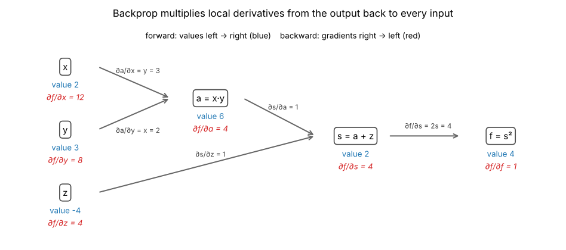

# A4.3 The chain rule as a computational graph

**Core** · Part A, week 4 (course week 04) · ~2 h · Lab:
[`labs/A/a4_3_chain_rule_graphs.py`](../../labs/A/a4_3_chain_rule_graphs.py)

## Why it matters

A neural network is a long chain of simple steps: multiply by weights, add a bias, squash with an
activation, repeat, then compute a loss. To train it you need the gradient of the loss with respect
to every weight, and deriving one giant formula by hand is hopeless. The **chain rule** says you do
not have to: the derivative of a chain is the product of the derivatives of its links. Organise the
computation as a **computational graph**, push values forward through it, then push gradients
backward, each node multiplying by its own small local derivative. That procedure is
**backpropagation**, and it is what `loss.backward()` does in every deep learning framework. This
lesson does it by hand on small graphs so that the framework is never a black box; you build a
general engine in [C1.3](../C/c1_3_autograd_engine.md).

## Prerequisite check

- Can you differentiate $x^k$, $e^x$ and $\log x$, and use the product rule? If not, revisit
  [A4.1](a4_1_derivatives.md).
- Can you state the gradient of the MSE, $\frac{2}{n}\mathbf{X}^\top\mathbf{r}$, and say why `dW = X.T @ G`
  has the shape of `W`? If not, revisit [A4.2](a4_2_gradients_jacobians.md).
- Can you multiply two matrices and check that the inner dimensions match? If not, revisit
  [A2.2](a2_2_matrix_multiplication_inverse.md).
- Do you know what a numerical gradient checker returns and how to read a relative error? If not,
  revisit [A4.2](a4_2_gradients_jacobians.md).

## Intuition

### Rates multiply

A car's fuel use depends on its speed, and its speed depends on how hard you press the pedal. If one
more centimetre of pedal adds 5 km/h, and one more km/h burns 0.2 more litres per hour, then one more
centimetre of pedal burns $5 \times 0.2 = 1$ more litre per hour. Exchange rates along a chain
multiply. That is the chain rule in one sentence:

$$\frac{d(\text{fuel})}{d(\text{pedal})} = \frac{d(\text{fuel})}{d(\text{speed})} \cdot \frac{d(\text{speed})}{d(\text{pedal})}.$$

### Draw the computation, then walk it backwards

Write $f = (xy + z)^2$ as three small steps, each a node in a graph: $a = xy$ (multiply), $s = a + z$
(add), $f = s^2$ (square). The **forward pass** computes the values from inputs to output. The
**backward pass** starts at the output with $\partial f/\partial f = 1$ and walks the edges in reverse.
At each node it multiplies the gradient arriving from above by the node's **local derivative**, which
only depends on that node's own inputs: an add node passes the gradient through unchanged, a
multiply node scales it by the *other* input, a square node by $2s$. When it reaches the inputs, it
has every partial derivative of $f$. The key plot shows both passes on this graph.

Two rules make this work on any graph:

1. **Along a path, multiply** the local derivatives (rates multiply).
2. **Where a value is used more than once, add** the gradients coming back along each use. If $x$
   feeds two nodes, nudging $x$ moves both, and the effects on $f$ add up.

### Why backwards and not forwards

You could also push derivatives forward from one input at a time, but then a model with a million
weights needs a million passes. Going backward from a *single scalar loss* gives the derivative with
respect to every input in one pass, at a cost of about one extra forward pass. That asymmetry is why
training works at all.

> **Bridge:** a computational graph is a dependency DAG, like the one Terraform builds from your
> resources. The forward pass is `terraform apply`: visit nodes in dependency order, each computing
> from its inputs. The backward pass visits them in exactly the reverse order. **Where it breaks:**
> Terraform's graph only orders the work; nothing flows back. In backprop, numbers flow back along
> every edge, and each node must remember the values it saw on the way forward (its **cache**). Those
> remembered values are why training needs far more memory than inference.

## The math

**Symbols**

| Symbol | Meaning | Shape |
|---|---|---|
| $f, g$ | functions; $f(g(x))$ is "$f$ after $g$" | — |
| $u$ | an intermediate value, $u = g(x)$ | scalar |
| $\bar{v}$ | "the gradient at node $v$": $\partial\mathcal{L}/\partial v$ for the final scalar $\mathcal{L}$ (or $f$) | same as $v$ |
| $\sigma(z)$ | logistic sigmoid $1/(1 + e^{-z})$ | elementwise |
| $\mathbf{x}$, $\mathbf{w}$, $b$, $y$ | one example's input, weights, bias and target 0 or 1 | `(d,)`, `(d,)`, scalar, scalar |
| $z$, $p$ | logit $\mathbf{w}^\top\mathbf{x} + b$ and probability $\sigma(z)$ | scalar |
| $\mathbf{J}_f$, $\mathbf{J}_g$ | Jacobians of $f$ and $g$ (A4.2) | `(m, k)`, `(k, n)` |

The bar notation is common in backprop code (`a_bar`, or `da` meaning "gradient of the loss with
respect to `a`"). It is always the gradient of the *one final scalar*, never of some other node.

**The chain rule for one variable.** Let $u = g(x)$ and $y = f(u)$. From A4.1, nudging $x$ by $h$ moves
$u$ by about $g'(x)\,h$. Nudging $u$ by any small amount $\delta$ moves $y$ by about $f'(u)\,\delta$; put
$\delta = g'(x)\,h$:

$$f(g(x + h)) \approx f(g(x)) + f'(g(x))\,g'(x)\,h \quad\Longrightarrow\quad \frac{dy}{dx} = f'(g(x))\cdot g'(x) = \frac{dy}{du}\cdot\frac{du}{dx}.$$

Example: $y = e^{-x^2}$. Inner $u = -x^2$ with $du/dx = -2x$; outer $y = e^u$ with $dy/du = e^u$. So
$dy/dx = e^{-x^2}\cdot(-2x)$. A longer chain just multiplies more factors.

**Many paths: add.** If $f$ depends on $x$ through several intermediate values $u_1, \dots, u_k$, each
path contributes its product and the contributions add:

$$\frac{\partial f}{\partial x} = \sum_{i=1}^{k}\frac{\partial f}{\partial u_i}\,\frac{\partial u_i}{\partial x}.$$

(This is the A4.2 linear approximation at work: a nudge in $x$ nudges every $u_i$, and the effects on
$f$ add because the gradient's linear approximation is a sum.)

**Local derivatives of common nodes.** For a node $v = \text{op}(\text{inputs})$, the backward rule is
$\overline{\text{input}} \mathrel{+}= \bar{v}\cdot\frac{\partial v}{\partial\,\text{input}}$. The `+=` is the "add over uses" rule:
initialise every gradient to 0, and each use adds its share.

| Node | Forward | Backward (what each input receives) |
|---|---|---|
| add | $v = a + b$ | $\bar{a} \mathrel{+}= \bar{v}$, $\bar{b} \mathrel{+}= \bar{v}$ (copies the gradient) |
| multiply | $v = ab$ | $\bar{a} \mathrel{+}= \bar{v}\,b$, $\bar{b} \mathrel{+}= \bar{v}\,a$ (swaps the inputs) |
| square | $v = a^2$ | $\bar{a} \mathrel{+}= \bar{v}\cdot 2a$ |
| exp | $v = e^a$ | $\bar{a} \mathrel{+}= \bar{v}\,v$ (reuse the forward output) |
| log | $v = \log a$ | $\bar{a} \mathrel{+}= \bar{v}/a$ |
| tanh | $v = \tanh a$ | $\bar{a} \mathrel{+}= \bar{v}\,(1 - v^2)$ |
| sigmoid | $v = \sigma(a)$ | $\bar{a} \mathrel{+}= \bar{v}\,v(1 - v)$ |
| matmul | $\mathbf{Z} = \mathbf{X}\mathbf{W}$ | $\bar{\mathbf{W}} \mathrel{+}= \mathbf{X}^\top\bar{\mathbf{Z}}$, $\bar{\mathbf{X}} \mathrel{+}= \bar{\mathbf{Z}}\mathbf{W}^\top$ (A4.2) |

The `tanh` rule is stated, not derived (it follows from the definition of $\tanh$ with the quotient
rule). The sigmoid rule is worth deriving once because it appears everywhere. Write
$\sigma = u^{-1}$ with $u = 1 + e^{-a}$. Then $d\sigma/du = -u^{-2}$ (power rule) and
$du/da = -e^{-a}$ (chain rule on $e^{-a}$, inner derivative $-1$). Multiply:

$$\sigma'(a) = \frac{e^{-a}}{(1 + e^{-a})^2} = \frac{1}{1 + e^{-a}}\cdot\frac{e^{-a}}{1 + e^{-a}} = \sigma(a)\,\big(1 - \sigma(a)\big),$$

because $1 - \sigma(a) = \frac{(1 + e^{-a}) - 1}{1 + e^{-a}} = \frac{e^{-a}}{1 + e^{-a}}$. Its largest value is
$0.5 \times 0.5 = 0.25$ at $a = 0$, and it is nearly 0 when $\lvert a\rvert$ is large: a saturated sigmoid
passes almost no gradient back. That is the seed of the vanishing-gradient problem
([C3.3](../C/c3_3_initialization.md), [E2.1](../E/e2_1_rnn_bptt.md)).

**The backward algorithm.** (1) Run the forward pass in dependency order and cache every value.
(2) Set $\bar{f} = 1$ and every other gradient to 0. (3) Visit the nodes in *reverse* order; at each,
add $\bar{v}\cdot(\text{local derivative})$ into each input's gradient. Because of the reverse order, a
node's $\bar{v}$ is complete (every use has added its share) before the node passes it on.

**Vector form: Jacobians multiply.** For $\mathbf{x} \in \mathbb{R}^n \xrightarrow{g} \mathbf{u} \in \mathbb{R}^k \xrightarrow{f} \mathbb{R}^m$,
each output of $f$ depends on $x_j$ through all $k$ entries of $\mathbf{u}$, so by the "add over paths" rule
$\frac{\partial f_i}{\partial x_j} = \sum_{l}\frac{\partial f_i}{\partial u_l}\frac{\partial u_l}{\partial x_j}$. That sum is
exactly a matrix product:

$$\mathbf{J}_{f\circ g} = \mathbf{J}_f\,\mathbf{J}_g, \qquad (m, n) = (m, k)\,(k, n).$$

For a scalar loss ($m = 1$), backprop computes the row vector $\bar{\mathbf{u}}^\top = \bar{f}\,\mathbf{J}_f$ and then
$\bar{\mathbf{x}}^\top = \bar{\mathbf{u}}^\top\mathbf{J}_g$, a **vector–Jacobian product**, from left to right. It never forms a
full Jacobian: for an elementwise node the product is an elementwise multiply, for a matmul it is
`G @ W.T` or `X.T @ G`. Pushing derivatives forward instead (**forward mode**) computes
$\mathbf{J}\mathbf{v}$ for one input direction $\mathbf{v}$ at a time; getting all $n$ partial derivatives that way
costs $n$ passes. **Reverse mode** costs one backward pass per *output*, and a loss has one output.

## Worked example by hand

**1. $f = (xy + z)^2$ at $x = 2$, $y = 3$, $z = -4$.**

Forward: $a = xy = 6$, $s = a + z = 2$, $f = s^2 = 4$.

Backward, from $\bar{f} = 1$:

| Node | Local derivative | Gradient |
|---|---|---|
| $f = s^2$ | $\partial f/\partial s = 2s = 4$ | $\bar{s} = 1 \cdot 4 = 4$ |
| $s = a + z$ | $\partial s/\partial a = \partial s/\partial z = 1$ | $\bar{a} = 4$, $\bar{z} = 4$ |
| $a = xy$ | $\partial a/\partial x = y = 3$, $\partial a/\partial y = x = 2$ | $\bar{x} = 4 \cdot 3 = 12$, $\bar{y} = 4 \cdot 2 = 8$ |

Check by differentiating the formula directly with the chain rule:
$\partial f/\partial x = 2(xy + z)\cdot y = 2 \cdot 2 \cdot 3 = 12$ ✓, $\partial f/\partial y = 2(xy + z)\cdot x = 8$ ✓,
$\partial f/\partial z = 2(xy + z) = 4$ ✓.

**2. A value used twice: $g = x\,(x + y)$ at $x = 3$, $y = 1$.** Nodes: $a = x + y = 4$, $g = x \cdot a = 12$.
Backward: $\bar{g} = 1$; the multiply node gives $\bar{a} = x = 3$ and a *direct* contribution
$\bar{x} \mathrel{+}= a = 4$; the add node gives $\bar{x} \mathrel{+}= \bar{a} = 3$ and $\bar{y} = 3$. Total
$\bar{x} = 4 + 3 = 7$. Check: $g = x^2 + xy$, $\partial g/\partial x = 2x + y = 7$ ✓. Forgetting the `+=` (keeping only the
last contribution) gives 3 or 4, both wrong.

**3. One neuron with a sigmoid and squared error.** Input $\mathbf{x} = (1, 2)$, weights $\mathbf{w} = (0.5, -0.25)$,
$b = 0$, target $y = 1$. Graph: $z = \mathbf{w}^\top\mathbf{x} + b$, $p = \sigma(z)$, $\mathcal{L} = (p - y)^2$.

- Forward: $z = 0.5 - 0.5 + 0 = 0$, $p = \sigma(0) = \frac{1}{1 + 1} = 0.5$, $\mathcal{L} = (0.5 - 1)^2 = 0.25$.
- Backward: $\bar{p} = 2(p - y) = -1$; $\bar{z} = \bar{p}\cdot p(1 - p) = -1 \times 0.25 = -0.25$;
  $z = w_1x_1 + w_2x_2 + b$ is a sum of products, so $\bar{w}_j = \bar{z}\,x_j$: $\bar{\mathbf{w}} = (-0.25, -0.5)$, and
  $\bar{b} = \bar{z} = -0.25$.
- Meaning: all three gradients are negative, so increasing $w_1$, $w_2$ or $b$ raises $z$, raises $p$
  towards the target 1, and lowers the loss. $w_2$'s push is twice $w_1$'s because its input is twice as large.

```text
== worked example: f = (x y + z)^2 ==
forward:  a = x*y = 6.0   s = a + z = 2.0   f = s^2 = 4.0
backward: df/ds = 4.0   df/da = 4.0   df/dx = 12.0   df/dy = 8.0   df/dz = 4.0
check by expanding the formula: (df/dx, df/dy, df/dz) = [12.0, 8.0, 4.0]

== worked example: fan-out g = x * (x + y) ==
forward: a = 4.0  g = 12.0   backward: dg/dx = 4.0 (direct) + 3.0 (via a) = 7.0   dg/dy = 3.0
check: g = x^2 + x y, dg/dx = 2x + y = 7.0   dg/dy = x = 3.0

== worked example: one neuron ==
forward:  z = 0.0   p = sigmoid(z) = 0.5   L = (p - y)^2 = 0.25
backward: dL/dp = -1.0   dp/dz = 0.25   dL/dz = -0.25
          dL/dw = [-0.25, -0.5]   dL/db = -0.25
numerical (dL/dw1, dL/dw2, dL/db) = [-0.25, -0.5, -0.25]
```

## Key plot



Blue numbers are computed left to right, red ones right to left. Each red number is the red number
of the node it feeds times the local derivative written on the edge: $12 = 4 \times 3$ for $x$. Every
quantity the backward pass needs was already computed by the forward pass and kept: that is the cache.

## From scratch in NumPy

Each graph gets a forward function that returns the output *and* a cache, and a backward function
that only reads the cache:

```python
def graph_forward(x: float, y: float, z: float) -> tuple[float, dict[str, float]]:
    """Forward pass; returns f and the cache of every intermediate value the backward pass needs."""
    a = x * y  # multiply node
    s = a + z  # add node
    f = s * s  # square node
    return f, {"x": x, "y": y, "z": z, "a": a, "s": s}


def graph_backward(cache: dict[str, float]) -> dict[str, float]:
    """Backward pass: start from df/df = 1 and multiply by each node's local derivative."""
    df_ds = 2 * cache["s"]  # square: d(s^2)/ds = 2s
    df_da = df_ds * 1.0  # add: ds/da = 1
    df_dz = df_ds * 1.0  # add: ds/dz = 1
    df_dx = df_da * cache["y"]  # multiply: da/dx = y
    df_dy = df_da * cache["x"]  # multiply: da/dy = x
    return {"s": df_ds, "a": df_da, "x": df_dx, "y": df_dy, "z": df_dz}
```

The batched neuron is the same graph with arrays. For $n$ examples, $\mathbf{z} = \mathbf{X}\mathbf{w} + b$
`(n,)`, $\mathbf{p} = \sigma(\mathbf{z})$ `(n,)`, $\mathcal{L} = \frac1n\sum_i(p_i - y_i)^2$. The backward pass applies the
table row by row: the mean of squares gives $\bar{\mathbf{p}} = \frac{2}{n}(\mathbf{p} - \mathbf{y})$; the elementwise
sigmoid gives $\bar{\mathbf{z}} = \bar{\mathbf{p}}\odot\mathbf{p}\odot(1 - \mathbf{p})$; the matmul gives $\bar{\mathbf{w}} = \mathbf{X}^\top\bar{\mathbf{z}}$; and
$b$, which is added to every row (a fan-out to $n$ uses), collects the sum $\bar{b} = \sum_i\bar{z}_i$:

```python
def neuron_backward(cache: dict[str, FloatArray]) -> tuple[FloatArray, float]:
    """Backward pass. -> (dL/dw (d,), dL/db scalar)."""
    X, y, p = cache["X"], cache["y"], cache["p"]
    n = len(y)
    dL_dp = 2.0 / n * (p - y)  # (n,): mean of squares
    dL_dz = dL_dp * p * (1 - p)  # (n,): elementwise, the diagonal Jacobian of sigmoid (A4.2)
    dL_dw = X.T @ dL_dz  # (d,): z = X w, pattern X^T G (A4.2)
    dL_db = float(dL_dz.sum())  # z = ... + b adds b to every row, so its gradient sums over rows
    return dL_dw, dL_db
```

Both are checked with the A4.2 gradient checker (copied into the lab, as the style guide requires),
and the Jacobian-product form of the chain rule is checked on $\tanh(\mathbf{A}\mathbf{x})$:

```text
== from scratch: graph checks at random points ==
point 0: rel error < 1e-8: True
point 1: rel error < 1e-8: True
point 2: rel error < 1e-8: True

== from scratch: batched neuron ==
loss = 0.4156   dL/dw shape (5,)   rel error < 1e-8: True   dL/db = -0.002963 vs numerical -0.002963

== from scratch: Jacobians multiply ==
J_tanh(Ax) = J_tanh @ J_A: True   shape (3, 4)
v^T J without forming J: True   shape (4,)
```

The last line is the point of reverse mode: `(v * (1 - tanh(A @ x) ** 2)) @ A` gives the same vector as
`v @ J` without ever building the `(3, 4)` Jacobian. For a layer with a million inputs and outputs the
Jacobian would have $10^{12}$ entries; the product never needs it.

Finally, the cost. The lab times both ways of getting the gradient of the batched neuron with 1,000
weights (timings vary by machine, hence the `~`):

```text
== from scratch: cost of a gradient ==
d = 1000: finite differences need 2000 forward passes; backprop needs 1 forward + 1 backward
~ time: backprop 0.15 ms   finite differences 48 ms
```

## With SciPy

Part A has no autodiff library: automatic differentiation arrives with your own engine in
[C1.3](../C/c1_3_autograd_engine.md) and PyTorch in [C2.1](../C/c2_1_tensors_autograd_modules.md), where
`loss.backward()` runs exactly this backward pass over a graph PyTorch records during the forward pass.
Here the library's job is checking: `scipy.optimize.check_grad` and `approx_fprime` on the batched neuron,
with the parameters $(\mathbf{w}, b)$ packed into one vector:

```text
== with scipy ==
scipy.optimize.check_grad on the batched neuron < 1e-6: True
scipy.optimize.approx_fprime matches backprop (rtol 1e-4): OK
```

## In practice

- **When to use it:** every time you need the gradient of a composed function, which in ML is always.
  You will write backward passes by hand in [C1.2](../C/c1_2_backprop_by_hand.md) and for custom layers;
  otherwise the framework does it, and knowing the rules lets you debug it.
- **Failure modes:**
  - *Overwriting instead of accumulating:* `grad_x = ...` where `grad_x += ...` was needed at a fan-out
    (a reused variable, a bias broadcast over rows, a shared weight). You notice a gradient check that
    fails only on the reused parameter. (PyTorch accumulates into `.grad` across `backward()` calls for
    the same reason, which is why training loops call `zero_grad()`.)
  - *Stale cache:* calling backward with a cache from a different forward pass (or after modifying an
    array in place). You notice gradients that check correctly in isolation but not inside the loop.
  - *Saturation:* $\sigma'(z) \le 0.25$ and is near 0 for $\lvert z\rvert > 5$, so gradients through many
    sigmoids shrink towards 0. You notice early layers' gradients orders of magnitude smaller than late
    layers'; it motivates ReLU and careful initialization ([C3.3](../C/c3_3_initialization.md)).
  - *Numerically unstable nodes:* computing $\log(\sigma(z))$ as two separate nodes gives $\log 0 = -\infty$
    for large negative $z$. Fused, stable versions exist ([C1.4](../C/c1_4_stable_softmax_cross_entropy.md)).
- **Defaults that work:** write forward and backward as a pair with an explicit cache; state shapes on
  every line; reuse forward outputs in the backward pass (`v` for exp, sigmoid and tanh) instead of
  recomputing; check every backward function with the A4.2 checker before using it.

## Exercises

Save your work to `my-work/A/a4_3_chain_rule_graphs.md` (or `.py`) and ask for a review.

1. **By hand:** (a) Classification uses the **log loss** $\mathcal{L} = -\big[y\log p + (1 - y)\log(1 - p)\big]$ with
   $p = \sigma(z)$. Using the table's log and sigmoid rows, show that $\partial\mathcal{L}/\partial z = p - y$, and
   then compute $\partial\mathcal{L}/\partial\mathbf{w}$ and $\partial\mathcal{L}/\partial b$ for the worked example's neuron
   ($\mathbf{x} = (1, 2)$, $\mathbf{w} = (0.5, -0.25)$, $b = 0$, $y = 1$). Compare $\partial\mathcal{L}/\partial z$ with the
   squared-error version: which loss pushes harder when the neuron is confidently wrong ($p$ near 0,
   $y = 1$), and why? (b) Draw the graph of $h = (x + y)(y + z)$, run the forward and backward passes at
   $(x, y, z) = (1, 2, 3)$, and check $\partial h/\partial y$ by expanding $h$.
2. **Code:** A network with one hidden layer of 3 tanh units:
   $\mathbf{H} = \tanh(\mathbf{X}\mathbf{W}_1 + \mathbf{b}_1)$, $\hat{\mathbf{y}} = \mathbf{H}\mathbf{w}_2 + b_2$,
   $\mathcal{L} = \frac1n\lVert\hat{\mathbf{y}} - \mathbf{y}\rVert^2$, with $\mathbf{X}$ `(n, 2)`, $\mathbf{W}_1$ `(2, 3)`,
   $\mathbf{b}_1$ `(3,)`, $\mathbf{w}_2$ `(3,)`, $b_2$ scalar. Write `forward` (returning the loss and a cache)
   and `backward` (returning all four gradients), with the shape of every intermediate in a comment.
   Check each gradient with the gradient checker on random data ($n = 6$, `SEED = 0`). Then use your
   gradients to take 200 gradient-descent steps ($\boldsymbol{\theta} \leftarrow \boldsymbol{\theta} - 0.1\,\nabla\mathcal{L}$) on
   $y = \sin(x_1) + 0.5x_2$ with $n = 64$ and print the loss every 50 steps.
3. **Think:** A model needs 2 GB of GPU memory to serve predictions but runs out of memory during
   training with the same batch size on a 16 GB GPU. Using this lesson, explain where the extra memory
   goes. Suggest two ways to cut it, and say what each costs. (You will meet the names of the standard
   techniques in [C4.2](../C/c4_2_mixed_precision.md); reason from the cache here.)

## Takeaways

1. Chain rule: rates along a chain multiply, $\frac{dy}{dx} = \frac{dy}{du}\frac{du}{dx}$; contributions from
   several paths add.
2. Backprop = forward pass with a cache, then a reverse pass where each node adds
   $\bar{v}\times(\text{local derivative})$ into each of its inputs, starting from $\bar{\mathcal{L}} = 1$.
3. Local rules to know: add copies, multiply swaps, $\sigma' = \sigma(1 - \sigma)$, $\tanh' = 1 - \tanh^2$,
   matmul gives $\mathbf{X}^\top\bar{\mathbf{Z}}$ and $\bar{\mathbf{Z}}\mathbf{W}^\top$; a broadcast bias sums its gradient over rows.
4. In vector form the chain rule is a product of Jacobians; reverse mode computes vector–Jacobian
   products without forming any Jacobian, so one backward pass gives the gradient for every parameter.
5. The cache is the price of reverse mode: training stores the forward activations, so it needs far
   more memory than inference.

**What builds on this:** [A4.4](a4_4_gradient_descent.md) (using these gradients to train);
[C1.2](../C/c1_2_backprop_by_hand.md) (backprop through a whole network by hand);
[C1.3](../C/c1_3_autograd_engine.md) (a general engine that builds the graph automatically);
[B2.1](../B/b2_1_logistic_regression.md) (the log-loss gradient $p - y$);
[E2.1](../E/e2_1_rnn_bptt.md) (the chain rule through time, and why long chains vanish).
