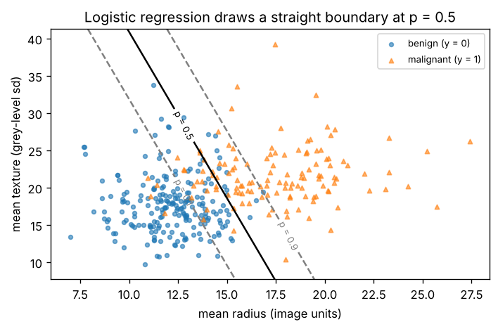

# B2.1 Logistic regression: sigmoid, log-loss, gradient descent from scratch

**Core** · Part B, week 2 (course week 08) · ~2.5 h · Lab:
[`labs/B/b2_1_logistic_regression.py`](../../labs/B/b2_1_logistic_regression.py)

## Why it matters

Most prediction problems at work are yes/no questions: will this customer churn, is this transaction fraud, is
this tumour malignant. **Logistic regression** is the standard first model for them. It is fast and readable, and
it gives a *probability* rather than just a label, which is what a downstream decision (block, review, call) needs.
It is also the last layer of almost every neural-network classifier (C1.1, C1.4): a linear score passed through a
squashing function and trained on log-loss. If you can derive its gradient and train it from scratch, backpropagation
in Part C is the same idea repeated. In production the two classic failures are numerical (a `log(0)` that turns
the loss into `inf` or `nan`) and statistical (perfectly separable data, where the weights run off to infinity and
the probabilities become absurdly confident). This lesson covers both.

## Prerequisite check

- Can you fit a linear regression by gradient descent and explain why features must be standardized first? If not,
  revisit [B1.5](b1_5_linear_regression.md).
- Can you compute a gradient with the chain rule and check it with central differences? If not, revisit
  [A4.2](../A/a4_2_gradients_jacobians.md).
- Can you say why log-loss is the negative log-likelihood of a Bernoulli (coin-flip) model? If not, revisit
  [A5.5](../A/a5_5_mle_map.md).
- Can you compute the cross-entropy $H(p, q)$ of two distributions over $\{0, 1\}$? If not, revisit
  [A6.4](../A/a6_4_entropy_cross_entropy_kl.md).
- Do you know why the test set stays untouched while you choose a model? If not, revisit [B1.1](b1_1_ml_workflow.md).

## Intuition

Linear regression gives a score $z = \mathbf{w}^\top\mathbf{x} + b$ that can be any number. For a yes/no question we want a probability
between 0 and 1. Logistic regression keeps the linear score and passes it through the **sigmoid**, an S-shaped curve
that maps $-\infty \to 0$, $0 \to 0.5$ and $+\infty \to 1$:

$$p = \sigma(z) = \frac{1}{1 + e^{-z}}.$$

So the model is "add up evidence, then squash". A large positive score means "very likely yes", a large negative one
"very likely no", and zero means "50/50". The set of points where $z = 0$ (so $p = 0.5$) is a straight line in two
dimensions, a plane in three, a hyperplane in general: the **decision boundary**. Logistic regression is a *linear
classifier*. It can only separate the classes with a flat boundary, unless you give it non-linear features (B1.3).

The score has a direct meaning. Turn the sigmoid inside out: $z = \log\frac{p}{1 - p}$, the **log-odds** (the logit). Odds of 3 mean "3 to 1
on", $p = 0.75$. So each weight $w_j$ is the change in log-odds when feature $j$ goes up by one unit with the others held fixed,
and $e^{w_j}$ is the factor by which the odds multiply (the **odds ratio**). In the lab, one standard deviation more of
`mean radius` multiplies the odds of malignancy by about 129, with the other four features held fixed.

**How do we fit it?** Not with squared error. We want the model to put high probability on what actually happened.
That is maximum likelihood (A5.5): for each example, the probability the model gave to its true label is $p_i$ if
$y_i = 1$ and $1 - p_i$ if $y_i = 0$. Take minus the log and average: that is **log-loss** (binary cross-entropy, A6.4). It
is small when the model is confidently right, about 0.69 ($\log 2$) for a 50/50 guess, and huge when it is confidently
wrong: a probability of 0.001 on the true class costs $-\log 0.001 = 6.9$. There is no closed form for the minimum (unlike
the normal equations of B1.5), so we use gradient descent. The gradient turns out to be almost identical to linear
regression's: the error $p - y$ times the features.

> **Bridge:** a logistic regression is a weighted scoring rule, like a fraud rules engine that adds points for each
> risk signal and blocks above a threshold. **Where it breaks:** the rules engine's points are set by people and its
> total has no meaning; here the weights are learned from labelled data and the score is calibrated log-odds, so
> $p = 0.8$ should mean "right about 80% of the time" (B4.1 checks that). And the engine's threshold is a business decision
> that stays separate: the model gives a probability, you choose where to cut.

## The math

**Symbols**

| Symbol | Meaning | Shape |
|---|---|---|
| $\mathbf{X}$ | features (standardized in the lab), one row per example | `(n, d)` |
| $\mathbf{y}$ | labels, $y_i \in \{0, 1\}$ (1 = positive class) | `(n,)` |
| $\mathbf{w}$, $b$ | weights and bias | `(d,)`, scalar |
| $\mathbf{A}$, $\boldsymbol{\theta}$ | $[\mathbf{1}, \mathbf{X}]$ and $(b, w_1, \dots, w_d)$, as in B1.5 | `(n, d + 1)`, `(d + 1,)` |
| $\mathbf{z}$ | logits (scores) $\mathbf{A}\boldsymbol{\theta}$ | `(n,)` |
| $\sigma(\cdot)$ | sigmoid $1/(1 + e^{-z})$, applied elementwise | — |
| $\mathbf{p}$ | predicted probabilities $\sigma(\mathbf{z})$, $p_i = P(y_i = 1 \mid \mathbf{x}_i)$ | `(n,)` |
| $\ell_i$ | log-loss of example $i$ | scalar |
| $\mathcal{L}(\boldsymbol{\theta})$ | mean log-loss $\frac1n\sum_i \ell_i$ | scalar |
| $\eta$ | learning rate | scalar |

**Step 1: the sigmoid's derivative.** Write $\sigma(z) = (1 + e^{-z})^{-1}$. By the chain rule,
$\sigma'(z) = -(1 + e^{-z})^{-2} \cdot (-e^{-z}) = \frac{e^{-z}}{(1 + e^{-z})^2}$. Split the fraction: $\frac{1}{1 + e^{-z}} \cdot \frac{e^{-z}}{1 + e^{-z}}$. The first factor is $\sigma(z)$. The second is
$\frac{(1 + e^{-z}) - 1}{1 + e^{-z}} = 1 - \sigma(z)$. So

$$\sigma'(z) = \sigma(z)\,(1 - \sigma(z)),$$

largest (0.25) at $z = 0$ and near zero in the flat tails.

**Step 2: log-loss for one example.**

$$\ell_i = -\big[y_i \log p_i + (1 - y_i)\log(1 - p_i)\big].$$

Only one term is ever active: if $y_i = 1$ it is $-\log p_i$, if $y_i = 0$ it is $-\log(1 - p_i)$.

**Step 3: its derivative with respect to the logit.** Chain rule through $p_i = \sigma(z_i)$:

$$\frac{\partial \ell_i}{\partial p_i} = -\frac{y_i}{p_i} + \frac{1 - y_i}{1 - p_i}, \qquad \frac{\partial p_i}{\partial z_i} = p_i(1 - p_i).$$

Multiply: $\frac{\partial \ell_i}{\partial z_i} = -y_i(1 - p_i) + (1 - y_i)p_i = -y_i + y_ip_i + p_i - y_ip_i = p_i - y_i$.

The $p(1 - p)$ from the sigmoid cancels the denominators from the log. The gradient with respect to the score is just
"prediction minus truth", the same as for squared error in linear regression (up to the factor 2).

**Step 4: the full gradient.** $z_i = \boldsymbol{\theta}^\top\mathbf{a}_i$ (where $\mathbf{a}_i$ is row $i$ of $\mathbf{A}$), so $\partial z_i/\partial\theta_j = a_{ij}$, and

$$\frac{\partial \mathcal{L}}{\partial \theta_j} = \frac1n\sum_i (p_i - y_i)\,a_{ij} \quad\Longrightarrow\quad \nabla_{\boldsymbol{\theta}}\mathcal{L} = \frac1n\,\mathbf{A}^\top(\mathbf{p} - \mathbf{y}), \quad \text{shape } (d + 1, n)(n,) \to (d + 1,).$$

The first entry (the ones column) is $\frac{\partial\mathcal{L}}{\partial b} = \frac1n\sum_i(p_i - y_i)$. At the minimum it is zero, so **the average predicted probability equals the
fraction of positives** in the training data. That is the logistic analogue of "residuals sum to zero" (B1.5).

**Step 5: computing it without overflow.** Plug $p = \sigma(z)$ into $\ell$ and simplify. $\log p = -\log(1 + e^{-z})$ and $\log(1 - p) = \log\frac{e^{-z}}{1 + e^{-z}} = -z - \log(1 + e^{-z})$.
So $\ell = y\log(1 + e^{-z}) + (1 - y)\big(z + \log(1 + e^{-z})\big) = \log(1 + e^{-z}) + (1 - y)z$. Since $\log(1 + e^{-z}) + z = \log(e^z + 1)$,

$$\ell = \log(1 + e^{z}) - yz.$$

Compute $\log(1 + e^z)$ with `np.logaddexp(0, z)`, which never overflows. Never compute $p$ first and then $\log p$: for $z = -800$,
$p$ underflows to exactly 0 and $\log 0 = -\infty$. For the sigmoid itself, use $1/(1 + e^{-z})$ when $z \ge 0$ and $e^z/(1 + e^z)$ when $z < 0$, so the
exponent is never positive and never overflows.

**Step 6: convex, so gradient descent finds the minimum.** Differentiate the gradient $\frac1n\sum_i(p_i - y_i)\mathbf{a}_i$ once more. Only $p_i$ depends on
$\boldsymbol{\theta}$, and by Steps 1 and 4, $\partial p_i/\partial\boldsymbol{\theta} = p_i(1 - p_i)\,\mathbf{a}_i$. So the Hessian is $\mathbf{H} = \frac1n\sum_i p_i(1 - p_i)\,\mathbf{a}_i\mathbf{a}_i^\top = \frac1n\mathbf{A}^\top\mathbf{S}\mathbf{A}$, with
$\mathbf{S} = \operatorname{diag}(p_i(1 - p_i))$, shape `(d + 1, d + 1)`. For any vector $\mathbf{v}$, $\mathbf{v}^\top\mathbf{H}\mathbf{v} = \frac1n\sum_i p_i(1 - p_i)(\mathbf{a}_i^\top\mathbf{v})^2 \ge 0$, so the
loss is convex (A4.5): any point with zero gradient is the global minimum. Since $p(1 - p) \le \frac14$, the curvature is never more than
$L = \frac14\lambda_{\max}\!\big(\frac1n\mathbf{A}^\top\mathbf{A}\big)$, and a fixed step $\eta = 1/L$ never overshoots (A4.4 showed $\eta < 2/\lambda_{\max}$ is the stability condition for a
quadratic; $1/L$ sits safely inside it). The lab uses that step.

**Step 7: when there is no minimum.** If some hyperplane separates the training classes perfectly (**perfect
separation**), take any separating $\boldsymbol{\theta}$ and double it: every $z_i$ doubles, every correct probability moves closer to 0 or 1, and
the loss falls. Doubling again lowers it again, forever. The loss approaches 0 but never reaches a minimum, and
the weights grow without bound. With 30 features and 343 rows this happens on breast cancer. The fix is a penalty on
$\lVert\mathbf{w}\rVert$ (B2.2), which is why scikit-learn applies one by default.

## Worked example by hand

One feature, four points: $x = 0, 1, 2, 3$ with labels $y = 0, 1, 0, 1$. Start from $w = 0$, $b = 0$.

**At the start.** Every $z_i = 0$, so every $p_i = \sigma(0) = 0.5$. Each example's loss is $-\log 0.5 = \log 2 = 0.6931$, and so is the mean.

**Gradient.** $p - y = (0.5, -0.5, 0.5, -0.5)$.
$\frac{\partial\mathcal{L}}{\partial w} = \frac14\sum(p_i - y_i)x_i = \frac14(0.5 \cdot 0 - 0.5 \cdot 1 + 0.5 \cdot 2 - 0.5 \cdot 3) = \frac14(-1) = -0.25$.
$\frac{\partial\mathcal{L}}{\partial b} = \frac14(0.5 - 0.5 + 0.5 - 0.5) = 0$.

**One step with $\eta = 1$.** $w = 0 - 1 \times (-0.25) = 0.25$, $b = 0$. Now $z = (0, 0.25, 0.5, 0.75)$ and
$p = (0.5, 0.5622, 0.6225, 0.6792)$ (for example $\sigma(0.25) = 1/(1 + e^{-0.25}) = 1/1.7788 = 0.5622$).
The losses are $-\log 0.5 = 0.6931$, $-\log 0.5622 = 0.5759$, $-\log(1 - 0.6225) = 0.9741$, $-\log 0.6792 = 0.3869$. Mean: $2.6300/4 = 0.6575$. The loss went down.

**Run to convergence** (the lab does 10,000 steps): $b = -1.3623$, $w = 0.9082$, loss 0.5869. The probabilities are
$(0.2039, 0.3884, 0.6116, 0.7961)$: they rise with $x$, as they should, and they average exactly 0.5, the fraction of positives
(Step 4). The model cannot do better than 0.5869 because the labels alternate: no straight cut separates them.

```text
== worked example by hand ==
x = [0.0, 1.0, 2.0, 3.0]   y = [0.0, 1.0, 0.0, 1.0]   start w = 0, b = 0
z = [0.0, 0.0, 0.0, 0.0]   p = [0.5, 0.5, 0.5, 0.5]   loss = 0.6931 (= log 2)
p - y = [0.5, -0.5, 0.5, -0.5]   dL/dw = mean((p - y) x) = -0.2500   dL/db = mean(p - y) = 0.0000
one step with lr = 1: w = 0.2500  b = 0.0000
z = [0.0, 0.25, 0.5, 0.75]   p = [0.5, 0.5622, 0.6225, 0.6792]   loss = 0.6575
after 10,000 steps: b = -1.3623  w = 0.9082   p = [0.2039, 0.3884, 0.6116, 0.7961]   loss = 0.5869
at the optimum mean(p - y) = 8.3e-17: average predicted probability = observed positive rate
```

## Key plot



A two-feature logistic regression draws a straight boundary where $z = 0$ ($p = 0.5$). The $p = 0.1$ and $p = 0.9$ contours are
parallel to it: the probability changes only across the boundary, never along it. The points between the dashed
lines are where the model is unsure, and they are where the classes overlap.

## From scratch in NumPy

**The data.** The Wisconsin breast cancer set: 569 tumours, 30 measurements of the cell nuclei in a biopsy image.
We make malignant the positive class ($y = 1$; scikit-learn codes it the other way round) and use five features that
are not near-copies of each other (radius, perimeter and area are almost the same measurement, which makes gradient
descent crawl, as in B1.5). A stratified 60/20/20 split, as in B1.1:

```text
== data ==
all rows (569, 30)  malignant share 0.3726
features used (5): ['mean radius', 'mean texture', 'mean smoothness', 'mean concavity', 'mean symmetry']
train X (343, 5)  val X (113, 5)  (test 113 rows kept aside)
malignant share: train 0.3732  val 0.3717
feature means (train): {'mean radius': 14.1362, 'mean texture': 19.2037, 'mean smoothness': 0.0963, 'mean concavity': 0.0867, 'mean symmetry': 0.1823}
```

**Stable sigmoid and log-loss.** Step 5 in code:

```python
def sigmoid(z):
    """Numerically stable logistic sigmoid, elementwise. z (...) -> (...)."""
    out = np.empty_like(z, dtype=np.float64)
    pos = z >= 0
    out[pos] = 1.0 / (1.0 + np.exp(-z[pos]))   # exp of a non-positive number: never overflows
    ez = np.exp(z[~pos])                        # z < 0, so exp(z) < 1
    out[~pos] = ez / (1.0 + ez)
    return out

def log_loss_from_logits(z, y):
    """Mean log-loss computed from logits, never from probabilities. z (n,), y (n,) -> scalar."""
    return float(np.mean(np.logaddexp(0.0, z) - y * z))
```

```text
== from scratch: stable sigmoid and log-loss ==
z = [-800.0, -30.0, 0.0, 30.0, 800.0]   y = [1.0, 1.0, 1.0, 0.0, 0.0]
naive per-example loss:   [inf, 30.000000000000092, 0.6931471805599453, 30.001020555434774, inf]
stable per-example loss:  [800.0, 30.000000000000092, 0.6931471805599453, 30.000000000000092, 800.0]
stable sigmoid matches scipy.special.expit: OK
```

The two extreme examples are confidently wrong. The naive formula returns `inf`, which poisons the mean and every
gradient after it. The stable one returns the true loss, 800. Look also at $z = 30$, $y = 0$: the naive answer is
30.00102 instead of 30. In float64, $\sigma(30) = 1 - 9.4 \times 10^{-14}$, and since float64 numbers near 1 are spaced $1.1 \times 10^{-16}$ apart, $1 - p$
keeps only about three correct digits of that tiny number. Subtracting nearly equal numbers loses precision (A3.4).

**Loss and gradient, checked.** Step 4 is two lines. The A4.2 gradient checker confirms it on a small random problem:

```python
def loss_and_grad(theta, A, y):
    """Mean log-loss and its gradient. theta (d + 1,), A (n, d + 1), y (n,) -> (scalar, (d + 1,))."""
    z = A @ theta                                # (n,) logits
    grad = A.T @ (sigmoid(z) - y) / len(y)       # (d + 1, n) @ (n,) -> (d + 1,)
    return log_loss_from_logits(z, y), grad
```

```text
== from scratch: gradient check ==
analytic gradient [-0.0588, 0.3771, -0.0347, 0.0319]
numeric gradient  [-0.0588, 0.3771, -0.0347, 0.0319]
relative error 3.3e-10 < 1e-6: OK
```

**Gradient descent on breast cancer.** Standardize with training statistics (B1.3, B1.4), start from zero, step $1/L$
(Step 6), stop when the gradient norm is below $10^{-7}$:

```python
mu, sd = X_tr.mean(axis=0), X_tr.std(axis=0)            # training statistics only
A_tr = add_intercept((X_tr - mu) / sd)                   # (n, d + 1)
L_smooth = np.linalg.eigvalsh(A_tr.T @ A_tr / n)[-1] / 4
theta_gd, losses_gd, steps_gd = fit_logistic_gd(A_tr, y_tr, lr=1.0 / L_smooth)
```

```text
== from scratch: gradient descent on breast cancer ==
smoothness bound L = 0.5956   lr = 1/L = 1.6790
converged in 2050 steps   train log-loss: start 0.6931 -> 0.1267
intercept b = -0.8168
weights per 1 sd: {'mean radius': 4.8585, 'mean texture': 1.7987, 'mean smoothness': 1.5642, 'mean concavity': 2.1219, 'mean symmetry': 0.0426}
train: accuracy 0.9417  log-loss 0.1267
val:   accuracy 0.9823  log-loss 0.0856
mean predicted p on train 0.3732 = malignant share 0.3732
odds ratio per 1 sd of mean radius: exp(4.8585) = 128.84
```

- The loss starts at $\log 2 = 0.6931$ (every $p = 0.5$) and converges in about 2,000 steps.
- The average predicted probability equals the malignant share, 0.3732, exactly as Step 4 says.
- Larger, more irregular nuclei raise the odds of malignancy. `mean symmetry` adds almost nothing once the
  other four are in the model (weight 0.04).
- Validation accuracy (0.98) is *higher* than training accuracy (0.94). That is not a bug: with 113 validation rows,
  one tumour is 0.9 points of accuracy, so the two numbers are within noise of each other (A6.2). Do not read a
  ranking into a difference of a few rows.

## With scikit-learn

`LogisticRegression` minimizes the same loss plus an L2 penalty, $C\sum_i\ell_i + \frac12\lVert\mathbf{w}\rVert^2$ (A5.5: $C$ is the prior variance). $C = \infty$
removes the penalty. In scikit-learn 1.9.1, `penalty=None` is deprecated in favour of `C=np.inf` (VERIFY as of 2026-10). The
default solver, `lbfgs`, is a quasi-Newton method that uses curvature information, so it needs far fewer iterations
than plain gradient descent.

```text
== with scikit-learn ==
LogisticRegression(C=inf) intercept_ -0.8168   coef_ [4.8586, 1.7987, 1.5642, 2.1219, 0.0426]
max |p_mine - p_sklearn| on val: 2.3e-06
probabilities match scikit-learn to 3 decimals (and to 1e-5): OK
sklearn log_loss on val 0.0856   accuracy 0.9823
Pipeline(StandardScaler, LogisticRegression) gives the same probabilities: OK
default C=1.0 (an L2 penalty, B2.2): coef_ [3.2104, 1.2383, 0.9008, 1.6782, 0.0956]
default C=1.0: val log-loss 0.1036   accuracy 0.9735
```

- The from-scratch probabilities match scikit-learn's to $2 \times 10^{-6}$. Both stop at a tolerance rather than the exact optimum,
  which is why the check uses $10^{-5}$ rather than $10^{-6}$.
- `predict_proba` returns two columns, $P(y = 0)$ and $P(y = 1)$; column 1 is the one you want. `predict` thresholds at 0.5.
- The **default** `LogisticRegression()` is *not* plain logistic regression: $C = 1$ shrinks every weight (3.21 instead of 4.86
  for radius). Here that costs a little validation log-loss. On the next problem it rescues the model.

**Perfect separation.** All 30 features, with weaker and weaker penalties:

```text
== perfect separation (all 30 features) ==
C =     1e+00: train accuracy 0.9913   train log-loss 0.043632   |w| =     3.54   val log-loss 0.0263
C =     1e+02: train accuracy 1.0000   train log-loss 0.005774   |w| =    20.15   val log-loss 0.1182
C =     1e+04: train accuracy 1.0000   train log-loss 0.000167   |w| =    55.97   val log-loss 0.3907
C =     1e+06: train accuracy 1.0000   train log-loss 0.000003   |w| =    97.57   val log-loss 0.7327
train loss -> 0 and |w| grows with C: no finite unpenalized minimum; keep a penalty (B2.2)
```

From $C = 100$ onwards a hyperplane separates every training tumour. As the penalty weakens, the weights keep growing,
the training loss heads to zero, and the validation log-loss gets 28 times *worse*. The model becomes certain, and
the few validation tumours on the wrong side of the plane get probabilities near 0 or 1 for the wrong class, each
costing a large loss. With `C=np.inf` the solver would never stop; it only halts at its iteration limit, with a
convergence warning.

## In practice

- **When to use it:** the first model on any binary classification problem, right after a majority-class baseline
  (B1.1); whenever you need calibrated probabilities, fast training and prediction, and weights you can explain; as
  the baseline that fancier models must beat (gradient boosting in B3.3 often wins on tabular data, but by how much?).
  For more than two classes, scikit-learn fits the multinomial version (softmax, C1.4) automatically.
- **Failure modes:**
  - *`nan` or `inf` loss.* You computed $\log$ of a probability that rounded to 0 or 1. Compute the loss from logits
    (`logaddexp`), or clip probabilities to $[10^{-15}, 1 - 10^{-15}]$ as `sklearn.metrics.log_loss` does.
  - *Perfect separation.* Training accuracy of 1.0, huge weights, probabilities of 0.000 and 1.000, a convergence
    warning. Keep a penalty (B2.2). Also suspect leakage (B1.4): a feature that separates perfectly is often the label in disguise.
  - *Unscaled features.* Slow or stalled gradient descent and, with a penalty, weights shrunk unevenly (a penalty treats
    all weights alike only if the features are on the same scale). Standardize inside a pipeline.
  - *Non-linear boundaries.* A curved or ring-shaped class region gives poor accuracy however long you train. Add
    features (B1.3), or use kNN (B2.3), an RBF SVM (B2.5) or trees (B3).
  - *Reading weights as causes, or comparing raw-unit weights.* As in B1.5: odds ratios are associations, conditional on the
    other features, and comparable only on standardized features.
  - *Thresholding at 0.5 by habit.* With rare positives or unequal error costs, the right threshold is rarely 0.5 (B4.1, B4.4).
- **Defaults that work:** `make_pipeline(StandardScaler(), LogisticRegression())` with the default L2 penalty (`C=1.0`,
  `solver="lbfgs"`), raising `max_iter` if you see a convergence warning; tune `C` by cross-validation (B4.3); report
  log-loss as well as accuracy, because log-loss sees the probabilities. In scikit-learn 1.9.1, choose the penalty with
  `l1_ratio` and `C` (`penalty` is deprecated; VERIFY as of 2026-10).

## Exercises

Save your work to `my-work/B/b2_1_logistic_regression.md` (or `.py`) and ask for a review.

1. **By hand:** Three points with one feature, $x = -1, 0, 2$, labels $y = 0, 0, 1$, and the model $w = 1$, $b = -0.5$.
   (a) Compute $z$, $p$ (to 4 decimals) and the mean log-loss. (b) Compute $\partial\mathcal{L}/\partial w$ and $\partial\mathcal{L}/\partial b$. (c) Take one gradient-descent step with
   $\eta = 0.5$ and recompute the loss; did it go down? (d) Write the odds ratio for $w = 1$ in words. (e) Is this dataset perfectly
   separable? What does that imply for the weights if you keep running gradient descent?
2. **Code:** Without looking at the lab, write `fit_logistic_gd` from scratch in a new file: stable sigmoid, loss from
   logits, vectorized gradient checked by central differences, and batch gradient descent. Train it on the five lab
   features (same split, same standardization) and match `LogisticRegression(C=np.inf)` probabilities on the validation rows
   to 3 decimals. Then add an option for **mini-batch** gradient descent (batch size 32, a reshuffle each epoch with
   `rng = np.random.default_rng(0)`) and compare the training loss after the same number of *examples processed* as full-batch
   gradient descent. Time yourself: this is the CP2 "30-minute" exercise. Write down how long the first attempt took.
3. **Think:** A hospital wants to use the 30-feature model to flag tumours for an urgent second reading. A colleague
   proposes `LogisticRegression(C=1e6)` "because it gets 100% training accuracy". Explain what is wrong with that choice
   (use the lab's table), what you would use instead and how you would choose its settings, and why the threshold at
   which a tumour is flagged should not simply be 0.5.

## Takeaways

1. Logistic regression is a linear score passed through a sigmoid: $p = \sigma(\mathbf{w}^\top\mathbf{x} + b)$. The score is the log-odds, $e^{w_j}$ is the odds ratio,
   and the decision boundary $z = 0$ is a hyperplane.
2. It is fitted by minimizing log-loss, the Bernoulli negative log-likelihood. The gradient is $\frac1n\mathbf{A}^\top(\mathbf{p} - \mathbf{y})$: prediction
   minus truth, times the features.
3. Compute the loss from logits, $\log(1 + e^z) - yz$ with `logaddexp`, and the sigmoid without positive exponents; naive formulas give
   `inf` and `nan`.
4. The loss is convex, so gradient descent (or lbfgs) finds the global minimum if one exists; at it, the average
   predicted probability equals the positive rate.
5. If the classes are perfectly separable there is no minimum: the weights diverge and the probabilities become
   overconfident. Keep a penalty (scikit-learn's default `C=1`), and report log-loss, not only accuracy.

**What builds on this:** [B2.2](b2_2_regularization.md) (L1 and L2 penalties on this loss);
[B4.1](b4_1_classification_metrics.md) (thresholds, ROC, calibration); [B4.4](b4_4_class_imbalance.md) (rare positives
and class weights); [C1.1](../C/c1_1_perceptron_mlp.md) (a neuron is a logistic regression);
[C1.4](../C/c1_4_stable_softmax_cross_entropy.md) (the multiclass softmax version, made stable the same way);
[E1.2](../E/e1_2_bow_tfidf.md) (logistic regression on TF-IDF, the text baseline); P2 (the M1 baseline is a regularized
logistic regression).

**References:** G. James, D. Witten, T. Hastie, R. Tibshirani, J. Taylor, *An Introduction to Statistical Learning with
Applications in Python*, Springer, 2023, chapter 4. W. N. Street, W. H. Wolberg, O. L. Mangasarian, "Nuclear feature
extraction for breast tumor diagnosis", *IS&T/SPIE Biomedical Image Processing*, 1993 (the source of the dataset).
scikit-learn User Guide, "Logistic regression" (VERIFY link:
https://scikit-learn.org/stable/modules/linear_model.html#logistic-regression).
