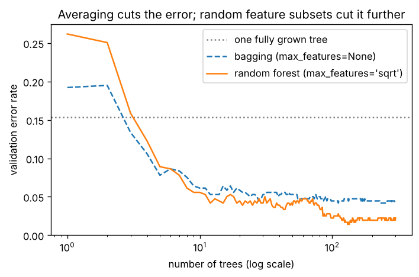

# B3.2 Random forests: bagging, feature subsampling, out-of-bag error

**Core** · Part B, week 3 (course week 09) · ~2 h · Lab:
[`labs/B/b3_2_random_forests.py`](../../labs/B/b3_2_random_forests.py)

## Why it matters

B3.1 ended with a problem: a fully grown tree fits its training rows perfectly, but it changes a lot when the data
changes a little, and it generalizes poorly. A **random forest** fixes this without making the trees any smarter. It
trains hundreds of deep trees on slightly different data and averages them. It is a strong default for tabular
data: little tuning, no scaling, robust to irrelevant features. It also gives you a validation estimate for free,
the **out-of-bag error**. You will meet forests as baselines in interviews and in production, inside isolation forests
for anomaly detection (B5.6), and as the reference that gradient boosting (B3.3) has to beat. The production mistakes
are treating the out-of-bag score as an honest test score when rows are not independent, and paying for 1,000 trees
when 200 give the same answer.

## Prerequisite check

- Can you grow a CART tree and explain why a fully grown one overfits? If not, revisit [B3.1](b3_1_decision_trees.md).
- Can you draw a bootstrap resample and explain what it is used for? If not, revisit
  [A6.2](../A/a6_2_confidence_intervals_bootstrap.md).
- Can you compute $\operatorname{Var}[X + Y]$ when $X$ and $Y$ are correlated? If not, revisit
  [A5.1](../A/a5_1_random_variables_expectation.md).
- Do you know why a validation set must not be used for training, and what cross-validation estimates? If not, revisit
  [B1.1](b1_1_ml_workflow.md).

## Intuition

Ask one doctor for a diagnosis and you get that doctor's quirks. Ask a hundred doctors who trained in different
hospitals and take the majority view, and the quirks cancel out, *as long as the doctors do not all share the same
quirks*. That condition is the whole story of random forests.

A deep tree is a model with low bias and high variance (B4.5 makes these terms precise). Low bias: it can fit almost any shape. High
variance: which shape it fits depends heavily on which training rows it saw (B3.1's bootstrap demo gave three different
root features in five resamples). Averaging reduces variance, so if we could train many trees on *independent* training
sets and average them, we would keep the low bias and lose most of the variance. We have only one training set, so we
fake many with the **bootstrap** (A6.2): draw $n$ rows *with replacement*. Each draw repeats some rows and leaves out
others, so each tree sees a slightly different dataset. Training a model on each bootstrap sample and averaging is
**bagging** (bootstrap aggregating, Breiman, 1996).

Bagging alone stalls quickly because the trees are too alike. If one feature is strongly predictive, almost every tree
puts it at the root, and the trees make similar mistakes; averaging similar mistakes does not cancel them.
A random forest (Breiman, 2001) adds one more source of randomness: at **every split**, the tree may only choose
among a random subset of the features (**feature subsampling**; for classification the usual size is $\sqrt{d}$). Strong features
are sometimes unavailable, so other trees are forced to find other routes to the answer. Each tree gets a bit worse;
the trees become much less alike; the average gets better.

The bootstrap has a bonus. About a third of the rows are left out of each tree's sample. For every training row, some
trees never saw it, so their vote on that row is an honest prediction. Collecting those votes for every row gives the
out-of-bag (OOB) estimate: a validation score that costs no extra data and no extra training.

> **Bridge:** a forest is like running the same request against many replicas of a service, each with slightly
> different caches and configs, and taking the majority answer. **Where it breaks:** replicas fail independently
> because of hardware; trees "fail" on the same hard examples because they learn from the same data. The gain from
> averaging depends entirely on how *different* the trees' mistakes are, and you must create that difference on
> purpose with bootstrap samples and feature subsets.

## The math

**Symbols**

| Symbol | Meaning | Shape |
|---|---|---|
| $n$, $d$, $K$ | training rows, features, classes | — |
| $B$ | number of trees | — |
| $T_b(\mathbf{x})$ | prediction of tree $b$ for one input: a number (regression) or class probabilities | scalar or `(K,)` |
| $\bar{T}(\mathbf{x})$ | the forest's prediction $\frac1B\sum_{b=1}^{B} T_b(\mathbf{x})$ | as $T_b$ |
| $\sigma^2$ | variance of one tree's prediction, over the randomness of its training sample | scalar |
| $\rho$ | correlation between two different trees' predictions | scalar in $[-1, 1]$ |
| $m_{\text{try}}$ | features considered at each split (`max_features`) | int |

**Step 1: a bootstrap sample leaves out about 37% of the rows.** One draw picks row $i$ with probability $1/n$, so it
misses row $i$ with probability $1 - 1/n$. The $n$ draws are independent, so row $i$ is never picked with probability

$$P(\text{row } i \text{ out of bag}) = \left(1 - \frac1n\right)^{n} \;\longrightarrow\; e^{-1} \approx 0.368 \quad \text{as } n \to \infty.$$

(The limit $\left(1 + \frac{x}{n}\right)^n \to e^x$ is the definition of the exponential, here with $x = -1$.) Each tree is therefore trained on about $1 - 0.368 = 63.2\%$ of the distinct rows, some of them
repeated, and is out of bag for the other 36.8%.

**Step 2: the variance of an average of correlated trees.** Treat each tree's prediction at a fixed input as a random
variable with variance $\sigma^2$ and pairwise correlation $\rho$, so $\operatorname{Cov}[T_b, T_c] = \rho\sigma^2$ for $b \ne c$. The variance of a sum is the sum of all variances
and covariances, and a constant factor comes out squared, $\operatorname{Var}[cX] = c^2\operatorname{Var}[X]$ (A5.1). There are $B$ variance terms and $B(B - 1)$ covariance terms ($B$ choices of $b$, $B - 1$ of $c \ne b$):

$$\operatorname{Var}\Big[\frac1B\sum_b T_b\Big] = \frac{1}{B^2}\Big(\sum_b \operatorname{Var}[T_b] + \sum_{b \ne c}\operatorname{Cov}[T_b, T_c]\Big) = \frac{1}{B^2}\big(B\sigma^2 + B(B - 1)\rho\sigma^2\big).$$

Divide through: $\frac{\sigma^2}{B} + \frac{B - 1}{B}\rho\sigma^2 = \rho\sigma^2 + \frac{\sigma^2}{B} - \frac{\rho\sigma^2}{B}$, so

$$\operatorname{Var}[\bar{T}] = \rho\sigma^2 + \frac{(1 - \rho)\,\sigma^2}{B}.$$

Read the two terms separately. The second shrinks as you add trees and vanishes as $B \to \infty$. The first does not depend on $B$ at
all: **with correlated trees, the variance can never fall below $\rho\sigma^2$**, however many trees you add. Bagging attacks the second
term; feature subsampling attacks the first by lowering $\rho$. Lowering $m_{\text{try}}$ lowers $\rho$ but makes each tree weaker (higher bias, larger $\sigma^2$),
so there is a best value in between. $\sqrt{d}$ is the classic default, not a law.

**Step 3: averaging does not change the bias.** $\mathbb{E}[\bar{T}] = \frac1B\sum\mathbb{E}[T_b] = \mathbb{E}[T_b]$: the forest is, on average, exactly as right or wrong as one tree. That is
why forests use deep, low-bias trees: averaging fixes their variance, but nothing would fix the bias of shallow trees.
(Boosting, B3.3, makes the opposite choice.)

**Step 4: voting.** For classification, scikit-learn averages the trees' class probabilities and predicts the largest
average (**soft voting**). Breiman's original forest let each tree cast one vote for its class (hard, majority voting). With deep trees the two
almost always agree. Why voting helps: if 3 classifiers were *independent* and each right with probability $p = 0.7$, the majority is right when
at least 2 are. Exactly 2 right can happen in 3 ways (any one of the three is the wrong one), each with probability $p^2(1 - p)$; all 3 right has probability $p^3$. In general, the number of ways to choose which $k$ of $n$ are right is the binomial coefficient $\binom{n}{k}$ (A5.2). So: $3p^2(1 - p) + p^3 = 0.441 + 0.343 = 0.784$. If the three were identical, the majority would be right with probability 0.7, no gain. Same lesson as Step 2.

**Step 5: the out-of-bag estimate.** For each training row $i$, average the predictions of only the trees whose bootstrap
sample did not contain $i$ (about $0.368B$ of them), and compare with $y_i$. The OOB accuracy is the accuracy of these predictions over all rows. Each
prediction comes from trees that never saw the row, so it behaves like a validation score. It is slightly pessimistic,
because each OOB prediction uses only about a third of the forest.

**Step 6: regression forests** average the trees' numeric predictions. Everything above carries over; scikit-learn's
default for regression is `max_features=1.0`, every feature, which makes `RandomForestRegressor` plain bagging unless you change it
(VERIFY as of 2026-10).

## Worked example by hand

**Out-of-bag probability.** With $n = 5$ rows: $(4/5)^5 = 1024/3125 = 0.3277$. With $n = 100$: $0.99^{100} = 0.3660$. The limit is $1/e = 0.3679$, and $n = 1000$
is already at 0.3677.

**Majority vote.** Three independent classifiers, each right 70% of the time: $3 \times 0.7^2 \times 0.3 + 0.7^3 = 0.784$, against 0.7 for one classifier.

**Correlated averaging.** With $\sigma^2 = 1$ and $\rho = 0.5$: one tree has variance 1. Ten trees: $0.5 + 0.5/10 = 0.55$. A hundred: $0.5 + 0.005 = 0.505$. Going from 10 trees to 100
buys almost nothing; the floor is $\rho\sigma^2 = 0.5$.

**OOB bookkeeping.** Four training rows (indices 0–3) with labels $1, 0, 0, 1$, and three trees with bootstrap samples
$\{0, 0, 2, 3\}$, $\{1, 2, 2, 3\}$, $\{0, 1, 1, 3\}$. Row 0 is missing only from tree 1's sample, row 1 only from tree 0's, row 2 only from tree 2's, and row 3 is in all three
(with 3 trees that happens often; with 100 it almost never does). Suppose the trees vote as in the table:

| Row | $y$ | Tree 0 | Tree 1 | Tree 2 | OOB trees | OOB vote |
|---|---|---|---|---|---|---|
| 0 | 1 | 1 | **1** | 1 | tree 1 | 1 ✓ |
| 1 | 0 | **0** | 0 | 0 | tree 0 | 0 ✓ |
| 2 | 0 | 0 | 0 | **1** | tree 2 | 1 ✗ |
| 3 | 1 | 1 | 1 | 1 | none | — |

OOB accuracy $= 2/3$ over the rows that have an OOB vote. The majority of *all* trees gets all four training rows right, but that is
the trees grading their own homework: tree 2's mistake on row 2 is exposed only when we look at a tree that did not train on row 2.

```text
== worked example by hand ==
P(a given row is out of bag), n =    5: (1 - 1/n)^n = 0.3277
P(a given row is out of bag), n =  100: (1 - 1/n)^n = 0.3660
P(a given row is out of bag), n = 1000: (1 - 1/n)^n = 0.3677
limit 1/e = 0.3679
3 independent classifiers, each right with p = 0.7: P(majority right) = 3p^2(1-p) + p^3 = 0.7840
simulated, 100,000 trials: 0.7849
average of B =   1 trees, variance 1.0, correlation 0.5: rho*s2 + (1-rho)*s2/B = 1.0000
average of B =  10 trees, variance 1.0, correlation 0.5: rho*s2 + (1-rho)*s2/B = 0.5500
average of B = 100 trees, variance 1.0, correlation 0.5: rho*s2 + (1-rho)*s2/B = 0.5050
simulated variance of the mean of 10 correlated outputs: 0.5490
row 0 (y = 1): out of bag for trees [1]  their votes [1]
row 1 (y = 0): out of bag for trees [0]  their votes [0]
row 2 (y = 0): out of bag for trees [2]  their votes [1]
row 3 (y = 1): out of bag for trees []  their votes []
OOB accuracy over rows with a vote: 0.6667   accuracy of all trees' majority on the training rows: 1.0000
```

The simulations (100,000 random trials) land within sampling noise of the formulas: 0.7849 against 0.784, 0.5490 against 0.55 (A5.4).

## Key plot



With one or two trees, both ensembles are *worse* than a single tree trained on all the data, because each tree saw
only 63% of the distinct rows (and the forest's trees were also denied most features). From 3 or 4 trees on, averaging
wins. Bagging flattens around 0.04; the forest keeps improving to 0.02 because its trees are less correlated. After
about 100 trees the curves are flat: more trees cost time and buy nothing, and they do not cause overfitting (the error settles; the small wiggles are validation noise).

## From scratch in NumPy

**The data.** scikit-learn's handwritten digits: 1,797 images of 8 × 8 pixels with intensities 0–16, flattened to $d = 64$ features,
$K = 10$ classes. A stratified 60/20/20 split. Pixel intensities need no scaling for trees.

```text
== data ==
train X (1079, 64)  val X (359, 64)  (test 359 rows kept aside)
classes 10, train counts per class [106, 110, 107, 109, 109, 110, 109, 107, 104, 108]
pixels that are 0 in every training image: 4 of 64
```

**The tree, with a random feature subset per split.** The B3.1 code, copied, with one new function. At each node it shuffles the features,
skips any that are constant in this node (the corner pixels are always 0), and evaluates the first `max_features` usable ones:

```python
def best_split_subset(X, Y, criterion, min_leaf, max_features, gen):
    best, tried = (-1, 0.0, np.inf), 0
    for j in gen.permutation(X.shape[1]):              # random feature order
        if tried >= max_features:
            break
        if X[:, j].min() == X[:, j].max():             # constant here: skip, as scikit-learn does
            continue
        tried += 1
        scores, thresholds = split_scores(X[:, j], Y, criterion, min_leaf)
        i = int(np.argmin(scores))
        if scores[i] < best[2]:
            best = (int(j), float(thresholds[i]), float(scores[i]))
    return best
```

**The forest.** Bootstrap rows, grow a full-depth tree, remember which rows were in the bag:

```python
for b in range(n_trees):
    rows = gen.integers(0, m, m)                       # m draws with replacement
    in_bag[b, rows] = True
    trees.append(grow(X[rows], Y[rows], 0, None, min_leaf, max_features, gen))
```

Prediction stacks every tree's probabilities into an array of shape `(B, m, K)` and averages over the first axis. The OOB
estimate multiplies the training-row probabilities by the out-of-bag mask `~in_bag` (shape `(B, n)`, broadcast to `(B, n, K)`; the validation array above has $m = 359$ rows in place of $n$), sums over trees and takes the
argmax per row (Step 5).

```text
== from scratch: a random forest ==
~ fitted 100 trees in 6.6 s
100 trees, max_features 8: each tree saw 0.6324 of the distinct training rows
single tree (tree 0) val accuracy 0.7437
forest val accuracy: average of probabilities 0.9666   majority vote 0.9666
out-of-bag accuracy 0.9676   (training rows never out of bag: 0)
```

- Each tree saw 63.24% of the distinct rows, as Step 1 predicts.
- One tree of the forest scores 0.744; the forest of 100 scores 0.967. Soft and hard voting agree here.
- The OOB accuracy (0.968) is within a few rows of the validation accuracy (0.967), and it needed no validation set.

**Why feature subsampling helps: measure the correlation.** For 25 trees of each kind, compare the average single tree,
how often two trees predict the same class, and the correlation between two trees' error indicators (1 if the tree
got a validation row wrong, else 0), which is the $\rho$ of Step 2 measured on mistakes:

```text
== from scratch: bagging versus random forest ==
bagging (25 trees, all 64 features)          : mean single-tree accuracy 0.8136   tree-pair agreement 0.7346   error correlation 0.3089   ensemble accuracy 0.9526
random forest (first 25 trees, 8 features)   : mean single-tree accuracy 0.7611   tree-pair agreement 0.6410   error correlation 0.2098   ensemble accuracy 0.9610
```

The forest's trees are individually *worse* (0.761 against 0.814): each split had only 8 pixels to choose from. But their
errors are less correlated (0.21 against 0.31), and the ensemble is better (0.961 against 0.953). That is Step 2 in
numbers: lowering $\rho$ was worth more than the increase in $\sigma^2$.

## With scikit-learn

`RandomForestClassifier` does the same thing: bootstrap samples, `max_features="sqrt"` (8 of 64 here), full-depth trees,
averaged probabilities, and `oob_score=True` for the OOB estimate. Its random numbers differ from ours, so equality is the
wrong test. Instead, compare with the spread across scikit-learn's own random seeds:

```text
== with scikit-learn ==
RandomForestClassifier(100 trees), random_state 0..4:
  val accuracy [0.9777, 0.961, 0.9694, 0.9749, 0.9721]   mean 0.9710
  OOB accuracy [0.9676, 0.9648, 0.9685, 0.9657, 0.9639]   mean 0.9661
ours: val 0.9666   OOB 0.9676
from-scratch val accuracy within scikit-learn's seed-to-seed spread (+-0.01): OK
sklearn's predict_proba = mean of its trees' predict_proba (soft voting): OK
```

- Changing only the random seed moves validation accuracy between 0.961 and 0.978: 6 rows out of 359. Our forest (0.967) sits inside that
  range. When you compare two forest settings, a difference smaller than this seed-to-seed spread is not a difference.
- OOB accuracy is more stable across seeds (0.964–0.969) than validation accuracy because it averages over 1,079 rows instead
  of 359.
- The last check confirms soft voting: `predict_proba` is exactly the mean of `estimators_[b].predict_proba`.

The key plot's numbers:

```text
== key plot: error versus number of trees ==
bagging (max_features=None)         : val error at 1, 10, 50, 100, 300 trees = 0.1922, 0.0613, 0.0529, 0.0446, 0.0418   OOB error at 300: 0.0417
random forest (max_features='sqrt') : val error at 1, 10, 50, 100, 300 trees = 0.2618, 0.0557, 0.0390, 0.0223, 0.0223   OOB error at 300: 0.0269
single tree on all training rows: val error 0.1532
saved lessons/B/img/b3_2_error_vs_trees.png
```

With 300 trees, the forest's validation error (0.022) is about half of bagging's (0.042) and a seventh of one tree's
(0.153). The OOB errors (0.042 and 0.027) tell the same story without touching the validation set.

## In practice

- **When to use it:** a strong, low-effort baseline for any tabular problem: little tuning, no scaling, works with
  hundreds of features, gives OOB error for free, and trains in parallel (`n_jobs=-1`, trees are independent). Gradient
  boosting (B3.3) is usually a bit more accurate after tuning; a forest is harder to get badly wrong.
- **Failure modes:**
  - *OOB used as the final test score.* OOB is fine for comparing settings, but you still report a held-out test score.
    If rows are not independent (several rows per customer, time series), OOB leaks exactly like random k-fold: a
    customer's other rows are in the bag. Use grouped or time-based validation (B4.3) and ignore OOB.
  - *Too few trees for stable results.* Scores that move a lot between seeds mean too few trees, or a validation set too small to
    tell settings apart. Check the seed-to-seed spread before celebrating a gain.
  - *Big and slow models.* Fully grown trees on a million rows have hundreds of thousands of leaves each; the model can be
    gigabytes and prediction latency grows with the number of trees. Limit `max_depth` or `min_samples_leaf`, or use fewer trees, if the
    validation curve allows.
  - *Extrapolation.* A regression forest predicts averages of training targets, so it can never predict above the largest
    or below the smallest target it saw. Prices that keep rising, or any trend, break it (B6.4).
  - *Probabilities.* Averaged leaf shares are smoother than one tree's but tend to be pulled away from 0 and 1; calibrate them (B4.1)
    before using them as probabilities.
- **Defaults that work:** `RandomForestClassifier(n_estimators=300, oob_score=True, n_jobs=-1, random_state=0)`; tune
  `max_features` (try `"sqrt"`, 0.3, 0.5) and `min_samples_leaf` (1, 5, 20) with OOB or cross-validation; for
  regression set `max_features` below 1.0 (for example 0.33) to get a real forest rather than bagging. In scikit-learn
  1.9.1 the classification default is `max_features="sqrt"` and the regression default is `1.0` (VERIFY as of 2026-10).

## Exercises

Save your work to `my-work/B/b3_2_random_forests.md` (or `.py`) and ask for a review.

1. **By hand:** (a) With $n = 4$ rows, what is the probability that a given row is out of bag for one tree, and how many distinct rows does a
   bootstrap sample contain on average? (b) Five independent classifiers are each right with probability 0.6. What is the
   probability that their majority vote is right? (c) Trees have $\sigma^2 = 4$ and $\rho = 0.3$. Compute the variance of the average of 1, 10 and
   infinitely many trees. How many trees are needed to get within 5% of the floor? (d) Explain in two sentences why
   a forest built from depth-2 trees would be a poor model, using Step 3.
2. **Code:** Compute the OOB score yourself on top of scikit-learn. Fit `RandomForestClassifier(n_estimators=300,
   oob_score=True, random_state=0)` on the lab's digits split. Use `estimators_samples_` (each tree's in-bag row indices) to build the
   out-of-bag mask, average the out-of-bag trees' `predict_proba`, and match `oob_score_` exactly. Then sweep `max_features` over
   1, 2, 4, 8, 16, 32 and 64. For each value, record OOB accuracy, validation accuracy, the mean accuracy of single trees and the
   mean error correlation between trees (as in the lab). Plot them, choose `max_features` using OOB only, and report the
   validation accuracy of your choice.
3. **Think:** A team trains a random forest on 2 years of card transactions to predict chargebacks. Each customer has
   on average 40 rows. They report the OOB AUC of 0.97 as the model's expected performance, and they plan to ship
   because "the OOB estimate is like cross-validation". Explain what is wrong, how the reported number will compare with
   the live AUC and why, and what validation they should run instead. What would you still use the OOB score for?

## Takeaways

1. Bagging trains each model on a bootstrap sample and averages; each sample holds about 63.2% of the distinct rows, and $(1 - 1/n)^n \to 1/e$ of rows are out of bag.
2. The variance of an average of $B$ trees is $\rho\sigma^2 + (1 - \rho)\sigma^2/B$: more trees remove the second term, and only less-correlated trees lower the floor $\rho\sigma^2$.
3. A random forest lowers $\rho$ by letting each split consider only a random subset of features ($\sqrt{d}$ for classification): weaker
   trees, better ensemble.
4. Averaging does not reduce bias, so forests use deep, low-bias trees; adding trees does not cause overfitting, it just
   stops helping after a few hundred.
5. The out-of-bag estimate is a free validation score from the trees that did not see each row; it is invalid when rows
   are grouped or ordered in time, and it never replaces the final test score.

**What builds on this:** [B3.3](b3_3_gradient_boosting.md) (boosting: shallow trees fitted in sequence instead of deep
trees in parallel); [B3.4](b3_4_interpretability_shap.md) (feature importance for forests and why the built-in one misleads);
[B4.5](b4_5_bias_variance.md) (bias and variance formally); [B5.6](b5_6_anomaly_detection.md) (isolation forests); P2
(a forest is a reasonable second baseline).

**References:** L. Breiman, "Bagging predictors", *Machine Learning* 24, 1996. L. Breiman, "Random forests", *Machine
Learning* 45, 2001. T. Hastie, R. Tibshirani, J. Friedman, *The Elements of Statistical Learning*, 2nd ed., Springer,
2009, chapter 15. scikit-learn User Guide, "Forests of randomized trees" (VERIFY link:
https://scikit-learn.org/stable/modules/ensemble.html#forest).
