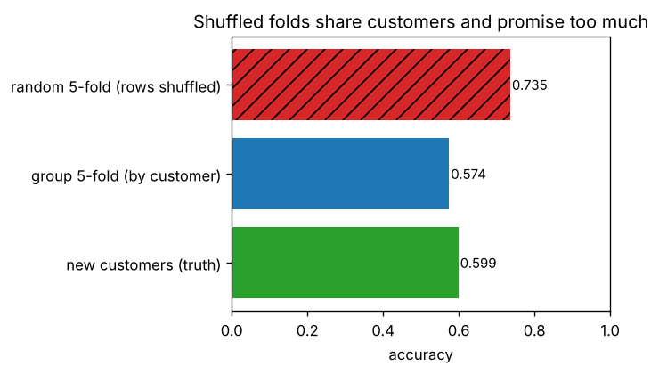

# B4.3 Cross-validation (k-fold, stratified, group, time-series) and hyperparameter tuning (grid, random, Bayesian)

**Core** · Part B, week 4 (course week 10) · ~2 h · Lab:
[`labs/B/b4_3_cross_validation_tuning.py`](../../labs/B/b4_3_cross_validation_tuning.py)

## Why it matters

One validation split gives one noisy number, and choosing a model or its settings on that number fits the noise. Cross-validation uses every row
for validation once and reports a mean with a spread. But it only works if the validation folds are *new* in the same way production data
will be new: new customers, or next month. The commonest serious evaluation bug in industry is a splitter that lets the same customer, patient
or week sit on both sides of the split; the score looks great and production disappoints. The second is tuning on the data you then report.
This lesson builds the four standard splitters from scratch, measures a group leak, compares grid, random and Bayesian search on one
budget, and shows how nested cross-validation and a single look at the test set keep the reported number honest. P2 is graded on exactly these choices.

## Prerequisite check

- Can you explain why a test set is held out and used once? If not, revisit [B1.1](b1_1_ml_workflow.md).
- Can you name three kinds of leakage, including rows from the same entity on both sides of a split? If not, revisit
  [B1.4](b1_4_data_leakage.md).
- Can you train LightGBM and say what `learning_rate` and `num_leaves` control? If not, revisit
  [B3.3](b3_3_gradient_boosting.md).
- Do you know why the best of many noisy estimates is optimistic (the multiple-comparisons problem)? If not, revisit
  [A6.3b](../A/a6_3b_multiple_comparisons_ab_tests.md).

## Intuition

**k-fold cross-validation** cuts the development data into $k$ parts (folds). Train on $k - 1$ of them, score on the one left out, and rotate until every
fold has been the validation fold once. You get $k$ scores: their mean is the estimate, and their spread shows how much the estimate depends on which rows you happened to hold out.

The rule that decides everything: **the validation fold must be new in the way production data is new.**

- Rows are independent, and new rows look like old rows: plain **k-fold**, shuffled.
- Classification with a rare class: **stratified k-fold**, so every fold has the same class mix and no fold ends up with almost no positives.
- Several rows per customer, patient or device, and production will see *new* entities: **group k-fold**, so all of an entity's rows land in the same fold.
  Otherwise the model can recognize the entity instead of learning the pattern.
- Time matters, and you will predict the future: a **time-series split**, which always trains on the past and validates on the block that follows.

**Tuning** means choosing hyperparameters (learning rate, tree size, penalty) by their cross-validated score. Three ways to spend a budget of
$B$ configurations:

- **Grid search** tries every combination of a few values per setting. If only one or two settings really matter, most of the grid tests values
  of the unimportant ones, and the important ones get only a handful of distinct values.
- **Random search** samples each setting from a range, so every one of the $B$ configurations tries a new value of every setting (Bergstra and Bengio, 2012).
- **Bayesian optimization** (here Optuna's TPE sampler) looks at the configurations tried so far and proposes the next one where good results look more
  likely than bad ones.

Whichever you use, choosing the best of many configurations by their scores makes the winning score optimistic: you picked it partly because its
folds happened to be kind. So the test set is touched once, at the end. To estimate how well the *whole procedure* (tune, then refit) performs, use
**nested cross-validation**: an inner loop tunes, an outer loop scores on rows the inner loop never saw.

> **Bridge:** a group leak is like load-testing a service with a replayed log while the cache is warm from the same log: every request is a cache
> hit and latency looks wonderful. Production traffic comes from new users with cold caches. **Where it breaks:** with a cache you can see the hit
> rate; with a model nothing tells you it is "recognizing" customers. You only find out by splitting by customer, which is why you must decide the
> splitter from how the data was generated, not from the scores.

## The math

**Symbols**

| Symbol | Meaning | Shape |
|---|---|---|
| $n$, $k$ | development rows, number of folds | ints |
| $\mathcal{F}_f$ | the row indices of fold $f$ ($f = 0, \dots, k - 1$, counted from 0 as in the code) | set |
| $s_f$ | the score of the model trained without fold $f$ and evaluated on it | scalar |
| $\mathbf{g}$ | group labels (customer ids), one per row | `(n,)` |
| $\boldsymbol{\lambda}$ | a hyperparameter configuration | — |
| $B$ | number of configurations a search may evaluate | int |
| $\hat{\mu}_j$, $\mu_j$ | estimated (cross-validated) and true score of configuration $j$ | scalars |

**Step 1: the k-fold estimate.** $\widehat{\text{score}} = \frac1k\sum_{f=0}^{k-1} s_f$. Report the standard deviation of the $s_f$ too. It understates the real uncertainty: the folds share training rows, so the $s_f$ are not independent,
but a large spread is still a warning that one split would have told you little. Without shuffling, fold $f$ is a contiguous block, and the first $n \bmod k$ folds get one extra row.

**Step 2: stratification.** scikit-learn's rule: sort the labels; fold $f$ receives, from each class, as many rows as that class has among the sorted positions
$f, f + k, f + 2k, \dots$. Dealing every $k$-th position of a sorted list gives each fold the same class proportions, to within one row per class. Each class's rows
are then handed out in their original order: the first ones to fold 0, the next to fold 1, and so on.

**Step 3: grouping.** Assign whole groups to folds: take groups from largest to smallest, and put each in the fold that currently has the fewest rows. No group then
appears in both a training fold and its validation fold, and fold sizes come out nearly equal.

**Step 4: the expanding window.** With $k$ splits, the test block size is $m = \lfloor n/(k + 1)\rfloor$. Split $f$ ($f = 0, \dots, k - 1$) validates on rows $[n - km + fm,\; n - km + (f + 1)m)$ and trains on every row before them.
Every validation row is later than every training row, as in production.

**Step 5: why the best score is optimistic.** Each estimate is the truth plus noise, $\hat{\mu}_j = \mu_j + \varepsilon_j$. The search reports $\min_j\hat{\mu}_j$ (for an error). Even if every configuration were equally good,
$\mu_j = \mu$, the minimum of $B$ noisy numbers is below $\mu$. With independent normal noise of standard deviation $\sigma$, $\min_j\varepsilon_j = -\max_j(-\varepsilon_j)$, and $-\varepsilon_j$ has the same distribution as $\varepsilon_j$ (the normal is symmetric), so $\mathbb{E}[\min_j\hat{\mu}_j] = \mu - c_B\,\sigma$, where $c_B$ is the expected largest of $B$ standard
normal draws, read from a table or a quick simulation ($c_{20} \approx 1.87$). The more configurations, the noisier the estimates, the bigger the optimism. It is the multiple-comparisons problem of A6.3b in another form.

**Step 6: nested cross-validation.** Outer loop: $k_{\text{out}}$ folds. For each outer fold, run the whole tuning procedure (an inner cross-validation over the $B$ configurations) on
the outer training rows only, refit the winner on them, and score it on the outer validation fold. The mean outer score estimates how well "tune then refit" performs
on new data. It does not produce a model: afterwards, run the tuning once on all development rows to get the model you ship.

**Step 7: how TPE proposes configurations.** After an initial batch of random trials, TPE splits the trials so far into the best fraction ("good") and the rest ("bad"). It
fits a density $l(\boldsymbol{\lambda})$ to the good configurations and $g(\boldsymbol{\lambda})$ to the bad ones, and proposes the candidate with the largest ratio $l(\boldsymbol{\lambda})/g(\boldsymbol{\lambda})$: a region where good results have been common and bad ones rare (Bergstra and colleagues, 2011).

## Worked example by hand

Ten rows (indices 0–9), labels $y = (0, 0, 0, 0, 0, 0, 1, 1, 1, 1)$, customers $\mathbf{g} = (1, 1, 1, 2, 2, 3, 3, 4, 5, 5)$.

- **k-fold, $k = 5$:** $10/5 = 2$ rows per fold, in order: test folds $\{0, 1\}, \{2, 3\}, \dots, \{8, 9\}$.
- **Stratified, $k = 2$:** the sorted labels are six 0s then four 1s. Positions 0, 2, 4, 6, 8 hold three 0s and two 1s; positions 1, 3, 5, 7, 9 also hold three 0s and two 1s.
  So each fold gets three negatives and two positives. Dealing in original order: the negatives 0, 1, 2 and the positives 6, 7 go to fold 0; the rest to fold 1. Test folds $\{0, 1, 2, 6, 7\}$ and $\{3, 4, 5, 8, 9\}$.
- **Group, $k = 3$:** group sizes are 3 (customer 1), 2 (customers 2, 3 and 5) and 1 (customer 4). Customer 1 goes to fold 0 (3 rows). Customer 2 goes to fold 1, the emptiest;
  customer 3 to fold 2; customer 5 to fold 1 (folds 1 and 2 both hold 2 rows, and the first such fold wins), making 4; customer 4 to fold 2, making 3. Test folds: rows $\{0, 1, 2\}$,
  $\{3, 4, 8, 9\}$ and $\{5, 6, 7\}$. No customer is split.
- **Time series, $k = 3$:** $m = \lfloor 10/4\rfloor = 2$. Test blocks start at $10 - 6 = 4$: $\{4, 5\}$, $\{6, 7\}$, $\{8, 9\}$, each trained on everything before it.

```text
== worked example by hand ==
k-fold (k=5): test [0, 1]  test [2, 3]  test [4, 5]  test [6, 7]  test [8, 9]
stratified (k=2): test [0, 1, 2, 6, 7]  test [3, 4, 5, 8, 9]
group (k=3): test [0, 1, 2]  test [3, 4, 8, 9]  test [5, 6, 7]
time series (k=3): test [4, 5]  test [6, 7]  test [8, 9]
   time-series fold 0: train [0, 1, 2, 3] -> test [4, 5]
   time-series fold 1: train [0, 1, 2, 3, 4, 5] -> test [6, 7]
   time-series fold 2: train [0, 1, 2, 3, 4, 5, 6, 7] -> test [8, 9]
```

**Selection bias, by hand.** Three configurations are truly equal (RMSE 0.46), and their CV estimates come out at 0.47, 0.45 and 0.46. You choose the second
and report 0.45. That is 0.01 better than the truth, and the difference is pure luck in the folds.

## Key plot



A synthetic dataset of 200 customers with 10 rows each, where part of the label depends on who the customer is. Shuffled k-fold puts each customer's rows in both
training and validation, the random forest recognizes customers, and the estimate is 0.735. Group k-fold estimates 0.574, close to the 0.599 the model actually
achieves on 200 customers it has never seen. The shuffled estimate is off by 14 points.

## From scratch in NumPy

**The splitters.** Each returns a list of `(train indices, test indices)` pairs. The stratified one follows Step 2, with classes numbered in order of first appearance as
scikit-learn does:

```python
def stratified_kfold(y, k):
    _, first_idx, y_inv = np.unique(y, return_index=True, return_inverse=True)
    y_enc = np.argsort(np.argsort(first_idx))[y_inv]          # class code = order of first appearance
    y_sorted = np.sort(y_enc)
    alloc = np.array([np.bincount(y_sorted[f::k], minlength=len(first_idx)) for f in range(k)])  # (k, n_classes)
    fold_of = np.empty(len(y), dtype=np.int64)
    for c in range(len(first_idx)):
        fold_of[y_enc == c] = np.repeat(np.arange(k), alloc[:, c])   # deal class c's rows in order
    return [(np.flatnonzero(fold_of != f), np.flatnonzero(fold_of == f)) for f in range(k)]
```

`group_kfold` sorts groups by size and gives each to the emptiest fold (Step 3); `time_series_split` is Step 4 in two lines.

**A group leak.** 200 customers, each with a 5-number signature (its rows carry it, plus a little noise) and a hidden tendency to be positive that the
signature does not predict; 3 row-level features carry the real, learnable signal. The model is a 200-tree random forest.

```text
== a group leak ==
random 5-fold (rows shuffled)   accuracy 0.7355  (folds [0.735, 0.73, 0.71, 0.728, 0.775])
group 5-fold (by customer)      accuracy 0.5740  (folds [0.545, 0.588, 0.628, 0.555, 0.555])
new customers (truth)           accuracy 0.5985
group 5-fold using only the 3 row features: 0.5795
```

With shuffled folds, the forest uses the signature to find the customer's other rows and copies their labels: an ability that is worthless on new customers.
Grouped folds remove it, and the estimate drops to what the row features can really deliver, which matches the new-customer truth within the fold-to-fold spread.
Notice that the shuffled folds also look *more stable* (0.71–0.78): a leak can make a bad estimate look precise.

## With scikit-learn

```text
== from scratch versus scikit-learn splitters ==
KFold(5): True
StratifiedKFold(5): True
TimeSeriesSplit(4): True
group k-fold: no group on both sides, every row tested once: OK   fold sizes mine [20, 20, 21, 21, 21]  sklearn [20, 20, 21, 21, 21]
   stratified fold 0: class shares in test [0.524, 0.333, 0.143] (all rows [0.515, 0.33, 0.155])
   stratified fold 1: class shares in test [0.524, 0.333, 0.143] (all rows [0.515, 0.33, 0.155])
```

`KFold`, `StratifiedKFold` and `TimeSeriesSplit` produce identical folds. For `GroupKFold` the lab checks the properties that matter (no group on both sides, every row
tested once) and the fold sizes: when groups have equal sizes, scikit-learn may order them differently. All splitters plug into `cross_val_score`, `GridSearchCV`,
`RandomizedSearchCV` and `cross_validate` through `cv=` (and `groups=` for grouped splitters). `TimeSeriesSplit(gap=g)` leaves $g$ rows out between training and validation,
for features computed over trailing windows (VERIFY as of 2026-10).

**Tuning LightGBM three ways.** California housing (B3.3), split once into 16,512 development rows and 4,128 test rows. Each method gets the same budget: 20 configurations,
each scored by 3-fold cross-validation on the development rows, with 200 trees per fit. Grid: 5 learning rates × 4 leaf counts. Random and Optuna: learning rate and leaves
on log scales, plus `min_child_samples` and `colsample_bytree`.

```python
def objective(trial):
    p = {"learning_rate": trial.suggest_float("learning_rate", 0.01, 0.3, log=True),
         "num_leaves": trial.suggest_int("num_leaves", 8, 256, log=True),
         "min_child_samples": trial.suggest_int("min_child_samples", 5, 100),
         "colsample_bytree": trial.suggest_float("colsample_bytree", 0.5, 1.0)}
    return cv_rmse(p, X_dev, y_dev, folds)

study = optuna.create_study(direction="minimize", sampler=optuna.samplers.TPESampler(seed=0))
study.optimize(objective, n_trials=20)
```

```text
== grid, random and Bayesian search ==
~ 60 configurations x 3 folds in 77 s
LightGBM defaults (lr 0.1, 31 leaves): CV RMSE 0.4633
grid          best CV RMSE 0.4618 (best of first 5: 0.5431)   learning_rate=0.1, num_leaves=63, min_child_samples=20, colsample_bytree=1
random        best CV RMSE 0.4592 (best of first 5: 0.4613)   learning_rate=0.103, num_leaves=76, min_child_samples=85, colsample_bytree=0.694
optuna (TPE)  best CV RMSE 0.4525 (best of first 5: 0.4574)   learning_rate=0.059, num_leaves=78, min_child_samples=16, colsample_bytree=0.614

== one look at the test set ==
grid          CV RMSE 0.4618   test RMSE 0.4287
random        CV RMSE 0.4592   test RMSE 0.4274
optuna (TPE)  CV RMSE 0.4525   test RMSE 0.4229
```

- With the same 20 evaluations, Optuna found the best configuration, random search came second and the grid third. The grid spent its first four evaluations at learning
  rate 0.01 (best of its first five: 0.543) and never varied two of the four settings. The improvement over LightGBM's defaults is modest (0.463 to 0.453, about 2%): for boosted trees,
  defaults are reasonable and tuning is a refinement, not a rescue.
- Test RMSE is *lower* than CV RMSE for every method. The CV models trained on two thirds of the development rows (11,008), and the final models on all 16,512. More
  data helps, so k-fold estimates are slightly pessimistic for the refitted model. One test split also has its own noise. The ranking held, but a 0.006 gap between methods is
  not a significant difference on its own; you would need repeated CV or a bootstrap (A6.2).

**Nested cross-validation.** On a 1,000-row sample, with 20 random configurations. Non-nested: choose by 3-fold CV and report the winner's CV score. Nested: re-run the choice inside
each outer fold (Step 6). Both report models trained on two thirds of the sample.

```text
== nested cross-validation ==
non-nested: best of 20 configurations, scored on the folds that chose it: 0.5583 (configuration 4)
outer fold 0: inner search chose configuration  0   outer RMSE 0.5781
outer fold 1: inner search chose configuration  4   outer RMSE 0.5829
outer fold 2: inner search chose configuration  4   outer RMSE 0.5240
nested estimate (mean outer RMSE) 0.5616   non-nested 0.5583   optimism of the non-nested number +0.0034
```

The non-nested number is optimistic, as Step 5 predicts, though only by 0.003 here: the 20 configurations of a stable model have similar scores. The bias grows with more
configurations, smaller data and noisier metrics. Note also that the inner search did not always choose the same configuration: the "best" configuration is itself uncertain.

## In practice

- **When to use it:** choose the splitter from how the data was generated, before looking at any score:
  - one row per independent entity, no time order: `KFold(shuffle=True)`; `StratifiedKFold(shuffle=True)` for classification;
  - several rows per entity, and production meets new entities: `GroupKFold` (or `StratifiedGroupKFold`);
  - time order matters: `TimeSeriesSplit` (with `gap` when features use trailing windows); never shuffle;
  - $k = 5$ is a good default; use 10 or repeated k-fold when data is small and fits are cheap.
  - for tuning: random search or Optuna over log-scaled ranges, with a budget you decide in advance; the same folds for every model you compare (P2 requires it); preprocessing
    inside a `Pipeline` so it is refitted in every fold (B1.4); early stopping on an inner split, not on the validation fold you score (B3.3).
- **Failure modes:**
  - *Group or time leaks.* The CV score is much better than the score on a later or truly new holdout. Re-split by entity or time.
  - *Tuning on the test set,* or looking at it "just once" per experiment. It becomes a validation set. Keep a final holdout untouched until the end.
  - *Reporting the best CV score as expected performance* after a large search. Use nested CV, or an untouched test set.
  - *Comparing models on different folds or budgets.* Fix the splitter's `random_state` and give every model the same number of configurations.
  - *Over-reading small differences.* Fold-to-fold spreads of ±0.02 make a 0.005 gain noise.
- **Defaults that work:** `StratifiedKFold(5, shuffle=True, random_state=0)` or `GroupKFold(5)`; `optuna` 5.0 with `TPESampler(seed=0)` and 30–100 trials, or
  `RandomizedSearchCV(n_iter=30)`; refit the winner on all development rows; one test evaluation with a bootstrap CI (VERIFY APIs as of 2026-10).

## Exercises

Save your work to `my-work/B/b4_3_cross_validation_tuning.md` (or `.py`) and ask for a review.

1. **By hand:** Twelve rows (indices 0–11), labels $y = (1, 0, 0, 1, 0, 0, 0, 1, 0, 0, 0, 0)$, customers $\mathbf{g} = (1, 1, 2, 2, 2, 3, 4, 4, 5, 5, 5, 5)$. (a) Write the test folds of unshuffled 4-fold, of stratified 3-fold (Step 2) and of
   a time-series split with $k = 3$. (b) Assign the customers to 3 group folds with the Step 3 rule. (c) A search compares 20 equally good configurations whose CV RMSE estimates have noise with
   standard deviation 0.004. Roughly how optimistic is the best score? (d) For each case, name the splitter: hospital readmission with several admissions per patient; next-week sales; one loan
   application per person with 3% defaults; images where each photographer took 50 photos.
2. **Code:** Build a synthetic daily series of 1,000 days with a trend, a weekly cycle and noise. Create lag features (values 1, 7 and 14 days earlier, and a 7-day trailing mean), and predict
   the next day with LightGBM. Hold out the last 200 days. On the first 800, compare the CV RMSE from shuffled 5-fold, from `TimeSeriesSplit(5)` and from `TimeSeriesSplit(5, gap=7)` with the RMSE
   on the 200 held-out days. Explain which estimate is closest and why the shuffled one is wrong.
3. **Think:** A teammate ran 500 configurations of an XGBoost model with 5-fold cross-validation on all the data they had (no test set) and reports the best CV AUC, 0.912, as the expected production
   AUC. The data has several visits per patient, collected over three years. List the problems, say which direction each one biases the number, and describe the evaluation you would run instead.

## Takeaways

1. k-fold CV scores every row once and reports a mean and a spread; the spread understates the uncertainty, but a large one is a warning.
2. The splitter must make validation data new in the way production data is new: stratified for rare classes, grouped for repeated entities, time-ordered for forecasting.
3. A group leak can turn a 0.60 model into a 0.74 estimate and make it look stable; decide the splitter from how the data was generated, not from the scores.
4. Random search beats grid search when only some settings matter, and Bayesian search (TPE) usually finds good settings in fewer trials; fix the budget and folds for a fair comparison.
5. The best score of a search is optimistic; touch the test set once, and use nested CV to estimate how well the tuning procedure itself performs.

**What builds on this:** [B4.4](b4_4_class_imbalance.md) (stratification and thresholds with rare positives); [B4.5](b4_5_bias_variance.md) (validation and
learning curves are cross-validated); [B6.3](b6_3_time_series_forecasting.md) (backtesting forecasts); [I2.4](../I/i2_4_rag_evals.md) and
[I3.3](../I/i3_3_agent_evals.md) (held-out eval sets for LLM systems); P2 (splitter, tuning budget and one test evaluation).

**References:** J. Bergstra, Y. Bengio, "Random search for hyper-parameter optimization", *Journal of Machine Learning Research* 13, 2012.
J. Bergstra, R. Bardenet, Y. Bengio, B. Kégl, "Algorithms for hyper-parameter optimization", *NeurIPS*, 2011. G. C. Cawley, N. L. C. Talbot, "On over-fitting in
model selection and subsequent selection bias in performance evaluation", *JMLR* 11, 2010. S. Varma, R. Simon, "Bias in error estimation when using cross-validation for
model selection", *BMC Bioinformatics* 7, 2006. T. Akiba et al., "Optuna: a next-generation hyperparameter optimization framework", *KDD*, 2019. scikit-learn User Guide,
"Cross-validation" (VERIFY link: https://scikit-learn.org/stable/modules/cross_validation.html).
