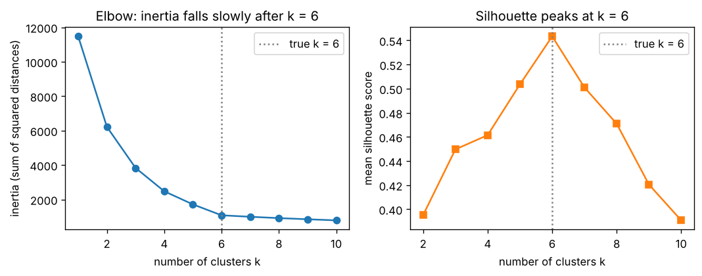

# B5.1 k-means from scratch, and choosing k (elbow, silhouette)

**Core** · Part B, week 5 (course week 11) · ~2 h · Lab:
[`labs/B/b5_1_k_means.py`](../../labs/B/b5_1_k_means.py)

## Why it matters

Every model so far learned from labels. Most data in a company has none: customers, sessions, transactions, log lines. **Clustering**
groups such rows by similarity so a person can look at a handful of groups instead of a million rows ("customer segments", "kinds of
error"). **k-means** is the clustering algorithm you will meet first in any job and in almost every interview: it is fast, simple, and
the default in every library. It also fails in quiet ways. It always returns exactly $k$ groups, even when the data has none; a bad
start leaves it stuck in a poor answer that looks fine; and the two usual ways to choose $k$, the **elbow method** and the **silhouette
score**, can disagree or mislead. This lesson builds k-means from scratch, shows each failure in numbers, and adds the tool P3 needs to
check that a clustering is real rather than an accident of the seed: the **adjusted Rand index (ARI)**.

## Prerequisite check

- Can you compute all pairwise squared distances between two sets of points without a loop, using $\lVert\mathbf{x} - \mathbf{c}\rVert^2 = \lVert\mathbf{x}\rVert^2 - 2\mathbf{x}\cdot\mathbf{c} + \lVert\mathbf{c}\rVert^2$? If not, revisit
  [B2.3](b2_3_knn.md).
- Do you know why features on different scales distort a Euclidean distance, and how standardization fixes it? If not, revisit
  [B1.3](b1_3_feature_engineering.md).
- Can you say what the mean of a set of vectors is, and what the variance of a feature measures? If not, revisit
  [A3.3](../A/a3_3_covariance_matrices.md).
- Can you picture a round 2-D Gaussian blob, $\mathcal{N}(\boldsymbol{\mu}, \sigma^2\mathbf{I}_2)$? If not, revisit
  [A5.2](../A/a5_2_common_distributions.md).
- Can you set a derivative to zero to find a minimum? If not, revisit [A4.1](../A/a4_1_derivatives.md).

## Intuition

Imagine you must open $k$ delivery depots for a city's customers, and each customer is served by the nearest depot. You want to place
the depots so that the total (squared) travel distance is as small as possible. You do not know the best places, but two moves are
obvious:

1. **Given depots, assign customers:** each customer goes to the nearest depot.
2. **Given customers, move depots:** put each depot at the centre (the mean) of the customers it serves.

Repeat the two moves until nothing changes. That is k-means, also called **Lloyd's algorithm**. Each depot is a **centroid**; the
total squared distance from points to their centroid is the **inertia**. Each move can only lower the inertia (or leave it unchanged),
so the loop always stops. But it stops at the first arrangement where neither move helps, which need not be the best one. Two depots
started in the same neighbourhood can end up splitting it between them while a distant neighbourhood shares a single depot with
another: a **local minimum**. Two fixes are standard. **k-means++** starts the depots far apart, and `n_init` runs the whole thing
several times from different starts and keeps the run with the lowest inertia.

k-means assumes clusters are roughly round blobs of similar spread, because "nearest centroid by Euclidean distance" draws straight
boundaries halfway between centroids. Long, curved or very unequal clusters break it (B5.2 and B5.3 handle those).

> **Bridge:** k-means is like sharding a key space across $k$ servers so that each key lives on the nearest shard, then rebalancing
> shard positions until no key wants to move. **Where it breaks:** a sharding scheme is correct by construction for any $k$ you
> choose, while a clustering is a *claim about the data*. k-means will happily return 6 "segments" of pure noise, so you must check
> that the groups are stable and mean something before anyone acts on them.

## The math

**Symbols**

| Symbol | Meaning | Shape |
|---|---|---|
| $\mathbf{X}$ | data matrix, one example per row (standardized features) | `(n, d)` |
| $\mathbf{x}_i$ | example $i$ | `(d,)` |
| $k$ | number of clusters, chosen by you (not the class count $K$) | int |
| $\mathbf{c}_j$ | centroid of cluster $j$; all centroids stacked as $\mathbf{C}$ | `(d,)`; `(k, d)` |
| $z_i$ | cluster label of example $i$, in $\{1, \dots, k\}$ | int; all labels `(n,)` |
| $S_j$ | the set of examples with $z_i = j$; $\lvert S_j\rvert$ is its size | set |
| $J$ | inertia: the within-cluster sum of squared distances | scalar |
| $D(\mathbf{x})$ | distance from $\mathbf{x}$ to the nearest centroid chosen so far (k-means++) | scalar |
| $a_i$, $b_i$, $s_i$ | silhouette ingredients for example $i$ (defined in Step 4) | scalars |

**Step 1: the objective.** k-means looks for labels and centroids that minimize
$$J(\mathbf{C}, \mathbf{z}) = \sum_{i=1}^{n} \lVert \mathbf{x}_i - \mathbf{c}_{z_i} \rVert_2^2 ,$$
the squared distance from every example to the centroid of its own cluster, summed. Small $J$ means tight clusters.

**Step 2: the two moves each lower $J$.**

*Assignment step.* Hold $\mathbf{C}$ fixed. Each term of the sum involves only one $z_i$, so the sum is smallest when every term is
smallest: set $z_i = \arg\min_j \lVert\mathbf{x}_i - \mathbf{c}_j\rVert^2$, the nearest centroid. Any other choice can only make that
term bigger.

*Update step.* Hold $\mathbf{z}$ fixed. The terms for cluster $j$ involve only $\mathbf{c}_j$, so minimize
$f(\mathbf{c}) = \sum_{i \in S_j} \lVert \mathbf{x}_i - \mathbf{c} \rVert^2$ for each $j$ separately. Write the squared norm as a sum over
features, $\sum_{i \in S_j}\sum_{m=1}^{d}(x_{im} - c_m)^2$, and take the derivative with respect to one coordinate $c_m$:
$$\frac{\partial f}{\partial c_m} = \sum_{i \in S_j} -2\,(x_{im} - c_m) = -2\Big(\sum_{i \in S_j} x_{im} - \lvert S_j\rvert\, c_m\Big).$$
Setting it to zero gives $c_m = \frac{1}{\lvert S_j\rvert}\sum_{i\in S_j} x_{im}$. Doing this for every $m$:
$$\mathbf{c}_j = \frac{1}{\lvert S_j\rvert}\sum_{i \in S_j}\mathbf{x}_i ,$$
the **mean** of the cluster's points. $f$ is a sum of squares, a convex bowl (A4.5), so this zero-derivative point is its minimum. This is where
the name comes from, and it is also why k-means uses *squared* Euclidean distance: with plain distances the best centre is not the mean.

*Why it stops.* Each step leaves $J$ the same or lower. There are finitely many ways to assign $n$ points to $k$ clusters, and the
algorithm cannot revisit an assignment with a higher $J$, so it must stop after finitely many steps (usually 10–50). Nothing in the
argument says the stopping point is the *global* minimum. Finding that is NP-hard in general, which is why we restart.

**Step 3: k-means++ initialization.** Choose the first centroid uniformly at random from the data. Then, for each next centroid, compute
$D(\mathbf{x}_i)^2$, the squared distance from every point to the nearest centroid chosen so far, and pick point $i$ with probability
$$P(i) = \frac{D(\mathbf{x}_i)^2}{\sum_{l=1}^{n} D(\mathbf{x}_l)^2}.$$
Far-away points are much more likely to be picked, so the starting centroids tend to land in different clusters. (Arthur and
Vassilvitskii proved the expected inertia right after seeding is within a factor $O(\log k)$ of the optimum.) It reduces, but does not
remove, bad starts; `n_init` restarts handle the rest.

**Step 4: the silhouette.** For example $i$ in cluster $A$:

- $a_i$ = mean distance from $\mathbf{x}_i$ to the *other* points of $A$ (how tightly it sits in its own cluster);
- $b_i$ = the smallest, over the other clusters $B$, of the mean distance from $\mathbf{x}_i$ to the points of $B$ (how far the nearest rival cluster is);
- $s_i = \dfrac{b_i - a_i}{\max(a_i, b_i)}$, a number in $[-1, 1]$; by convention $s_i = 0$ if $\mathbf{x}_i$ is alone in its cluster.

$s_i$ near 1: well inside its cluster. Near 0: on the border between two clusters. Negative: closer to another cluster than to its own.
The **silhouette score** of a clustering is the mean of $s_i$ over all points. These are plain (not squared) distances.

**Step 5: the elbow.** Plot the best $J$ against $k$. $J$ always falls as $k$ grows (with $k = n$ every point is its own centroid and
$J = 0$), so "minimize $J$" cannot choose $k$. Instead look for the **elbow**: the $k$ after which adding a cluster buys much less. It is
a judgement read off a plot, not a rule.

**Step 6: the adjusted Rand index.** To compare two labelings $\mathbf{u}$ and $\mathbf{v}$ of the same $n$ points (two runs, or a run and
known groups), look at *pairs* of points, so the names of the clusters do not matter. Build the contingency table $n_{uv}$ = number of
points with label $u$ in the first labeling and $v$ in the second; let $a_u = \sum_v n_{uv}$ and $b_v = \sum_u n_{uv}$ be its row and column
sums. Writing $\binom{m}{2} = m(m-1)/2$ for the number of pairs among $m$ points:

- pairs together in both labelings: $\text{index} = \sum_{u,v}\binom{n_{uv}}{2}$;
- if the second labeling were a random shuffle with the same cluster sizes, the expected index would be
  $\mathbb{E} = \sum_u\binom{a_u}{2}\sum_v\binom{b_v}{2} \big/ \binom{n}{2}$;
- the largest possible index is at most $\text{max} = \frac12\big(\sum_u\binom{a_u}{2} + \sum_v\binom{b_v}{2}\big)$.

$$\text{ARI} = \frac{\text{index} - \mathbb{E}}{\text{max} - \mathbb{E}}.$$
ARI = 1 for identical groupings (whatever the names), about 0 for agreement no better than chance, and it can be slightly negative.
Because cluster ids are arbitrary (run 1's "cluster 3" may be run 2's "cluster 0"), never compare labels with `==`; compare with ARI.

## Worked example by hand

Four points in 2-D, $k = 2$: $A = (1, 1)$, $B = (1, 3)$, $C = (5, 1)$, $D = (6, 3)$. By eye the answer is $\{A, B\}$ and $\{C, D\}$.
Start (badly) with the centroids on $A$ and $B$: $\mathbf{c}_1 = (1, 1)$, $\mathbf{c}_2 = (1, 3)$.

**Iteration 1, assignment.** Squared distances to $(\mathbf{c}_1, \mathbf{c}_2)$: $A$: $(0, 4)$. $B$: $(4, 0)$.
$C$: $(5-1)^2 + 0^2 = 16$ and $4^2 + 2^2 = 20$, so $C$ joins cluster 1. $D$: $5^2 + 2^2 = 29$ and $5^2 + 0^2 = 25$, so $D$ joins
cluster 2. **Update:** $\mathbf{c}_1 = \text{mean}(A, C) = (3, 1)$, $\mathbf{c}_2 = \text{mean}(B, D) = (3.5, 3)$.
Inertia: $A$ and $C$ are each $2^2 = 4$ from $(3, 1)$; $B$ and $D$ are each $2.5^2 = 6.25$ from $(3.5, 3)$; $J = 20.5$.

**Iteration 2.** $A$: $(4, 10.25)$; $B$: $(8, 6.25)$; $C$: $(4, 6.25)$; $D$: $(13, 6.25)$. Every point keeps its cluster, so the centroids do
not move: **converged at $J = 20.5$**. Yet the split $\{A, B\}, \{C, D\}$ has centroids $(1, 2)$ and $(5.5, 2)$ and
$J = 1 + 1 + 1.25 + 1.25 = 4.5$. Lloyd's algorithm stopped in a local minimum more than four times worse than the best answer.

**k-means++ would have avoided it.** Suppose $A$ is picked first. $D^2$ to $B, C, D$ is $4, 16, 29$ (sum 49), so the second centroid is $B$
with probability $4/49 = 0.082$, $C$ with $0.327$ and $D$ with $0.592$. Nine times in ten it starts in the other group.

**Silhouette of $A$** in $\{A, B\}, \{C, D\}$: $a = \lVert A - B\rVert = 2$; $b = (\lVert A - C\rVert + \lVert A - D\rVert)/2 =
(4 + \sqrt{29})/2 = (4 + 5.385)/2 = 4.693$; $s = (4.693 - 2)/4.693 = 0.574$.

```text
== worked example by hand ==
iteration 1: squared distances to (c1, c2): A (0, 4)  B (4, 0)  C (16, 20)  D (29, 25)
  clusters {A,C} {B,D} -> centroids [3.0, 1.0] [3.5, 3.0], inertia 20.5
iteration 2: squared distances to (c1, c2): A (4, 10.25)  B (8, 6.25)  C (4, 6.25)  D (13, 6.25)
  clusters {A,C} {B,D} -> centroids [3.0, 1.0] [3.5, 3.0], inertia 20.5
  centroids did not move: converged
the other split {A,B} {C,D}: centroids [1.0, 2.0] [5.5, 2.0], inertia 4.5
k-means++ after picking A first: D^2 to B, C, D = 4, 16, 29 -> probabilities 0.082, 0.327, 0.592
silhouette of A in {A,B} {C,D}: a = 2.000, b = (4.000 + 5.385) / 2 = 4.693, s = 0.574
```

## Key plot



On data with six well-separated round blobs both tools agree: inertia stops falling fast after $k = 6$ (drops of 634 then 86), and the
silhouette peaks at $k = 6$. That is the easy case. On real data (exercise 2) the elbow is often a smooth curve and the silhouette can
prefer a $k$ that is useless for the business, so treat both as evidence, not as an answer.

## From scratch in NumPy

**The data.** 600 points from six round Gaussian blobs (standard deviation 1) centred on a 3 × 2 grid with spacing 4 and 5. The two
features are on similar scales already; on real data you would standardize first (B1.3), since k-means is all distances.

```text
== data ==
X (600, 2), true groups [100, 100, 100, 100, 100, 100] (labels are never shown to k-means)
feature means [3.988, 2.468], stds [3.457, 2.678]
```

**Lloyd's algorithm.** The two steps are three short functions. `sq_dists` is B2.3's vectorized distance matrix:

```python
def assign(X, C):                         # X (n, d), C (k, d) -> (n,)
    return np.argmin(sq_dists(X, C), axis=1)

def update(X, labels, C_old):             # -> (k, d)
    C = C_old.copy()
    for j in range(len(C)):
        members = X[labels == j]
        if len(members):                  # an empty cluster keeps its old centroid
            C[j] = members.mean(axis=0)
    return C
```

`lloyd` alternates them until the centroids move less than a tolerance (scikit-learn's rule: total squared movement below
`tol` × the mean feature variance), recording the inertia after each update. `kmeans_plus_plus` implements Step 3 with
`gen.choice(n, p=D2 / D2.sum())`.

```text
== from scratch: Lloyd's algorithm with k-means++ ==
converged in 13 iterations; inertia per iteration: [2053.92, 1904.53, 1862.01, 1791.44, 1730.35, 1698.49, 1676.61, 1655.62, 1644.75, 1642.4, 1641.67, 1640.32, 1640.32]
inertia never increased: OK
cluster sizes [46, 59, 99, 101, 133, 162], final inertia 1640.3231
```

The inertia falls at every iteration, as Step 2 promises. But look at the cluster sizes: the true groups have 100 points each, and this
single k-means++ run produced clusters of 162 and 133 next to 46 and 59. Its inertia, 1640, is 52% above the best value found below
(1081). Even k-means++ landed in a local minimum here: two centroids split one blob between them (46 + 59 points), so the three
blobs of the other row must share the remaining two centroids (133 + 162). Moving one centroid across would lower the inertia a lot,
but neither Lloyd step can do it: each only moves a centroid to the mean of points that are already nearest to it.

**The adjusted Rand index.** `adjusted_rand` builds the contingency table with `np.add.at` and applies Step 6:

```text
== adjusted Rand index ==
same groups, different names: ARI 1.0000
one point moved: ARI 0.4444
k-means labels vs the same labels shuffled across points: ARI -0.0015
k-means labels vs the true blobs: ARI 0.6924
matches sklearn.metrics.adjusted_rand_score: OK
```

Renaming clusters does not change ARI; on 6 points, moving a single one costs a lot; a random shuffle scores about 0. The stuck run
agrees with the true blobs only at 0.69.

**Bad local minima and `n_init`.** Run Lloyd 100 times from one initialization each, and count runs whose inertia is more than 1% above
the best known (1080.53):

```text
== bad local minima and n_init ==
init=random     n_init=1: 21 of 100 runs stuck (inertia > 1% above best 1080.53); worst 1761.42
init=k-means++  n_init=1: 15 of 100 runs stuck (inertia > 1% above best 1080.53); worst 1760.74
init=random     n_init=10: 0 of 20 runs stuck
init=k-means++  n_init=10: 0 of 20 runs stuck
an example stuck run: inertia 1652.60, cluster sizes [46, 58, 99, 101, 134, 162], ARI with the true blobs 0.6886 (best run: 0.9105)
saved outputs/b5_1/local_minimum.png
```

On this evenly spaced grid, k-means++ helps only a little (15 stuck runs against 21). Restarts fix it: if one run gets stuck with
probability $q$, ten independent runs all get stuck with probability $q^{10}$; for $q = 0.15$ that is about $6 \times 10^{-9}$. The best run
still has ARI 0.91, not 1, with the true blobs: the blobs overlap a little (spacing 4, spread 1), and points in the overlap are assigned
to the nearer centroid whatever blob generated them. `outputs/b5_1/local_minimum.png` draws the stuck and the best clustering side by
side: the stuck run is the same trap as above, with two centroids in one top blob and the three bottom blobs sharing two.

**Choosing $k$.** For $k = 1, \dots, 10$, the best of 10 k-means++ runs, with the silhouette (Step 4) computed from the full $n \times n$
distance matrix:

```text
== choosing k: elbow and silhouette ==
 k   inertia     drop silhouette
 1   11474.2                    
 2    6219.9   5254.3     0.3952
 3    3833.1   2386.8     0.4496
 4    2477.1   1356.0     0.4615
 5    1714.3    762.8     0.5035
 6    1080.5    633.8     0.5433
 7     994.4     86.2     0.5010
 8     917.1     77.2     0.4709
 9     850.0     67.2     0.4205
10     785.7     64.2     0.3908
from-scratch silhouette matches sklearn.metrics.silhouette_score: OK
best silhouette at k = 6
```

The silhouette needs all pairwise distances, so it costs $O(n^2)$ time and memory: fine for 600 points, impossible for a million. On
large data compute it on a random sample of a few thousand points (`silhouette_score(..., sample_size=5000, random_state=0)`).

**Stability.** A clustering worth acting on comes back when you change things that should not matter: the seed, or which rows you
happened to collect. Refit with five other seeds, then on 10 **bootstrap** resamples (draw $n$ rows with replacement, A6.2), each time
comparing with the full-data clustering by ARI on all 600 original points:

```text
== stability: seeds and bootstrap ==
k=6, 5 other seeds: ARI with seed 0 = [1.0, 1.0, 1.0, 1.0, 1.0]
k=3: ARI of 10 bootstrap refits with the full-data clustering: mean 0.6927, min 0.2543
k=6: ARI of 10 bootstrap refits with the full-data clustering: mean 0.9797, min 0.9602
k=9: ARI of 10 bootstrap refits with the full-data clustering: mean 0.7637, min 0.6714
```

At the true $k = 6$ the clustering barely moves. At $k = 3$ there is no single natural answer (three columns of two blobs, or other
merges, are nearly as good), so each resample picks a different one, down to ARI 0.25. At $k = 9$ the extra centroids split blobs
arbitrarily. Instability is a strong sign that the $k$ (or the whole clustering) is not real. P3 uses exactly this check.

## With scikit-learn

Started from the *same* initial centroids, `KMeans(init=C0, n_init=1, algorithm="lloyd")` must follow the same path. Its cluster ids may
differ, so the check maps each of our clusters to the scikit-learn cluster most of its points land in, verifies that this is a
permutation, and then compares labels, centroids and inertia:

```text
== with scikit-learn: KMeans ==
sklearn from the same start: inertia 1640.3231, iterations 13
ARI(mine, sklearn) = 1.0000
matches sklearn.cluster.KMeans (labels up to relabelling, centroids, inertia): OK
independent runs, n_init=10 each: inertia mine 1080.5339, sklearn 1080.5339, ARI between them 1.0000
```

Run independently with 10 restarts each, our implementation and scikit-learn's reach the same best clustering. Useful details
(scikit-learn 1.9.1; VERIFY as of 2026-10):

- `KMeans(n_clusters=k, n_init=..., random_state=0)`: the default `init="k-means++"` (scikit-learn adds a few "greedy" candidates per
  step); `n_init="auto"` is the default and means **1 run** with k-means++ (10 with random init), so set `n_init=10` yourself when the answer matters.
- `.labels_`, `.cluster_centers_`, `.inertia_`, `.n_iter_`; `.predict(X_new)` assigns new rows to the nearest centroid, so a
  fitted k-means is also a tiny "segment this new customer" service.
- `MiniBatchKMeans` updates centroids from small random batches: much faster on millions of rows, slightly higher inertia.
- `sklearn.metrics.silhouette_score(X, labels, sample_size=...)` and `adjusted_rand_score(labels_a, labels_b)`.
- Put `StandardScaler` and `KMeans` in one `Pipeline` so new rows are scaled with the same statistics (B1.3).

## In practice

- **When to use it:** a fast first segmentation of tabular data with a modest number of standardized numeric features; vector
  quantization (compressing points to $k$ prototypes, for example colours or embeddings); a baseline before B5.2's DBSCAN or B5.3's
  Gaussian mixtures. Cost per iteration is $O(nkd)$, so it scales to millions of rows.
- **Failure modes:**
  - *Unscaled features.* The feature with the largest spread decides the clusters (exercise 2). Notice it by printing the
    centroids: if they differ in one column only, scaling is the suspect.
  - *Local minima.* Uneven cluster sizes on data you expect to be balanced, or inertia that changes with the seed. Fix: `n_init=10` or more.
  - *Non-round or unequal clusters.* Long, curved, nested or very differently sized groups get cut by straight boundaries. Notice
    it by plotting a 2-D view (B5.4, B5.5) or by low silhouettes; use B5.2 or B5.3.
  - *Outliers.* A mean is pulled by extreme points; one far outlier can capture a centroid of its own. Check cluster sizes of 1–2 and
    clip or remove outliers first (B1.2, B5.6).
  - *Clusters in noise.* k-means always returns $k$ groups. Check stability (ARI across seeds and bootstrap resamples) and whether
    the groups differ in ways that matter to the people who will use them.
  - *Silhouette compared across feature spaces.* The score depends on the features and their scaling, so a higher silhouette after a
    different scaling does not mean a better clustering (exercise 2).
- **Defaults that work:** standardize; `KMeans(n_clusters=k, n_init=10, random_state=0)`; scan $k$ from 2 to about 10 with inertia,
  silhouette (on a sample if $n$ is large) and bootstrap ARI; prefer the smallest $k$ that is stable and that a person can name and act on.

## Exercises

Save your work to `my-work/B/b5_1_k_means.md` (or `.py`) and ask for a review.

1. **By hand:** One feature, five points: $0, 2, 3, 9, 11$; $k = 2$. (a) Start with centroids at 0 and 2 and run Lloyd's algorithm until it
   stops, giving the assignments, centroids and inertia at each iteration. (b) In 1-D the optimal clustering into two groups splits the sorted
   points at one cut. Compute the inertia of all four cuts: did (a) reach the global minimum? (c) k-means++ has picked 0 as its first
   centroid. Give the probability of picking each point next. (d) For the final clustering, compute the silhouette value of the point 3.
   (e) Compute the ARI between the labelings $(1, 1, 1, 2, 2)$ and $(1, 1, 2, 2, 2)$ of these five points.
2. **Code:** Load the wine dataset (`sklearn.datasets.load_wine`, 178 wines, 13 chemical features, 3 cultivars). Using your own k-means
   (k-means++, `n_init=10`), cluster with $k = 3$ on the raw features and on standardized features. For each, report the inertia, the
   silhouette score and the ARI against the cultivar labels (which k-means never sees), and explain the difference using the centroids and
   the feature standard deviations. Then, on standardized features, for $k = 2, \dots, 8$, tabulate inertia, silhouette, and the mean and
   minimum ARI of 20 bootstrap refits with the full-data clustering. Which $k$ would you report, and on what evidence?
3. **Think:** A marketing lead asks for "five customer segments" from 40 standardized behavioural features (spend, visits, basket size,
   tenure, …) for 2 million customers. On a sample, the silhouette is highest at $k = 2$ (0.31) and is about 0.18 at $k = 5$; the elbow
   is a smooth curve. Do you deliver five segments? Explain what you would check, what you would show the marketing lead, and what you would
   tell them the segments can and cannot be used for.

## Takeaways

1. k-means minimizes inertia, the within-cluster sum of squared distances, by alternating two steps that each lower it: assign to the
   nearest centroid, move each centroid to its cluster's mean (the mean is the exact minimizer of squared distances).
2. It always converges, but often to a local minimum; here one k-means++ start gave inertia 1640 against the best 1081. k-means++ seeding
   and `n_init` restarts are the fix: ten runs made every trial reach the best answer.
3. The elbow and the silhouette are evidence for $k$, not answers; the silhouette also costs $O(n^2)$, so sample it on large data.
4. The adjusted Rand index compares two clusterings by pairs of points, ignoring cluster names: 1 identical, about 0 chance. Use it,
   never `==` on labels, to compare runs, check against scikit-learn, and measure stability.
5. A clustering you will act on must be stable across seeds and bootstrap resamples (ARI near 1), and must make sense to the people using it;
   k-means returns $k$ groups whether or not they exist.

**What builds on this:** [B5.2](b5_2_hierarchical_dbscan.md) (clusters that are not round, and noise);
[B5.3](b5_3_gmm_em.md) (soft assignments: k-means is a limiting case of a Gaussian mixture fitted by EM);
[B5.4](b5_4_pca.md) and [B5.5](b5_5_tsne_umap.md) (2-D views to inspect clusters); [B5.6](b5_6_anomaly_detection.md) (distance to the
nearest centroid as an anomaly score); P3 (segmentation with stability checks); [I2.1](../I/i2_1_embeddings_semantic_search.md)
(clustering embeddings; k-means also powers approximate nearest-neighbour indexes).

**References:** S. P. Lloyd, "Least squares quantization in PCM", *IEEE Transactions on Information Theory* 28(2), 1982. D. Arthur,
S. Vassilvitskii, "k-means++: the advantages of careful seeding", *SODA*, 2007. P. J. Rousseeuw, "Silhouettes: a graphical aid to the
interpretation and validation of cluster analysis", *Journal of Computational and Applied Mathematics* 20, 1987. L. Hubert, P. Arabie,
"Comparing partitions", *Journal of Classification* 2, 1985. scikit-learn User Guide, "Clustering" (VERIFY link:
https://scikit-learn.org/stable/modules/clustering.html).
