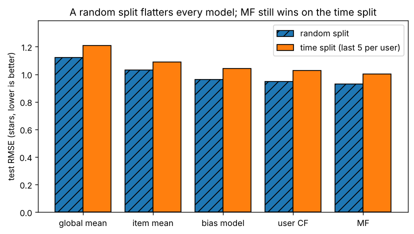

# B6.1 Recommender systems: collaborative filtering and matrix factorization from scratch, implicit feedback

**Core** · Part B, week 6 (course week 12) · ~2.5 h · Lab:
[`labs/B/b6_1_recommender_systems.py`](../../labs/B/b6_1_recommender_systems.py)

## Why it matters

Every product with a catalogue ranks it for each user: films on a home screen, "customers also bought", jobs in a feed. A
**recommender system** does that ranking; it is one of the most common ML systems in industry and a standard interview topic. Its
classical core, **collaborative filtering** and **matrix factorization**, fits in an afternoon. The traps are elsewhere: a random split
flatters every model, 94% of the matrix is missing (and missing is not "zero"), and predicting star ratings well is not the same as putting
the right ten items at the top. This lesson builds both models on real MovieLens ratings and shows each trap in numbers.

## Prerequisite check

- Can you compute the cosine similarity of two vectors, and say what a value of $-1$, $0$ and $1$ means? If not, revisit
  [A1.5](../A/a1_5_vectors.md).
- Can you say what the best rank-$k$ approximation of a matrix is, and how the SVD gives it? If not, revisit [A3.2](../A/a3_2_svd.md).
- Can you write one step of stochastic gradient descent, $\boldsymbol\theta \leftarrow \boldsymbol\theta - \eta\nabla\ell$, for a single example? If
  not, revisit [A4.4](../A/a4_4_gradient_descent.md).
- Can you explain why a random split of time-ordered data leaks the future into training? If not, revisit
  [B1.4](b1_4_data_leakage.md).
- Can you say what an L2 penalty does to a weight vector, and why it reduces overfitting? If not, revisit [B2.2](b2_2_regularization.md).

## Intuition

Picture the data as a huge spreadsheet: one row per user, one column per film, and a star rating in a cell if that user rated that
film. In MovieLens 100K it has 943 rows and 1,682 columns, and 94% of the cells are empty. Recommending means guessing what would be in
the empty cells, then showing each user the films with the best guesses.

**Collaborative filtering** guesses from people like you. To predict Ana's rating of a film she has not seen, find the users whose past
ratings move up and down with hers, and average what *they* gave that film. It needs no information about the films at all, only the
pattern of who rated what, which is why it is called *collaborative*.

**Matrix factorization** guesses from hidden tastes. Describe every film by $k$ numbers (how much action, how arty, how
family-friendly) and every user by $k$ numbers (how much they like each); a rating is roughly the match between the two lists, their dot
product. Nobody names the $k$ dimensions: the model learns both lists so that their dot products reproduce the ratings we *have*, and uses
them to fill in the rest. The learned vectors are called **latent
factors** (latent = hidden), and they are an early example of an **embedding**, a learned vector that places similar things near each
other (E1.3 and I2.1 return to this).

Two things make the problem harder than "fill in a spreadsheet":

1. **Missing is not zero.** An empty cell means "we don't know", not "zero stars". Any method that treats empty cells as values (for
   example a plain SVD of the matrix with zeros in the gaps) learns mostly from invented data.
2. **Most real feedback is implicit.** Products log clicks, plays and purchases rather than stars. That is **implicit feedback**: a play
   shows interest, but no play does not show dislike (the user may never have seen the item). Implicit models are judged on whether the
   right items reach the top ten, not on a rating error.

> **Bridge:** matrix factorization is like denormalizing a sparse many-to-many join table (`user_item_rating`) into two small dense
> tables, `user_vec(user_id, f1..fk)` and `item_vec(item_id, f1..fk)`, so that any user-item score is one dot product away, with no join.
> **Where it breaks:** a denormalization is lossless. These two tables are *learned*: they reproduce the known rows only approximately (on
> purpose, so they generalize) and they score pairs that were never in the table, which is the whole point.

## The math

**Symbols** (in this lesson only, $k$ is the number of latent factors, not the number of clusters)

| Symbol | Meaning | Shape |
|---|---|---|
| $n_{\text{users}}$, $n_{\text{items}}$ | number of users, number of items | int |
| $\mathbf{R}$ | rating matrix; $r_{ui}$ = rating of user $u$ for item $i$, defined only where observed | `(n_users, n_items)` |
| $\Omega$ | the set of observed pairs $(u, i)$ in the training data; $\lvert\Omega\rvert$ = number of training ratings | set |
| $\bar r_u$ | mean of user $u$'s training ratings | scalar |
| $c_{ui}$ | centred rating $r_{ui} - \bar r_u$ (0 where $r_{ui}$ is missing); one user's row is $\mathbf{c}_u$ | scalar; `(n_items,)` |
| $s_{uv}$ | similarity of users $u$ and $v$; $\mathbf{S}$ holds all of them | scalar; `(n_users, n_users)` |
| $N_m(u, i)$ | the $m$ users most similar to $u$ who rated item $i$ | set |
| $\mu$ | global mean of the training ratings | scalar |
| $b_u$, $b_i$ | user bias and item bias | scalars; all of them `(n_users,)`, `(n_items,)` |
| $\mathbf{p}_u$, $\mathbf{q}_i$ | latent factor vectors of user $u$ and item $i$; stacked as $\mathbf{P}$ and $\mathbf{Q}$ | `(k,)`; `(n_users, k)`, `(n_items, k)` |
| $\hat r_{ui}$ | predicted rating | scalar |
| $e_{ui}$ | error $r_{ui} - \hat r_{ui}$ | scalar |
| $\lambda$, $\eta$ | L2 strength, learning rate | scalars |
| $\lambda_i$, $\lambda_u$ | damping strengths of the bias model (pseudo-counts: how many "average" ratings each mean is blended with) | scalars |
| $n_i$, $n_u$ | number of training ratings of item $i$, of user $u$ | ints |

Indices in the math start at 1 (user 1 is the first user); in the code they start at 0, so the lab subtracts 1 from the MovieLens ids.

**Step 1: user-based collaborative filtering.** People use the star scale differently (some never give less than 3), so first remove
each user's own average: $c_{ui} = r_{ui} - \bar r_u$. A positive $c_{ui}$ means "liked it more than usual". Set $c_{ui} = 0$ where there
is no rating, so a missing rating contributes nothing. The similarity of two users is the cosine (A1.5) of their centred rows:
$$s_{uv} = \frac{\mathbf{c}_u \cdot \mathbf{c}_v}{\lVert\mathbf{c}_u\rVert\,\lVert\mathbf{c}_v\rVert}.$$
Only items *both* users rated contribute to the dot product. $s_{uv}$ is near 1 for matching tastes, near $-1$ for opposite ones, near 0 when
they share few items.
The prediction for a missing $r_{ui}$ starts from $u$'s own average and adds the similarity-weighted opinion of the $m$ most similar users
who rated $i$:
$$\hat r_{ui} = \bar r_u + \frac{\sum_{v \in N_m(u,i)} s_{uv}\,c_{vi}}{\sum_{v \in N_m(u,i)} \lvert s_{uv}\rvert}.$$
The denominator turns the sum into a weighted average. It uses $\lvert s_{uv}\rvert$ so that a user with opposite taste ($s < 0$) who
loved the item ($c_{vi} > 0$) pushes the prediction *down*. Computing all of $\mathbf{S}$ costs $O(n_{\text{users}}^2\, n_{\text{items}})$; that is fine for 943
users and impossible for 100 million, one reason industry moved to factorization and to approximate nearest neighbours (I2.1).

**Step 2: the bias model.** Before any personal taste, a lot of the signal is simple: some films are better liked than others, and some
users are more generous. The **bias model** captures only that:
$$\hat r_{ui} = \mu + b_u + b_i .$$
$b_i$ is how much item $i$ is rated above or below the global mean, and $b_u$ the same for user $u$. A good estimate is a *damped* mean:
$b_i = \sum_{u}(r_{ui} - \mu)/(\lambda_i + n_i)$, summing over the users who rated $i$, and then $b_u = \sum_{i}(r_{ui} - \mu - b_i)/(\lambda_u + n_u)$ (the lab uses $\lambda_i = 25$, $\lambda_u = 10$). With $\lambda_i = 25$, an item rated 5 stars by one
person gets $b_i = (5 - 3.5)/26 \approx 0.06$, not $+1.5$; an item with hundreds of ratings gets nearly its plain mean. This is the L2 idea of
B2.2 again: shrink estimates built on little data towards zero. The bias model is the **popularity baseline** for rating prediction, and
every recommender must beat it.

**Step 3: matrix factorization.** Add a personal term, the match between user tastes and item traits:
$$\hat r_{ui} = \mu + b_u + b_i + \mathbf{p}_u \cdot \mathbf{q}_i, \qquad \mathbf{p}_u, \mathbf{q}_i \text{ each shape } (k,).$$
For all pairs at once, the personal part is $\mathbf{P}\mathbf{Q}^\top$, shape `(n_users, k) @ (k, n_items)` = `(n_users, n_items)`: a rank-$k$ matrix,
which is why this is called a *factorization*. With $k = 20$ it describes 1.6 million cells with $(943 + 1682) \times 20 = 52{,}500$ numbers.
We fit it only to the observed ratings, with an L2 penalty on everything we learn:
$$J = \sum_{(u,i) \in \Omega} \Big[(r_{ui} - \hat r_{ui})^2 + \lambda\big(b_u^2 + b_i^2 + \lVert\mathbf{p}_u\rVert^2 + \lVert\mathbf{q}_i\rVert^2\big)\Big].$$
The penalty sits inside the sum: every rating pulls the vectors towards fitting it and towards zero.

*Why not just use the SVD?* A3.2's truncated SVD gives the best rank-$k$ approximation of a *complete* matrix. Our matrix is 94% empty; to
use the SVD we would have to fill the gaps with something, and the SVD would then spend its effort reproducing our invented numbers. $J$
sums only over $\Omega$, the cells we actually know. There is no closed form for that, so we use gradient descent.

**Step 4: the gradients, one rating at a time.** Take one term of $J$, for one rating, and write $e = r_{ui} - \hat r_{ui}$:
$$\ell_{ui} = e^2 + \lambda\big(b_u^2 + b_i^2 + \lVert\mathbf{p}_u\rVert^2 + \lVert\mathbf{q}_i\rVert^2\big).$$
Differentiate with respect to $b_u$. $\hat r_{ui}$ contains $b_u$ with coefficient 1, so $\partial e/\partial b_u = -1$, and by the chain rule
(A4.3) $\partial e^2/\partial b_u = 2e \cdot (-1)$. The penalty gives $2\lambda b_u$. So
$$\frac{\partial\ell_{ui}}{\partial b_u} = -2(e - \lambda b_u), \qquad \frac{\partial\ell_{ui}}{\partial b_i} = -2(e - \lambda b_i).$$
For $\mathbf{p}_u$: $\mathbf{p}_u \cdot \mathbf{q}_i = \sum_f p_{uf}q_{if}$, so $\partial \hat r_{ui}/\partial p_{uf} = q_{if}$, and for the whole vector
$\partial e/\partial\mathbf{p}_u = -\mathbf{q}_i$ (shape `(k,)`). With the penalty $\partial\lambda\lVert\mathbf{p}_u\rVert^2/\partial\mathbf{p}_u = 2\lambda\mathbf{p}_u$:
$$\frac{\partial\ell_{ui}}{\partial\mathbf{p}_u} = -2(e\,\mathbf{q}_i - \lambda\mathbf{p}_u), \qquad \frac{\partial\ell_{ui}}{\partial\mathbf{q}_i} = -2(e\,\mathbf{p}_u - \lambda\mathbf{q}_i).$$
An SGD step moves against the gradient. Folding the 2 into the learning rate $\eta$ gives the updates used everywhere since the Netflix
Prize:
$$b_u \leftarrow b_u + \eta(e - \lambda b_u),\quad b_i \leftarrow b_i + \eta(e - \lambda b_i),\quad \mathbf{p}_u \leftarrow \mathbf{p}_u + \eta(e\,\mathbf{q}_i - \lambda\mathbf{p}_u),\quad \mathbf{q}_i \leftarrow \mathbf{q}_i + \eta(e\,\mathbf{p}_u - \lambda\mathbf{q}_i).$$
Read the $\mathbf{p}_u$ update in words: if the prediction was too low ($e > 0$), move the user's taste vector towards the item's trait vector,
which raises their dot product; if too high, move it away. Use the *old* $\mathbf{p}_u$ in the $\mathbf{q}_i$ update (compute both from the
same values). The factors must start as small random numbers, not zeros: if $\mathbf{P} = \mathbf{Q} = \mathbf{0}$, both factor gradients are
zero and they would never move.

The lab updates a **mini-batch** of 256 ratings at a time, adding up each rating's update (`np.add.at` handles a user who appears twice),
which behaves like one-at-a-time SGD but runs in NumPy instead of a Python loop.

**Step 5: implicit feedback.** Now the data is only "user $u$ watched item $i$" ($y_{ui} = 1$). Unobserved pairs are not known zeros, but we
need *some* contrast, otherwise the model can score everything 1. The standard trick is **negative sampling**: for each observed pair, draw a
few random items the user has not interacted with and treat them as $y = 0$, freshly sampled every epoch. Most random items really are
uninteresting to a given user, so the labels are mostly right, and no single unobserved item is consistently called "disliked". The model
is logistic regression (B2.1) on a dot product:
$$P(y_{ui} = 1) = \sigma(z_{ui}), \qquad z_{ui} = b_i + \mathbf{p}_u\cdot\mathbf{q}_i ,$$
trained with log loss plus L2. B2.1 showed that the derivative of log loss with respect to the logit is $\sigma(z) - y$, so the updates are
those of Step 4 with $-e$ replaced by $\sigma(z_{ui}) - y_{ui}$. There is no $b_u$: a user bias would shift all of a user's scores equally and
cannot change the *order* of their items, which is all that is used.

**Step 6: judging and splitting.** Scores are not stars, so RMSE means nothing for an implicit model. For each user, remove the items they
already have, take the 10 highest-scoring ones and measure **recall@10**, the share of the user's held-out items in that top 10 (B6.2 covers
ranking metrics properly). The held-out items must be the user's *next* ones: per user, sorted by time, the last 5 ratings are the test set,
the 5 before them validation (for $\lambda$ and the epochs), the rest training. A random split would train on later ratings and test on
earlier ones: temporal leakage (B1.4).

## Worked example by hand

Four users, four films, a dash for "not rated":

| | Item 1 | Item 2 | Item 3 | Item 4 | mean $\bar r_u$ |
|---|---|---|---|---|---|
| Ana | 5 | 4 | – | 1 | $10/3 = 3.333$ |
| Ben | 4 | 5 | 4 | 2 | $3.75$ |
| Cy | 1 | 2 | 1 | 5 | $2.25$ |
| Dee | 5 | – | 5 | 1 | $11/3 = 3.667$ |

**Centre.** Ana: $5 - 3.333 = 1.667$, $0.667$, $0$ (missing), $-2.333$. Ben: $0.25, 1.25, 0.25, -1.75$. Cy: $-1.25, -0.25, -1.25, 2.75$.
Dee: $1.333, 0, 1.333, -2.667$.

**Similarity of Ana and Ben.** Dot product: $1.667 \times 0.25 + 0.667 \times 1.25 + 0 \times 0.25 + (-2.333)(-1.75) = 0.417 + 0.833 + 0 + 4.083
= 5.333$. Norms: $\lVert\mathbf{c}_{\text{Ana}}\rVert = \sqrt{2.778 + 0.444 + 0 + 5.444} = \sqrt{8.667} = 2.944$ and
$\lVert\mathbf{c}_{\text{Ben}}\rVert = \sqrt{0.0625 + 1.5625 + 0.0625 + 3.0625} = \sqrt{4.75} = 2.179$. So $s = 5.333/(2.944 \times 2.179) = 0.831$.
The same steps give $s_{\text{Ana,Cy}} = -0.898$ (Cy's taste is the mirror image of Ana's) and $s_{\text{Ana,Dee}} = 0.878$.

**Predict Ana's rating of item 3** from all three users who rated it ($m = 3$):
$$\hat r = 3.333 + \frac{0.831 \times 0.25 + (-0.898)(-1.25) + 0.878 \times 1.333}{0.831 + 0.898 + 0.878} = 3.333 + \frac{0.208 + 1.123 + 1.171}{2.607}
= 3.333 + \frac{2.501}{2.607} = 4.293 .$$
Cy *disliked* item 3, and Cy's taste is opposite to Ana's, so Cy's opinion counts as a vote *for* the film. Ben and Dee liked it. All three
push the prediction above Ana's average.

**One SGD step of matrix factorization** with $k = 2$: $\mu = 3$, $b_u = 0.5$, $b_i = 0$, $\mathbf{p}_u = (0.1, 0.2)$, $\mathbf{q}_i = (0.3, -0.1)$, a true
rating $r = 5$, $\eta = 0.1$, $\lambda = 0.1$.

- Predict: $\mathbf{p}_u\cdot\mathbf{q}_i = 0.03 - 0.02 = 0.01$, so $\hat r = 3 + 0.5 + 0 + 0.01 = 3.51$ and $e = 5 - 3.51 = 1.49$.
- Biases: $b_u = 0.5 + 0.1(1.49 - 0.1 \times 0.5) = 0.5 + 0.144 = 0.644$; $b_i = 0 + 0.1(1.49 - 0) = 0.149$.
- $\mathbf{p}_u = (0.1, 0.2) + 0.1\big[1.49\,(0.3, -0.1) - 0.1\,(0.1, 0.2)\big] = (0.1, 0.2) + 0.1\,(0.437, -0.169) = (0.1437, 0.1831)$.
- $\mathbf{q}_i = (0.3, -0.1) + 0.1\big[1.49\,(0.1, 0.2) - 0.1\,(0.3, -0.1)\big] = (0.3, -0.1) + 0.1\,(0.119, 0.308) = (0.3119, -0.0692)$ (using the old $\mathbf{p}_u$).
- New prediction: $3 + 0.644 + 0.149 + (0.1437 \times 0.3119 + 0.1831 \times (-0.0692)) = 3.793 + 0.0448 - 0.0127 = 3.825$. One step moved
  it from 3.51 towards 5. The biases did most of the work, because the factors are still tiny; that is typical early in training.

```text
== worked example by hand ==
user means: [3.333, 3.75, 2.25, 3.667]
centred ratings (0 = missing):
  Ana  [1.667, 0.667, 0.0, -2.333]
  Ben  [0.25, 1.25, 0.25, -1.75]
  Cy   [-1.25, -0.25, -1.25, 2.75]
  Dee  [1.333, 0.0, 1.333, -2.667]
cosine similarity of Ana with Ben, Cy, Dee: [0.831, -0.898, 0.878]
Ana, item 3: 3.333 + (2.501) / 2.607 = 4.293
MF step: r_hat = 3.0 + 0.5 + 0.0 + 0.010 = 3.510, error e = 1.490
  b_u 0.5 -> 0.6440, b_i 0.0 -> 0.1490
  p_u [0.1, 0.2] -> [0.1437, 0.1831], q_i [0.3, -0.1] -> [0.3119, -0.0692]
  new prediction 3.8251 (closer to 5.0)
```

## Key plot



Every model looks 0.06–0.09 stars better when its test ratings are picked at random than when they are each user's *latest* ratings. The
ranking of the models is unchanged, but the random split promises a quality the product never delivers. Report the time-split number.

## From scratch in NumPy

**The data.** MovieLens 100K (GroupLens, University of Minnesota): 100,000 ratings from 1 to 5 stars, collected in 1997–98. The lab
downloads it once into `data/ml-100k/` and checks its checksum.

```text
== data ==
MovieLens 100K from data/ml-100k/ (source: GroupLens, https://files.grouplens.org/datasets/movielens/ml-100k.zip)
100,000 ratings, 943 users, 1682 items, density 0.0630 (94% of the matrix is missing)
rating counts 1..5: [6110, 11370, 27145, 34174, 21201]
ratings per user: min 20, median 65, max 737
ratings per item: min 1, median 27, max 583; 333 items have fewer than 5
time split: train 90,570, validation 4,715, test 4,715 ratings
every user's test ratings come at or after all of their training ratings: OK
test ratings of items never seen in training (cold items): 13
```

Every user has at least 20 ratings (GroupLens filtered the data that way). Items are uneven: half have 27 ratings or fewer, and 13 test
ratings are of items with *no* training ratings, the **cold-start** problem, where every model here falls back on biases or the mean.

**Baselines.** Always first:

```text
== baselines ==
global mean  test RMSE 1.2077
item mean    test RMSE 1.0917
bias model   test RMSE 1.0602
```

The global mean (3.53 stars) is off by 1.21 stars; item means cut that to 1.09 and the damped bias model to 1.06. Most of the easy signal is
"this film is liked; this user is generous".

**User-based CF.** `cosine_rows` normalizes each centred row and takes one matrix product, `U @ U.T`, for all 943 × 943 similarities.
`user_cf_predict` then loops over the test ratings, picks the most similar users who rated the item, and applies Step 1:

```text
== from scratch: user-based collaborative filtering ==
similarity matrix (943, 943); mean off-diagonal similarity 0.0193
user-based CF (k=40) test RMSE 1.0653
  with k=5   test RMSE 1.1065
  with k=20  test RMSE 1.0663
  with k=100 test RMSE 1.0750
```

(`k` in this printout is the neighbour count $m$.) Most pairs of users share few films, so the average similarity is near 0. Five
neighbours are noisy (1.11), 100 dilute the signal (1.075), 20–40 is best. CF alone does *not* beat the bias model (1.065 against 1.060):
centring on the user mean removes the user bias but not the item bias. Exercise 2 fixes that.

**Matrix factorization.** Before training, the lab checks the gradient formula of Step 4 against central differences on 50 ratings
(A4.1). Then it trains three values of $\lambda$ for 40 epochs each and watches the validation RMSE after every epoch:

```text
== from scratch: matrix factorization by SGD ==
analytic gradient of J w.r.t. P matches central differences: OK
lambda=0.05  train RMSE after 40 epochs 0.6601; best validation RMSE 0.9959 at epoch 19
lambda=0.1   train RMSE after 40 epochs 0.7877; best validation RMSE 0.9924 at epoch 37
lambda=0.2   train RMSE after 40 epochs 0.9070; best validation RMSE 1.0142 at epoch 39
chosen on validation: lambda=0.1, epochs=37
matrix factorization (k=20) test RMSE 1.0023
```

This is B2.2 and B4.5 again. With $\lambda = 0.05$ training RMSE falls to 0.66 while validation bottoms out at epoch 19 and rises: the
factors memorize ratings (`outputs/b6_1/mf_curves.png`). $\lambda = 0.2$ holds the model back (validation 1.01). With $\lambda = 0.1$, refitted
on training + validation, the untouched test set scores **1.0023** against 1.0602 for the bias model: 0.058 stars of personal taste over
popularity. Modest gains are normal; on star ratings most of the variance is in the biases.

## With scikit-learn and SciPy

scikit-learn has no matrix-factorization recommender (dedicated libraries exist; see In practice), but it and SciPy have the pieces:

```text
== with scikit-learn and SciPy ==
from-scratch user similarity matches sklearn.metrics.pairwise.cosine_similarity: OK
truncated SVD, missing = 0           test RMSE 2.5426
truncated SVD, missing = bias model  test RMSE 1.0259
(SVD fits every cell, including the 94% that were invented; MF fits only the observed ratings)
```

The two SVD lines answer "why not just use the SVD?" with numbers. `scipy.sparse.linalg.svds` gives the best rank-20 fit of a *full* matrix
(A3.2). With zeros in the gaps it predicts values near 0 for most cells, including the test ratings: RMSE 2.54, far worse than the mean.
Filling the gaps with the bias model first is much better (1.026), but still worse than MF (1.002): the SVD spends its rank on 1.5 million
invented cells, MF only on the 95,000 real ones.

**Random split versus time split.** The lab repeats everything (fitted on training + validation) with each user's 10 held-out ratings
chosen at random instead of last:

```text
== random split versus time split ==
model          random     time
global mean    1.1225   1.2076
item mean      1.0293   1.0895
bias model     0.9637   1.0424
user CF        0.9473   1.0291
MF             0.9288   1.0023
(baselines and CF here use train + validation, like MF, so the columns are comparable)
```

Every model is 0.06–0.09 stars better on the random split, because it has seen ratings the user made *after* the test ratings, and later
ratings of the test films by others: the user's future taste and the film's later reputation leak in. A production system would discover
that gap after launch. The ordering of the models is the same, and even the smallest gap (user CF against the bias model on the time split,
0.013) is real: a paired bootstrap of the difference (A6.2; exercise 2) gives a 95% interval of about $[0.004, 0.024]$. The comparison
survives the random split; the absolute numbers do not.

**Implicit feedback.** Forget the stars: every rating becomes "watched". The lab trains logistic MF with 4 sampled negatives per positive
(Step 5) and compares three ways to fill each user's top 10, all scored by recall@10 on the same last-5 test items:

```text
== implicit feedback: sampled negatives ==
popularity (most watched)                recall@10 0.0668
explicit MF (highest predicted rating)   recall@10 0.0193
implicit MF (sampled negatives)          recall@10 0.1196
user 1, top 3 by explicit MF: Pather Panchali (1955) (8 watchers); Close Shave, A (1995) (105 watchers); Secrets & Lies (1996) (147 watchers)
user 1, top 3 by implicit MF: Jackie Chan's First Strike (1996) (140 watchers); Trainspotting (1996) (240 watchers); Mission: Impossible (1996) (324 watchers)
```

- **The best rating predictor is a poor recommender.** Explicit MF (best RMSE) puts only 1.9% of users' next films in their top 10, worse than
  the non-personal "most watched" list (6.7%). Its picks are films with high predicted *ratings* that few people watch, like *Pather Panchali*
  (8 viewers): users would rate it highly, but were not going to watch it.
- **Modelling what people do beats modelling what they say.** Implicit MF reaches 12.0%, almost twice popularity, with widely watched films
  at the top for user 1.
- **Popularity is a strong ranking baseline.** A ranking model that does not clearly beat "most watched" is not worth shipping.

The implicit model's settings ($k = 20$, $\lambda = 0.01$, 20 epochs) were fixed before looking at the test set and not tuned. Tuning them on
the validation block (as was done for $\lambda$ above) would be the next step, and B6.2 evaluates this kind of ranking more carefully.

## In practice

- **When to use it:** neighbour-based CF for small catalogues, explanations ("because you watched…") and baselines; matrix factorization
  for many users and items. Factor vectors double as **embeddings** for "similar items" and as the first stage of a two-stage recommender
  (B6.2). For implicit data use an implicit objective (sampled negatives, or weighted ALS) and judge by ranking metrics.
- **Failure modes:**
  - *Random split:* optimistic by 0.06–0.09 RMSE here. Split by time; suspect it when offline gains do not survive an A/B test.
  - *Missing treated as zero:* RMSE 2.54 here; predictions cluster near zero.
  - *Wrong target:* lowest RMSE, worst top 10. Measure what the product shows and users click.
  - *Cold start:* new users and items have no factors. Fall back on popularity or content features (genre, text embeddings); monitor the
    share of cold traffic.
  - *Overfitting the factors:* validation RMSE turns up while training RMSE falls; early-stop on a time-ordered validation block.
  - *Popularity bias and feedback loops* `[RAI]`: trained on what it showed, a recommender keeps showing the same items, and niche items and
    new creators never get exposure. Measure catalogue coverage and exposure by item group; reserve traffic for exploration.
  - *Privacy* `[RAI]`: histories are personal data, and factor vectors can reveal what a user watched. Minimize and protect them like the raw
    logs ([B1.2](b1_2_data_cleaning.md)); J2.5 returns to privacy.
- **Defaults that work:** $k$ = 20–100; factors initialized $\mathcal{N}(0, 0.1^2)$; $\eta \approx 0.01$; $\lambda$ (0.02–0.1 per rating) and the epoch
  count chosen on a time-ordered validation block; 4–10 sampled negatives per positive. Libraries: `implicit` (ALS, BPR), `LightFM` (hybrid with
  content), `surprise` (explicit ratings), PyTorch for custom models (not pinned in this course; VERIFY (as of 2026-11) their maintenance status).

## Exercises

Save your work to `my-work/B/b6_1_recommender_systems.md` (or `.py`) and ask for a review.

1. **By hand:** Using the worked-example table: (a) compute $s_{\text{Ben,Dee}}$ from the centred ratings. (b) Predict Dee's rating of item 2
   with user-based CF using the two most similar users to Dee who rated item 2 (you will need $s_{\text{Dee},v}$ for Ana, Ben and Cy). (c) A bias
   model has $\mu = 3.5$ and $\lambda_i = 25$. Item A has 4 ratings that sum to 20; item B has 400 ratings that sum to 1,700. Compute both damped
   item biases and say which film you would put higher in a "best rated" list, and why. (d) Do one SGD step of matrix factorization for
   $r = 2$ with $\mu = 3.5$, $b_u = 0.2$, $b_i = 0.3$, $\mathbf{p}_u = (0.5, 0)$, $\mathbf{q}_i = (0.4, 0.2)$, $\eta = 0.1$, $\lambda = 0.1$. Give all four
   updated values and the new prediction.
2. **Code:** Starting from the lab (copy what you need), (a) change user-based CF to centre on the bias model instead of the user mean:
   $c_{ui} = r_{ui} - (\mu + b_u + b_i)$ and $\hat r_{ui} = \mu + b_u + b_i + \sum s_{uv}c_{vi}/\sum\lvert s_{uv}\rvert$. Report the test RMSE for
   $m = 20, 40, 100$ next to the lab's user-mean version. (b) Implement **item-based** CF (similarities between item columns; predict from the
   $m$ items most similar to $i$ that $u$ rated) on the same residuals, and report its RMSE. (c) Compute a 95% bootstrap confidence interval
   (A6.2, 1,000 resamples of test ratings) for the RMSE *difference* between your best CF model and the lab's MF. Is MF reliably better?
3. **Think:** You are building "recommended jobs" for a job board. You have two years of logs: impressions (job shown), clicks, saves and
   applications, plus job text and candidate profiles. A colleague proposes matrix factorization on a click matrix, evaluated by RMSE on a
   random 20% of clicks. List what is wrong with that plan and describe the plan you would propose instead: the feedback signal and how you
   treat non-clicks, the split, the offline metric, the cold-start strategy (new jobs arrive every hour), and at least one `[RAI]` risk with how
   you would measure it.

## Takeaways

1. Collaborative filtering predicts from similar users: centre each user's ratings, take cosine similarities of the centred rows, and average
   the neighbours' centred ratings weighted by similarity. Missing ratings must contribute nothing.
2. Matrix factorization learns a $k$-vector per user and per item so that $\mu + b_u + b_i + \mathbf{p}_u\cdot\mathbf{q}_i$ fits the *observed*
   ratings, with an L2 penalty; SGD updates are $\mathbf{p}_u \leftarrow \mathbf{p}_u + \eta(e\,\mathbf{q}_i - \lambda\mathbf{p}_u)$ and its mirror for
   $\mathbf{q}_i$. A plain SVD of a filled-in matrix is not the same thing and is worse.
3. Always beat the bias model (damped item and user means) and, for ranking, "most watched". Here MF beat the bias model by 0.058 RMSE and
   implicit MF nearly doubled popularity's recall@10.
4. Split by time. A random split made every model look 0.06–0.09 stars better than it is on users' next ratings.
5. Implicit feedback (views, clicks) is the common case: non-interactions are unknown, not negative, so sample negatives and judge by ranking
   metrics. A model with the best RMSE was the worst top-10 recommender.

**What builds on this:** [B6.2](b6_2_ranking_metrics.md) (ranking metrics and two-stage retrieve-then-rank with these factors);
[E1.3](../E/e1_3_word2vec.md) (word2vec: embeddings learned with the same negative-sampling trick); [I2.1](../I/i2_1_embeddings_semantic_search.md)
(embeddings and nearest-neighbour search at scale); [I2.3](../I/i2_3_rag_pipeline.md) (retrieval in RAG).

**References:** Y. Koren, R. Bell, C. Volinsky, "Matrix Factorization Techniques for Recommender Systems", *IEEE Computer* 42(8), 2009
(VERIFY link). F. M. Harper, J. A. Konstan, "The MovieLens Datasets: History and Context", *ACM Transactions on Interactive Intelligent
Systems* 5(4), 2015. Y. Hu, Y. Koren, C. Volinsky, "Collaborative Filtering for Implicit Feedback Datasets", *ICDM*, 2008. GroupLens,
MovieLens datasets page (VERIFY link: https://grouplens.org/datasets/movielens/).
