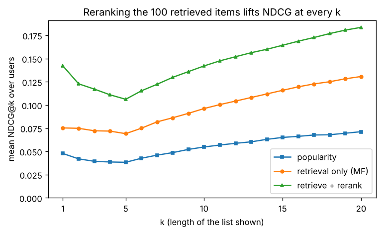

# B6.2 Ranking metrics (precision@k, NDCG) and the retrieve-then-rank pattern

**Depth** · Part B, week 6 (course week 12) · ~1.5 h · Lab:
[`labs/B/b6_2_ranking_metrics.py`](../../labs/B/b6_2_ranking_metrics.py)

## Why it matters

A recommender, a search engine and the retrieval step of a RAG system (I2.3) all produce the same thing: an **ordered list**, of which
a user looks at the first few entries. Accuracy, RMSE and ROC-AUC do not measure what matters about such a list, which is how many good
items are near the top. **Ranking metrics** do: **precision@k**, **recall@k**, **MAP@k** and **NDCG@k**. Every interview on recommenders
or search asks for at least one of them, and every RAG evaluation (I2.4) uses them. The second idea of this lesson is how production
systems are built to score well on them: **retrieve-then-rank**. A cheap model narrows millions of items to a hundred candidates, and a
slower, smarter model reorders just those. In the lab, that second stage lifts NDCG@10 by 48% over the factor model of B6.1 alone.

## Prerequisite check

- Can you explain why the implicit-feedback model of B6.1 is judged by a top-10 list and not by RMSE? If not, revisit
  [B6.1](b6_1_recommender_systems.md).
- Can you define precision and recall for a classifier from the confusion matrix? If not, revisit
  [B4.1](b4_1_classification_metrics.md).
- Can you say what a gradient-boosted model is and what LightGBM's main settings do? If not, revisit
  [B3.3](b3_3_gradient_boosting.md).
- Can you explain why the test period must come after everything a model or a feature was computed from? If not, revisit
  [B1.4](b1_4_data_leakage.md).
- Can you compute a log in base 2 (for example $\log_2 8 = 3$, $\log_2 3 \approx 1.585$)? If not, revisit
  [A6.4](../A/a6_4_entropy_cross_entropy_kl.md), which uses bits.

## Intuition

You search for "postgres connection pool timeout" and get ten links. What makes the list good?

- How many of the ten are useful: **precision@10**.
- How many of *all* the useful pages on the web for this query made it into the ten: **recall@10**.
- Whether the useful ones are at the *top*. A list with the right answer first is better than the same list with it tenth, because people
  read from the top and stop. Precision and recall ignore order inside the top $k$; **average precision** (AP) and **NDCG** reward putting
  relevant items early.
- Whether the *most* useful ones are on top, when usefulness has grades (a perfect answer, a partial one, a vaguely related one). Only
  NDCG uses graded relevance.

Each metric is computed per user (or per query) and then averaged, so every user counts equally, however many items they have.

**Retrieve-then-rank** is a cost argument. Scoring every item for every user with a rich model is too slow: a catalogue of 10 million items
and a model that takes 0.1 ms per pair is 1,000 seconds per page view. So production systems use two stages:

1. **Retrieval (candidate generation):** a model whose scores are a dot product of a user vector and an item vector, so an approximate
   nearest-neighbour index (I2.1) can return the top few hundred items in milliseconds. B6.1's factors are exactly such vectors. This stage
   must have high **recall**: an item it misses can never be shown.
2. **Ranking (reranking):** a model with many features, including features about the *pair* (does this film match what the user watched
   yesterday?), applied only to the candidates. This stage must have high **precision at the top**: it decides the ten the user sees.

> **Bridge:** this is a database query plan. Retrieval is the index scan that cheaply narrows millions of rows to a few hundred with a
> condition the index supports; ranking is the expensive `ORDER BY` on a computed expression that only runs on the rows that survived.
> **Where it breaks:** an index scan returns *exactly* the rows matching the condition. A retriever is a model: it returns its best guess, it
> silently drops relevant items, and nothing downstream can bring them back. Measure its recall separately.

## The math

**Symbols** (for one user; every metric is then averaged over users)

| Symbol | Meaning | Shape |
|---|---|---|
| $L = (i_1, i_2, \dots)$ | the ranked list shown to the user, best first; $i_j$ is the item at position $j$ | sequence |
| $k$ | how many positions are evaluated (the list the user sees) | int |
| $\mathcal{R}$ | the user's relevant items (in the lab: the 5 films they watched next) | set |
| $\mathrm{rel}(i)$ | relevance of item $i$: 0 if not relevant; 1 if binary; a grade such as 1–3 if graded | scalar |
| $\mathbb{1}[\cdot]$ | indicator: 1 if the condition holds, else 0 | |
| $\mathrm{DCG@}k$, $\mathrm{IDCG@}k$ | discounted cumulative gain of $L$, and of the best possible list | scalars |

**Precision and recall at $k$.** Count the relevant items among the first $k$:
$$\mathrm{P@}k = \frac{1}{k}\sum_{j=1}^{k}\mathbb{1}[i_j \in \mathcal{R}], \qquad \mathrm{R@}k = \frac{1}{\lvert\mathcal{R}\rvert}\sum_{j=1}^{k}\mathbb{1}[i_j \in \mathcal{R}].$$
Same numerator, different denominators: precision asks "how much of what I showed was good?", recall "how much of what was good did I
show?". If a user has only 2 relevant items, P@10 can be at most 0.2; recall does not have that problem, which is one reason recall@k is
popular for recommenders.

**Average precision at $k$.** Walk down the list; each time you hit a relevant item at position $j$, write down the precision at that
point, P@$j$. Average those numbers:
$$\mathrm{AP@}k = \frac{1}{\min(k, \lvert\mathcal{R}\rvert)}\sum_{j=1}^{k}\mathrm{P@}j \cdot \mathbb{1}[i_j \in \mathcal{R}].$$
A relevant item at position 1 contributes $1/1$; at position 10, after nothing else relevant, only $1/10$. The denominator
$\min(k, \lvert\mathcal{R}\rvert)$ is the most hits possible in $k$ positions, so a perfect list scores 1. (Conventions differ: some divide by
$\lvert\mathcal{R}\rvert$, some by the number of hits. With $k$ equal to the whole list, the first two agree with scikit-learn's
`average_precision_score`, which the lab checks.) **MAP@$k$** is the mean of AP@$k$ over users.

**NDCG at $k$.** Give each position a **gain** equal to the relevance of the item there, and divide it by a **discount** that grows with
the position:
$$\mathrm{DCG@}k = \sum_{j=1}^{k}\frac{\mathrm{rel}(i_j)}{\log_2(j + 1)} .$$
Position 1 is divided by $\log_2 2 = 1$, position 2 by $\log_2 3 = 1.585$, position 3 by 2, position 7 by 3: the discount grows slowly, so
lower positions still count, but less. DCG has no fixed scale (it grows with the number and grade of relevant items), so divide it by the
DCG of the **ideal list**, the user's relevant items sorted by relevance, best first:
$$\mathrm{NDCG@}k = \frac{\mathrm{DCG@}k(L)}{\mathrm{IDCG@}k}, \qquad \mathrm{IDCG@}k = \mathrm{DCG@}k(\text{all of } \mathcal{R} \text{ sorted by relevance}).$$
NDCG is between 0 and 1, and 1 means no reordering could do better. Two details matter in practice:

- **Which items build the ideal list.** It must be *all* the user's relevant items, including those your system never retrieved. If you
  build it only from the candidates you scored, a retriever that misses half the relevant items is not penalized. The lab shows the size of
  this error.
- **Linear or exponential gain.** Some papers and libraries use gain $2^{\mathrm{rel}} - 1$ instead of $\mathrm{rel}$, which rewards the very
  best items more. scikit-learn's `ndcg_score` uses the linear gain; with binary relevance the two are identical ($2^1 - 1 = 1$). Always say
  which you used.

**Retrieve-then-rank, formally.** Stage 1 scores every item with $s_1(u, i) = b_i + \mathbf{p}_u\cdot\mathbf{q}_i$ (B6.1) and keeps the top $N$
unseen items (here $N = 100$). Its quality is **recall@$N$**: the share of relevant items among the candidates, which is the *ceiling* for
everything after it. Stage 2 is a **learning-to-rank** model $s_2(u, i) = f(\mathbf{x}_{ui})$, where $\mathbf{x}_{ui}$ is a feature vector for the
pair: the stage-1 score and rank, item popularity, how well the item's genres match the user's, how similar it is to the user's latest
films, and so on. It is trained on (user, candidate, label) rows, where the label says whether the user went on to interact with the
candidate.

How do you *train* a model for a ranking metric? NDCG is a step function of the scores (it only changes when two items swap places), so its
gradient is zero almost everywhere. LightGBM's **LambdaRank** objective works around this: for every pair of candidates of the same user where
a relevant item is scored below an irrelevant one, it pushes the two scores apart with a force proportional to how much NDCG would improve if
they swapped. You do not need the formula; you need to know that `LGBMRanker(objective="lambdarank")` takes a `group` argument saying which
rows belong to the same user (one ranking per group) and optimizes an NDCG-like objective inside each group. (Burges, 2010, explains it.)

**Training the ranker without leakage.** The features for a (user, candidate) pair must be computed from data that existed *before* the
label. The lab uses three time blocks per user: *base* (everything except each user's last 10 interactions), the *label block* (the 5 before
the last 5) and the *test block* (the last 5):

1. Stage 1 is trained on base; it retrieves candidates; features are computed from base; labels come from the label block. The ranker trains on that.
2. For the test, stage 1 is retrained on base + label block, candidates and features are recomputed from base + label block, the *same*
   trained ranker scores them, and the test block judges the result.

The ranker therefore learns "given what was known up to now, what will this user watch next?", which is the question it is asked in production.

## Worked example by hand

One user has four relevant items with graded relevance: A (3), C (2), E (1), F (2). The system shows five items in the order A, B, C, D, E;
F is relevant but not shown.

- **P@3:** the top 3 are A, B, C; A and C are relevant: $2/3 = 0.667$.
- **R@3:** 2 of the 4 relevant items: $2/4 = 0.5$.
- **AP@5** (relevance as binary): hits at positions 1 (A), 3 (C) and 5 (E), with precisions $1/1$, $2/3$ and $3/5$. Sum $1 + 0.667 + 0.6 = 2.267$;
  divide by $\min(5, 4) = 4$: $0.567$.
- **DCG@5:** gains $3, 0, 2, 0, 1$: $\frac{3}{\log_2 2} + \frac{0}{\log_2 3} + \frac{2}{\log_2 4} + \frac{0}{\log_2 5} + \frac{1}{\log_2 6} =
  3 + 0 + 1 + 0 + \frac{1}{2.585} = 4.387$.
- **IDCG@5:** the ideal list uses all four relevant items, including F, sorted: $3, 2, 2, 1$: $3 + \frac{2}{1.585} + \frac{2}{2} + \frac{1}{2.322} =
  3 + 1.262 + 1 + 0.431 = 5.693$.
- **NDCG@5** $= 4.387/5.693 = 0.771$.

Now swap A and C (show C, B, A, D, E). P@3 is unchanged (still A and C in the top 3), but DCG falls to $2 + 0 + 3/2 + 0 + 0.387 = 3.887$ and NDCG
to $3.887/5.693 = 0.683$: the most relevant item moved from position 1 to 3. Precision cannot see that; NDCG can.

```text
== worked example by hand ==
P@3 = 0.6667, R@3 = 0.5000
AP@5 = (1/1 + 2/3 + 3/5) / min(5, 4) = 0.5667
DCG@5 = 4.3869, ideal gains [3.0, 2.0, 2.0, 1.0], IDCG@5 = 5.6925, NDCG@5 = 0.7706
swap A and C: NDCG@5 = 0.6828; P@3 unchanged = 0.6667
```

## Key plot



Reranking the 100 retrieved films lifts NDCG at every list length, by about half at $k = 10$. The dip up to $k = 5$ is not a bug: every user
has exactly 5 relevant films, so the ideal DCG keeps growing until $k = 5$ and then stops, while the systems' DCG keeps growing slowly. Compare
systems at the same $k$; never compare an NDCG@5 with an NDCG@20.

## From scratch in NumPy

**The metrics.** Each function takes one user's ranked list and a dictionary `rel` from item to relevance (missing = 0), so the code
reads like the formulas. For example:

```python
def dcg_at_k(gains, k):
    g = np.asarray(gains[:k], dtype=float)
    return float(np.sum(g / np.log2(np.arange(2, len(g) + 2))))   # positions 1..k -> log2(2..k+1)

def ndcg_at_k(ranked, rel, k):
    ideal = dcg_at_k(sorted(rel.values(), reverse=True), k)       # ALL relevant items, best first
    return dcg_at_k([rel.get(i, 0.0) for i in ranked], k) / ideal if ideal > 0 else 0.0
```

`np.arange(2, len(g) + 2)` is the off-by-one to watch: position $j$ (from 1) is divided by $\log_2(j + 1)$, and Python positions start at 0.

## With scikit-learn

`sklearn.metrics.ndcg_score(y_true, y_score, k=...)` takes, for each user, a relevance and a score for *every* item, sorts by score itself,
and computes the ideal from `y_true`. On the worked example and on 200 random users with graded relevance it agrees with the from-scratch
code to 12 digits; so does `average_precision_score` with the from-scratch AP over the full list:

```text
== from scratch versus scikit-learn ==
worked example: mine 0.770632, sklearn ndcg_score 0.770632
NDCG@10 matches sklearn.metrics.ndcg_score on 200 random users: OK
AP over the full list matches sklearn.metrics.average_precision_score: OK
```

scikit-learn has no precision@k or recall@k for rankings (`top_k_accuracy_score` is a different thing: whether the true *class* is among the
$k$ most probable classes). Write them yourself; they are two lines each.

**The three time blocks.** MovieLens 100K again, every rating read as "watched":

```text
== data and the three time blocks ==
MovieLens 100K from data/ml-100k/ (source: GroupLens, https://files.grouplens.org/datasets/movielens/ml-100k.zip)
base 90,570 | label block 4,715 | test 4,715 interactions (every rating = 'watched')
stage 1 is trained on base; the reranker learns to predict the label block; everything is refitted on
base + label block and judged on the test block, so no model ever sees the interactions it is scored on
```

**Stage 1: retrieval.** The implicit-feedback factor model of B6.1 (copied into the lab), trained on base, retrieves each user's top 100
unseen films:

```text
== stage 1: retrieve candidates with the factor model ==
recall@10  of the retriever on the label block: 0.1563
recall@50  of the retriever on the label block: 0.4257
recall@100 of the retriever on the label block: 0.5970
(recall@100 is the ceiling: the reranker can only reorder what stage 1 retrieved)
```

The retriever puts 16% of the next films in its top 10 but 60% in its top 100. There is a lot of room between those two numbers for a
second stage to move good candidates up, and a hard ceiling of 60%: 40% of what users watched next is not among the candidates at all.

**Stage 2: features and model selection.** For each of the 943 × 100 (user, candidate) pairs the lab builds 9 "static" features from
the history (stage-1 score and rank, overall and recent item popularity, damped mean rating, release year, user activity, genre affinity
between the user's history and the film, and the gap between the film's year and the years the user usually watches) and 2 **recency**
features (cosine similarity between the film's factor vector and the sum of the factor vectors of the user's 5 latest films, and the film's
popularity in the 30 days before the user's own last interaction). Which set to use is decided on 20% of users held out *from the label
block*, never on the test block:

```text
== stage 2: features for the reranker ==
training pairs X (94300, 11), positives 2815 (2.99%); one query group per user, 100 rows each
choosing features on 188 held-out users of the label block (NDCG@10):
  retrieval order only               0.1239
  rerank, static features            0.1211
  rerank, static + recency features  0.1368
chosen: 11 features; refit the reranker on all 943 users of the label block
feature importance (share of total gain):
  sim_to_last5           0.241
  mf_rank                0.109
  user_activity          0.093
  item_pop               0.093
  genre_affinity         0.089
  year_gap               0.082
  item_mean_rating       0.080
  mf_score               0.077
  item_pop_at_user_time  0.056
  item_pop_recent        0.051
  item_year              0.028
```

Two lessons are in this printout. First, a reranker with only the static features is *worse* than the retrieval order (0.121 against 0.124):
those features mostly restate what the factor model already knows (popularity, genre taste), so the ranker has little new to learn and
adds noise. A second stage pays off only when it sees information the first stage cannot use. Second, the information that helped is
**recency**. The factor model gives a user's whole history equal weight, but what someone watches next depends most on what they watched
last; `sim_to_last5` became the most important feature. Only 3% of pairs are positive (about 3 of each user's 100 candidates), which is why the
model is judged on ranking, not accuracy.

**The test.**

```text
== two-stage recommender on the test block ==
system                    P@10    R@10  MAP@10  NDCG@10
popularity              0.0334  0.0668  0.0241   0.0548
retrieval only (MF)     0.0584  0.1169  0.0469   0.0962
retrieve + rerank       0.0819  0.1637  0.0727   0.1421
stage-1 recall@100 on the test block (the ceiling): 0.5466
NDCG@10 gain from reranking: +0.0459, 95% bootstrap CI over users [+0.0373, +0.0560]
sklearn ndcg_score on the candidate lists only: 0.2013 (higher: its ideal ignores relevant items not retrieved)
```

- Reranking raises every metric: NDCG@10 from 0.096 to 0.142 (+48%), recall@10 from 0.117 to 0.164. A paired bootstrap over users (A6.2)
  puts the NDCG gain at $[+0.037, +0.056]$, well clear of 0.
- The absolute numbers look small. They are normal for "predict the next 5 films out of 1,600": P@10 = 0.08 means almost one correct film in
  every list of ten. Compare systems, not raw values against intuition from classification.
- The last line is the IDCG trap from The math, measured. Handing `ndcg_score` only the 100 candidates gives 0.201, 42% higher than the honest
  0.142, because its ideal list contains only the relevant items stage 1 happened to retrieve. Make sure the ideal list uses every relevant item.

## In practice

- **When to use which metric:** recall@$N$ for a retriever (did the candidates contain the answer?); NDCG@$k$ or MAP@$k$ for the final list;
  precision@$k$ when the user sees exactly $k$ slots and all that matters is how many are good; **MRR** (the mean of $1/\text{rank}$ of the first
  relevant item) when there is one right answer, as in question answering. Pick $k$ to match the interface (the 10 tiles on a screen).
- **When to use two stages:** whenever the catalogue is too large to score every item with the best model, and whenever good signals exist
  that a dot product cannot express: recency, context (device, time of day), business rules, pair features. Search engines, feeds, ads and
  RAG pipelines (embedding retrieval, then a cross-encoder reranker, I2.3) are all built this way.
- **Failure modes:**
  - *Ideal list built from the candidates only.* NDCG inflated by 42% here. Check that the denominator uses all relevant items.
  - *A reranker that only restates stage 1.* No gain or a loss (the static-only ranker above). Ablate features on a validation set.
  - *Retriever recall too low.* The reranker cannot recover missed items; track recall@$N$ as its own metric and raise $N$ or improve stage 1.
  - *Leaky training rows.* Features computed from a period that includes the label (for example item popularity counted over all data). The
    offline gain then vanishes online. Build features "as of" the label time.
  - *Offline–online gap.* Offline metrics only score items users happened to interact with; they cannot reward a good film the user never saw
    (the same bias as B6.1's implicit feedback). Treat offline NDCG as a filter and the A/B test (A6.3b) as the judge.
  - *Popularity bias.* `[RAI]` Both stages can learn to favour already popular items. Report coverage (share of the catalogue that appears in
    any top 10) and exposure by item group next to NDCG.
- **Defaults that work:** $N$ = 100–1,000 candidates; LightGBM `LGBMRanker(objective="lambdarank")` with one `group` per user or query;
  binary relevance unless you have grades; NDCG@10 and recall@$N$ reported together, each with a bootstrap interval over users
  (LightGBM 4.7.0; VERIFY (as of 2026-11) parameter names, which change between major versions).

## Exercises

Save your work to `my-work/B/b6_2_ranking_metrics.md` (or `.py`) and ask for a review.

1. **By hand:** A user has 3 relevant items, X, Y and Z (binary relevance). System 1 shows X, a, b, Y, c. System 2 shows a, X, Y, b, c (a, b, c are
   not relevant). For each system compute P@5, R@5, AP@5 and NDCG@5. Which system is better by each metric, and why do the metrics disagree or
   agree? Then give the NDCG@5 of System 1 if X has relevance 3 and Y and Z relevance 1 (linear gain), and say how it changes your ranking of the two systems.
2. **Code:** Extend the lab's test evaluation. (a) Implement MRR@10 and **catalogue coverage** (the share of all 1,682 films that appear in at
   least one user's top 10), and the mean popularity (number of watchers in the history) of recommended films, for the three systems. (b) Split
   users into three equal groups by activity (number of history interactions) and report NDCG@10 of retrieval-only and retrieve + rerank per
   group. Who gains most from reranking? (c) Using the lab's validation users only, measure how much NDCG@10 falls when you drop `sim_to_last5`.
3. **Think:** Your team's RAG system (I2.3) retrieves 20 chunks by embedding similarity and passes the top 5 to an LLM. Answers are often wrong
   because the right chunk is missing from the 5. A colleague proposes a cross-encoder reranker on the 20 chunks. Describe how you would
   decide whether that helps: which metric you measure for the retriever and which for the reranker, what labels you need and how you get them,
   how you choose the number of candidates, and what the latency and cost trade-offs are.

## Takeaways

1. Precision@k and recall@k count relevant items in the top $k$ (divide by $k$, or by the number of relevant items); they ignore order inside the top $k$.
2. AP rewards relevant items early by averaging P@$j$ at each hit; NDCG divides each gain by $\log_2(j + 1)$ and normalizes by the ideal list,
   and it is the only one of the four that uses graded relevance.
3. Build the ideal list from *all* relevant items, not just the retrieved ones; the shortcut inflated NDCG@10 by 42% in the lab.
4. Retrieve-then-rank: a cheap, high-recall retriever (dot products, ANN search) feeds a feature-rich ranker; the retriever's recall@$N$ caps
   everything after it.
5. A second stage pays off only with information the first stage lacks; here recency features turned a useless reranker into a 48% NDCG@10 gain,
   and the feature set was chosen on validation users, never on the test block.

**What builds on this:** [I2.3](../I/i2_3_rag_pipeline.md) (retrieval and cross-encoder reranking in RAG);
[I2.4](../I/i2_4_rag_evals.md) (recall@k, MRR and NDCG as RAG retrieval evals); [I2.1](../I/i2_1_embeddings_semantic_search.md)
(approximate nearest-neighbour search for stage 1).

**References:** K. Järvelin, J. Kekäläinen, "Cumulated gain-based evaluation of IR techniques", *ACM Transactions on Information Systems*
20(4), 2002. C. J. C. Burges, "From RankNet to LambdaRank to LambdaMART: An Overview", Microsoft Research Technical Report MSR-TR-2010-82,
2010. P. Covington, J. Adams, E. Sargin, "Deep Neural Networks for YouTube Recommendations", *RecSys*, 2016 (a two-stage production
system). scikit-learn User Guide, "Ranking metrics" (VERIFY link: https://scikit-learn.org/stable/modules/model_evaluation.html).
