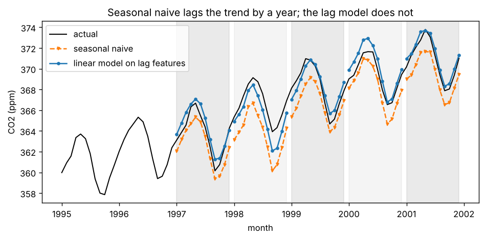

# B6.3 Time-series forecasting: trend, seasonality, lag features, naive baselines, walk-forward validation

**Core** · Part B, week 6 (course week 12) · ~2.5 h · Lab:
[`labs/B/b6_3_time_series_forecasting.py`](../../labs/B/b6_3_time_series_forecasting.py)

## Why it matters

Demand planning, capacity planning, staffing, budgets, inventory, energy load, the number of support tickets next week: a large share of
the ML work in ordinary companies is **forecasting** a number over time. It looks like regression with a date column, and treating it that
way is the most common way to get it wrong. The rows are not independent, a random split tests the model on the past using the future,
features built with an innocent-looking rolling window quietly read values that will not exist at prediction time, and a model that cannot
beat "same as last year" is common and goes unnoticed without a baseline. This lesson builds the toolkit that every later forecasting
model is judged with: decomposition into **trend** and **seasonality**, **naive baselines**, **lag features** with a test that proves they
never see the future, and **walk-forward validation**.

## Prerequisite check

- Can you explain why a random split of time-ordered data is temporal leakage, with an example? If not, revisit
  [B1.4](b1_4_data_leakage.md).
- Can you describe a time-series split (train on the past, validate on the block that follows) and how it differs from k-fold? If not,
  revisit [B4.3](b4_3_cross_validation_tuning.md).
- Can you fit a linear regression and read its coefficients? If not, revisit [B1.5](b1_5_linear_regression.md).
- Do you know what MAE measures, in which units, and how it differs from RMSE? If not, revisit [B4.2](b4_2_regression_metrics.md).
- In pandas, do you know what `s.shift(1)` and `s.rolling(3).mean()` return for the first rows? If not, revisit
  [A1.3](../A/a1_3_pandas.md).

## Intuition

Look at the key plot below before reading on: monthly carbon dioxide at Mauna Loa, Hawaii. Three things are visible.

1. **Trend:** the level climbs, about 1.5 parts per million (ppm) a year by the 1990s.
2. **Seasonality:** a cycle of about 6 ppm that repeats every 12 months (plants in the northern hemisphere absorb CO2 in summer and release it in
   winter). The period, here 12, is called $m$.
3. **Noise:** small wiggles that neither explains.

A forecast has to continue the first two and ignore the third. Before building anything clever, ask what the simplest forecasts would
score, because they are surprisingly hard to beat:

- **Naive:** next month = this month. Good for random-walk series (stock prices); bad with strong seasonality.
- **Seasonal naive:** next January = last January. Captures seasonality perfectly; misses the trend, so here it is always about a year's
  growth too low.
- **Moving average:** the mean of the last 12 months. Smooths away the noise and the seasonality, and also misses the trend.

A learned model must beat the best of these, by enough to justify its cost. That is the forecasting version of "always start with a
baseline" (B1.1).

The most useful trick for applying ordinary ML to a series is to turn it into a table. For each month $t$, make a row whose target is $y_t$
and whose features are earlier values: $y_{t-12}$ (same month last year), $y_{t-13}$, the mean of some past window. These are **lag
features**. Any regressor can then learn, for example, "this January ≈ last January plus the recent growth". The catch is the word
*earlier*. If you will forecast 12 months ahead, then on the day you forecast next December, the most recent value you have is this
December, 12 months before the target. Every feature of a target month must be at least as old as the forecast **horizon** $h$; if any
feature is younger, the model is trained on information it will never have when it is used. That is temporal leakage at the feature level, and
it is easy to write by accident.

Finally, **walk-forward validation** (also called a rolling-origin evaluation): pretend to stand at the end of 1996, train on everything
before, forecast 1997, score it. Then move to the end of 1997, retrain, forecast 1998, and so on. Each fold uses only the past, exactly as
the model will be used, and the five scores show how the error varies from year to year.

> **Bridge:** walk-forward validation is replaying production traffic against a new build: you feed requests in the order they arrived, and
> the service only knows what it had seen up to each request. **Where it breaks:** a replay of an API is deterministic once the inputs are
> fixed. A forecast is judged against a future that was itself random, so five folds give you five noisy scores, not one truth; look at the
> spread, not only the mean.

## The math

**Symbols**

| Symbol | Meaning | Shape |
|---|---|---|
| $y_t$ | the value of the series at time $t = 1, \dots, n$; all of them $\mathbf{y}$ | scalar; `(n,)` |
| $m$ | the seasonal period (12 for monthly data with a yearly cycle, 7 for daily data with a weekly one) | int |
| $T$ | the forecast **origin**: the last time whose value is known when the forecast is made | int |
| $h$ | the **horizon**: how many steps ahead; $h = 1, \dots, H$ | int |
| $\hat y_{T+h \mid T}$ | the forecast of $y_{T+h}$ made at origin $T$ | scalar |
| $\mathrm{trend}_t$, $s_t$, $r_t$ | trend, seasonal and residual components | scalars |
| $\mathbf{x}_t$ | the feature vector for target month $t$ | `(d,)` |

**Step 1: additive decomposition.** Model the series as
$$y_t = \mathrm{trend}_t + s_t + r_t ,$$
where the seasonal component repeats ($s_t = s_{t+m}$) and sums to zero over one cycle. (When the seasonal swing grows with the level, as with
sales that double and whose December peak doubles with them, use a *multiplicative* version, $y_t = \mathrm{trend}_t \times s_t \times r_t$, or
take logs first.)

*Trend by a centred moving average.* Averaging any 12 consecutive months cancels the seasonal cycle, because every month appears exactly once.
But 12 is even, so a 12-month window has no middle month. The fix is the **2×12 moving average**: average two neighbouring 12-month windows,
which is the same as giving 13 months the weights $\tfrac{1}{24}, \tfrac{1}{12}, \dots, \tfrac{1}{12}, \tfrac{1}{24}$ (half weight for the two
end months, which are the same calendar month a year apart):
$$\mathrm{trend}_t = \frac{1}{m}\Big(\tfrac12 y_{t-m/2} + y_{t-m/2+1} + \dots + y_{t+m/2-1} + \tfrac12 y_{t+m/2}\Big).$$
It uses $m/2$ values *after* $t$, so it is undefined for the last 6 months and, more importantly, it is a description of the past, never a
feature for forecasting.

*Seasonal by averaging.* Subtract the trend ($y_t - \mathrm{trend}_t$), average the result over all Januaries, all Februaries and so on to get
12 numbers, then subtract their mean so they sum to 0. That is $s_t$. The residual is what is left: $r_t = y_t - \mathrm{trend}_t - s_t$.

**Step 2: the baselines.** At origin $T$, for $h = 1, \dots, H$ (with $H \le m$):
$$\text{naive: } \hat y_{T+h\mid T} = y_T, \qquad \text{seasonal naive: } \hat y_{T+h\mid T} = y_{T+h-m}, \qquad \text{moving average: } \hat y_{T+h\mid T} = \frac{1}{m}\sum_{j=0}^{m-1} y_{T-j}.$$
Seasonal naive says "same month one cycle ago"; for $h \le m$ that month is always in the history.

**Step 3: the direct lag-feature model.** To forecast $H = 12$ months with one model, build for every month $t$ a feature vector whose entries
are at least 12 months old:
$$\mathbf{x}_t = \big(y_{t-12},\ y_{t-13},\ y_{t-24},\ \tfrac{1}{12}\textstyle\sum_{j=12}^{23} y_{t-j},\ \text{month of } t\big),$$
and fit $\hat y_t = \mathbf{w}^\top\mathbf{x}_t + b$ (linear regression; the month enters as 11 one-hot columns, B1.3). At origin $T$, every
feature of every target month $T+1, \dots, T+12$ uses only $y_{\le T}$, so the same fitted model forecasts all 12 months directly. This is the
**direct** strategy. (The alternative, **recursive**, fits a 1-step model and feeds its own forecasts back in as lags; exercise 2 compares them.)
The month dummies let the model shift each calendar month; the lags carry the level and the growth. A linear model can learn
$\hat y_t \approx y_{t-12} + (y_{t-12} - y_{t-24})$, "last year plus last year's growth", which is exactly what seasonal naive is missing.

In pandas, a lag of $k$ is `s.shift(k)`: row $t$ receives the value from row $t - k$, and the first $k$ rows become NaN (not known yet). A
rolling mean over the 12 months ending 12 months ago is `s.shift(12).rolling(12).mean()`. The *order* matters: `s.rolling(12).mean().shift(11)`
looks almost identical and includes $y_{t-11}$, which is 11 months old.

**Step 4: the leakage test.** A feature function is safe for horizon $h$ if the feature row of month $t$ does not change when every value
newer than $t - h$ is replaced by garbage. That is a test you can run on any feature code:
1. compute the features on the real series;
2. pick a month $t$; overwrite $y_{t-h+1}, y_{t-h+2}, \dots, y_n$ with random numbers; recompute the features;
3. the row for month $t$ must be identical. Repeat for many $t$.

It catches off-by-one shifts, centred windows (`rolling(..., center=True)`), "fill missing values with the mean of the column" and
anything else that reads the future, because it tests behaviour, not code.

**Step 5: walk-forward validation and the error metric.** With $n$ months, $F$ folds and horizon $H$, fold $f = 0, \dots, F-1$ tests the months
$n - (F - f)H + 1, \dots, n - (F - f - 1)H$ and trains on every month before them (an **expanding window**; a *sliding* window would drop the oldest
months, useful when old data no longer resembles the present). Refit the model at every origin, exactly as you would in production. Score each
fold with the mean absolute error, $\mathrm{MAE} = \frac{1}{H}\sum_{h=1}^{H}\lvert y_{T+h} - \hat y_{T+h\mid T}\rvert$, in the units of the series,
and report all folds plus the mean. To compare across series of different scale, divide by the baseline's error: the **skill score**
$1 - \mathrm{MAE}_{\text{model}}/\mathrm{MAE}_{\text{seasonal naive}}$ is 0 for "no better than the baseline" and 1 for perfect.

## Worked example by hand

A quarterly series ($m = 4$) for 2022–2023: $10, 16, 6, 12$ and $12, 18, 8, 14$. We forecast the four quarters of 2024, whose true values are
$14, 20, 10, 16$.

**Trend.** The 2×4 moving average centred on 2022Q3 uses 2022Q1 to 2023Q1 with weights $\tfrac18, \tfrac14, \tfrac14, \tfrac14, \tfrac18$:
$(\tfrac12 \cdot 10 + 16 + 6 + 12 + \tfrac12 \cdot 12)/4 = 45/4 = 11.25$. Centred on 2022Q4: $(\tfrac12 \cdot 16 + 6 + 12 + 12 + \tfrac12 \cdot 18)/4 = 47/4 = 11.75$.
The trend rises 0.5 a quarter, 2 a year. The detrended value of 2022Q3 is $6 - 11.25 = -5.25$: Q3 is a low quarter.

**Baselines** at origin 2023Q4:
- Naive: $14, 14, 14, 14$. Errors $0, 6, 4, 2$; MAE $= 12/4 = 3$.
- Seasonal naive (same quarter of 2023): $12, 18, 8, 14$. Errors $2, 2, 2, 2$; MAE $= 2$. It has the shape right and is a year's growth (2) too low everywhere.

**A lag model.** "Last year's value plus last year's growth": $\hat y_t = y_{t-4} + (y_{t-4} - y_{t-8}) = 2y_{t-4} - y_{t-8}$. For 2024Q1:
$2 \times 12 - 10 = 14$; Q2: $2 \times 18 - 16 = 20$; Q3: $2 \times 8 - 6 = 10$; Q4: $2 \times 14 - 12 = 16$. MAE $= 0$ (the toy series was built with a
constant growth, so this is luckier than real life). Both inputs are at least 4 quarters old, so at the end of 2023 they are all known: the
`shift` table below shows them filled in for 2024 while $y$ itself is still unknown.

```text
== worked example by hand ==
2x4 moving average centred on 2022Q3: 11.25; on 2022Q4: 11.75
naive                    forecast [14.0, 14.0, 14.0, 14.0]  errors [0.0, 6.0, 4.0, 2.0]  MAE 3.00
seasonal naive           forecast [12.0, 18.0, 8.0, 14.0]  errors [2.0, 2.0, 2.0, 2.0]  MAE 2.00
lag model 2*lag4 - lag8  forecast [14.0, 20.0, 10.0, 16.0]  errors [0.0, 0.0, 0.0, 0.0]  MAE 0.00
lag features with shift() (NaN = not known); for 2024 every input is already known at the end of 2023:
           y  lag4  lag8  2*lag4 - lag8
2022Q1  10.0   NaN   NaN            NaN
2022Q2  16.0   NaN   NaN            NaN
2022Q3   6.0   NaN   NaN            NaN
2022Q4  12.0   NaN   NaN            NaN
2023Q1  12.0  10.0   NaN            NaN
2023Q2  18.0  16.0   NaN            NaN
2023Q3   8.0   6.0   NaN            NaN
2023Q4  14.0  12.0   NaN            NaN
2024Q1   NaN  12.0  10.0           14.0
2024Q2   NaN  18.0  16.0           20.0
2024Q3   NaN   8.0   6.0           10.0
2024Q4   NaN  14.0  12.0           16.0
```

## Key plot



Each shaded band is one walk-forward fold, forecast from the end of the year before. Seasonal naive (dashed) has exactly the right shape and
is always too low by about one year of growth. The linear model on lag features (solid) has learned the growth and tracks the actual values,
with its largest miss in 1998, when CO2 rose faster than in any other year of the series.

## From scratch in NumPy

**The data.** The weekly Mauna Loa CO2 record (Scripps Institution of Oceanography; Keeling and Whorf) ships with statsmodels, so no
download is needed. The lab averages it to months:

```text
== data ==
weekly 2284 rows 1958-03-29 to 2001-12-29, 59 missing weeks
monthly series: 526 months, 1958-03 to 2001-12; filled by interpolation: 1958-06, 1958-10, 1964-02, 1964-03, 1964-04
first value 316.10 ppm, last 371.02 ppm; mean change per year 1.253 ppm
```

Five months have no measurements at all. The lab fills them by linear interpolation between their neighbours. Strictly, interpolation uses
a later value, but these months are more than 30 years before the first test fold, so no test forecast can be affected. In a live system,
fill gaps only with past values (forward fill, or a model's own forecast).

**Decomposition.** `centred_ma` applies the 13 weights of Step 1 with `np.convolve`; `decompose` averages the detrended values by calendar month:

```text
== from scratch: decomposition ==
seasonal effect by month (ppm): Mar +1.42, Apr +2.50, May +2.92, Jun +2.28, Jul +0.74, Aug -1.32, Sep -3.04, Oct -3.14, Nov -2.05, Dec -0.92, Jan -0.02, Feb +0.63
trend from 315.45 to 370.79 ppm; residual std 0.283 ppm
matches statsmodels.tsa.seasonal.seasonal_decompose (trend and seasonal): OK
share of variance: trend 0.9815, seasonal 0.0145, residual 0.0003
```

CO2 peaks in May and bottoms out in October, a swing of about 6 ppm. The trend explains 98% of the variance, the season 1.5%, the residual
0.03%. That is an unusually clean series; on sales or web traffic the residual share is often 20–50%, and the baselines are much harder to
beat. `outputs/b6_3/decomposition.png` draws the four components.

**Walk-forward splits.** `walk_forward(n, n_folds, horizon)` builds the expanding-window folds of Step 5. It is B4.3's time-series splitter
with the test size set to the horizon:

```text
== from scratch: walk-forward splits ==
walk_forward matches sklearn TimeSeriesSplit(n_splits=5, test_size=12): OK
fold 0: train 1958-03..1996-12 (466 months) -> test 1997-01..1997-12
fold 1: train 1958-03..1997-12 (478 months) -> test 1998-01..1998-12
fold 2: train 1958-03..1998-12 (490 months) -> test 1999-01..1999-12
fold 3: train 1958-03..1999-12 (502 months) -> test 2000-01..2000-12
fold 4: train 1958-03..2000-12 (514 months) -> test 2001-01..2001-12
```

**Baselines.** Each forecaster is a function `(history, h) -> forecast` that only ever receives `x[train]`, so it *cannot* see the test year:

```text
== baselines under walk-forward validation ==
naive                mean MAE over the 5 folds 2.049 ppm
seasonal naive       mean MAE over the 5 folds 1.652 ppm
moving average (12)  mean MAE over the 5 folds 2.132 ppm
fold 0 (1997), seasonal naive forecast for Jan-Mar: 362.02, 363.18, 364.06; actual: 363.12, 363.88, 364.56
```

Seasonal naive is the best baseline, as expected with a strong cycle, and its misses are one year of growth (about 1.1 ppm in January 1997).

**Lag features and the leakage test.** `make_features` builds the inputs of Step 3 with `shift`. `assert_no_future` is Step 4: it overwrites
everything newer than $t - 12$ with garbage (values around 1,000 ppm) at 20 random months and checks that the feature rows do not move.
`make_features_leaky` contains two plausible bugs, an off-by-one (`shift(11)` before a 12-month rolling mean) and a centred smoothing window:

```text
== lag features and the leakage test ==
features ['lag_12', 'lag_13', 'lag_24', 'roll_mean_12', 'month']; first complete row 1960-03 (needs 24 months of history)
             lag_12   lag_13   lag_24  roll_mean_12  month
1960-03-01  316.733  316.700  316.100       315.480      3
1960-04-01  317.675  316.733  317.200       315.519      4
1960-05-01  318.325  317.675  317.433       315.594      5
make_features: no feature uses data newer than 12 months: OK
make_features_leaky fails the test, as it should: features of 1995-12 use data newer than 12 months: ['roll_mean_12', 'smooth']
```

Read the table diagonally: `lag_12` of April 1960 (317.675) is `lag_13` of May 1960. Both bugs are caught and named. Put a test like this in
the test suite of any forecasting pipeline; it is as cheap as a unit test and catches the bug that costs most.

**The model.** A `LinearRegression` on the 4 lag columns and 11 month dummies, refitted at each origin on every complete row before it:

```text
== lag-feature model under walk-forward validation ==
method                           1997   1998   1999   2000   2001    mean
naive                           1.967  2.418  2.056  1.883  1.919   2.049
seasonal naive                  1.109  2.914  1.611  1.136  1.493   1.652
moving average (12)             1.880  2.914  2.180  1.729  1.958   2.132
linear model on lag features    0.680  1.196  0.650  0.819  0.454   0.760
last fold's coefficients on lag_12, lag_13, lag_24, roll_mean_12: 0.687, 0.178, 0.134, 0.021
```

The lag model beats seasonal naive in every one of the five years, and halves its mean error (skill 0.54, below). Look across the columns
too: 1998 is the worst year for every method. The year-to-year spread (0.45 to 1.20 for the model) is as large as some differences between
methods, which is why you report every fold, not only the mean. The four lag coefficients sum to 1.02, slightly more than 1: together with the
month terms and the intercept, the model has learned to add growth on top of last year's level.

## With scikit-learn

`TimeSeriesSplit(n_splits=5, test_size=12)` produced the same folds as `walk_forward`, and `seasonal_decompose` the same trend and seasonal
components (checked above). What happens if you ignore the time order and cross-validate the same model with a shuffled `KFold`?

```text
== random split versus walk-forward ==
shuffled 5-fold MAE 0.501 ppm against walk-forward 0.760 ppm
skill vs seasonal naive (1 - MAE / MAE_snaive): 0.540
```

Shuffled 5-fold reports an error a third lower than walk-forward. With shuffling, each test month has training months on both sides of it,
including later ones, so the model has effectively seen the growth rate and level of the very period it is tested on: it interpolates
instead of forecasting. Nothing in the code is wrong; only the split is. Use `TimeSeriesSplit` (with `test_size` equal to your horizon, and
`gap` if the most recent data arrives late) whenever the model will predict the future.

## In practice

- **When to use what:** always compute naive and seasonal naive first; they take one line and set the bar. Use lag features with a linear model
  or gradient boosting (B6.4) when you have a long history, many related series, or useful extra features (prices, promotions, weather,
  holidays). Use classical models (B6.4) for short, single series.
- **Failure modes:**
  - *Random split or shuffled CV.* Optimistic by a third here. Use walk-forward with the real horizon.
  - *Features younger than the horizon.* A lag-1 feature in a 12-month-ahead model, a centred window, an off-by-one shift. The model looks
    excellent offline and fails in production. Run the leakage test of Step 4 in CI.
  - *Features that are not known in advance.* Next month's weather, next month's price changes or promotions that have not been decided: either
    use only what is known at the origin (the promotion *plan*, the weather *forecast*), or forecast the feature too.
  - *Scaling and filling over the whole series.* A scaler or an imputer fitted on all months uses future statistics; fit them inside each fold (B1.4).
  - *Ignoring the error spread across folds.* One lucky year can make a model look good; report every fold and the seasonal-naive skill score.
  - *Structural breaks.* A pandemic, a price change or a new product line changes the series' behaviour. Old data then hurts; watch recent folds,
    consider a sliding window, and monitor forecast errors after deployment (J2.2).
- **Defaults that work:** seasonal naive as the baseline; MAE in the series' units plus a skill score or **MASE** (MAE divided by the in-sample
  MAE of the seasonal-naive forecast); walk-forward with 3–10 folds, test size = horizon, refit at every origin; lags at multiples of the season
  and at the horizon; `shift` before `rolling`; a leakage test in the test suite (pandas 3.0.6, scikit-learn 1.9.1, statsmodels 0.15.0;
  VERIFY (as of 2026-11)).

## Exercises

Save your work to `my-work/B/b6_3_time_series_forecasting.md` (or `.py`) and ask for a review.

1. **By hand:** Sales, in thousands, for eight months of a product with a 4-month cycle ($m = 4$): $20, 30, 25, 45$,
   $24, 34, 29, 49$. (a) Compute the 2×4 moving-average trend centred on months 3 and 4 and the detrended values there. (b) Give the naive, seasonal-naive
   and 4-month moving-average forecasts for months 9–12 and their MAE if the truth is $28, 38, 33, 53$. (c) You will forecast 2 months ahead.
   For each feature, say whether it is allowed: $y_{t-1}$; $y_{t-2}$; $y_{t-4}$; the mean of $y_{t-2}, \dots, y_{t-5}$; the mean of
   $y_{t-1}, \dots, y_{t+2}$; the month of $t$. (d) In pandas, which of `s.shift(2).rolling(3).mean()` and `s.rolling(3).mean().shift(1)` is safe for
   horizon 2, and why?
2. **Code:** On the lab's CO2 series and walk-forward folds: (a) build a **one-step** model (lags 1, 2, 12, 13 and month dummies, linear regression) and
   produce 12-month forecasts **recursively** (forecast month 1, append it to the history as if it were data, recompute the features, forecast month 2,
   and so on). Compare its per-fold MAE with the lab's direct model. (b) Compute MASE for both models and for seasonal naive, scaling by the in-sample
   MAE of seasonal naive on each fold's training data. (c) Run the lab's `assert_no_future` on your one-step feature function with `min_age=1` and with
   `min_age=12`. Explain both results.
3. **Think:** An online grocer asks you to forecast daily orders per warehouse, 14 days ahead, for staffing. You have three years of daily orders,
   the promotion calendar (planned two weeks ahead), public holidays, and daily weather. List the baselines you would compute first; the features you
   would use and the minimum age of each; how you would set up the validation (folds, horizon, gap); the metric you would report to the operations
   team; and two ways the historical data itself could mislead you (think about days the warehouse ran out of stock, or was closed).

## Takeaways

1. Decompose first: trend (a centred 2×$m$ moving average) plus seasonality (the mean detrended value per position in the cycle) plus residual tells
   you what any forecast must capture. The centred average uses future values and is never a feature.
2. Naive, seasonal naive and moving-average baselines take a line each; a model is only interesting if it beats the best of them in most folds. Here
   seasonal naive was the bar (MAE 1.65 ppm) and the lag model halved it (0.76).
3. Lag features turn a series into a table, but every feature must be at least as old as the horizon. Build them with `shift` before `rolling`, and
   prove it with a test that scrambles the future and checks the feature rows do not change.
4. Validate walk-forward: refit at each origin, test on the next horizon, report every fold. A shuffled split was a third too optimistic.
5. Report MAE in the series' units with a skill score or MASE against seasonal naive, and the spread across folds, not only the mean.

**What builds on this:** [B6.4](b6_4_arima_vs_boosting.md) (exponential smoothing, ARIMA and gradient boosting on these lag features, compared on these
folds); [J2.2](../J/j2_2_monitoring_drift.md) (forecast errors and drift monitored over time); P12 (a forecasting capstone option).

**References:** R. J. Hyndman, G. Athanasopoulos, *Forecasting: Principles and Practice*, 3rd edition, OTexts, 2021, chapters 2–3 and 5 (VERIFY link:
https://otexts.com/fpp3/). R. J. Hyndman, A. B. Koehler, "Another look at measures of forecast accuracy", *International Journal of Forecasting* 22(4),
2006 (MASE). C. D. Keeling, T. P. Whorf, Mauna Loa CO2 record, as distributed with statsmodels (`statsmodels.api.datasets.co2`).
