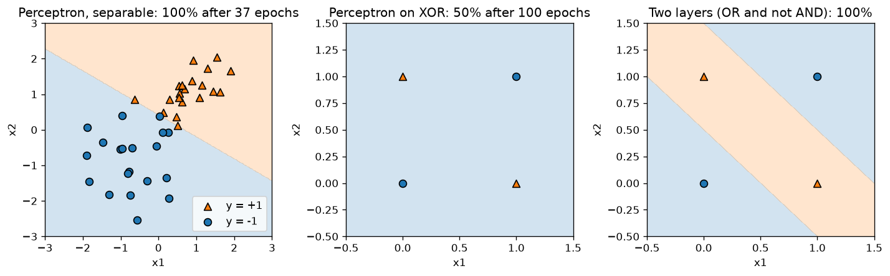

# C1.1 Perceptron and multilayer perceptron

**Core** · Part C, week C1 (course week 13) · ~2 h · Lab:
[`labs/C/c1_1_perceptron_mlp.py`](../../labs/C/c1_1_perceptron_mlp.py)

## Why it matters

Every neural network in this course, from the digit classifier in P4 to the transformer in F1, is built from one
part: a **neuron**, a weighted sum of its inputs followed by a non-linear function. Stack neurons side by side and you
get a **layer**; stack layers and you get a **multilayer perceptron (MLP)**, which is also the "feed-forward" block
inside every transformer. You need to know three things about it before you can train one: why one layer of neurons
cannot solve even a four-point problem (XOR), why stacking layers does nothing *unless* there is a non-linearity in
between, and what a ReLU network's output actually looks like. In production, forgetting the activation (or putting
it in the wrong place) gives a deep network that is secretly a linear model, and nothing crashes to tell you.

## Prerequisite check

- Can you multiply a `(5, 3)` matrix by a `(3, 4)` matrix and say the result's shape, and explain a matrix as a
  linear map? If not, revisit [A2.1](../A/a2_1_matrices_as_linear_maps.md).
- Can you write logistic regression as "linear score, then sigmoid", and say why its decision boundary is a
  straight line? If not, revisit [B2.1](../B/b2_1_logistic_regression.md).
- Can you compute the derivative of the sigmoid, $\sigma'(z) = \sigma(z)(1 - \sigma(z))$? If not, revisit
  [A4.3](../A/a4_3_chain_rule_graphs.md).
- Can you explain how adding a feature like $x_1 x_2$ lets a linear model draw a curved boundary? If not, revisit
  [B1.3](../B/b1_3_feature_engineering.md).

## Intuition

**One neuron is logistic regression.** It computes a score $z = w_1x_1 + w_2x_2 + b$ and passes it through an
**activation function**. With a sigmoid you get exactly B2.1's model. With a hard step (output 1 if $z > 0$, else
0) you get Rosenblatt's 1958 **perceptron**, the first neural network. Either way, the set of inputs where the
neuron "fires" is one side of a straight line (a hyperplane in more dimensions).

**One line cannot do XOR.** XOR is "exactly one of the two inputs is on": the points $(0, 1)$ and $(1, 0)$ are
positive, $(0, 0)$ and $(1, 1)$ are negative. The positives sit on one diagonal of the square, the negatives on the
other. No straight line puts both positives on one side and both negatives on the other. Try it with a ruler. This
little fact, published by Minsky and Papert in 1969, stalled neural-network research for years.

**Two layers can.** Break XOR into pieces you *can* draw with lines. Hidden neuron 1 computes OR ("at least one
input is on": fires above the line $x_1 + x_2 = 0.5$). Hidden neuron 2 computes AND ("both are on": fires above
$x_1 + x_2 = 1.5$). The output neuron fires for "OR and not AND", which is XOR. The hidden layer has *re-described*
the input: in the space of (OR, AND), the four points become $(0, 0)$, $(1, 0)$, $(1, 0)$, $(1, 1)$, and there a single
line does separate them. That is the whole idea of a hidden layer: it learns new features in which the problem is
easier. You did this by hand in B1.3 when you added $x_1x_2$; an MLP learns the features itself.

**The non-linearity is what makes it work.** If the hidden neurons had no activation, each would be a linear
function of the input, and the output a linear function of linear functions, which is just another linear function.
Ten linear layers equal one. The activation (step, sigmoid, tanh, ReLU) is what stops the layers from collapsing.

**A ReLU network is made of flat pieces.** ReLU, $\max(0, z)$, is the default activation today. A network of ReLUs is
linear wherever no unit switches on or off, so its output is a *piecewise linear* function: flat panels glued along
creases. More pieces means a more flexible function. Adding units to one layer adds pieces one at a time; adding
layers can *multiply* them, because each layer folds the output of the previous one. That is one concrete sense in
which "depth helps".

> **Bridge:** an MLP layer is a pure function `layer(x) = activation(x @ W + b)`, and a network is function
> composition, like a chain of middleware or `pipe(f, g, h)`. **Where it breaks:** middleware is written by people,
> each step with a meaning; here the weights are learned and the intermediate features (hidden units) usually have
> no name. And composing pure *linear* functions gives nothing new: the non-linear `activation` is the part that
> matters, unlike in a pipeline where every step adds behaviour.

## The math

**Symbols**

| Symbol | Meaning | Shape |
|---|---|---|
| $\mathbf{x}$ | one example's input | `(d,)` |
| $\mathbf{X}$ | a batch of inputs, one example per row | `(n, d)` |
| $y$ | label; $\pm1$ for the perceptron (B2.1 used 0 and 1) | scalar |
| $\mathbf{w}$, $b$ | one neuron's weights and bias | `(d,)`, scalar |
| $z$ | a neuron's score (pre-activation) | scalar |
| $\eta$ | learning rate | scalar |
| $f(\cdot)$ | activation function, applied elementwise | — |
| $\mathbf{W}^{[l]}$, $\mathbf{b}^{[l]}$ | weights and biases of layer $l$; column $j$ of $\mathbf{W}^{[l]}$ is unit $j$'s weights | `(d_{l-1}, d_l)`, `(d_l,)` |
| $\mathbf{H}^{[l]}$ | activations of layer $l$ for the batch; $\mathbf{H}^{[0]} = \mathbf{X}$ | `(n, d_l)` |
| $d_l$ | width (number of units) of layer $l$; $d_0 = d$ | int |

**The perceptron.** Predict $\hat{y} = +1$ if $z = \mathbf{w}^\top\mathbf{x} + b > 0$, else $-1$. The **perceptron rule** visits the examples one at a
time; when it gets one wrong ($y z \le 0$: the score has the wrong sign, or is exactly 0), it updates

$$\mathbf{w} \leftarrow \mathbf{w} + \eta\,y\,\mathbf{x}, \qquad b \leftarrow b + \eta\,y.$$

*Why this helps.* After the update, the score on the same example is
$(\mathbf{w} + \eta y\mathbf{x})^\top\mathbf{x} + (b + \eta y) = z + \eta\,y\,(\lVert\mathbf{x}\rVert^2 + 1)$. The added term has the sign of $y$, so the score moves
towards the correct side. One update may not be enough, and it may break another example, but the **perceptron
convergence theorem** (Novikoff, 1962) says: if some line separates the data with a gap, the rule makes only a
finite number of mistakes and stops. If no line separates the data, it never stops.

**Why no line separates XOR (a four-line proof).** Suppose $w_1, w_2, b$ classified XOR correctly. Then:
$(0, 0)$ negative gives $b \le 0$; $(1, 1)$ negative gives $w_1 + w_2 + b \le 0$; $(0, 1)$ positive gives $w_2 + b > 0$;
$(1, 0)$ positive gives $w_1 + b > 0$. Add the first two inequalities: $w_1 + w_2 + 2b \le 0$. Add the last two:
$w_1 + w_2 + 2b > 0$. Both cannot hold, so no such line exists.

**A layer.** Put $d_l$ neurons side by side, all reading the same input. Stack their weight vectors as the columns of
$\mathbf{W}^{[l]}$, and process a whole batch at once, one example per row:

$$\mathbf{H}^{[l]} = f\big(\mathbf{H}^{[l-1]}\mathbf{W}^{[l]} + \mathbf{b}^{[l]}\big), \qquad (n, d_{l-1})\,(d_{l-1}, d_l) \to (n, d_l).$$

The bias $\mathbf{b}^{[l]}$, shape `(d_l,)`, is added to every row (NumPy broadcasting, A1.2). An **MLP** with $L$ layers repeats
this $L$ times. The last layer usually has no activation (its outputs are logits, passed to a loss as in C1.4), so a
"2-layer MLP" has one **hidden layer** and one output layer. "Dense" and "fully connected" mean the same thing as
"layer" here: every unit reads every input.

**Without activations, layers collapse.** Take $f(z) = z$. Then

$$\mathbf{H}^{[2]} = (\mathbf{X}\mathbf{W}^{[1]} + \mathbf{b}^{[1]})\mathbf{W}^{[2]} + \mathbf{b}^{[2]} = \mathbf{X}\underbrace{(\mathbf{W}^{[1]}\mathbf{W}^{[2]})}_{(d_0,\ d_2)} + \underbrace{(\mathbf{b}^{[1]}\mathbf{W}^{[2]} + \mathbf{b}^{[2]})}_{(d_2,)},$$

using associativity of matrix multiplication (A2.2). That is one layer with weights $\mathbf{W}^{[1]}\mathbf{W}^{[2]}$. By induction, any
number of linear layers is one linear layer. It is still a linear model, with exactly the limits of B1.5 and B2.1.

**The activations you will meet.**

| Name | $f(z)$ | $f'(z)$ | Range | Note |
|---|---|---|---|---|
| step | 1 if $z > 0$ else 0 | 0 (undefined at 0) | $\{0, 1\}$ | the perceptron; no gradient, so it cannot be trained by gradient descent |
| sigmoid | $\sigma(z) = 1/(1 + e^{-z})$ | $\sigma(z)(1 - \sigma(z))$ | $(0, 1)$ | derivative at most 0.25; flat ("saturated") for large $\lvert z\rvert$ |
| tanh | $\tanh z = \frac{e^z - e^{-z}}{e^z + e^{-z}}$ | $1 - \tanh^2 z$ | $(-1, 1)$ | zero-centred; derivative 1 at 0, saturates like sigmoid |
| ReLU | $\max(0, z)$ | 1 if $z > 0$ else 0 | $[0, \infty)$ | no saturation for $z > 0$; cheap; the default |

The derivative column is what C1.2's backward pass multiplies by. A sigmoid unit at $z = 4$ passes back only 0.018 of the
gradient it receives; stack a few of those and the gradient vanishes (C3.3). ReLU passes back exactly 1 or 0.
(At exactly $z = 0$, ReLU has no derivative; code uses 0 by convention, and it almost never matters.)

**What a ReLU network computes.** Fix an input. Each hidden unit is either on ($z > 0$, output $z$) or off (output 0).
Within any region of input space where the on/off pattern does not change, every unit's output is a linear function
of the input, so the network output is too. The pattern changes only where some unit's $z$ crosses zero. So the
output is **piecewise linear**: linear inside each region, with creases where a unit switches.

*Counting pieces along a line.* Restrict the input to a line, $\mathbf{x}(t) = t\,\mathbf{u}$. In a one-hidden-layer network each unit's
$z$ is linear in $t$, so it crosses zero at most once: $d_1$ units give at most $d_1$ creases and at most $d_1 + 1$ pieces.
Depth can do much better. The *tent map* $g(x) = 2\,\mathrm{ReLU}(x) - 4\,\mathrm{ReLU}(x - 0.5)$ uses two ReLUs; on $[0, 1]$ it rises from 0 to 1 and falls
back to 0 (two pieces). Check it: for $0 \le x \le 0.5$ only the first ReLU is on, so $g(x) = 2x$, rising from 0 to 1; for $0.5 < x \le 1$
both are on, so $g(x) = 2x - 4(x - 0.5) = 2 - 2x$, falling from 1 to 0. Now feed $g$'s output into a second copy of $g$. As $x$ goes
from 0 to 0.5, $g(x)$ sweeps the whole interval $[0, 1]$ once, so the second copy traces one complete tent (up and down) over that
half; as $x$ goes from 0.5 to 1, $g(x)$ sweeps $[0, 1]$ again (backwards), giving a second tent. Two tents are 4 pieces. Each extra
copy doubles the count again, so $L$ copies in sequence give $2^L$ pieces from only $2L$ units (Telgarsky, 2016). A one-hidden-layer network needs at least
$2^L - 1$ units for the same function. Depth lets a network *reuse* its folds; width only adds them.

**Universal approximation (what it does and does not say).** Cybenko (1989) and Hornik (1991) proved that a network
with *one* hidden layer of sigmoid-like units can approximate any continuous function on a bounded region as closely
as you like, if it has enough units. It says nothing about *how many* units (it can be astronomically many), whether
gradient descent will find the weights, or how well the network generalizes. It is a statement that MLPs are
flexible enough, not that they are easy to train. The sawtooth example is why depth is used in practice: some
functions need exponentially fewer units when the network is deep.

## Worked example by hand

**1. The perceptron rule.** Three points: $\mathbf{x}_1 = (2, 1)$ with $y = +1$, $\mathbf{x}_2 = (1, 3)$ with $y = -1$, $\mathbf{x}_3 = (-1, -1)$ with
$y = -1$. Start at $\mathbf{w} = (0, 0)$, $b = 0$, $\eta = 1$.

*Epoch 1.*
- Point 1: $z = 0 \cdot 2 + 0 \cdot 1 + 0 = 0$, and $yz = 0 \le 0$, so update: $\mathbf{w} = (0, 0) + (+1)(2, 1) = (2, 1)$, $b = 0 + 1 = 1$.
- Point 2: $z = 2 \cdot 1 + 1 \cdot 3 + 1 = 6$. $y = -1$, so $yz = -6 \le 0$: wrong. $\mathbf{w} = (2, 1) - (1, 3) = (1, -2)$, $b = 1 - 1 = 0$.
- Point 3: $z = 1(-1) + (-2)(-1) + 0 = 1$. $yz = -1$: wrong. $\mathbf{w} = (1, -2) - (-1, -1) = (2, -1)$, $b = 0 - 1 = -1$.

*Epoch 2.* Point 1: $z = 4 - 1 - 1 = 2$, correct. Point 2: $z = 2 - 3 - 1 = -2$, correct. Point 3: $z = -2 + 1 - 1 = -2$,
correct. No mistakes, so the rule stops: the boundary is $2x_1 - x_2 - 1 = 0$.

**2. The perceptron on XOR.** Points in the order $(0, 0)$, $(0, 1)$, $(1, 0)$, $(1, 1)$ with labels $-1, +1, +1, -1$, from zero.
- $(0, 0)$: $z = 0$, wrong. $\mathbf{w} = (0, 0)$, $b = -1$.
- $(0, 1)$: $z = -1$, $y = +1$, wrong. $\mathbf{w} = (0, 1)$, $b = 0$.
- $(1, 0)$: $z = 0$, wrong. $\mathbf{w} = (1, 1)$, $b = 1$.
- $(1, 1)$: $z = 3$, $y = -1$, wrong. $\mathbf{w} = (0, 0)$, $b = 0$.

Four mistakes, and we are back where we started. Every epoch repeats this exactly, forever.

**3. Two layers solve XOR.** Hidden layer: $\mathbf{W}^{[1]} = \begin{pmatrix}1 & 1\\ 1 & 1\end{pmatrix}$, shape `(2, 2)` (column 1 is the OR unit, column 2 the AND
unit), $\mathbf{b}^{[1]} = (-0.5, -1.5)$, step activation. Output: $\mathbf{W}^{[2]} = \begin{pmatrix}1\\ -1\end{pmatrix}$, shape `(2, 1)`, $b^{[2]} = -0.5$, step.

For $\mathbf{x} = (1, 1)$: hidden scores $(1 + 1 - 0.5,\ 1 + 1 - 1.5) = (1.5, 0.5)$, both positive, so $\mathbf{h} = (1, 1)$. Output score
$1 \cdot 1 + (-1) \cdot 1 - 0.5 = -0.5$, not positive, so the output is 0: correct. For $(0, 1)$: hidden scores $(0.5, -0.5)$, so
$\mathbf{h} = (1, 0)$; output score $1 - 0 - 0.5 = 0.5$, output 1: correct. Do the other two yourself; the lab prints all four.

**4. Two linear layers are one.** $\mathbf{W}^{[1]} = \begin{pmatrix}1 & 2\\ 0 & 1\end{pmatrix}$, $\mathbf{W}^{[2]} = \begin{pmatrix}3\\ -1\end{pmatrix}$, no biases, $\mathbf{x} = (1, 1)$. Layer by layer:
$\mathbf{x}\mathbf{W}^{[1]} = (1 \cdot 1 + 1 \cdot 0,\ 1 \cdot 2 + 1 \cdot 1) = (1, 3)$, then $(1, 3)\mathbf{W}^{[2]} = 3 - 3 = 0$. In one step:
$\mathbf{W}^{[1]}\mathbf{W}^{[2]} = \begin{pmatrix}1 \cdot 3 + 2 \cdot (-1)\\ 0 \cdot 3 + 1 \cdot (-1)\end{pmatrix} = \begin{pmatrix}1\\ -1\end{pmatrix}$, and $\mathbf{x}\begin{pmatrix}1\\ -1\end{pmatrix} = 0$. Same answer. Now put a ReLU after layer 1.
At $\mathbf{x} = (1, 1)$ nothing changes, because both hidden values (1 and 3) are already positive. At $\mathbf{x} = (-1, 0)$:
$\mathbf{x}\mathbf{W}^{[1]} = (-1 \cdot 1 + 0 \cdot 0,\ -1 \cdot 2 + 0 \cdot 1) = (-1, -2)$, the ReLU turns it into $(0, 0)$, and the output is 0. The single matrix
gives $(-1) \cdot 1 + 0 \cdot (-1) = -1$. Different: with the ReLU in between, no single matrix reproduces the network.

```text
== worked example: perceptron rule by hand ==
epoch 1:
  point 1 x=[2.0, 1.0] y=+1 z=+0.0 -> update: w=[2.0, 1.0] b=+1.0
  point 2 x=[1.0, 3.0] y=-1 z=+6.0 -> update: w=[1.0, -2.0] b=+0.0
  point 3 x=[-1.0, -1.0] y=-1 z=+1.0 -> update: w=[2.0, -1.0] b=-1.0
epoch 2:
  point 1 x=[2.0, 1.0] y=+1 z=+2.0 -> correct, no change
  point 2 x=[1.0, 3.0] y=-1 z=-2.0 -> correct, no change
  point 3 x=[-1.0, -1.0] y=-1 z=-2.0 -> correct, no change
no mistakes in epoch 2: converged with w=[2.0, -1.0] b=-1.0
```

## Key plot



Left: on separable data the perceptron finds *a* separating line (not the best one; it stops at the first that
works). Middle: on XOR it cycles and ends where it started, predicting $-1$ everywhere (50%). Right: the hand-set
two-layer network fires in the band between the OR line and the AND line, which contains exactly the two positives.

## From scratch in NumPy

**The data.** Two Gaussian clouds, 20 points each, centred at $(1, 1)$ and $(-1, -1)$ with standard deviation 0.7, close
enough that the perceptron needs several passes; and the four XOR points. Labels are $\pm1$.

```text
== data ==
separable X (40, 2)  y (40,)  class counts 20 / 20
first 3 rows: [[-0.5567, -2.5425], [0.6796, 1.1541], [-1.0031, -0.5405]] labels [-1.0, 1.0, -1.0]
XOR X [[0.0, 0.0], [0.0, 1.0], [1.0, 0.0], [1.0, 1.0]]  y [-1.0, 1.0, 1.0, -1.0]
```

**The perceptron rule** is a loop over examples, because each update changes the weights the next example sees:

```python
def perceptron_epoch(X, y, w, b, lr=1.0):
    """One pass of the perceptron rule. X (n, d), y (n,) in {-1, +1}, w (d,) -> (w, b, mistakes)."""
    w = w.copy()
    mistakes = 0
    for i in range(len(y)):
        z = float(X[i] @ w + b)      # the score
        if y[i] * z <= 0:            # wrong side, or exactly on the boundary
            w += lr * y[i] * X[i]
            b += lr * y[i]
            mistakes += 1
    return w, b, mistakes
```

```text
== from scratch: perceptron on separable data and on XOR ==
separable: mistakes per epoch, first 10: [3, 2, 2, 2, 2, 2, 2, 1, 2, 2] ... last 3: [2, 2, 0]
separable: converged after 37 epochs  w=[2.9315, 4.7317] b=-2.0  train accuracy 1.0000
XOR, epoch 1 from w = 0, b = 0:
  point 1 x=[0.0, 0.0] y=-1 z=+0.0 -> update: w=[0.0, 0.0] b=-1.0
  point 2 x=[0.0, 1.0] y=+1 z=-1.0 -> update: w=[0.0, 1.0] b=+0.0
  point 3 x=[1.0, 0.0] y=+1 z=+0.0 -> update: w=[1.0, 1.0] b=+1.0
  point 4 x=[1.0, 1.0] y=-1 z=+3.0 -> update: w=[0.0, 0.0] b=+0.0
XOR: mistakes per epoch, first 8: [4, 4, 4, 4, 4, 4, 4, 4] ... epoch 100: 4
XOR: after 100 epochs  w=[0.0, 0.0] b=+0.0  train accuracy 0.5000  (never 1.0)
```

On separable data the mistakes eventually hit 0 (after 37 passes here; the theorem guarantees *some* finite
number, not a small one). On XOR the four updates cancel exactly: their sum is
$\sum_i y_i\mathbf{x}_i = -(0, 0) + (0, 1) + (1, 0) - (1, 1) = (0, 0)$ and $\sum_i y_i = 0$. With all-zero weights every score is 0, the lab
predicts $-1$ for $z \le 0$, and two of the four points are right: 50%, the accuracy of a coin.

**Two layers with hand-set weights** (worked example 3) as matrix code, one row per example:

```python
H = step(X @ W1_xor + b1_xor)            # (n, 2): (OR, AND)
out = step(H @ W2_xor + b2_xor)[:, 0]    # (n,)
```

```text
== from scratch: a two-layer network with hand-set weights solves XOR ==
x=[0.0, 0.0]  hidden (OR, AND)=[0.0, 0.0]  output=0
x=[0.0, 1.0]  hidden (OR, AND)=[1.0, 0.0]  output=1
x=[1.0, 0.0]  hidden (OR, AND)=[1.0, 0.0]  output=1
x=[1.0, 1.0]  hidden (OR, AND)=[1.0, 1.0]  output=0
matches XOR: OK
```

**Activations and their derivatives** at a few points. The sigmoid's derivative is at most 0.25 and only 0.018 at
$z = \pm4$; tanh's is 1 at the centre but also tiny in the tails; ReLU's is exactly 0 or 1. The lab saves the curves to
`outputs/c1_1/c1_1_activations.png`.

```text
== from scratch: activations and derivatives ==
z            [-4.0, -1.0, 0.0, 1.0, 4.0]
sigmoid  f  [0.018, 0.2689, 0.5, 0.7311, 0.982]
sigmoid  f' [0.0177, 0.1966, 0.25, 0.1966, 0.0177]
tanh     f  [-0.9993, -0.7616, 0.0, 0.7616, 0.9993]
tanh     f' [0.0013, 0.42, 1.0, 0.42, 0.0013]
relu     f  [0.0, 0.0, 0.0, 1.0, 4.0]
relu     f' [0.0, 0.0, 0.0, 1.0, 1.0]
saved outputs/c1_1/c1_1_activations.png
```

**Two linear layers equal one**, on random matrices. The difference is $4 \times 10^{-16}$, rounding error (A3.4). Put a ReLU
between them and the two disagree by more than 1.

```text
== from scratch: two linear layers equal one ==
W1 (3, 4) @ W2 (4, 2) = W (3, 2)
max |(X W1) W2 - X (W1 W2)| = 4.4e-16
two linear layers equal one linear layer: OK
with a ReLU in between, max |difference| = 1.3942 (no longer one matrix)
```

**Counting linear pieces.** Along a line, the network is linear wherever the on/off pattern of its hidden units
stays the same, so the lab evaluates the network at 20,001 points on the line and counts how often the pattern
changes:

```python
P = np.concatenate(patterns, axis=1)            # (m, total hidden units): True where a unit is on
changes = np.any(P[1:] != P[:-1], axis=1)       # (m - 1,): did any unit switch between neighbours?
pieces = int(changes.sum()) + 1
```

```text
== from scratch: linear pieces of ReLU networks along a line ==
random 1 hidden layer,  8 units   units  8: mean pieces   8.1  (max 9)
random 1 hidden layer, 16 units   units 16: mean pieces  15.2  (max 17)
random 1 hidden layer, 32 units   units 32: mean pieces  29.2  (max 32)
random 2 hidden layers, 8 + 8     units 16: mean pieces  15.4  (max 21)
random 4 hidden layers, 8 x 4     units 32: mean pieces  25.4  (max 33)
sawtooth, 1 layer(s) of 2 ReLUs ( 2 units):  2 pieces; one hidden layer needs >= 1 units
sawtooth, 2 layer(s) of 2 ReLUs ( 4 units):  4 pieces; one hidden layer needs >= 3 units
sawtooth, 3 layer(s) of 2 ReLUs ( 6 units):  8 pieces; one hidden layer needs >= 7 units
sawtooth, 4 layer(s) of 2 ReLUs ( 8 units): 16 pieces; one hidden layer needs >= 15 units
sawtooth, 5 layer(s) of 2 ReLUs (10 units): 32 pieces; one hidden layer needs >= 31 units
sawtooth, 6 layer(s) of 2 ReLUs (12 units): 64 pieces; one hidden layer needs >= 63 units
saved outputs/c1_1/c1_1_sawtooth.png
```

Read this table honestly; it has two lessons, not one.

- **With random weights, depth does not multiply pieces.** Each one-hidden-layer network has close to its maximum,
  units + 1 (some units cross zero outside the window). The deep random networks have about one piece per unit,
  no more: 4 layers of 8 give 25 pieces, *fewer* than one layer of 32 (29). Hanin and Rolnick (2019) showed this is
  typical: at initialization the number of pieces grows with the total number of units, not exponentially with depth.
- **With the right weights, depth multiplies.** The sawtooth doubles the pieces with every 2-unit layer: 64 pieces from
  12 units, where a single hidden layer would need 63. So depth gives *capacity* that width cannot match cheaply, but
  whether training actually uses it depends on the data and the optimizer. That is an empirical question, and it is
  why the rest of Part C is about making training work.

## With scikit-learn

`sklearn.linear_model.Perceptron` runs exactly the same rule. With the learning rate fixed at 1, no shuffling and no
early stopping, its weights match the from-scratch ones bit for bit. `MLPClassifier` is a small MLP trained by
gradient descent (or here L-BFGS, a quasi-Newton method, as in B2.1); with 4 tanh hidden units it learns XOR by itself
instead of needing hand-set weights.

```text
== with scikit-learn ==
sklearn Perceptron: coef_ [2.9315, 4.7317]  intercept_ -2.0
matches the from-scratch perceptron exactly: OK
sklearn Perceptron on XOR: train accuracy 0.5000
MLPClassifier(4 tanh units) on XOR: predictions [-1.0, 1.0, 1.0, -1.0]  train accuracy 1.0000
MLPClassifier probabilities P(y=+1): [0.0005, 0.9999, 0.9993, 0.0006]
```

`MLPClassifier` is fine for small tabular problems and for checking ideas. It runs only on the CPU and offers no
control over the architecture beyond layer widths, so from C2 on we use PyTorch.

## In practice

- **When to use it:** an MLP is the default network for fixed-length feature vectors (embeddings, tabular data after
  encoding), and the building block inside CNNs, RNNs and transformers. On ordinary tabular data, gradient-boosted
  trees (B3.3) usually beat a plain MLP with less tuning; try them first and make the MLP earn its place. The
  perceptron itself is of historical and teaching value only: use logistic regression (B2.1), which gives
  probabilities and has a loss with a gradient.
- **Failure modes:**
  - *Missing activation.* A "deep" network that scores exactly like logistic regression and whose decision boundary is a
    straight line. Check every layer has a non-linearity except the last; in PyTorch print the model.
  - *Activation on the output layer.* A ReLU on the logits makes all negative scores 0, so some classes can never win;
    a sigmoid before a loss that already applies one squashes twice. The last layer outputs raw logits (C1.4).
  - *Saturated sigmoid or tanh units.* Training stalls because the derivatives are near 0 (the table above). You notice
    it as a loss that barely moves from the start; ReLU-family activations and good initialization (C3.3) avoid it.
  - *Dead ReLUs.* A unit whose $z$ is negative for every input outputs 0 and gets zero gradient, so it never recovers.
    You notice it by counting units that are never on over a batch; a too-large learning rate is the usual cause.
  - *Expecting the perceptron to converge.* On data that is not linearly separable (almost all real data) it never
    stops, and its final weights depend on when you stop.
- **Defaults that work:** ReLU in hidden layers (GELU inside transformers, F1.2); no activation on the output layer;
  1–3 hidden layers of 64–512 units for tabular or embedding inputs; widths and depth tuned on validation data like any
  other hyperparameter (B4.3). Weight initialization matters as soon as the network is more than two layers deep (C3.3).

## Exercises

Save your work to `my-work/C/c1_1_perceptron_mlp.md` (or `.py`) and ask for a review.

1. **By hand:** (a) Run the perceptron rule with $\eta = 1$ from $\mathbf{w} = (0, 0)$, $b = 0$ on the points $(1, 0)$ with $y = +1$, $(0, 1)$
   with $y = -1$ and $(1, 1)$ with $y = +1$, in that order, until an epoch has no mistakes. Show every score and update.
   (b) Give hand-set weights and biases for a 2-2-1 network of step units that computes XNOR (output 1 when both inputs
   are equal), and check all four inputs. (c) For $\mathbf{W}^{[1]} = \begin{pmatrix}2 & -1\\ 1 & 1\end{pmatrix}$ and $\mathbf{W}^{[2]} = \begin{pmatrix}1\\ 2\end{pmatrix}$ with no biases or activations, write the single
   matrix that replaces both layers and check it on $\mathbf{x} = (1, -1)$. Then put a ReLU after layer 1 and recompute.
2. **Code:** Write `mlp_forward(X, Ws, bs, activation)` for any number of layers (no activation on the last one).
   Then, using it and *no training*, build by hand a one-hidden-layer ReLU network that computes $f(x) = \lvert x\rvert$ exactly, and
   one with $k$ hidden units that interpolates $\sin x$ linearly between $k + 1$ equally spaced knots on $[-\pi, \pi]$. Report the
   maximum error on a fine grid for $k = 4, 8, 16, 32$. How does the error shrink when $k$ doubles, and what does that say
   about the universal approximation theorem's "enough units"?
3. **Think:** A colleague shows you a 6-layer "deep" network for churn prediction that scores exactly the same AUC as
   logistic regression on the same features. Give two likely explanations (one a bug, one not), how you would tell them
   apart in under an hour, and what you would recommend shipping if both models really are equally good.

## Takeaways

1. A neuron is a weighted sum plus a bias, passed through an activation; with a sigmoid it is logistic regression,
   with a step it is the perceptron. Its decision boundary is a hyperplane.
2. The perceptron rule converges on linearly separable data and cycles forever otherwise; XOR is the four-point proof
   that one layer is not enough.
3. A layer is $\mathbf{H} = f(\mathbf{X}\mathbf{W} + \mathbf{b})$ with $\mathbf{W}$ `(d_in, d_out)`. Without the non-linearity $f$, any stack of layers collapses to one
   linear layer.
4. Hidden layers learn new features in which the problem becomes simpler; a ReLU network is a piecewise linear
   function whose pieces are where units switch on or off.
5. One hidden layer can approximate any continuous function given enough units, but depth can need exponentially fewer
   units (the sawtooth); with random weights, pieces grow only with the number of units, so training decides what
   depth is worth.

**What builds on this:** [C1.2](c1_2_backprop_by_hand.md) (training an MLP: backpropagation);
[C1.3](c1_3_autograd_engine.md) (an engine that differentiates any network); [C1.4](c1_4_stable_softmax_cross_entropy.md)
(the output layer and its loss); [C3.3](c3_3_initialization.md) (initialization and vanishing gradients);
[D1.1](../D/d1_1_convolution.md) (convolution: a layer with shared, local weights); [F1.2](../F/f1_2_transformer_block.md)
(the MLP inside every transformer block); P4 (an MLP on digits from your own engine).

**References:** F. Rosenblatt, "The perceptron: a probabilistic model for information storage and organization in the
brain", *Psychological Review*, 1958. M. Minsky, S. Papert, *Perceptrons*, MIT Press, 1969. A. Novikoff, "On convergence
proofs on perceptrons", *Symposium on the Mathematical Theory of Automata*, 1962. G. Cybenko, "Approximation by
superpositions of a sigmoidal function", *Mathematics of Control, Signals and Systems*, 1989. K. Hornik, "Approximation
capabilities of multilayer feedforward networks", *Neural Networks*, 1991. M. Telgarsky, "Benefits of depth in neural
networks", *COLT*, 2016. B. Hanin, D. Rolnick, "Complexity of linear regions in deep networks", *ICML*, 2019.
I. Goodfellow, Y. Bengio, A. Courville, *Deep Learning*, MIT Press, 2016, chapter 6.
