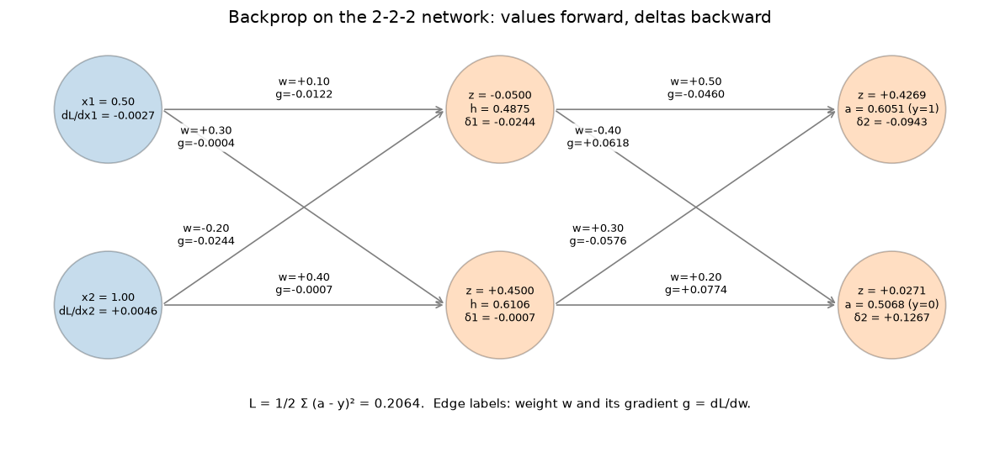

# C1.2 Backpropagation by hand on a tiny network with real numbers

**Core** · Part C, week C1 (course week 13) · ~2 h · Lab:
[`labs/C/c1_2_backprop_by_hand.py`](../../labs/C/c1_2_backprop_by_hand.py)

## Why it matters

Training a network means nudging every weight in the direction that lowers the loss, which needs the gradient of
the loss with respect to every weight. **Backpropagation** computes all of them in one backward sweep that costs
about as much as two forward passes, whether the network has 12 weights or 70 billion. PyTorch does it for you, but
when training goes wrong (a loss that will not move, gradients that are `nan`, a custom layer that trains worse than
it should), the person who can do it by hand on a small network is the one who finds the bug. This lesson does
every multiplication on a network small enough to fit on a page, then writes the same thing in matrix form for a
batch, which is the form every framework uses.

## Prerequisite check

- Can you run the backward pass of $f = (xy + z)^2$ on a graph, multiplying local derivatives and adding over uses?
  If not, revisit [A4.3](../A/a4_3_chain_rule_graphs.md).
- Can you check a gradient with central differences and a relative error? If not, revisit
  [A4.2](../A/a4_2_gradients_jacobians.md).
- Can you write a layer as $\mathbf{H} = f(\mathbf{X}\mathbf{W} + \mathbf{b})$ with $\mathbf{W}$ shape `(d_in, d_out)`? If not, revisit [C1.1](c1_1_perceptron_mlp.md).
- Can you compute an entry of a matrix product, $(\mathbf{A}\mathbf{B})_{ij} = \sum_k A_{ik}B_{kj}$, and the shape of $\mathbf{A}^\top\mathbf{B}$? If not, revisit
  [A2.2](../A/a2_2_matrix_multiplication_inverse.md).
- Can you take a gradient-descent step and say why the learning rate matters? If not, revisit
  [A4.4](../A/a4_4_gradient_descent.md).

## Intuition

The loss is computed at the end of a chain: input → hidden layer → output layer → loss. Each weight affects the loss
only through the values downstream of it. Backpropagation asks one question at every node, starting from the end:
**"if this value went up a little, how much would the loss go up?"** That number is the node's gradient.

- At the output, the answer is easy: the loss is a simple formula of the output.
- One step back, a hidden unit affects the loss through *every* output it feeds. Its gradient is the sum, over
  those outputs, of "output's gradient × how strongly this unit drives that output" (the weight on the edge).
- A weight's gradient is "gradient of the value it feeds × the value coming into it". A weight on an edge carrying a
  big input, into a unit whose output matters a lot, gets a big gradient.

So gradients flow backwards along the same edges the values flowed forward, multiplied by the same weights. You
already know the two rules from A4.3: **multiply along a path, add where paths meet**. A neural network is just a
graph where those rules are applied to whole matrices at once.

One quantity does most of the work: $\boldsymbol{\delta}$, the gradient of the loss with respect to a layer's *pre-activation* $\mathbf{z}$. Once you
have a layer's $\boldsymbol{\delta}$, its weight gradient, its bias gradient and the gradient sent to the layer below are each a single
matrix product.

> **Bridge:** backprop is like tracing a bad number in a report back through a chain of SQL views: the final view's
> error is split among the columns it was computed from, in proportion to how much each contributed, and the
> blame keeps propagating upstream to the base tables. **Where it breaks:** blame in a report is usually traced for one
> row by a person; backprop computes the exact sensitivity of one scalar to *every* parameter at once, and it needs the
> intermediate values from the forward pass (the cache), which is why training uses far more memory than inference.

## The math

**Symbols**

| Symbol | Meaning | Shape |
|---|---|---|
| $\mathbf{X}$ | inputs, one example per row ($n = 1$ for the hand example) | `(n, d)` |
| $\mathbf{Y}$ | targets, one row per example | `(n, k)` |
| $\mathbf{W}^{[1]}$, $\mathbf{b}^{[1]}$ | hidden layer weights and biases | `(d, h)`, `(h,)` |
| $\mathbf{W}^{[2]}$, $\mathbf{b}^{[2]}$ | output layer weights and biases | `(h, k)`, `(k,)` |
| $\mathbf{Z}^{[1]}$, $\mathbf{H}$ | hidden pre-activations and activations $\mathbf{H} = \sigma(\mathbf{Z}^{[1]})$ | `(n, h)` |
| $\mathbf{Z}^{[2]}$, $\mathbf{A}$ | output pre-activations and outputs $\mathbf{A} = \sigma(\mathbf{Z}^{[2]})$ | `(n, k)` |
| $\mathcal{L}$ | mean loss over the batch | scalar |
| $\mathbf{G}_{\mathbf{V}}$ | $\partial\mathcal{L}/\partial\mathbf{V}$ for any array $\mathbf{V}$; always the **same shape** as $\mathbf{V}$ (A4.3 wrote $\bar{v}$) | shape of $\mathbf{V}$ |
| $\boldsymbol{\Delta}^{[l]}$ | $\mathbf{G}_{\mathbf{Z}^{[l]}}$, the "delta" of layer $l$ (one row $\boldsymbol{\delta}$ per example) | `(n, d_l)` |
| $\odot$ | elementwise product | — |

In the lab, $d = h = k = 2$: a **2-2-2 network**.

**Forward pass.**

$$\mathbf{Z}^{[1]} = \mathbf{X}\mathbf{W}^{[1]} + \mathbf{b}^{[1]},\quad \mathbf{H} = \sigma(\mathbf{Z}^{[1]}),\quad \mathbf{Z}^{[2]} = \mathbf{H}\mathbf{W}^{[2]} + \mathbf{b}^{[2]},\quad \mathbf{A} = \sigma(\mathbf{Z}^{[2]}),$$

$$\mathcal{L} = \frac{1}{n}\sum_{i=1}^{n}\frac12\sum_{j=1}^{k}(A_{ij} - Y_{ij})^2.$$

The $\frac12$ only makes the derivative tidier. Squared error on sigmoid outputs keeps every step simple to do by hand;
C1.4 replaces it with softmax and cross-entropy, which is what classifiers really use.

**Backward pass, one step at a time.** Each line is the chain rule (A4.3): the gradient arriving from above times the
local derivative.

1. *Loss → outputs.* $\partial\mathcal{L}/\partial A_{ij} = \frac{1}{n}(A_{ij} - Y_{ij})$, so $\mathbf{G}_{\mathbf{A}} = \frac{1}{n}(\mathbf{A} - \mathbf{Y})$, shape `(n, k)`.
2. *Outputs → output pre-activations.* $A_{ij} = \sigma(Z^{[2]}_{ij})$ depends only on $Z^{[2]}_{ij}$, and $\sigma' = \sigma(1 - \sigma)$ (A4.3), so
   $$\boldsymbol{\Delta}^{[2]} = \mathbf{G}_{\mathbf{A}} \odot \mathbf{A} \odot (1 - \mathbf{A}), \qquad (n, k).$$
   An elementwise function gives an elementwise product: no matrix multiply. Note that $\sigma'(z)$ is computed from the
   *output* $\mathbf{A}$, which the forward pass cached.
3. *Output pre-activations → $\mathbf{W}^{[2]}$, $\mathbf{b}^{[2]}$ and $\mathbf{H}$.* Write one entry of $\mathbf{Z}^{[2]} = \mathbf{H}\mathbf{W}^{[2]} + \mathbf{b}^{[2]}$:
   $$Z^{[2]}_{ij} = \sum_{m=1}^{h} H_{im}W^{[2]}_{mj} + b^{[2]}_j.$$
   - *Weight* $W^{[2]}_{mj}$ appears in $Z^{[2]}_{ij}$ for every example $i$ (and in no other column), with local derivative $H_{im}$. Add over the
     uses: $\frac{\partial\mathcal{L}}{\partial W^{[2]}_{mj}} = \sum_i H_{im}\Delta^{[2]}_{ij} = (\mathbf{H}^\top\boldsymbol{\Delta}^{[2]})_{mj}$. So
     $$\mathbf{G}_{\mathbf{W}^{[2]}} = \mathbf{H}^\top\boldsymbol{\Delta}^{[2]}, \qquad (h, n)(n, k) \to (h, k).$$
   - *Bias* $b^{[2]}_j$ appears in $Z^{[2]}_{ij}$ for every $i$ with local derivative 1: $\mathbf{G}_{\mathbf{b}^{[2]}} = \sum_i \boldsymbol{\delta}^{[2]}_i$, the column sums of $\boldsymbol{\Delta}^{[2]}$, shape `(k,)`.
     (The bias was *broadcast* to every row on the way forward; its gradient is *summed* over the rows on the way back.)
   - *Hidden value* $H_{im}$ appears in $Z^{[2]}_{ij}$ for every output $j$, with local derivative $W^{[2]}_{mj}$:
     $\frac{\partial\mathcal{L}}{\partial H_{im}} = \sum_j \Delta^{[2]}_{ij}W^{[2]}_{mj} = (\boldsymbol{\Delta}^{[2]}\mathbf{W}^{[2]\top})_{im}$. So
     $$\mathbf{G}_{\mathbf{H}} = \boldsymbol{\Delta}^{[2]}\mathbf{W}^{[2]\top}, \qquad (n, k)(k, h) \to (n, h).$$
4. *Hidden values → hidden pre-activations*, elementwise again: $\boldsymbol{\Delta}^{[1]} = \mathbf{G}_{\mathbf{H}} \odot \mathbf{H} \odot (1 - \mathbf{H})$, shape `(n, h)`.
5. *Hidden pre-activations → $\mathbf{W}^{[1]}$, $\mathbf{b}^{[1]}$, $\mathbf{X}$*: the same three rules as step 3, one layer down:
   $$\mathbf{G}_{\mathbf{W}^{[1]}} = \mathbf{X}^\top\boldsymbol{\Delta}^{[1]}\ (d, h), \qquad \mathbf{G}_{\mathbf{b}^{[1]}} = \textstyle\sum_i \boldsymbol{\delta}^{[1]}_i\ (h,), \qquad \mathbf{G}_{\mathbf{X}} = \boldsymbol{\Delta}^{[1]}\mathbf{W}^{[1]\top}\ (n, d).$$
   You never update $\mathbf{X}$, but $\mathbf{G}_{\mathbf{X}}$ is what a layer passes to the layer below it in a deeper network.

**The pattern for any dense layer** $\mathbf{Z} = \mathbf{X}\mathbf{W} + \mathbf{b}$, given its delta $\boldsymbol{\Delta} = \mathbf{G}_{\mathbf{Z}}$, shape `(n, d_out)`:

| Gradient | Formula | Shapes |
|---|---|---|
| $\mathbf{G}_{\mathbf{W}}$ | $\mathbf{X}^\top\boldsymbol{\Delta}$ | `(d_in, n) @ (n, d_out) -> (d_in, d_out)` |
| $\mathbf{G}_{\mathbf{b}}$ | $\sum_i \boldsymbol{\delta}_i$ (`Delta.sum(axis=0)`) | `(d_out,)` |
| $\mathbf{G}_{\mathbf{X}}$ | $\boldsymbol{\Delta}\mathbf{W}^\top$ | `(n, d_out) @ (d_out, d_in) -> (n, d_in)` |

and for an elementwise activation $\mathbf{H} = f(\mathbf{Z})$: $\mathbf{G}_{\mathbf{Z}} = \mathbf{G}_{\mathbf{H}} \odot f'(\mathbf{Z})$.

*A shape check that is also a memory aid.* $\mathbf{G}_{\mathbf{W}}$ must have $\mathbf{W}$'s shape `(d_in, d_out)`, and it must be built from $\mathbf{X}$ `(n, d_in)` and $\boldsymbol{\Delta}$
`(n, d_out)`. The only product of those two that has that shape is $\mathbf{X}^\top\boldsymbol{\Delta}$. Shapes cannot catch everything (when
$d_{\text{in}} = d_{\text{out}}$, $\boldsymbol{\Delta}^\top\mathbf{X}$ has the right shape and is wrong), which is why the gradient check exists.

*Where the batch sum lives.* $\mathbf{X}^\top\boldsymbol{\Delta}$ sums over the $n$ examples inside the matrix product: row $i$ of $\mathbf{X}$ meets row $i$ of $\boldsymbol{\Delta}$. Each
example contributes its own outer product $\mathbf{x}_i^\top\boldsymbol{\delta}_i$, and the $\frac1n$ of the mean is already inside $\boldsymbol{\Delta}$ from step 1. So the
matrix form gives exactly the average of the one-example gradients; the lab checks it.

**Cost.** Each matrix product in the backward pass has the same size as one in the forward pass, and there are two
per layer ($\mathbf{X}^\top\boldsymbol{\Delta}$ and $\boldsymbol{\Delta}\mathbf{W}^\top$) against one forward ($\mathbf{X}\mathbf{W}$). So a training step costs about three forward passes, for any number of
parameters. Numerical gradients would cost two forward passes *per parameter*.

## Worked example by hand

One example, $n = 1$. $\mathbf{x} = (0.5, 1.0)$, target $\mathbf{y} = (1, 0)$.
$\mathbf{W}^{[1]} = \begin{pmatrix}0.1 & 0.3\\ -0.2 & 0.4\end{pmatrix}$, $\mathbf{b}^{[1]} = (0.1, -0.1)$, $\mathbf{W}^{[2]} = \begin{pmatrix}0.5 & -0.4\\ 0.3 & 0.2\end{pmatrix}$, $\mathbf{b}^{[2]} = (0, 0.1)$.
Remember: column $j$ of a weight matrix holds the weights *into* unit $j$, and row $m$ the weights *out of* input $m$.

**Forward.**

- $z^{[1]}_1 = 0.5 \times 0.1 + 1.0 \times (-0.2) + 0.1 = 0.05 - 0.2 + 0.1 = -0.05$; $z^{[1]}_2 = 0.5 \times 0.3 + 1.0 \times 0.4 - 0.1 = 0.45$.
- $h_1 = \sigma(-0.05) = 1/(1 + e^{0.05}) = 1/2.05127 = 0.48750$; $h_2 = \sigma(0.45) = 1/(1 + e^{-0.45}) = 1/1.63763 = 0.61064$.
- $z^{[2]}_1 = 0.48750 \times 0.5 + 0.61064 \times 0.3 + 0 = 0.24375 + 0.18319 = 0.42694$;
  $z^{[2]}_2 = 0.48750 \times (-0.4) + 0.61064 \times 0.2 + 0.1 = -0.19500 + 0.12213 + 0.1 = 0.02713$.
- $a_1 = \sigma(0.42694) = 0.60514$; $a_2 = \sigma(0.02713) = 0.50678$.
- $\mathcal{L} = \frac12[(0.60514 - 1)^2 + (0.50678 - 0)^2] = \frac12[0.15591 + 0.25683] = 0.20637$.

**Backward.**

- Step 1: $\mathbf{a} - \mathbf{y} = (-0.39486, 0.50678)$ (with $n = 1$ there is no $\frac1n$ to apply).
- Step 2: $\mathbf{a} \odot (1 - \mathbf{a}) = (0.60514 \times 0.39486,\ 0.50678 \times 0.49322) = (0.23895, 0.24995)$, so
  $\boldsymbol{\delta}^{[2]} = (-0.39486 \times 0.23895,\ 0.50678 \times 0.24995) = (-0.09435, 0.12667)$.
- Step 3: $\mathbf{G}_{\mathbf{W}^{[2]}} = \mathbf{h}^\top\boldsymbol{\delta}^{[2]}$, an outer product `(2, 1) @ (1, 2)`: entry $(m, j)$ is $h_m\delta^{[2]}_j$:
  $$\mathbf{G}_{\mathbf{W}^{[2]}} = \begin{pmatrix}0.48750 \times (-0.09435) & 0.48750 \times 0.12667\\ 0.61064 \times (-0.09435) & 0.61064 \times 0.12667\end{pmatrix} = \begin{pmatrix}-0.04600 & 0.06175\\ -0.05761 & 0.07735\end{pmatrix}.$$
  $\mathbf{G}_{\mathbf{b}^{[2]}} = \boldsymbol{\delta}^{[2]} = (-0.09435, 0.12667)$.
  $\mathbf{G}_{\mathbf{h}} = \boldsymbol{\delta}^{[2]}\mathbf{W}^{[2]\top}$: entry $m$ is $\sum_j \delta^{[2]}_jW^{[2]}_{mj}$, row $m$ of $\mathbf{W}^{[2]}$ dotted with $\boldsymbol{\delta}^{[2]}$:
  $g_{h_1} = -0.09435 \times 0.5 + 0.12667 \times (-0.4) = -0.04717 - 0.05067 = -0.09784$;
  $g_{h_2} = -0.09435 \times 0.3 + 0.12667 \times 0.2 = -0.02830 + 0.02533 = -0.00297$.
- Step 4: $\mathbf{h} \odot (1 - \mathbf{h}) = (0.24984, 0.23776)$, so $\boldsymbol{\delta}^{[1]} = (-0.09784 \times 0.24984,\ -0.00297 \times 0.23776) = (-0.02445, -0.00071)$.
- Step 5: $\mathbf{G}_{\mathbf{W}^{[1]}} = \mathbf{x}^\top\boldsymbol{\delta}^{[1]} = \begin{pmatrix}0.5 \times (-0.02445) & 0.5 \times (-0.00071)\\ 1.0 \times (-0.02445) & 1.0 \times (-0.00071)\end{pmatrix} = \begin{pmatrix}-0.01222 & -0.00035\\ -0.02445 & -0.00071\end{pmatrix}$, $\mathbf{G}_{\mathbf{b}^{[1]}} = (-0.02445, -0.00071)$.

**Read the numbers.** Output 1 should be 1 and is 0.61, so its delta is negative (raise $z^{[2]}_1$); output 2 should be 0 and
is 0.51, so its delta is positive (lower $z^{[2]}_2$). Hidden unit 2 barely matters right now: the two outputs pull it in
opposite directions ($0.3 \times$ "up" against $0.2 \times$ "down") and almost cancel, so its weights get gradients about 35 times smaller than
unit 1's. That cancellation is the "add where paths meet" rule at work.

**One step.** With $\eta = 0.5$, $W^{[2]}_{11} = 0.5 - 0.5 \times (-0.04600) = 0.52300$, and so on for all 12 parameters. The lab recomputes the
loss: 0.20637 → 0.18615. It went down.

```text
== worked example: forward pass ==
z1 = x W1 + b1   = [[-0.05, 0.45]]
h  = sigmoid(z1) = [[0.4875, 0.6106]]
z2 = h W2 + b2   = [[0.4269, 0.0271]]
a2 = sigmoid(z2) = [[0.6051, 0.5068]]
L  = 1/2 sum (a2 - y)^2 = 0.206369

== worked example: backward pass ==
dL/da2 = a2 - y              = [[-0.3949, 0.5068]]
a2 (1 - a2)                  = [[0.2389, 0.25]]
delta2 = dL/dz2              = [[-0.0943, 0.1267]]
dL/dW2 = h^T delta2          = [[-0.046, 0.0618], [-0.0576, 0.0774]]
dL/db2 = delta2              = [-0.0943, 0.1267]
dL/dh  = delta2 W2^T         = [[-0.0978, -0.003]]
h (1 - h)                    = [[0.2498, 0.2378]]
delta1 = dL/dz1              = [[-0.0244, -0.0007]]
dL/dW1 = x^T delta1          = [[-0.0122, -0.0004], [-0.0244, -0.0007]]
dL/db1 = delta1              = [-0.0244, -0.0007]
dL/dx  = delta1 W1^T         = [[-0.0027, 0.0046]]

== gradient check and one gradient-descent step ==
dL/dW1  numeric [[-0.0122, -0.0004], [-0.0244, -0.0007]]  rel error < 1e-8  PASS
dL/db1  numeric [-0.0244, -0.0007]  rel error < 1e-8  PASS
dL/dW2  numeric [[-0.046, 0.0618], [-0.0576, 0.0774]]  rel error < 1e-8  PASS
dL/db2  numeric [-0.0943, 0.1267]  rel error < 1e-8  PASS
dL/dx   numeric [[-0.0027, 0.0046]]  rel error < 1e-8
one step with lr = 0.5: W2 becomes [[0.523, -0.4309], [0.3288, 0.1613]]
loss 0.206369 -> 0.186154  (fell by 0.020215)
```

The lab prints 4 decimals; your hand values should agree to the 4th decimal if you kept 5 digits at every step.

## Key plot



The same numbers as the hand calculation, on the graph. Forward values (z, h, a) flow left to right; deltas flow right
to left. Each edge's gradient is the value at its left end times the delta at its right end: for example the top
edge of the output layer, $0.4875 \times (-0.0943) = -0.0460$.

## From scratch in NumPy

**The batch version.** Four examples (the XOR inputs with one-hot targets: column 0 means "XOR is 1") through the
same network. The function is the five steps above, with the $\frac1n$ inside $\boldsymbol{\Delta}^{[2]}$:

```python
def forward_backward(X, Y, W1, b1, W2, b2):
    """Mean loss and all gradients of the 2-layer sigmoid net. X (n, d), Y (n, k) -> (loss, grads)."""
    n = X.shape[0]
    Z1 = X @ W1 + b1;  H = sigmoid(Z1)              # (n, h)
    Z2 = H @ W2 + b2;  A2 = sigmoid(Z2)             # (n, k)
    loss = 0.5 * np.sum((A2 - Y) ** 2) / n
    D2 = (A2 - Y) * A2 * (1 - A2) / n               # (n, k) delta2
    D1 = (D2 @ W2.T) * H * (1 - H)                  # (n, h) delta1
    return loss, {"W2": H.T @ D2, "b2": D2.sum(axis=0),
                  "W1": X.T @ D1, "b1": D1.sum(axis=0), "X": D1 @ W1.T}
```

It is checked two ways: against a Python loop that averages the one-example gradients, and against numerical
gradients.

```text
== from scratch: batch backward pass in matrix form ==
dW1 shape (2, 2)  = [[0.0016, 0.0009], [0.0015, 0.0009]]
db1 shape (2,)    = [0.0031, 0.0018]
dW2 shape (2, 2)  = [[0.0128, 0.0002], [0.0139, 0.0004]]
db2 shape (2,)    = [0.025, 0.0005]
dX  shape (4, 2)  = [[0.0011, -0.0011], [-0.0007, 0.0011], [-0.0007, 0.0011], [0.0011, -0.0011]]
matrix form = mean of per-example gradients: OK
numerical check on the batch: worst rel error < 1e-8  PASS
```

Every gradient has the shape of the thing it is the gradient of: `dW1` is `(2, 2)` like `W1`, `db1` is `(2,)` like
`b1`, `dX` is `(4, 2)` like `X`.

**Training it.** Gradient descent with $\eta = 5$ from the same starting weights, on the XOR batch:

```text
== from scratch: training the 2-2-2 network on XOR ==
step    0: loss 0.2555
step  100: loss 0.2500
step  500: loss 0.2322
step 1000: loss 0.0041
step 2000: loss 0.0008
step 3000: loss 0.0005
P(XOR = 1) for (0,0) (0,1) (1,0) (1,1): [0.0238, 0.9798, 0.9798, 0.0207]
learned W1 = [[5.3478, 7.399], [5.3465, 7.3918]]  b1 = [-8.1828, -3.3693]
saved outputs/c1_2/c1_2_xor_loss.png
```

- The loss sits near 0.25 for hundreds of steps (a **plateau**: every output near 0.5, gradients tiny), then drops
  fast. Plateaus like this are normal in training; a loss that has not moved yet is not always a broken network.
- Look at the learned hidden layer. Unit 1 has weights $(5.35, 5.35)$ and bias $-8.18$: it fires only when *both* inputs are 1
  ($5.35 + 5.35 > 8.18$, but $5.35 < 8.18$). That is AND. Unit 2 has weights $(7.4, 7.4)$ and bias $-3.37$: it fires when *either* is 1. That is OR.
  Backprop rediscovered C1.1's hand-set solution, with sigmoids instead of steps.

## With PyTorch

PyTorch's autograd records the forward pass and runs exactly these backward steps. You will learn its API in
[C2.1](c2_1_tensors_autograd_modules.md); here it is only a referee. In float64, with the same weights and the same
batch, its gradients agree with ours to rounding error:

```python
tp = {k: torch.tensor(v, dtype=torch.float64, requires_grad=True) for k, v in params.items()}
a2t = torch.sigmoid(torch.sigmoid(xt @ tp["W1"] + tp["b1"]) @ tp["W2"] + tp["b2"])
loss_t = 0.5 * ((a2t - yt) ** 2).sum() / xt.shape[0]
loss_t.backward()        # fills tp["W1"].grad and the others
```

```text
== with PyTorch ==
torch loss 0.255483   ours 0.255483
dW1 max |torch - ours| < 1e-12
db1 max |torch - ours| < 1e-12
dW2 max |torch - ours| < 1e-12
db2 max |torch - ours| < 1e-12
matches PyTorch autograd: OK
```

## In practice

- **When to use it:** you never write backprop by hand for a production model; autograd does it. You write it (or
  reason through it) when you implement a custom layer or loss, when you debug gradients that are `nan`, zero or
  exploding, and when you need to know what will happen to memory (every cached $\mathbf{H}$ is held until the backward pass).
- **Failure modes:**
  - *Wrong transpose or order* (`delta.T @ X` instead of `X.T @ delta`). Shapes catch it unless the layer is square; the
    gradient check catches it always. Check on a non-square layer.
  - *Missing $\frac1n$, or applied twice.* Gradients off by exactly a factor of the batch size; the check catches it, and so does a
    learning rate that has to change whenever the batch size does.
  - *Bias gradient with the wrong shape.* `D.sum(axis=0, keepdims=True)` gives `(1, k)`; subtracting it from a `(k,)` bias
    silently broadcasts. Assert shapes after computing gradients.
  - *Derivative from the wrong value.* $\sigma'(z) = a(1 - a)$ uses the sigmoid's *output*; writing `sigmoid(A) * (1 - sigmoid(A))` applies the
    sigmoid twice. The numbers look plausible, and the check fails.
  - *Gradient check in float32.* Central differences need float64 (A4.2): in float32 the rounding error alone can exceed
    your tolerance, so a correct gradient "fails".
  - *All-zero (or identical) starting weights.* Both hidden units receive identical gradients and stay identical forever,
    so the network behaves as if it had one unit. Initialize randomly (C3.3).
- **Defaults that work:** check every new layer's gradient numerically on a tiny random batch in float64 (relative error
  below $10^{-6}$; here we get below $10^{-8}$); compare against PyTorch autograd for anything non-trivial; print shapes the first time
  through.

## Exercises

Save your work to `my-work/C/c1_2_backprop_by_hand.md` (or `.py`) and ask for a review.

1. **By hand:** Use the lesson's weights, but with **ReLU** hidden units (outputs still sigmoid, same squared-error
   loss), input $\mathbf{x} = (1, 0.5)$ and target $\mathbf{y} = (0, 1)$. (a) Do the forward pass and the loss. (b) Compute $\boldsymbol{\delta}^{[2]}$, $\mathbf{G}_{\mathbf{W}^{[2]}}$, $\mathbf{G}_{\mathbf{h}}$,
   $\boldsymbol{\delta}^{[1]}$ and $\mathbf{G}_{\mathbf{W}^{[1]}}$, with the shape of each. (c) Take one step on $\mathbf{W}^{[2]}$ and $\mathbf{b}^{[2]}$ only, with $\eta = 1$, and show the loss falls. (d) Which
   gradients would be exactly zero if $z^{[1]}_1$ had been negative, and why is that a problem if it happens for every input?
2. **Code:** Write `forward_backward` for an MLP with **any number of layers** (a list of widths), ReLU hidden layers, a
   linear output and mean squared error, using the dense-layer table. Gradient-check every parameter on a random batch
   of 5 in float64. Then train a 1-32-32-1 network with full-batch gradient descent on 200 points of
   $y = \sin(3x) + 0.1\varepsilon$ on $[-2, 2]$ (seed 0), plot the fit, and report the training loss before and after.
3. **Think:** A colleague proposes computing all gradients numerically "because then there is no backprop code to get
   wrong". For a 1-million-parameter model, estimate the cost of one numerical gradient compared with backprop, in
   forward passes. Then name two situations where you *should* still compute numerical gradients, and what tolerance and
   precision you would use.

## Takeaways

1. Backpropagation is the chain rule applied backwards through the network: multiply local derivatives along each path,
   add where paths meet. It gives every parameter's gradient for about the cost of two extra forward passes.
2. For a dense layer $\mathbf{Z} = \mathbf{X}\mathbf{W} + \mathbf{b}$ with delta $\boldsymbol{\Delta}$ `(n, d_out)`: $\mathbf{G}_{\mathbf{W}} = \mathbf{X}^\top\boldsymbol{\Delta}$, $\mathbf{G}_{\mathbf{b}} = $ column sums of $\boldsymbol{\Delta}$, $\mathbf{G}_{\mathbf{X}} = \boldsymbol{\Delta}\mathbf{W}^\top$. For an elementwise activation,
   multiply elementwise by $f'(\mathbf{Z})$.
3. A gradient always has the shape of the thing it differentiates; the batch sum happens inside $\mathbf{X}^\top\boldsymbol{\Delta}$, and broadcast biases are
   summed on the way back.
4. The backward pass needs the forward pass's values (the cache), so training holds every activation in memory.
5. Check every hand-written gradient numerically in float64 and against autograd; a plausible-looking gradient can be wrong.

**What builds on this:** [C1.3](c1_3_autograd_engine.md) (automating these steps for any graph);
[C1.4](c1_4_stable_softmax_cross_entropy.md) (the output layer's delta becomes $\mathbf{p} - \mathbf{y}$); [C2.1](c2_1_tensors_autograd_modules.md)
(PyTorch autograd); [C3.3](c3_3_initialization.md) (why products of small derivatives vanish, and symmetry breaking);
[C4.3](c4_3_debugging_training.md) (debugging gradients in real runs); [E2.1](../E/e2_1_rnn_bptt.md) (backprop through time);
P4 (an MLP whose gradients must match PyTorch's to $10^{-6}$).

**References:** D. E. Rumelhart, G. E. Hinton, R. J. Williams, "Learning representations by back-propagating errors",
*Nature*, 1986. I. Goodfellow, Y. Bengio, A. Courville, *Deep Learning*, MIT Press, 2016, section 6.5. Stanford CS231n
course notes, "Backpropagation, Intuitions" (VERIFY link: https://cs231n.github.io/optimization-2/).
